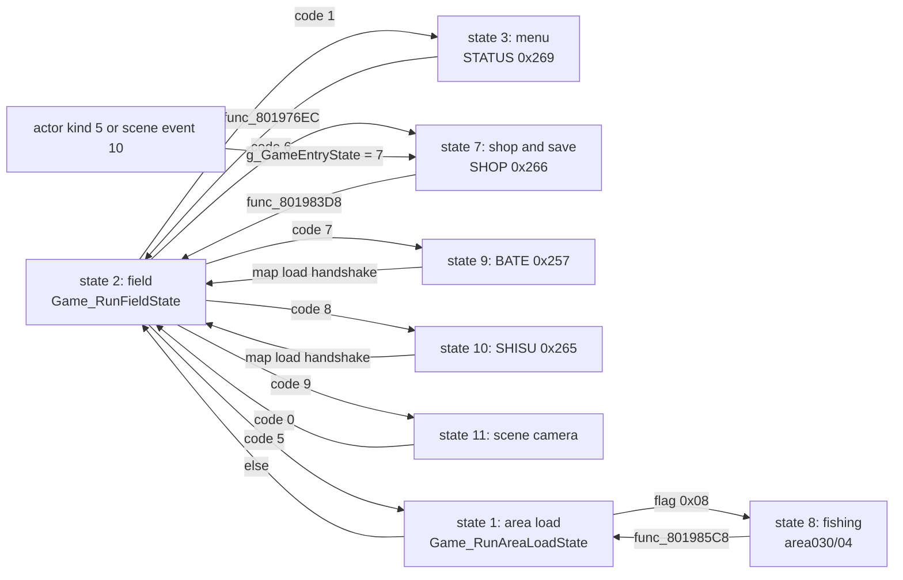

Besides the field, the game runs full-screen modes: the in-game menu, shops, the save screen, the fishing pond, the fairy village, the master menu, the world map, and the BATE and SHISU screens. Most stream their code from the disc into a shared window and run inside the same main loop. This page maps what opens each screen: the request code or flag, the entry state that runs it, the overlay that holds its code, and how control returns to the field. Save and load card paths are in [saving](../saving/), window and panel drawing in [UI and text drawing](../ui/), and the codes in [phases](../phases/).

## Terms

The [glossary](../../appendix/glossary/) defines request code and entry state.

| Term            | Meaning                                                                                                                                                                      |
| --------------- | ---------------------------------------------------------------------------------------------------------------------------------------------------------------------------- |
| Entry substate  | `g_GameEntrySubstate`: index into the 3 or 4 entry handler table that the state owns.                                                                                        |
| Menu step bytes | `D_80148650`, `D_80148651`, `D_80148652`: the step and sub-steps that STATUS, SHOP, BATE and SHISU dispatch on.                                                              |
| Scene event     | An entry of `g_SceneEvents[64]` (`0x801C84BC`), selected by `D_801448EB` and stepped by `D_801448EC`. It runs inside the field state ([scenario](../scenario/#event-stage)). |

## From request to screen

`Game_RunFieldState (emi/etc/game/00@0x80197378)` is entry state 2. Each frame it maps the request code to the next entry state ([phases](../phases/) covers codes 2 to 5: message wait, battle, camera and area change). The table lists the screens.

| Request or trigger                                                 | Entry state | Overlay (slot)                   | Screen                                                          |
| ------------------------------------------------------------------ | ----------: | -------------------------------- | --------------------------------------------------------------- |
| Code 1, written by `func_801B2A00` (actor step table `D_801CD110`) |           3 | STATUS (`0x269`), start/08       | The in-game menu. The button that triggers it is `[unknown]`.   |
| Code 6, written by `Party_JoinMember` when the party is full       |           7 | SHOP (`0x266`)                   | Step 6 (`func_801DE188`), `[inferred]` a party-swap screen.     |
| Actor of kind 5 (`func_801A18C8`)                                  |           7 | SHOP                             | Step = actor field `+0x18` plus 2.                              |
| Scene event 10, cases 6 and 23 (`Scene_RunShopSaveEvent`)          |           7 | SHOP                             | Step = `D_80148698` plus 2. Step 3 is the save screen.          |
| Code 7, written by `scena06` (`func_801F97C0`, `func_801F9DF4`)    |           9 | BATE (`0x257`)                   | List screen, selector `D_8018E244`. `[inferred]` screen.        |
| Code 8, written by `scena11` (`func_801F8B84`)                     |          10 | SHISU (`0x265`)                  | Status-style screen. `[inferred]` screen.                       |
| Code 9, Start in the field (`func_801B5910`, `func_80167428`)      |          11 | none (field overlay)             | Scene dispatch with camera control. `[inferred]` Start meaning. |
| Area load flag `0x08` (`g_GameRequestFlags & 8`)                   |           8 | `area030/04` at `0x801D0C00`     | The fishing pond.                                               |
| Scene event 4 (`g_SceneEvents[4]`)                                 |   2 (stays) | SISYOU (`0x267`)                 | The master menu. The trigger is `[unknown]`.                    |
| Area load flag `0x10`                                              |   2 (stays) | COMMU00 (`0x258`), COMMU01 to 05 | The fairy village.                                              |
| Area load flag `0x01`                                              |  2, mode 10 | World area overlay               | The world map. The map code is `[inferred]`.                    |

Every screen state has the same three substates. Substate 0 starts the overlay stream and waits for `EMI_LoaderIsReady`. The middle substate runs one frame of the screen and `Menu_RunPanelTasks`. The last substate re-streams the character bank (`EMI_StreamFamilyArchive` with the `PL` family) and returns to state 2 with `g_GameEntrySubstate = 0` and `g_GameStateIndex = 0`.

The state functions are `Game_RunMenuState (emi/etc/game/00@0x801975E4)` (state 3), `Game_RunShopState (emi/etc/game/00@0x80198234)` (7), `Game_RunFishingState (emi/etc/game/00@0x801984AC)` (8), `Game_RunAbilityMenuState (emi/etc/game/00@0x80198744)` (9), `Game_RunStatusMenuState (emi/etc/game/00@0x80198904)` (10) and `Game_RunSceneCameraState (emi/etc/game/00@0x80198AC4)` (11).

## In-game menu (entry state 3)

Code 1 calls `UI_SetMode(2)` and `func_80198BC4(0)`, then sets state 3, substate 0. The substates are `g_GameEntryHandlers` (`0x801C7B44`):

| Substate | Function (`emi/etc/game/00`) | Work                                                                                         |
| -------: | ---------------------------- | -------------------------------------------------------------------------------------------- |
|        0 | `func_80197620`              | Stream STATUS, copy palettes 1 and 2, `D_80148650 = 0`, `UI_SetMode(3)`, `func_80198C38(1)`. |
|        1 | `func_80199368`              | `Game_RunScenarioEntry`, `Menu_DispatchStep`, `Menu_RunPanelTasks`.                          |
|        2 | `func_801976EC`              | Leave: restore the character bank, reload the fairy village, re-enter the area, state 2.     |

`Menu_DispatchStep (emi/etc/start/08@0x801D1740)` runs `D_801EC35C[D_80148650]`, nine step functions. The program is STATUS entry 0. The start menu (New Game, Load Game) runs the same bytes from `START.EMI` entry 8, a copy of `BIN/ETC/STATUS.EMI` entry 0. The nine steps have no established names or roles `[unknown]`. The load-game steps are in [saving](../saving/).

`func_801976EC` leaves in one of four ways, by the conditions in the table:

| Condition                                                              | Result                                                                                      |
| ---------------------------------------------------------------------- | ------------------------------------------------------------------------------------------- |
| `D_8014869C != 0`, `D_8014504A == 0`, and the world map or area `0xBD` | Save the party position and area in `D_80145040..D_80145048`, request the staged area.      |
| `D_8014869C != 0`, any other case                                      | Clear the flag bytes at `D_8014504A - 0x122`, request the saved area `D_80145048` (kind 4). |
| `D_8014869C == 0`, `D_8014869D != 0`                                   | `Game_RequestAreaChange(D_8014869D, 0x430000, 0x160000, 4)`: jump to that area.             |
| Both zero                                                              | `g_GameStateIndex = 0`. The field resumes.                                                  |

The writers of `D_8014869C` and `D_8014869D` are not traced, so their meaning is `[unknown]`.

## Shop and save (entry state 7)

State 7 runs `g_GameStateHandlers` (`0x801C7B7C`):

| Substate | Function (`emi/etc/game/00`) | Work                                                                                                                          |
| -------: | ---------------------------- | ----------------------------------------------------------------------------------------------------------------------------- |
|        0 | `Game_LoadShopOverlay`       | If a shop actor is selected and its `+0x18` is 9, return to state 2 at once. Otherwise stream SHOP and copy palettes 1 and 2. |
|        1 | `func_80199398`              | Field frame, `Area_RunParty`, panels, `Shop_DispatchStep`.                                                                    |
|        2 | `func_801983D8`              | Restore the character bank, stream COMMU00 when the area has flag `0x10`, return to state 2.                                  |

`Shop_DispatchStep (emi/etc/shop/00@0x801D0EA0)` runs `D_801E5144[11]` by `D_80148650`. Entry 0, `func_801D0EDC`, is the selector. It reads `D_8014865C`. A negative value (a script or code origin) sets the step to `D_80148698 + 2`. A shop-actor index copies the actor row's `+0x18` and adds 2, and copies `+0x1C` to `D_80148699`. Actor kind 9 never reaches the screen (see `Game_LoadShopOverlay`). The other ten entries are the screens. Only step 3 is identified, the save screen ([saving](../saving/)). The roles of steps 2 and 4 to 10 are `[unknown]`.

## BATE and SHISU (entry states 9 and 10)

States 9 and 10 have the same shape. Substate 0 (`func_80198780` and `func_80198940`) calls `UI_SetMode(2)`, waits two frames, streams the slot (BATE `0x257`, SHISU `0x265`), copies palettes 1 and 2, and advances. Substate 1 (`func_801993F0` and `func_80199418`) runs `func_801D0D9C` or `func_801D0D80` plus `Menu_RunPanelTasks`. Substate 2 (`GameRunMapLoadHandshake`) streams the character bank, calls `UI_SetMode(3)`, waits for the effect, and returns to state 2.

Each overlay starts with an `OverlayHeader`, then a step entry that dispatches `table[D_80148650]`, with a second table indexed by `D_80148651`. In BATE, `func_801D0DD8` sets `D_80148650 = D_8018E244 + 2`, so the scenario that opens the screen picks which one. `scena06` stores 0 to `D_8018E244` next to its writes of request code 7.

What the two screens show is `[inferred]`. Both draw character data, and the only writers of codes 7 and 8 are in `scena06` and `scena11` ([request codes](../phases/#the-request-code) owns the list). A scenario-driven party or ability viewer fits both.

## Fishing (entry state 8)

`Game_RunAreaLoadState` (state 1) sets `g_GameEntryState = 8` right after `func_8019FAA0` when `g_GameRequestFlags & 8`; bit 3 of the area record's `flag_32` marks a fishing area ([area](../areas/)). The substates are `g_GameSubstateHandlers[4]` (`0x801C7B88`):

| Substate | Function                                   | Work                                                                                         |
| -------: | ------------------------------------------ | -------------------------------------------------------------------------------------------- |
|        0 | `func_801984E8` (`emi/etc/game/00`)        | `UI_SetMode(1)`, redraw, copy a framebuffer strip, call substate 1 once, clear `D_80143F22`. |
|        1 | `func_801E0BD0` (`emi/world00/area030/04`) | The pond frame: `func_801E09B4` and the field draw.                                          |
|        2 | `func_801985C8` (`emi/etc/game/00`)        | Restore the character bank, fade, `Game_RequestAreaChange(D_80143F04, ..., 4)`, state 1.     |
|        3 | `func_801E0C20` (`emi/world00/area030/04`) | `func_800F500C`. The caller of this substate is not found.                                   |

The fishing program is part of the pond area's own image. `world00/area030/04` has `D_801D0C00 = 22` at its head (the code-overlay id convention), and its functions start at `0x801D0C90`, in the window the other overlays use. States 1 and 8 stream no separate screen slot `[inferred]`. Substates 1 and 3 resolve to addresses that exist only in this image, which is why `emi/etc/game/00` references them as undefined symbols. Substate 2 returns through the area load (state 1), not directly to the field. The rod and lure row layouts are in [field](../../data/field/#fairy-village-and-fishing).

## Master (scene event 4)

The master menu is not an entry state. `g_SceneEvents[4]` is `Master_RunSceneEvent (emi/etc/game/00@0x801A7CF0)`, stepped by `D_801448EC`.

| Step | Work                                                                                             |
| ---: | ------------------------------------------------------------------------------------------------ |
|    0 | Set bits 0 to 2 (`0x7`) of `g_AreaWalkFlags` and stream SISYOU (`0x267`).                        |
|    1 | When ready, copy palette 2 and call `func_801D0C18` (overlay init).                              |
|    2 | `Master_DispatchMenu` (`func_801D25D8`): one frame of the menu, every frame.                     |
|    3 | Stream the character bank (the `PL` family).                                                     |
|    4 | When ready, clear bits 0 to 2 of `g_AreaWalkFlags` and reset the scene event (`D_801448EB = 0`). |

`Master_DispatchMenu (emi/etc/sisyou/00@0x801D25D8)` indexes `g_MasterMenuFuncs[7]` by `g_MasterStep`. The last step function is `Master_ApplyMaster`. The script that selects scene event 4 (`D_801448EB = 4`) is `[unknown]`. The menu is `[inferred]` to be where a character takes a master and its skills.

## Fairy village

The fairy village is an area (`flag_32` bit 4), not an entry state.

- After the menu (`func_801976EC`) and the shop and save screens (`func_801983D8`) return, the code streams COMMU00 (`0x258`) and calls `func_801F03D0` when the area has the flag. The reload is likely needed because the screen overlays take over the shared window `[inferred]`.
- `Fairy_VillageInit` (`emi/etc/commu00/00`) acts when `g_GameAreaId != D_80143F04`. When no fairy is active it calls `Fairy_JoinVillage` three times (one per party slot) and seeds five counters from `g_BattleCount`.
- COMMU01 to 05 (`0x259`, `0x25A` and `0x25B`, `0x25C`, `0x25D`, `0x25E`) are streamed one per step by `func_801F1770`, `func_801F1EB0`, `func_801F1FD8`, `func_801F222C` and `func_801F22C8`. Each advances `D_801448EC`, and all dispatch on the COMMU step byte `D_801F294C`, which COMMU00 owns.

That the five COMMU screens are scene events, and which game action opens each, is `[inferred]`. The fairy job rows and the 60-job table are in [field](../../data/field/#fairy-village-and-fishing).

## World map

The world map is an area with `g_GameRequestFlags & 1`. It stays in entry state 2.

- `Game_RunAreaLoadState` sets `g_GameEntryMode = 10` (instead of 0, or 20 for area `0xBD`) and applies the area's screen effect with `UI_SetMode(g_GameRequestKind)`. With the flag set it also calls `func_801A0048` on the camera cell.
- The field step `func_801B146C` tests the cell under the party with `Area_GetCellCode`. The value `0xAF` requests an area change (`Game_RequestAreaChange`, `g_GameRequestKind = 0xC`).
- Random encounters on the world map skip the `D_80143EFC >= 0xF1` test in `Area_CanStartEncounter`. Its last test reads the cell class ahead of the party instead of building a formation ([battle](../battle/)).

The world-map code is in the `world*` area overlays, which were not read `[unknown]`.

## Data and limits

The table lists the limits that the screen code enforces. Counts of entry states, request codes, battle substates, scene events and panel tasks are in [phases](../phases/), [battle flow](../battle/), [scenario](../scenario/) and [scheduler](../../concepts/scheduler/).

| Limit                           | Value                                                                                                                                                         | Source                                                                 |
| ------------------------------- | ------------------------------------------------------------------------------------------------------------------------------------------------------------- | ---------------------------------------------------------------------- |
| Menu, shop, fishing substates   | 3, 3, 4                                                                                                                                                       | `g_GameEntryHandlers`, `g_GameStateHandlers`, `g_GameSubstateHandlers` |
| BATE, SHISU, state 11 substates | 3 each                                                                                                                                                        | `g_MenuAbilityOpen`, `g_MenuStatusOpen`, `g_GameFlowHandlers`          |
| STATUS menu steps               | 9                                                                                                                                                             | `D_801EC35C[9]`                                                        |
| SHOP steps                      | 11 (selector, then 10)                                                                                                                                        | `D_801E5144[11]`                                                       |
| SHOP actor kinds                | 0 to 8 select a screen (`+0x18` plus 2 must stay at 10 or less). Kind 9 skips it. `[inferred]`                                                                | `func_801D0EDC`, `Game_LoadShopOverlay`                                |
| Master steps                    | 7                                                                                                                                                             | `g_MasterMenuFuncs`                                                    |
| BATE, SHISU step tables         | 8 and 5 entries, by the gaps between symbols `[inferred]`                                                                                                     | `D_801D86E0`, `D_801D8700`; `D_801D96DC`, `D_801D96F0`                 |
| Fishing rod rows                | The code does not bound the selector: it indexes `sel * 10`. [Field](../../data/field/#fairy-village-and-fishing) owns the rod and lure rows and their count. | `func_801DDE2C (emi/world00/area030/04@0x801DDE2C)`                    |
| COMMU archives                  | 7 slots, `0x258` to `0x25E`                                                                                                                                   | [disc slot ids](../../formats/emi/#disc-slot-ids)                      |
| Screen overlay slots            | BATE `0x257`, SHISU `0x265`, SHOP `0x266`, SISYOU `0x267`, START `0x268`, STATUS `0x269`                                                                      | [disc slot ids](../../formats/emi/#disc-slot-ids)                      |

The dispatch indexes the step byte into the owning overlay's table with no bound check, so an edited screen must keep the byte inside the table. A shop actor kind above 8 reads past `D_801E5144` `[inferred]` from the 11-entry table and the `+2` in `func_801D0EDC`.

## Open questions

| Question                                                                    | What would settle it                                                                            |
| --------------------------------------------------------------------------- | ----------------------------------------------------------------------------------------------- |
| Button that writes request code 1 (menu open)                               | Read the callers of the actor step table `D_801CD110`.                                          |
| Names of the 9 STATUS steps and the 10 SHOP screens                         | Read each step function after `D_801EC35C` and `D_801E5144`.                                    |
| What BATE and SHISU show, and the other scenarios that open them            | Enumerate every scenario write of `g_GameStateIndex = 7` or 8; read the step tables.            |
| Which script selects scene event 4 (master) and scene events for COMMU01-05 | Search the area setup streams and scenarios for `D_801448EB` stores.                            |
| Caller of fishing substate 3 (`func_801E0C20`)                              | Search `area030` for stores to `g_GameEntrySubstate` (only `func_801DDC54` stores 3).           |
| World-map code                                                              | Read the world area overlays selected by flag `0x01`.                                           |
| Ending and credits screens                                                  | `scena17` loads `ENDKANJI` (`0x260`) at `0x801F8554`; read `scena17` to `scena19` `[inferred]`. |
| `D_8014869C` and `D_8014869D`, set by the menu overlay                      | Find their writers in `emi/etc/start/08`.                                                       |

## Sources and confidence

- **Confidence:** medium. The entry-state routes, the substate tables and the return paths are read in the code. The roles of the STATUS and SHOP steps, of BATE and SHISU, and the world-map and master triggers are `[inferred]` or `[unknown]`.
- **Evidence:** the state functions in `emi/etc/game/00`, the heads and step tables of the STATUS, SHOP, BATE, SHISU, SISYOU, COMMU and `area030` overlays, and the writers of the request codes in the scenario overlays.

## Related

- [Game phases](../phases/): the entry states and request codes that route to each screen.
- [UI and text drawing](../ui/): the panels and text that every screen draws.
- [Saving and loading](../saving/): the save and load screens that run inside the menu and shop overlays.
- [Areas and the field](../areas/): the area load that opens the fishing pond, the fairy village and the world map.
- [Field and party records](../../data/field/): the fishing and fairy village records.
