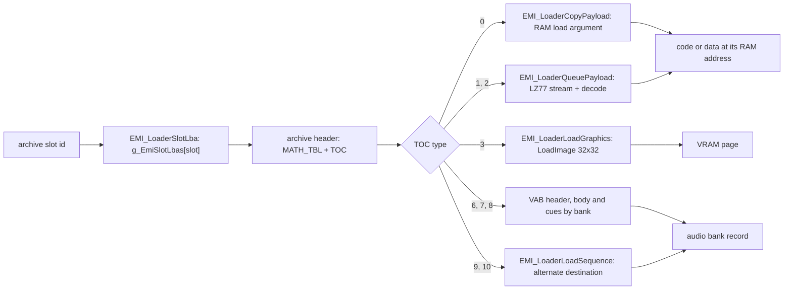

# EMI container

*Read this first for any file format: almost all game data sits in EMI archives.*

The EMI archive container: header, table of contents, entry types, disc slot ids, loader chain and
archive shapes. An archive is a sector-aligned container of typed entries. It is never an image:
extract the entries, then classify each one. The US `Breath of Fire III (USA)` disc holds 880 archives with 6,344
entries and 250,503,535 payload bytes.

## Header

All 880 archives share one header.

| Offset | Size | Type      | Meaning                             |
| -----: | ---: | --------- | ----------------------------------- |
| `0x00` |    4 | `u32`     | entry count                         |
| `0x04` |    4 | `u32`     | format version (`1` on the US disc) |
| `0x08` |    8 | `char[8]` | `MATH_TBL`                          |

## TOC entry

| Offset | Size | Type  | Meaning                      |
| -----: | ---: | ----- | ---------------------------- |
| `0x00` |    4 | `u32` | payload size                 |
| `0x04` |    4 | `u32` | type-dependent load argument |
| `0x08` |    4 | `u32` | cached first payload word    |
| `0x0C` |    2 | `u16` | type                         |
| `0x0E` |    2 | `u16` | padding (`0x2E2E`)           |

The first payload is at `0x800`; every payload starts on a `0x800` boundary:

```text
next payload offset = current offset + size rounded up to a multiple of 0x800
```

## Padding

The packer reproduces the retail fill exactly; `cmp` after extract and repack is byte-exact.

| Region                                      | Fill     |
| ------------------------------------------- | -------- |
| TOC entry `0x0E` (u16)                      | `0x2E2E` |
| `0x10 + count*0x10` up to `0x800`           | `0x2E`   |
| payload end up to the next `0x800` boundary | `0x5F`   |

Measured over the disc: 1,686,656 bytes of `0x2E` TOC fill, 7,440,017 bytes of `0x5F`
inter-payload fill, and no exception. The last payload ends exactly on the file end; no archive
carries a trailing sector.

## Load argument

TOC `0x04` is not always a CPU pointer.

|      Type | Interpretation                                                        |
| --------: | --------------------------------------------------------------------- |
|  `0`, `1` | CPU destination (type 1: LZ77 output address)                         |
|       `3` | packed graphics upload descriptor                                     |
|   `6`-`8` | audio bank selector `0`-`6`                                           |
| `9`, `10` | sequence copy; destination is the bank record's alternate destination |

A bank's type-6 and type-7 entries share one selector; a type-8 selector is one of its container's type-6 selectors. Selector use over the 1,020
type-6 entries:

| Selector | Archives (type-6 entries)                                                         |
| -------: | --------------------------------------------------------------------------------- |
|      `0` | BGM (81), BOSS music (35), BATTLE (2), ETC (1)                                    |
|      `1` | BMAGIC (128), PLCHAR (19), BOSS (40), BATTLE (6), ETC (14), WORLD second bank (3) |
|      `2` | WORLD areas (200), BOSS (40), BATTLE (2), ETC (2)                                 |
|  `3`-`5` | BPLCHAR character forms (63, 74, 70)                                              |
|      `6` | BENEMY (200), BOSS (40)                                                           |

A BOSS archive loads banks 0, 1, 2 and 6 together. Bank use is described in [audio](audio.md).

## Type map

| Type | Role on the US disc                                  | Entries |
| ---: | ---------------------------------------------------- | ------: |
|  `0` | generic RAM payload; code or data                    |   2,623 |
|  `1` | queued RAM payload; type-1 entries are LZ77          |      65 |
|  `2` | shares the type-1 handler (`EMI_LoaderQueuePayload`) |       0 |
|  `3` | raw graphics upload                                  |     593 |
|  `6` | VAB header (VH)                                      |   1,020 |
|  `7` | VAB body (VB)                                        |   1,020 |
|  `8` | auxiliary audio cue table                            |     904 |
|  `9` | sequence-side payload                                |       0 |
| `10` | sequence-side payload (SEP package)                  |     119 |

Types 4 and 5 are loader states, not entry types. `EMI_LoaderNextRead` sets state 5 for slot 0, the
archive header sector; `g_EmiEntryHandlers[4]` and `[5]` both point at `EMI_LoaderReadToc`. No TOC row
carries them (0 of 6,344).

Type `0` alone does not prove code: deciding that an entry is code also needs archive identity, slot, extracted bytes,
load address and reviewed code evidence. Types 2 and 9 have no shipped entry on this disc.
The type-1 payload format is [LZ77](lz77.md); type 3 is [graphics](graphics.md); types 6-10 are
[audio](audio.md).

## Confirmed data-only payloads

Two type-0 images contain no code: both are 512-byte CLUT banks. Each has one segment ending at `0x200` holding one
CLUT and no code; neither payload has a `jr $ra` or an
`addiu sp,sp` prologue.

| Target                   |         Load | Payload                                                                               |
| ------------------------ | -----------: | ------------------------------------------------------------------------------------- |
| `emi/etc/bate/03`        | `0x80033A00` | 256 colors (512 B), arena `+0x200`, VRAM row 481 ([area](area.md#palette-arena))      |
| `emi/battle/batl_re2/01` | `0x80036E00` | 256 colors (512 B), arena `+0x3600`, VRAM row 507; colors 96-255 `0x8000` (STP black) |

## Disc slot ids

`EMI_LoaderStreamInitSlot(slot_id)` (`exe/slus_004_22@0x80161FDC`) reads the archive start LBA from
`g_EmiSlotLbas[slot_id]`. The slot id is the archive's index in the disc file list: `0x261` is
`FIRST.EMI`, `0x262` is `GAME.EMI`. The list is ordered by ascending
LBA, which makes each directory a contiguous run (`measured`: all 17 directory ranges equal the base slots below;
slots `0x373`-`0x376` are `CAPCOM30.STR`, `LOGO.EXE`, `SYSTEM.CNF`, `SLUS_004.22`). The table and its
bytes are described in [executable](exe.md#the-disc-file-table). The entry slot inside an archive is a different number: the
TOC index.

| Kind         | Base slot | Archives | Caller that picks the slot                                                                                                                            |
| ------------ | --------: | -------: | ----------------------------------------------------------------------------------------------------------------------------------------------------- |
| `BATTLE/*`   |     `0x0` |        9 | fixed ids 0-8 in `battle/03` and `battle/15`                                                                                                          |
| `BENEMY`     |     `0x9` |      200 | `battle/03 func_801D1228`: `g_GameAreaId + 9`                                                                                                         |
| `BGM`        |    `0xD1` |       81 | `SND_RequestBgm`: `D_80181EB8[id]` holds the slot (`0xD1`-`0x121`)                                                                                    |
| `BMAGIC`     |   `0x122` |      144 | `battle/15 func_800AE1F8`, `func_800AE2D4`: `BattleSelection.id` from the table at `0x800B65F8` (`0x122`-`0x1B1`)                                     |
| `BMAG_XA`    |   `0x1B2` |        1 | `SND_StartXaStream`, key `0x1000 + n`                                                                                                                 |
| `BOSS`       |   `0x1B3` |       40 | no static caller found                                                                                                                                |
| `BPLCHAR`    |   `0x1DB` |      121 | `EMI_StreamFamilyArchive` families 1 and 2; `battle/03 func_801E7948`; id tables `D_800B4A64/68` (`0x232`-`0x23B`), `func_801E75B0` (`0x23C`-`0x23F`) |
| `ETC/*`      |   `0x254` |       22 | fixed ids (`0x256`-`0x25F`, `0x262`, `0x266`, `0x268`, `0x269`) in `etc/game/00`, `etc/game/01`, `etc/commu00` and `battle/03`                        |
| `PLCHAR`     |   `0x26A` |       38 | `EMI_StreamFamilyArchive` families 0 and 3                                                                                                            |
| `SCENARIO`   |   `0x290` |       25 | `etc/game/00 Scene_RequestOverlay`: `scenario_id + 661` (`0x295` = `SCENA00`)                                                                         |
| `SCE_XA`     |   `0x2A9` |        2 | `SND_StartXaStream`, key kinds 0 and 2                                                                                                                |
| `WORLD00-04` |   `0x2AB` |      200 | `etc/game/00 func_8019FAA0`, `battle/03 func_801D7108`: `area + 0x2AB`                                                                                |

`EMI_StreamFamilyArchive` (`exe/slus_004_22@0x8016728C`) adds a family bias to the index:

| Family |    Bias | Archives      |
| -----: | ------: | ------------- |
|    `0` | `0x26A` | `PLxxx` bank  |
|    `1` | `0x1DB` | `BPLDxxx`     |
|    `2` | `0x1EE` | `BPLUxxx`     |
|    `3` | `0x27D` | `PLPxxx` code |

Slot ids 618, 475, 494 and 637 are `PL012`, `BPLD012`, `BPLU012` and `PLP012` in the disc list.
`SND_StartXaStream` (`@0x801636A0`) is not an EMI loader: it streams the three XA files
(`D_80183230 = {0x2A9, 0x1B2, 0x2AA}`) with its own state machine.

## Loader chain

Every archive read runs `EMI_LoaderStreamInitSlot` -> `EMI_LoaderSlotLba` -> `EMI_LoaderBeginRead` ->
`EMI_OnCdReady`, then `EMI_LoaderNextRead` per TOC row. Callback states 0, 4, 6, 8, 9 and 10 run
in the callback; states 1, 2, 3, 5 and 7 go through the 24-slot ring.

| Type      | Handler chain                                                                                                                                                                                                       |
| --------- | ------------------------------------------------------------------------------------------------------------------------------------------------------------------------------------------------------------------- |
| header    | `EMI_LoaderReadToc` (checks `MATH_TBL`, builds cumulative sector offsets in `D_80146678[]`)                                                                                                                         |
| `0`       | `EMI_LoaderCopyPayload` -> `EMI_LoaderCopySector` (sector straight to the load argument)                                                                                                                            |
| `1`       | `EMI_LoaderQueuePayload` -> `EMI_LoaderReadSector` (`0x80163238`; decoder init `EMI_DecodeBegin`) -> `EMI_LoaderStageSector` (`0x8016327C`; two 0x400-byte halves to the scratchpad, decoder step `EMI_DecodeStep`) |
| `3`       | `EMI_LoaderLoadGraphics` (descriptor `col:row:count`) -> `EMI_LoaderUploadSector` (`0x80163378`; `LoadImage` of one 32x32-word rectangle)                                                                           |
| `6`       | `EMI_LoaderLoadVabHeader` (copy VH; close the bank's previous owner)                                                                                                                                                |
| `7`       | `EMI_LoaderLoadVabBody` (`SsVabOpenHeadSticky`) -> `EMI_LoaderTransferVabBody` (`SsVabTransBodyPartly`)                                                                                                             |
| `8`       | `EMI_LoaderLoadVabCues` (copy to `0x801486A0 + 124 * bank`)                                                                                                                                                         |
| `9`, `10` | `EMI_LoaderLoadSequence` (copy to the bank record's alternate destination)                                                                                                                                          |



## Payload census

The type map above is the loader's contract; the bytes behind it, measured over the 6,344 entries:

| Type | Entries | Payload bytes | Note                                                |
| ---: | ------: | ------------: | --------------------------------------------------- |
|  `0` |   2,623 |    39,534,564 | 429 code, 98 mixed, 945 data, 1,098 asset, 53 empty |
|  `1` |      65 |    12,723,580 | all LZ77; 21,753,944 bytes decoded                  |
|  `3` |     593 |   112,312,320 | every payload a multiple of `0x800`                 |
|  `6` |   1,020 |     4,904,832 | every header starts `pBAV`                          |
|  `7` |   1,020 |    79,157,504 | header size equals `fsize` in 1,020/1,020           |
|  `8` |     904 |        34,432 | cue tables                                          |
| `10` |     119 |     1,836,303 | every package starts `pQES`                         |

No entry uses types 2, 4, 5 or 9. A class is a byte estimate, not an image: 527 code-bearing
entries resolve to 405 distinct images.

All 880 archives rebuild byte-identical from their entries: 6,344 entries, 250,503,535 bytes.

## Archive shapes

Entry types per family over the 880 archives; slot numbers are TOC indexes.

| Family                              | Archives | Shape                                                                                | Entries by type                 |
| ----------------------------------- | -------: | ------------------------------------------------------------------------------------ | ------------------------------- |
| BENEMY                              |      200 | slot 0 VH (6,688 B), slot 1 cue table (64 B), slot 2 VB (2,816-35,632 B); selector 6 | 6:200 7:200 8:200               |
| BGM                                 |       81 | VH, SEP, VB (78); VH, SEP, cue (4-20 B), VB (BGM004, BGM108, BGM117); selector 0     | 6:81 7:81 8:3 10:81             |
| BPLCHAR                             |      121 | 44 whole banks, 75 one-section banks, 2 container archives (`BPLD349`, `BPLU349`)    | 0:120 1:45 6:207 7:207 8:207    |
| PLCHAR                              |       38 | 19 `PLxxx` (VAB triple + LZ77 bank), 19 `PLPxxx` (code)                              | 0:19 1:19 6:19 7:19 8:19        |
| WORLD00-04                          |      200 | seven shapes (below)                                                                 | 0:1,832 3:408 6:203 7:203 8:203 |
| BMAGIC, BOSS, BATTLE, SCENARIO, ETC |      240 | code-overlay shapes (below)                                                          | mixed                           |

BENEMY, BGM and WORLD put the VAB triple (VH, cues or sequence, VB) at slots 0-2.

**BENEMY.** The 200 cue tables are byte-identical. The VH has 67 distinct bodies and the VB 58.

**BGM.** Slot 1 is the SEP package.

**BPLCHAR.**

| Shape            | Archives | Slots                                                                                                                 |
| ---------------- | -------: | --------------------------------------------------------------------------------------------------------------------- |
| whole bank       |       44 | three VAB triples (selectors 3, 4, 5, one per character form), 16 KiB zero filler at slot 3, LZ77 container at slot 7 |
| one-section bank |       75 | VAB triple and one type-0 section at `0x8003B80C`, `0x8005F80C`, `0x8007180C` or `0x8007A80C`                         |
| container only   |        2 | `BPLD349`, `BPLU349`: raw or LZ77 container                                                                           |

The filler loads at `0x8003B800` before the LZ77 container overwrites it; it has no consumer
([character](character.md) classes it `reserve`).

**PLCHAR.** `PLxxx` is a VAB triple plus an LZ77 bank at `0x8003B800` (slot 3); `PLPxxx` is one
type-0 code entry at `0x801CE400` (slot 0).

### Code overlays

The first `u32` of every code payload is a module id; the type-0 loader compares it with the TOC
cached first word. The ids form one namespace:

| Range            | Bodies | Content                                                                                                                                                           |
| ---------------- | -----: | ----------------------------------------------------------------------------------------------------------------------------------------------------------------- |
| `0x12`-`0x20`    |     15 | ETC programs (`0x12` START/STATUS, `0x13` SHOP, `0x14` BATE, `0x15` SHISU, `0x18` COMMU00, `0x19`-`0x1D` COMMU01-05, `0x1E` GAME00, `0x1F` SISYOU, `0x20` GAME01) |
| `0x21`-`0x33`    |     19 | PLCHAR programs (`33 +` name-order ordinal)                                                                                                                       |
| `0x34`-`0x104`   |    181 | WORLD area programs (`52 + area`; 200 archives, 19 are data-only)                                                                                                 |
| `0x105`-`0x118`  |     20 | SCENA00-19 controllers                                                                                                                                            |
| `0x119`-`0x11D`  |      5 | SCE10EFF, SCE15EF0-3 effect controllers                                                                                                                           |
| `0x11E`-`0x140`  |     35 | BOSS modules                                                                                                                                                      |
| `0x141`          |      1 | shared START#9 / SHOP#8 overlay                                                                                                                                   |
| `0x142`, `0x143` |      2 | BATL_END, BATL_OVR battle-effect modules                                                                                                                          |
| `0x144`-`0x1BF`  |    124 | BMAGIC effect modules                                                                                                                                             |

Companion world modules use the same word: `0x16` at `0x801D0C00`, `0x17` at `0x800F5000`, `0x18`
at `0x801EEC00`, `0xFC`-`0x104` at `0x80117000`. A copy payload keeps its source's id.
`MagicModule`, `OverlayHeader` and `SceneOverlayHeader` type the id word; world, plchar and
boss keep a lone `u32`.

Code slot by family:

| Family   | Load address                                   | Slot of the code entry                                                                                                                                                                                              |
| -------- | ---------------------------------------------- | ------------------------------------------------------------------------------------------------------------------------------------------------------------------------------------------------------------------- |
| WORLD    | `0x801F2C00`                                   | varies by shape; see below                                                                                                                                                                                          |
| PLCHAR   | `0x801CE400`                                   | 0 (`PLPxxx`)                                                                                                                                                                                                        |
| SCENARIO | `0x801F6C00` (SCENA), `0x801D0C00` (SCE*)      | 0 only (the controller)                                                                                                                                                                                             |
| BMAGIC   | `0x801EEC00`                                   | 3 (128 archives with a VAB triple), 0 (13 archives without); extra slots are type-3 uploads, CLUT banks (`0x80033800`-`0x80036E00`) and data blocks (`0x800C3800`, `0x80036C00`)                                    |
| BOSS     | `0x800C1800`                                   | 17-entry shape (BOSS001, 004, 022, 025, 031): slots 0, 12, 13; 20-entry shape (35): slots 3, 15, 16. The three programs are the boss module and the two copied battle programs                                      |
| BATTLE   | none (per archive)                             | `BATTLE`/`BATTLE2`: programs at slots 3 and 15 (16 entries, byte-identical across the two); `BATL_END`/`BATL_OVR`: module at slot 0; `BATL_RE2`: CLUT bundle; `BATL_DRA`, `BATL_RET`, `BATL_SE`, `COMN_SE`: no code |
| ETC      | `0x801D0C00` (menus), `0x80195800` (`game/00`) | slot 0 for `bate`, `game/00`, `shisu`, `shop`, `sisyou`; 6 for `commu03`/`commu04`; 7 for `commu01`/`commu05`/`commu02b`; 8 for `commu02` and `start/08`; 9 for `start/09`                                          |

WORLD shapes (the role follows the load address, not the slot number):

| Shape | Archives | Slots | Layout                                                                                               |
| ----- | -------: | ----: | ---------------------------------------------------------------------------------------------------- |
| A     |      174 |    14 | audio 0-2, `0x800E3800` at 3, `0x800D3800` at 4, area program at 13                                  |
| B     |       11 |    15 | A plus a `0x801EEC00` module at 14 (WORLD04 AREA175-185)                                             |
| C     |        9 |    15 | `0x80117000` at 13, area program at 14                                                               |
| D     |        3 |    23 | AREA030, 089, 129: second audio bank, modules `0x801D0C00` and `0x800F5000`, extra CLUTs and uploads |
| E     |        1 |    14 | AREA002: area program at 9                                                                           |
| F     |        1 |    15 | AREA004: reordered, extra type-3 `0x1A080400`                                                        |
| G     |        1 |    15 | AREA024: reordered, extra type-3 at 9                                                                |

Format detail per load address is in [area](area.md) and [character](character.md); code overlay
residency is in [runtime](../game/runtime.md).

## Code entries

Every reviewed code entry is an image. The WORLD area program family at `0x801F2C00` covers 200
entries: 181 code programs, and 19 payloads with no stack prologue
and no `jr $ra`, which are data blocks.

## Open questions

| Question                                                                                                                                                                       |
| ------------------------------------------------------------------------------------------------------------------------------------------------------------------------------ |
| BOSS slot ids `0x1B3`-`0x1DA`: no caller found; the one boss-overlay site read requests slot 4 (`BATL_RET`)                                                                    |
| BMAGIC loading is table-driven (`BattleSelection` at `0x800B65F8`); no caller maps a spell id to a table row                                                                   |
| BPLCHAR section readers at `0x8005680C`, `0x8007180C`, `0x8007A80C`: not found                                                                                                 |
| BPLCHAR filler (16 KiB zero entry at `0x8003B800`, 44 archives): purpose                                                                                                       |
| BGM cue tables in BGM004, BGM108, BGM117 (4-20 B): consumer                                                                                                                    |
| Type-8 cue byte 2, low nibble                                                                                                                                                  |
| Type-0 slots with no named reader: BATTLE script bank at `0x800F0800` beyond `Actor_BeginScript`; BMAGIC data blocks at `0x80036C00` and `0x800C3800`; modules at `0x80117000` |

## Sources

The container, header, TOC and padding are measured from the retail archives. The community
[BoF3-Data-Doc](https://github.com/GlitchedDragon-dev/BoF3-Data-Doc) (EMI and overlay notes, no
license, cited only) is confirmation ([sources](../sources.md)).
