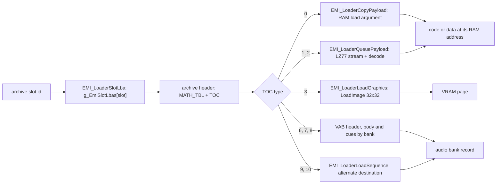

# EMI container

Almost all game data lives in `.EMI` archives. An archive is a header, a table of contents (TOC) and a run of payloads, each starting on a CD sector boundary (2,048 bytes). Each TOC row gives the payload size, a type and a load argument. The type tells the loader what to do with the payload: copy it to RAM, decompress it, upload it to VRAM, or hand it to the sound system. The archive does not say what the payload means. That depends on the archive family and the slot, so extract the entries and classify each one.

The US disc has 880 archives with 6,344 entries and 250,503,535 payload bytes. The [executable page](exe.md#the-disc-file-table) describes how the game finds an archive on the disc. This page describes what is inside one. Graphics payloads are in [graphics](graphics.md), audio payloads in [audio](audio.md), and the compressed type 1 form is [LZ77](lz77.md).

## Header

All 880 archives share one 16-byte header.

| Offset | Size | Type      | Meaning                             |
| -----: | ---: | --------- | ----------------------------------- |
| `0x00` |    4 | `u32`     | entry count                         |
| `0x04` |    4 | `u32`     | format version (`1` on the US disc) |
| `0x08` |    8 | `char[8]` | `MATH_TBL`                          |

## TOC entry

One 16-byte row per entry follows the header, starting at `0x10`.

| Offset | Size | Type  | Meaning                                                                  |
| -----: | ---: | ----- | ------------------------------------------------------------------------ |
| `0x00` |    4 | `u32` | payload size in bytes                                                    |
| `0x04` |    4 | `u32` | load argument (see [Load argument](#load-argument))                      |
| `0x08` |    4 | `u32` | copy of the first payload word (the loader compares it with the payload) |
| `0x0C` |    2 | `u16` | entry type                                                               |
| `0x0E` |    2 | `u16` | padding, always `0x2E2E`                                                 |

The first payload starts at `0x800`. Each later payload starts at the next sector boundary after the previous one:

```text
next payload offset = current offset + size rounded up to a multiple of 0x800
```

The last payload ends exactly at the end of the file, so no archive has a trailing sector.

For example, a TOC row with size 1,160, load argument `0x800E4000` and type `0` describes a 1,160-byte block that the type-0 handler copies to RAM address `0x800E4000`. It takes one sector, so the next payload starts 2,048 bytes after it.

### Padding

Padding bytes have fixed values, so a rebuilt archive can match the original byte for byte.

| Region                                      | Fill     |
| ------------------------------------------- | -------- |
| TOC row bytes `0x0E`-`0x0F`                 | `0x2E2E` |
| `0x10 + count * 0x10` up to `0x800`         | `0x2E`   |
| payload end up to the next `0x800` boundary | `0x5F`   |

Over the whole disc this is 1,686,656 bytes of `0x2E` TOC fill and 7,440,017 bytes of `0x5F` payload fill, with no exception.

## Entry types

The type is a loader command. Types 4 and 5 never appear in a TOC (0 of 6,344 rows); they are internal loader states, and `g_EmiEntryHandlers` points both at `EMI_LoaderReadToc`. Types 2 and 9 have a handler but no entry uses them on this disc.

| Type | Loader treatment                                                | Entries | Payload bytes | Note                                                 |
| ---: | --------------------------------------------------------------- | ------: | ------------: | ---------------------------------------------------- |
|  `0` | copy to RAM at the load argument; code or data                  |   2,623 |    39,534,564 | 429 code, 98 mixed, 945 data, 1,098 asset, 53 empty  |
|  `1` | queue for decompression, then copy to RAM                       |      65 |    12,723,580 | all [LZ77](lz77.md); 21,753,944 bytes decoded        |
|  `2` | same handler as type 1 (`EMI_LoaderQueuePayload`)               |       0 |             - |                                                      |
|  `3` | raw [graphics](graphics.md#type-3-load-argument) upload to VRAM |     593 |   112,312,320 | every payload is a multiple of 2,048 bytes           |
|  `6` | VAB header (VH)                                                 |   1,020 |     4,904,832 | every header starts `pBAV`                           |
|  `7` | VAB body (VB)                                                   |   1,020 |    79,157,504 | header size equals the VH `fsize` field in all 1,020 |
|  `8` | cue table of one bank                                           |     904 |        34,432 | see [audio](audio.md#emi-type-8-cue-records)         |
|  `9` | sequence copy                                                   |       0 |             - |                                                      |
| `10` | sequence copy (SEP package)                                     |     119 |     1,836,303 | every package starts `pQES`                          |

The `Note` classes for type 0 are byte estimates, not proof. A type-0 entry is code only when its archive, slot, bytes, load address and reviewed disassembly agree. The 527 code-bearing entries resolve to 405 distinct images.

### Load argument

The load argument at TOC `+0x04` is not always a CPU address.

|      Type | Interpretation                                                               |
| --------: | ---------------------------------------------------------------------------- |
|  `0`, `1` | CPU destination address (for type 1, the address of the decoded output)      |
|       `3` | packed VRAM upload descriptor ([graphics](graphics.md#type-3-load-argument)) |
|   `6`-`8` | audio bank selector, `0` to `6`                                              |
| `9`, `10` | sequence copy; the destination comes from the bank record                    |

A bank's type-6 and type-7 entries share one selector. A type-8 selector is one of its container's type-6 selectors. The 1,020 type-6 entries use the selectors like this:

| Selector | Archives (type-6 entry counts)                                                    |
| -------: | --------------------------------------------------------------------------------- |
|      `0` | BGM (81), BOSS music (35), BATTLE (2), ETC (1)                                    |
|      `1` | BMAGIC (128), PLCHAR (19), BOSS (40), BATTLE (6), ETC (14), WORLD second bank (3) |
|      `2` | WORLD areas (200), BOSS (40), BATTLE (2), ETC (2)                                 |
|  `3`-`5` | BPLCHAR character forms (63, 74, 70)                                              |
|      `6` | BENEMY (200), BOSS (40)                                                           |

A BOSS archive loads banks 0, 1, 2 and 6 together. [Audio](audio.md) explains what a bank is.

## Disc slot ids

The game names an archive by its slot id, the archive's index in the disc file list. `EMI_LoaderStreamInitSlot (exe/slus_004_22@0x80161FDC)` takes the slot id and reads the start sector from `g_EmiSlotLbas[slot_id]`. For example, `0x261` is `FIRST.EMI` and `0x262` is `GAME.EMI`. The list is in ascending sector order, so each directory is one contiguous run of slots (all 17 directory ranges equal the base slots below). Slots `0x373` to `0x376` are `CAPCOM30.STR`, `LOGO.EXE`, `SYSTEM.CNF` and `SLUS_004.22`. The table itself is described on the [executable page](exe.md#the-disc-file-table).

Do not confuse the slot id with the entry slot, which is the TOC index inside one archive.

| Kind         | Base slot | Archives | Caller that picks the slot                                                                                                                                                                                                    |
| ------------ | --------: | -------: | ----------------------------------------------------------------------------------------------------------------------------------------------------------------------------------------------------------------------------- |
| `BATTLE/*`   |     `0x0` |        9 | fixed ids 0-8 in `emi/battle/battle/03` and `emi/battle/battle/15`                                                                                                                                                            |
| `BENEMY`     |     `0x9` |      200 | `func_801D1228 (emi/battle/battle/03@0x801D1228)`: `g_GameAreaId + 9`                                                                                                                                                         |
| `BGM`        |    `0xD1` |       81 | `SND_RequestBgm (exe/slus_004_22@0x80161BBC)`: the table `D_80181EB8[id]` holds the slot (`0xD1`-`0x121`)                                                                                                                     |
| `BMAGIC`     |   `0x122` |      144 | `func_800AE1F8 (emi/battle/battle/15@0x800AE1F8)` and `func_800AE2D4 (emi/battle/battle/15@0x800AE2D4)`: `BattleSelection.id` from the table at `0x800B65F8` (`0x122`-`0x1B1`)                                                |
| `BMAG_XA`    |   `0x1B2` |        1 | `SND_StartXaStream`, key `0x1000 + n`                                                                                                                                                                                         |
| `BOSS`       |   `0x1B3` |       40 | no static caller found                                                                                                                                                                                                        |
| `BPLCHAR`    |   `0x1DB` |      121 | `EMI_StreamFamilyArchive` families 1 and 2; `func_801E7948 (emi/battle/battle/03@0x801E7948)`; id tables `D_800B4A64` and `D_800B4A68` (`0x232`-`0x23B`), `func_801E75B0 (emi/battle/battle/03@0x801E75B0)` (`0x23C`-`0x23F`) |
| `ETC/*`      |   `0x254` |       22 | fixed ids (`0x256`-`0x25F`, `0x262`, `0x266`, `0x268`, `0x269`) in `emi/etc/game/00`, `emi/etc/game/01`, `emi/etc/commu00/00` and `emi/battle/battle/03`                                                                      |
| `PLCHAR`     |   `0x26A` |       38 | `EMI_StreamFamilyArchive` families 0 and 3                                                                                                                                                                                    |
| `SCENARIO`   |   `0x290` |       25 | `Scene_RequestOverlay (emi/etc/game/00@0x801A7804)`: `scenario_id + 661` (`0x295` is `SCENA00`)                                                                                                                               |
| `SCE_XA`     |   `0x2A9` |        2 | `SND_StartXaStream`, key kinds 0 and 2                                                                                                                                                                                        |
| `WORLD00-04` |   `0x2AB` |      200 | `func_8019FAA0 (emi/etc/game/00@0x8019FAA0)` and `func_801D7108 (emi/battle/battle/03@0x801D7108)`: `area + 0x2AB`                                                                                                            |

`EMI_StreamFamilyArchive (exe/slus_004_22@0x8016728C)` adds a family bias to the character index, for the four character families:

| Family |    Bias | Archives      |
| -----: | ------: | ------------- |
|    `0` | `0x26A` | `PLxxx` bank  |
|    `1` | `0x1DB` | `BPLDxxx`     |
|    `2` | `0x1EE` | `BPLUxxx`     |
|    `3` | `0x27D` | `PLPxxx` code |

For example, character index 12 in family 0 is slot `0x26A + 12 = 618`, which is `PL012`. Slots 475, 494 and 637 are `BPLD012`, `BPLU012` and `PLP012`.

`SND_StartXaStream (exe/slus_004_22@0x801636A0)` is not an EMI loader. It streams the three XA files (`D_80183230 = {0x2A9, 0x1B2, 0x2AA}`) with its own state machine ([STR and XA](str.md)).

## Loader chain

Every archive read runs `EMI_LoaderStreamInitSlot`, `EMI_LoaderSlotLba`, `EMI_LoaderBeginRead` and `EMI_OnCdReady`. Then `EMI_LoaderNextRead` starts each TOC row. Loader states 0, 4, 6, 8, 9 and 10 run inside the CD callback. States 1, 2, 3, 5 and 7 go through a 24-slot ring that `EMI_LoaderService` drains each frame.

| Type      | Handler chain                                                                                                                                                                                                                            |
| --------- | ---------------------------------------------------------------------------------------------------------------------------------------------------------------------------------------------------------------------------------------- |
| header    | `EMI_LoaderReadToc` checks `MATH_TBL` and builds the cumulative sector offsets in `D_80146678[]`                                                                                                                                         |
| `0`       | `EMI_LoaderCopyPayload`, then `EMI_LoaderCopySector` (each sector goes straight to the load argument)                                                                                                                                    |
| `1`       | `EMI_LoaderQueuePayload`, then `EMI_LoaderReadSector` (`@0x80163238`, starts the decoder with `EMI_DecodeBegin`), then `EMI_LoaderStageSector` (`@0x8016327C`, copies two 1,024-byte halves to the scratchpad and runs `EMI_DecodeStep`) |
| `3`       | `EMI_LoaderLoadGraphics` (descriptor `col:row:count`), then `EMI_LoaderUploadSector` (`@0x80163378`, one `LoadImage` of a 32x32-word rectangle)                                                                                          |
| `6`       | `EMI_LoaderLoadVabHeader` copies the VH and closes the bank's previous owner                                                                                                                                                             |
| `7`       | `EMI_LoaderLoadVabBody` (`SsVabOpenHeadSticky`), then `EMI_LoaderTransferVabBody` (`SsVabTransBodyPartly`)                                                                                                                               |
| `8`       | `EMI_LoaderLoadVabCues` copies the table to `0x801486A0 + 124 * bank`                                                                                                                                                                    |
| `9`, `10` | `EMI_LoaderLoadSequence` copies the payload to the bank record's alternate destination                                                                                                                                                   |

All handlers sit in `exe/slus_004_22`.



## Archive shapes

Archives of one family share a shape: the same entry types in the same slots. The shape tells you what a slot holds without reading it. Slot numbers in this section are TOC indexes. The table counts the entries of each type over the 880 archives of the family.

| Family                              | Archives | Shape                                                                                     | Entries by type                 |
| ----------------------------------- | -------: | ----------------------------------------------------------------------------------------- | ------------------------------- |
| BENEMY                              |      200 | slot 0 VH (6,688 B), slot 1 cue table (64 B), slot 2 VB (2,816-35,632 B); selector 6      | 6:200 7:200 8:200               |
| BGM                                 |       81 | VH, SEP, VB (78 archives); VH, SEP, cue (4-20 B), VB (BGM004, BGM108, BGM117); selector 0 | 6:81 7:81 8:3 10:81             |
| BPLCHAR                             |      121 | 44 whole banks, 75 one-section banks, 2 container archives (`BPLD349`, `BPLU349`)         | 0:120 1:45 6:207 7:207 8:207    |
| PLCHAR                              |       38 | 19 `PLxxx` (VAB triple + LZ77 bank), 19 `PLPxxx` (code)                                   | 0:19 1:19 6:19 7:19 8:19        |
| WORLD00-04                          |      200 | seven shapes ([below](#world-shapes))                                                     | 0:1,832 3:408 6:203 7:203 8:203 |
| BMAGIC, BOSS, BATTLE, SCENARIO, ETC |      240 | code-overlay shapes ([below](#code-overlays))                                             | mixed                           |

BENEMY, BGM and WORLD put the sound bank first (VH, cue table or sequence, VB) at slots 0-2. In BENEMY the 200 cue tables are byte-identical; the VH has 67 distinct bodies and the VB 58. In BGM, slot 1 is the SEP package.

### Character archives

A BPLCHAR archive has one of three shapes:

| Shape            | Archives | Slots                                                                                                                 |
| ---------------- | -------: | --------------------------------------------------------------------------------------------------------------------- |
| whole bank       |       44 | three VAB triples (selectors 3, 4, 5, one per character form), 16 KiB zero filler at slot 3, LZ77 container at slot 7 |
| one-section bank |       75 | VAB triple and one type-0 section at `0x8003B80C`, `0x8005680C`, `0x8005F80C`, `0x8007180C` or `0x8007A80C`           |
| container only   |        2 | `BPLD349`, `BPLU349`: raw or LZ77 container                                                                           |

The filler loads at `0x8003B800` and the LZ77 container then overwrites it. Nothing reads it ([character](character.md) classes it `reserve`).

A PLCHAR archive pair has two shapes. `PLxxx` is a VAB triple plus an LZ77 bank at `0x8003B800` (slot 3). `PLPxxx` is one type-0 code entry at `0x801CE400` (slot 0).

### Code overlays

The first `u32` of every code payload is a module id, and the type-0 loader compares it with the TOC's cached first word. The ids form one namespace across all archives:

| Range            | Bodies | Content                                                                                                                                                           |
| ---------------- | -----: | ----------------------------------------------------------------------------------------------------------------------------------------------------------------- |
| `0x12`-`0x20`    |     15 | ETC programs (`0x12` START/STATUS, `0x13` SHOP, `0x14` BATE, `0x15` SHISU, `0x18` COMMU00, `0x19`-`0x1D` COMMU01-05, `0x1E` GAME00, `0x1F` SISYOU, `0x20` GAME01) |
| `0x21`-`0x33`    |     19 | PLCHAR programs (`33 +` name-order ordinal)                                                                                                                       |
| `0x34`-`0x104`   |    181 | WORLD area programs (`52 + area`; 200 archives, 19 are data-only)                                                                                                 |
| `0x105`-`0x118`  |     20 | SCENA00-19 controllers                                                                                                                                            |
| `0x119`-`0x11D`  |      5 | SCE10EFF, SCE15EF0-3 effect controllers                                                                                                                           |
| `0x11E`-`0x140`  |     35 | BOSS modules                                                                                                                                                      |
| `0x141`          |      1 | shared START#9 / SHOP#8 overlay                                                                                                                                   |
| `0x142`, `0x143` |      2 | BATL_END, BATL_OVR battle-effect modules                                                                                                                          |
| `0x144`-`0x1BF`  |    124 | BMAGIC effect modules                                                                                                                                             |

A few companion world modules use the same word: `0x16` at `0x801D0C00`, `0x17` at `0x800F5000`, `0x18` at `0x801EEC00`, and `0xFC`-`0x104` at `0x80117000`. A payload that the game copies from another overlay keeps its source's id.

Where the code entry sits depends on the family:

| Family   | Load address                                   | Slot of the code entry                                                                                                                                                                                                      |
| -------- | ---------------------------------------------- | --------------------------------------------------------------------------------------------------------------------------------------------------------------------------------------------------------------------------- |
| WORLD    | `0x801F2C00`                                   | varies by shape ([below](#world-shapes))                                                                                                                                                                                    |
| PLCHAR   | `0x801CE400`                                   | 0 (`PLPxxx`)                                                                                                                                                                                                                |
| SCENARIO | `0x801F6C00` (SCENA), `0x801D0C00` (SCE*)      | 0 only (the controller)                                                                                                                                                                                                     |
| BMAGIC   | `0x801EEC00`                                   | 3 (128 archives with a VAB triple), 0 (13 archives without); the other slots are type-3 uploads, CLUT banks (`0x80033800..0x80036E00`) and data blocks (`0x800C3800`, `0x80036C00`)                                         |
| BOSS     | `0x800C1800`                                   | 17-entry shape (BOSS001, 004, 022, 025, 031): slots 0, 12, 13; 20-entry shape (35 archives): slots 3, 15, 16. The three programs are the boss module and the two copied battle programs                                     |
| BATTLE   | none (per archive)                             | `BATTLE` and `BATTLE2`: programs at slots 3 and 15 (16 entries, byte-identical across the two); `BATL_END` and `BATL_OVR`: module at slot 0; `BATL_RE2`: CLUT bundle; `BATL_DRA`, `BATL_RET`, `BATL_SE`, `COMN_SE`: no code |
| ETC      | `0x801D0C00` (menus), `0x80195800` (`game/00`) | slot 0 for `bate`, `game/00`, `shisu`, `shop`, `sisyou`; 6 for `commu03` and `commu04`; 7 for `commu01`, `commu05` and `commu02b`; 8 for `commu02` and `start/08`; 9 for `start/09`                                         |

### WORLD shapes

A WORLD archive holds one sound bank, its type-3 uploads and the type-0 [area working set](area.md). The role of an entry follows its load address, not its slot number. Seven shapes cover the 200 archives:

| Shape | Archives | Entries | Layout                                                                                                                     |
| ----- | -------: | ------: | -------------------------------------------------------------------------------------------------------------------------- |
| A     |      174 |      14 | audio 0-2, `0x800E3800` at 3, `0x800D3800` at 4, area program at 13                                                        |
| B     |       11 |      15 | A plus a `0x801EEC00` module at 14 (WORLD04 AREA175-185)                                                                   |
| C     |        9 |      15 | `0x80117000` module at 13, area program at 14                                                                              |
| D     |        3 |      23 | AREA030, 089, 129: second audio bank, area program at 3, modules at `0x801D0C00` and `0x800F5000`, extra CLUTs and uploads |
| E     |        1 |      14 | AREA002: area program at 9                                                                                                 |
| F     |        1 |      15 | AREA004: area program at 9, extra type-3 upload `0x1A080400` at 14                                                         |
| G     |        1 |      15 | AREA024: extra type-3 upload `0x1A080400` at 9, area program at 14                                                         |

The area program is code in 181 archives. The other 19 payloads at `0x801F2C00` have no stack prologue and no `jr $ra`, so they are data ([area](area.md#0x801f2c00-area-program-code-arena)). Format details per load address are in [area](area.md) and [character](character.md). Which overlay is resident in which window is in [runtime](../data/programs.md).

### Data-only code-window payloads

Two type-0 images with code-style addresses hold no code. Both are 512-byte CLUT banks with one segment ending at `0x200`, one CLUT and neither a `jr $ra` nor an `addiu sp,sp` prologue.

| Target                   |         Load | Payload                                                                               |
| ------------------------ | -----------: | ------------------------------------------------------------------------------------- |
| `emi/etc/bate/03`        | `0x80033A00` | 256 colors (512 B), arena `+0x200`, VRAM row 481 ([area](area.md#palette-arena))      |
| `emi/battle/batl_re2/01` | `0x80036E00` | 256 colors (512 B), arena `+0x3600`, VRAM row 507; colors 96-255 `0x8000` (STP black) |

## Open questions

| Question                                                                                                                                                                       | What would settle it                                |
| ------------------------------------------------------------------------------------------------------------------------------------------------------------------------------ | --------------------------------------------------- |
| BOSS slot ids `0x1B3`-`0x1DA`: no caller found; the one boss-overlay site read requests slot 4 (`BATL_RET`)                                                                    | a runtime trace of a boss battle load               |
| BMAGIC loading is table-driven (`BattleSelection` at `0x800B65F8`); no caller maps a spell id to a table row                                                                   | the code that fills `BattleSelection.id`            |
| BPLCHAR section readers for `0x8005680C`, `0x8007180C` and `0x8007A80C`: not found                                                                                             | a reader of those addresses in a battle overlay     |
| BPLCHAR filler (16 KiB zero entry at `0x8003B800`, 44 archives): purpose                                                                                                       | a reader, or proof that nothing reads it            |
| BGM cue tables in BGM004, BGM108 and BGM117 (4-20 B): consumer                                                                                                                 | the sound-request code that indexes bank cue tables |
| Type-8 cue byte 2, low nibble                                                                                                                                                  | a consumer of the cue byte                          |
| Type-0 slots with no named reader: BATTLE script bank at `0x800F0800` beyond `Actor_BeginScript`; BMAGIC data blocks at `0x80036C00` and `0x800C3800`; modules at `0x80117000` | readers of those addresses                          |

## Sources

The container, header, TOC and padding are measured from the retail archives. The community [BoF3-Data-Doc](https://github.com/GlitchedDragon-dev/BoF3-Data-Doc) (EMI and overlay notes) is confirmation only ([sources](../appendix/sources.md)).
