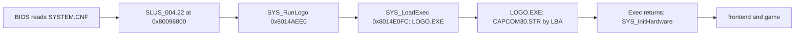

# Executables and boot files

*Read this if you need the executables, the system file or the disc file table.*

The five non-archive files that start the game, and the disc table that lets the game find every
other file. Evidence tags: `read` (reader code read), `measured` (checked over every instance,
count given), `inferred`, `unknown`. Layouts and counts only; no retail bytes are quoted.

## Files

| Path                |        Size (bytes) |    LBA | Kind                                   | Read by                                       |
| ------------------- | ------------------: | -----: | -------------------------------------- | --------------------------------------------- |
| `SYSTEM.CNF`        |                  70 | 187467 | text, 4 `KEY = value` lines            | BIOS (boot)                                   |
| `SLUS_004.22`       |           1,445,888 | 187468 | PS-X EXE, resident game                | BIOS, from `BOOT`                             |
| `LOGO/LOGO.EXE`     |             122,880 | 187407 | PS-X EXE, Capcom logo                  | `SYS_RunLogo` -> `SYS_LoadExec`               |
| `LOGO/CAPCOM30.STR` |           2,365,440 | 186252 | MDEC video + XA, see [STR](str.md)     | `LOGO.EXE`, by hard-coded LBA                 |
| license sectors     | 28,032 (12 x 2,336) |   0-11 | licence text and logo, outside ISO9660 | BIOS only (`license_data.dat` in the extract) |

The disc also carries a silent CDDA track 2 (37,044,044 bytes, every sample zero, `measured`) and
no other audio track. No game function read issues `CdlPlay` (`measured` by search); code not read is not searched, so
"nothing plays it" stays `inferred`.

## PS-X EXE header

Both executables use the standard 0x800-byte header (`PS-X EXE` magic at 0, fields as `u32` from
0x10). `measured` on both files:

| Offset | Field                        |   `SLUS_004.22` |   `LOGO.EXE` |
| -----: | ---------------------------- | --------------: | -----------: |
| `0x10` | `pc`                         |    `0x8014AA0C` | `0x801CE724` |
| `0x14` | `gp`                         |             `0` |          `0` |
| `0x18` | `t_addr`                     |    `0x80096800` | `0x801CE000` |
| `0x1C` | `t_size`                     |      `0x160800` |    `0x1D800` |
| `0x20` | `d_addr`..`b_size` (4 words) |             `0` |          `0` |
| `0x30` | `s_addr`                     |    `0x801FFFF0` | `0x801FFFF0` |
| `0x34` | `s_size`                     |             `0` |          `0` |
| `0x4C` | region marker                | "North America" |      "Japan" |

- File size equals `0x800 + t_size` in both files (`measured`: 1,445,888 and 122,880).
- Bytes `0x83`-`0x7FF` of both headers are zero (`measured`).
- `SLUS_004.22` starts at `stup2` (`2MBYTE.OBJ`, PsyQ), `LOGO.EXE` at `__SN_ENTRY_POINT`
  `__SN_ENTRY_POINT (exe/logo@0x801CE724)`.
- The `LOGO.EXE` region marker is the Japanese string, which the US executable keeps
  (`measured`; no reader looks at it).
- The executable image spans `0x80096800`-`0x801F7000`. The module windows from `0x801EEC00` and
  `0x801F2C00` lie inside that range and are overwritten by overlays at run time
  ([runtime](../game/runtime.md#module-windows)). The last 17,408 bytes of the file
  (`0x801F2C00` on) hold only the byte values 0, 14 and 15 (`measured`).

## SYSTEM.CNF

Four lines, each `KEY = value`: `BOOT` names `cdrom:\SLUS_004.22;1`, `TCB` is 4, `EVENT` is 16,
`STACK` is `0X801FFF00` (`measured`). The BIOS reads the file; the game never opens it.
Editing `TCB`, `EVENT` or `STACK` changes the kernel's control-block and event tables
(`inferred` from the PsyQ boot convention).

## Boot chain

`read`: `SYS_RunLogo` passes the string `\LOGO\LOGO.EXE;1` (`s__LOGO_LOGO_EXE_1_80149800`) to
`SYS_LoadExec`. That function calls `CdSearchFile`, reads the first sector (the header) into a
staging buffer, copies 40 bytes of header fields to the boot scratch area (`D_80143E70`), then reads `t_size`
bytes from the next sector to `t_addr` through `SYS_ReadCd`. It retries up to 10 times. `SYS_RunLogo`
then sets the new stack top to `0x801FF000`, runs `Exec` inside a critical section, and restores
the boot display (`SYS_InitHardware`, `ClearOTag`, `DrawOTag`, `GFX_ClearRect`).

`LOGO.EXE` does not use a file name for the video. It stores the start LBA as the 32-bit constant
`D_801D8BB0 (exe/logo@0x801D8BB0)` = `0x0002D78C` (186,252, the LBA of `CAPCOM30.STR`; `read`, `measured` against the
directory). Moving the STR file requires the
same edit in `LOGO.EXE`.

## The disc file table

`g_EmiSlotLbas` in `SLUS_004.22` is an array of 887 `u32` start LBAs. `EMI_LoaderSlotLba`
(`0x80162160`) returns `g_EmiSlotLbas[slot_id]`; every EMI, XA and logo read goes through it
([EMI slot ids](emi.md#disc-slot-ids)).

| Fact                                                   | Value                                                   | Evidence   |
| ------------------------------------------------------ | ------------------------------------------------------- | ---------- |
| File offset of slot 0                                  | `0xEC444` (address minus `0x80096000`)                  | `measured` |
| Entries                                                | 887, 4 bytes each, 3,548 bytes                          | `measured` |
| Order                                                  | ascending LBA                                           | `measured` |
| Set of values equals the LBAs of the 887 ISO9660 files | yes, 887 of 887                                         | `measured` |
| Slots 0-882                                            | the 883 files under `BIN/`                              | `measured` |
| Slots 883-886                                          | `CAPCOM30.STR`, `LOGO.EXE`, `SYSTEM.CNF`, `SLUS_004.22` | `measured` |

The table is ascending by LBA, so it follows the on-disc order, not the directory-record order
(the directory lists `SLUS_004.22` before `SYSTEM.CNF`; the table lists them the other way).
The `u32` after the last slot (`0x0002E03A`) is not a file (`measured`: it is not an LBA of any
file).

The table is the only place the game learns where a file starts. A file may shrink in place, but a
file that moves, or a file that must grow, needs both the ISO9660 directory record and this table
rewritten. The patcher (`assets import disc`) does neither: it keeps every file in its sectors
([patched disc image](assets.md#sector-sealing)).

## Other executable data an editor meets

| Data                           | Address / file offset                                           | Shape                                                       | Evidence                             |
| ------------------------------ | --------------------------------------------------------------- | ----------------------------------------------------------- | ------------------------------------ |
| XA stream slot ids             | `D_80183230` = `{0x2A9, 0x1B2, 0x2AA}` (S_XA00, MAGIC00, VOICE) | 3 `u32` slot ids                                            | `read` (`SND_ResolveXaStream`)       |
| XA cue-array pointers          | `D_8018323C` = `{0x801839C4, 0x801832C4, 0x80183298}`           | 3 pointers to `u16` arrays, see [STR](str.md#xa-cue-tables) | `read`, `measured`                   |
| BGM id to slot table           | `D_80181EB8[id]`                                                | slot ids `0xD1`-`0x121`                                     | `read` ([EMI](emi.md#disc-slot-ids)) |
| Item, ability and level data   | not here: `ETC/GAME.EMI` entry 0                                | [game records](../game/records.md)                          | `read`                               |
| Save frame, checksum constants | not here                                                        | [save format](save.md)                                      | `read`                               |

## Sources

PS-X EXE header fields follow [psx-spx](https://psx-spx.consoledev.net/cdromformat/) ([sources](../sources.md)); the values above are measured from the retail files.
