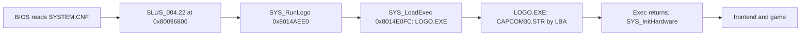

# Executables and boot files

Five files outside the [EMI](emi.md) archives start the game: the system file, two executables, the logo video and the license sectors. One more thing lives in the main executable and matters to every file on the disc: the table of start sectors that lets the game find each file. This page describes these files and that table. The boot sequence that runs them is in [boot](../systems/boot.md).

## Files

| Path                |        Size (bytes) |    LBA | Kind                                   | Read by                               |
| ------------------- | ------------------: | -----: | -------------------------------------- | ------------------------------------- |
| `SYSTEM.CNF`        |                  70 | 187467 | text, 4 `KEY = value` lines            | the BIOS (boot)                       |
| `SLUS_004.22`       |           1,445,888 | 187468 | PS-X EXE, resident game                | the BIOS, from `BOOT`                 |
| `LOGO/LOGO.EXE`     |             122,880 | 187407 | PS-X EXE, Capcom logo                  | `SYS_RunLogo`, through `SYS_LoadExec` |
| `LOGO/CAPCOM30.STR` |           2,365,440 | 186252 | MDEC video and XA, see [STR](str.md)   | `LOGO.EXE`, by a fixed sector number  |
| license sectors     | 28,032 (12 x 2,336) |   0-11 | license text and logo, outside ISO9660 | the BIOS only                         |

The disc also has one CDDA track (track 2, 37,044,044 bytes). Every sample in it is zero. No game function that was read issues `CdlPlay` (found by searching every function read), so nothing in the code read so far plays it. Code that was not read is not covered by that search, so "nothing plays it" is `[inferred]`.

## PS-X EXE header

Both executables begin with the standard 2,048-byte PS-X EXE header: the `PS-X EXE` magic at offset 0 and fields as `u32` from `0x10` ([psx-spx](https://psx-spx.consoledev.net/cdromformat/)). The BIOS copies `t_size` bytes from sector 1 of the file to `t_addr`, then jumps to `pc`.

| Offset | Field                          |   `SLUS_004.22` |   `LOGO.EXE` |
| -----: | ------------------------------ | --------------: | -----------: |
| `0x10` | `pc`                           |    `0x8014AA0C` | `0x801CE724` |
| `0x14` | `gp`                           |             `0` |          `0` |
| `0x18` | `t_addr`                       |    `0x80096800` | `0x801CE000` |
| `0x1C` | `t_size`                       |      `0x160800` |    `0x1D800` |
| `0x20` | `d_addr` to `b_size` (4 words) |             `0` |          `0` |
| `0x30` | `s_addr`                       |    `0x801FFFF0` | `0x801FFFF0` |
| `0x34` | `s_size`                       |             `0` |          `0` |
| `0x4C` | region marker                  | "North America" |      "Japan" |

All of this holds on both files:

- The file size equals `0x800 + t_size` (1,445,888 and 122,880 bytes).
- Header bytes `0x83` to `0x7FF` are zero.
- `SLUS_004.22` starts at `stup2` (the PsyQ `2MBYTE.OBJ` start-up code). `LOGO.EXE` starts at `__SN_ENTRY_POINT (exe/logo@0x801CE724)`.
- The `LOGO.EXE` region marker is the Japanese string, and the US executable keeps it. No reader looks at it.
- The main executable image spans `0x80096800` to `0x801F7000`. The module windows from `0x801EEC00` and `0x801F2C00` lie inside that range, and overlays overwrite them at run time ([runtime](../data/programs.md#module-windows)). The last 17,408 bytes of the file (the `0x801F2C00` window) hold only the byte values 0, 14 and 15.

## SYSTEM.CNF

The file has four lines of the form `KEY = value`:

| Key     | Value                  |
| ------- | ---------------------- |
| `BOOT`  | `cdrom:\SLUS_004.22;1` |
| `TCB`   | `4`                    |
| `EVENT` | `16`                   |
| `STACK` | `0x801FFF00`           |

The BIOS reads the file and the game never opens it. `TCB` and `EVENT` size the kernel's thread control block and event tables, and `STACK` is the initial stack pointer (`[inferred]` from the PsyQ boot convention).

## Boot chain

The BIOS reads `SYSTEM.CNF` and loads `SLUS_004.22`. The game first runs the logo program as a nested executable, then returns and starts the frontend.

`SYS_RunLogo` passes the string `\LOGO\LOGO.EXE;1` to `SYS_LoadExec` . That function calls `CdSearchFile`, reads the first sector (the header) into a staging buffer and copies 40 bytes of header fields to the boot scratch area (`D_80143E70`). It then reads `t_size` bytes from the next sector to `t_addr` through `SYS_ReadCd`, and retries up to 10 times. `SYS_RunLogo` then sets the new stack top to `0x801FF000`, runs `Exec` inside a critical section and restores the boot display (`SYS_InitHardware`, `ClearOTag`, `DrawOTag`, `GFX_ClearRect`).

`LOGO.EXE` finds the video by sector number, not by file name. It stores the start LBA as the 32-bit constant `D_801D8BB0 (exe/logo@0x801D8BB0)`, which is `0x0002D78C` (186,252), the LBA of `CAPCOM30.STR` (checked against the directory). Moving the STR file requires the same change in `LOGO.EXE`.

## The disc file table

`g_EmiSlotLbas` in `SLUS_004.22` is an array of 887 `u32` start sector numbers, one per disc file. `EMI_LoaderSlotLba (exe/slus_004_22@0x80162160)` returns `g_EmiSlotLbas[slot_id]`. Every EMI, XA and logo read goes through it ([EMI slot ids](emi.md#disc-slot-ids)). The table is the only place where the game learns where a file starts.

| Fact                                                   | Value                                                   |
| ------------------------------------------------------ | ------------------------------------------------------- |
| File offset of slot 0                                  | `0xEC444` (the address minus `0x80096000`)              |
| Entries                                                | 887, 4 bytes each, 3,548 bytes                          |
| Order                                                  | ascending LBA                                           |
| The set of values equals the LBAs of the ISO9660 files | yes, 887 of 887                                         |
| Slots 0-882                                            | the 883 files under `BIN/`                              |
| Slots 883-886                                          | `CAPCOM30.STR`, `LOGO.EXE`, `SYSTEM.CNF`, `SLUS_004.22` |

The table follows the on-disc order, not the directory-record order. The directory lists `SLUS_004.22` before `SYSTEM.CNF`, and the table lists them the other way. The `u32` after the last slot (`0x0002E03A`) is not a file: it is not the LBA of any file.

A file may shrink in place. A file that moves, or one that must grow, needs both its ISO9660 directory record and this table rewritten ([sector layout](conversion.md#sector-sealing)).

## Other executable data

Some tables that editors look for sit in the main executable, and some do not.

| Data                           | Address                                                         | Shape                                                       | Reader or page                                     |
| ------------------------------ | --------------------------------------------------------------- | ----------------------------------------------------------- | -------------------------------------------------- |
| XA stream slot ids             | `D_80183230` = `{0x2A9, 0x1B2, 0x2AA}` (S_XA00, MAGIC00, VOICE) | 3 `u32` slot ids                                            | `SND_ResolveXaStream (exe/slus_004_22@0x80163744)` |
| XA cue-array pointers          | `D_8018323C` = `{0x801839C4, 0x801832C4, 0x80183298}`           | 3 pointers to `u16` arrays, see [STR](str.md#xa-cue-tables) | -                                                  |
| BGM id to slot table           | `D_80181EB8[id]`                                                | slot ids `0xD1`-`0x121`                                     | [EMI](emi.md#disc-slot-ids)                        |
| Item, ability and level data   | not here: `ETC/GAME.EMI` entry 0                                | [game records](../data/records.md)                          | -                                                  |
| Save frame, checksum constants | not here                                                        | [save format](save.md)                                      | -                                                  |
