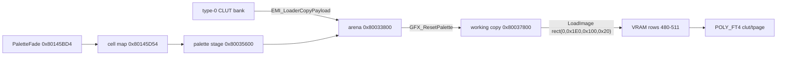

# Graphics

*Read this if you extract or edit textures and palettes.*

VRAM uploads, palettes and the palette codec. Type-3 EMI entries are raw VRAM uploads. A payload has no header; the TOC load argument places it.
Palette bytes arrive separately as small type-0 entries. The runtime primitives are the PsyQ SDK's
records. The sprite records are `SPRT` (free size), `SPRT_8` and `SPRT_16`, and the game also draws
textured `POLY_FT4`/`POLY_GT4` quads and untextured `TILE` and `POLY_G` records (identifier counts in
the game code read: `POLY_FT4` 152, `SPRT` 95, `POLY_GT4` 36, `SPRT_8` 13, `SPRT_16` 5). The
menu's panel icon is one `SPRT_8` written at the primitive cursor `g_GfxPrimCursor` (`0x8014598C`).

## Type-3 load argument

The type-3 handler `EMI_LoaderLoadGraphics (exe/slus_004_22@0x80162698)` reads the load argument as masked fields.

| Bits                 | Meaning                            | Unit                  |
| -------------------- | ---------------------------------- | --------------------- |
| `31:24`, mask `0x3F` | first rectangle column             | 32 VRAM words         |
| `23:16`, mask `0x1F` | first rectangle row                | 32 VRAM rows          |
| `15:8`, mask `0x3F`  | rectangles per row                 | 32x32-word rectangles |
| `7:0`                | unused (`0` in 592 of 593 entries) |                       |

## Chunk layout

Each `0x800`-byte payload chunk is one 32x32 rectangle of 16-bit VRAM words: 32 payload rows of 32
little-endian words. Rectangles fill a row left to right up to `rectangles per row`, then the
destination advances 32 VRAM rows down. Payload order is rectangle order.

Every extracted payload is a whole number of rectangles whose count divides into rows
(593/593 entries, 54,840 rectangles). A rectangle is uploaded only when its whole 32x32 extent is
inside the 1024x512-word frame buffer; the loader drops the rest instead of clipping. `@0x80163378`
calls `LoadImage` while `x < 1001` and `y < 501`, which for the 32-aligned destinations means the
rectangle fits. `ETC/FIRST.EMI#6` starts at row 15 and spans 8 rectangle rows, so rows 16-22 are
dropped; those words are zero in all 14 dropped rectangles.

The rectangle is 32 VRAM words wide in every mode; the pixel dimensions follow the draw state's
bits per pixel, which no payload or descriptor field carries.

| Mode  | Pixels per rectangle |
| ----- | -------------------- |
| 4bpp  | 128x32               |
| 8bpp  | 64x32                |
| 16bpp | 32x32                |

## Palette

Palette entries are raw little-endian PSX color words:

```text
15      14..10 9..5 4..0
STP     blue   green red
```

| Mode | Colors | Row size |
| ---- | -----: | -------: |
| 4bpp |     16 |   `0x20` |
| 8bpp |    256 |  `0x200` |

A CLUT bank is a whole number of 4bpp rows, so its payload holds an even byte count and a multiple
of `0x20` bytes; a bank whose word count also divides by 256 is a whole number of 8bpp rows.
Nothing in the payload names a bank's bpp, geometry or owner. Palette data commonly loads into
`0x80033XXX`-`0x8003AXXX` as type-0 entries; the runtime drawing data, not the texture payload,
supplies the texture-to-palette association ([area](area.md#palette-arena)).

### Texture-to-palette join

A texture's palette row follows from a draw rule, never from the texture
payload:

- A **literal site** names a texture page and a CLUT in one function (`WORLD00/AREA024.EMI#14`
  writes `0x003B` and `0x78CA`). The proven sites are listed in the [assets join table](assets.md#texture-evidence).
- The **world-map terrain rule** reads each tile descriptor word (`func_80155560 (exe/slus_004_22@0x80155560)`): bit 31 selects
  the depth, bits 24-27 the CLUT index and bits 28-29 the page bank. An 8bpp descriptor
  (`bit 31 = 0`) reads CLUT row `(0, 483 + index)`; a 4bpp descriptor reads `(16 * index, 483)`.
  Both use page `(320 + 128 * bank, 256)`. Empty descriptors name nothing.

A rule joins only when exactly one type-3 sheet covers the page and exactly one distinct bank
holds the row. Two sheets over the same words, or two banks that disagree at the same arena
position, leave the texture unjoined: the sheet slot is known and no palette is guessed.
The bank search first uses the texture's own archive; when that archive has no bank for the row,
the resident set of palette banks loaded from the disc is consulted and identical banks collapse.
The battle icon rows show the limit: row 506 differs between `BATL_OVR.EMI` and `BATL_DRA.EMI`,
and row 507 agrees in `BATTLE.EMI`, `BATL_RE2.EMI`, `BATL_RET.EMI` and `BATTLE2.EMI` but differs
in `BATL_DRA.EMI`, so a disc-wide resident set leaves them unjoined rather than guess.

The encoded words assume graph type 0, the runtime the US disc selects: `GetGraphType()` reads
`D_8018B15C`, and `SetVideoMode(MODE_NTSC)` with `_reset(3)` leaves it zero. A site that writes the
graph-type-1/2 encoding is decoded with the page fields that encoding places there.

The proven rules cover **212 of the 593 type-3 textures, 890 palette rows**: 200 world-map terrain
sheets (865 distinct rows across the archives), 11 of which also carry a literal site, plus the
nine area sprite sheets, two `AREA030` icon sheets and the `BMAGIC/MAGIC218` effect sheet.
These are the measured totals. The association still comes from code, not
data: a texture with no draw rule stays unknown.

## Palette words and runtime records

`GetClut` (`exe/slus_004_22@0x8017A6F0`) builds a 16-bit CLUT word: bits 0-5 are the column in
16-word units, bits 6-15 the row.

```text
clut = ((y & 0x3FF) << 6) | ((x >> 4) & 0x3F)
```

`GetTPage` (`@0x8017A620`) has two encodings. The US disc runs graph type 0: `GetGraphType()` reads
`D_8018B15C`, and the boot path leaves it zero.

| Graph type | TPage word                                                                                          |
| ---------- | --------------------------------------------------------------------------------------------------- |
| 0          | `(tp & 3) << 7 \| (abr & 3) << 5 \| ((y & 0x100) >> 4) \| ((x & 0x3FF) >> 6) \| ((y & 0x200) << 2)` |
| 1, 2       | `(tp & 3) << 9 \| (abr & 3) << 7 \| ((y & 0x300) >> 3) \| ((x & 0x3FF) >> 6)`                       |

`tp` is 0 4bpp, 1 8bpp, 2 15bpp. A site that writes the graph-type-1/2 encoding must be decoded with
that row. The game also open-codes both forms as `getTPage`/`getTPageN` in
`Area_DrawObjectSprite (exe/slus_004_22@0x8014C4D4)`.

The palette arena is not the only palette writer. The frontend keeps three records beside it:

| Record                     | Address      |   Size | Count | Readers                                                 |
| -------------------------- | ------------ | -----: | ----: | ------------------------------------------------------- |
| `PaletteFade`              | `0x80145BD4` | `0x0C` |    32 | `GFX_AllocPaletteFade`, `GFX_MarkPaletteCells`          |
| cell map                   | `0x80145D54` |    `1` |  4×16 | `GFX_FindPaletteCell`, `GFX_AllocPaletteCell`           |
| `GraphicsPaletteAnimation` | `0x80145D94` | `0x10` |     8 | `GFX_StartPaletteAnimation`, `GFX_StepPaletteAnimation` |
| palette stage              | `0x80035600` | `0x40` |     - | `func_80166C48` callers                                 |

`PaletteFade` layout:

| Offset | Width | Meaning                                                  |
| -----: | ----: | -------------------------------------------------------- |
| `0x00` |     1 | flags                                                    |
| `0x01` |     1 | unknown                                                  |
| `0x02` |     1 | red offset                                               |
| `0x03` |     1 | green offset                                             |
| `0x04` |     1 | blue offset                                              |
| `0x05` |     1 | table index                                              |
| `0x06` |     1 | step                                                     |
| `0x07` |     1 | unknown                                                  |
| `0x08` |     4 | target pointer (the target pattern at `+0x08` sets size) |

`GraphicsPaletteAnimation` layout:

| Offset | Width | Meaning                                                  |
| -----: | ----: | -------------------------------------------------------- |
| `0x00` |     1 | flags (bit 0: slot in use)                               |
| `0x01` |     1 | frames left on the current entry                         |
| `0x02` |     1 | last owner animation id (`0xFF` on start)                |
| `0x03` |     1 | initial value, copied from owner `+0x27` on start        |
| `0x04` |     4 | pointer to the source table                              |
| `0x08` |     4 | pointer to the current entry                             |
| `0x0C` |     4 | pointer to the owner (owner `+0x4B` is the animation id) |

The cell map is one byte per cell; `0xFF` is empty. `GFX_StepPaletteAnimation` selects the source-table
entry named by the owner's animation id, advances the entry four bytes at a time (entry byte 3 is the frame
count) and wraps when the next entry starts with `0xFF`: that entry's second byte is the back-step, a count of four-byte entries. The battle
overlay has a different 0x0C-byte view at `0x80145BD4` (`BattleSpriteSlot`): it reads bytes `+0x02`
(a second copy of the shared sprite value), `+0x03` and `+0x04`. The same address is not the same object
in another overlay.



The arena base holds 256 units of `0x40` bytes (32 rows of `0x200`). `GFX_ResetPalette` zeroes rows
28-31 and copies all 32 rows into the working copy; `GFX_CopyPalette(row)` copies one row and raises
`g_GfxPalettePending`; `GFX_UploadPalette` uploads the working copy once per frame while the flag
is nonzero. `GFX_StepPaletteAnimation` writes one stage entry, so a palette animation changes
the arena before the next upload.

## Load path

| Asset                         | Route                                                                                                                                                                                                   |
| ----------------------------- | ------------------------------------------------------------------------------------------------------------------------------------------------------------------------------------------------------- |
| texture page, type 3          | `EMI_LoaderLoadGraphics` (`exe/slus_004_22@0x80162698`) uploads it with `LoadImage`, one 32x32 rectangle at a time ([chunk layout](#chunk-layout))                                                      |
| CLUT bank, type 0             | `EMI_LoaderCopyPayload` (`@0x801625E4`) copies it into the palette arena at its load address; the engine uploads the arena's working copy to VRAM rows 480-511 ([area](area.md#palette-arena))          |
| `etc/start/09` save-icon TIMs | never uploaded: `CardBuildFileHeader` (`emi/etc/start/09@0x801EF27C`) copies icon 0's CLUT colors and each icon's pixels into the memory-card save frame at `0x800C1800`; nothing reads the TIM headers |

A 16-color CLUT at arena offset `o` sits at VRAM `x = (o mod 0x200) / 2`, `y = 480 + o / 0x200`.

## VRAM coordinates

A palette-arena word `w` is VRAM column `w % 256`, row `480 + w / 256`. A CLUT word is
`(x / 16) | (y << 6)`. A texture-page word `tpage` holds the page column `(w & 0xf) * 64` words, the
page row `(w & 0x10) ? 256 : 0`, the color mode `(w >> 7) & 3` (0 4bpp, 1 8bpp, 2 15bpp, 3 reserved)
and the blend `(w >> 5) & 3`.

## Codec

Palette codec rules:

| Operation        | Contract                                                                                                             |
| ---------------- | -------------------------------------------------------------------------------------------------------------------- |
| decode           | payload bytes to color words; rejects an odd byte count and a word count that is not a whole number of 16-color rows |
| encode           | color words back to the same payload bytes                                                                           |
| validate         | the bank rule above                                                                                                  |
| word to RGBA     | each 5-bit channel repeats its top 3 bits; alpha stays `0xff` because STP is not alpha; RGBA to word clears STP      |
| JSON export      | `format`, `words`, `rows_4bpp`, `rows_8bpp` plus one `{index, word, stp, rgba}` record per color                     |
| PNG strip export | PNG swatch strip, 16 colors per row and one 4bpp row per image row                                                   |

The arena bank of an area is one type-0 entry; its load argument is
`0x80033E00` in most areas.

`words` is the bank's 16-bit color count; `rows_4bpp` and `rows_8bpp` are the whole rows the bank
can fill. A texture join needs a draw site that names one row; the bank alone proves no owner.

The disc holds 620 type-0 palette entries in the `0x80033800`-`0x80036E00` band: 32-6,144 bytes
each, 1,121,696 bytes in total, every size a multiple of `0x20`; 577 carry 64 bytes or more and 43
are one 16-color row. Measured: all 620 decode and re-encode
byte-exactly.

## Sources

Chunk, palette and VRAM facts are measured from the retail payloads. The community
[BoF3-Data-Doc](https://github.com/GlitchedDragon-dev/BoF3-Data-Doc) (texture and palette notes, no
license, cited only) is confirmation. The runtime primitives are PsyQ 3.7 ([sources](../sources.md)).
