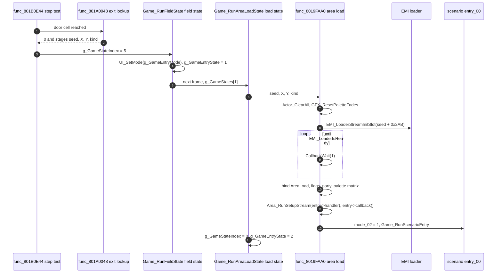

# Areas and the field

An area is one place the party can stand: a town, a dungeon, the world map, a battlefield, the fishing pond, the fairy village or the camp. The game has 200 of them, one `WORLDnn/AREAnnn.EMI` archive each. The player walks to an exit and the screen fades to the next area. Under the fade the game frees the old area's objects, streams the new archive, builds the new area's characters from a short byte program, and lets the active [scenario](scenario.md) react to the arrival.

One resident engine in `emi/etc/game/00` runs every area. The area archive supplies only data and a small code overlay for the area's own behaviour. Byte layouts of the archives are in the [area format](../../formats/area.md). The fields of an entity row are in [field](../field.md). The map-kind flags are in [runtime](../runtime.md#map-modes-and-the-shared-map-engine). This page covers the flow: load, per-frame update, exits and the setup stream.

## Load and transition

An area change begins when the party steps on an exit cell or when code calls `Game_RequestAreaChange (emi/etc/game/00@0x8019FA28)`. Either one stages a destination and sets the request code `g_GameStateIndex` to 5. The staged destination is four values: `g_GameContextSeed` (the area id), `g_GameEntryPosX` and `g_GameEntryPosY` (16.16 positions) and `g_GameContextKind`.

On the next frame `Game_RunFieldState (emi/etc/game/00@0x80197378)` sees request 5, sets the arrival effect with `UI_SetMode(g_GameEntryMode)` and moves to entry state 1. That is `Game_RunAreaLoadState (emi/etc/game/00@0x801971E8)`, which passes the staged values to `func_8019FAA0 (emi/etc/game/00@0x8019FAA0)`, the only function that loads an area.

Inside `func_8019FAA0` the steps run in this order, from the call sequence in the assembly.

| Step | Call                                                                             | Effect                                                                                                                                                       |
| ---: | -------------------------------------------------------------------------------- | ------------------------------------------------------------------------------------------------------------------------------------------------------------ |
|    1 | `Actor_ClearAll`, `GFX_ResetPaletteFades`                                        | Free the 20 staged scene objects and clear palette fades.                                                                                                    |
|    2 | `SND_StartBgm(g_GamePrevSelection, 100, 8)`                                      | Start the BGM chosen for the previous cell, or set `g_SndBgmId = 0xFF` when there is none.                                                                   |
|    3 | `EMI_LoaderStreamInitSlot(seed + 0x2AB)` and poll                                | Only when the id differs from `g_GameAreaId` and `g_GameStateIndex` is 5. The poll blocks the callback thread, one `CallbackWait(1)` per frame.             |
|    4 | read `g_AreaLoads[g_GameAreaId]`                                                 | Copy `AreaLoad.flag_32` to `g_GameRequestFlags` and mark a palette upload pending.                                                                           |
|    5 | `GFX_ResetPalette`, `func_801BFF9C`                                              | `func_801BFF9C` places the party rows from the map kind (world map, battlefield, fishing, camp or walked area).                                              |
|    6 | `func_801A0348`, `func_80153DE8`, `SetColorMatrix`                               | Cache the zone kind of the arrival cell. Run map setup. Load the GTE colour matrix from `AreaLoad.matrix`, or the default `D_8018214C` when it is null.      |
|    7 | `Scene_Start` when `g_SceneState.flags_01 & 0x80`                                | Advance the story chapter ([scenario](scenario.md#chapter-advance)).                                                                                         |
|    8 | `Area_RunSetupStream(AreaLoad.handler)`, `AreaLoad.callback()`                   | Build the area's entities and objects, then run the area's own setup code if the callback is set.                                                            |
|    9 | `SYS_ClearFlag(g_SceneEventFlags, 0x1C)`, `mode_02 = 1`, `Game_RunScenarioEntry` | Let the scenario react to the arrival.                                                                                                                       |

Back in `Game_RunAreaLoadState`, a fishing area (`flag_32 & 8`) goes to entry state 8. Every other area goes to entry state 2 with `g_GameStateIndex = 0`, the running field. The arrival effect is `UI_SetMode(g_GameRequestKind)`; `g_GameRequestKind` is 11 when the area id is among the first 11 words of `D_801C8384`, otherwise 1. Fishing and the fairy village are in [screens](screens.md).

### Doors

An exit is a 12-byte rectangle record. `func_801A0048 (emi/etc/game/00@0x801A0048)` takes the party's cell (x, y) and walks the area's exit list from the last entry down to entry 0. An entry covers `span` cells starting at `(cx, cy)`, along x when `mode` is 0 and along y otherwise.

| Offset | Field  | Meaning                                                                                                                      |
| -----: | ------ | ---------------------------------------------------------------------------------------------------------------------------- |
|   0x00 | `cx`   | First cell x.                                                                                                                |
|   0x01 | `cy`   | First cell y.                                                                                                                |
|   0x02 | `key`  | Destination area id, or `0xFFFF` for a conditional destination.                                                              |
|   0x04 | `idx`  | Destination x as `(idx << 8) & 0xFF8000`, a 16.16 position.                                                                  |
|   0x06 | `alt`  | Destination y, same encoding. For `0xFFFF` keys it is the index of the conditional list instead.                             |
|   0x08 | `mode` | 0: the span runs along x. Otherwise it runs along y.                                                                         |
|   0x09 | `span` | Number of cells from `(cx, cy)`.                                                                                             |
|   0x0A | `kind` | Bits 4 to 6 go to byte 1 of the scratchpad work record. The low bits and bit 7 go to `g_GameContextKind` (masked with `0x8F`). |

The exit table hangs off the area record: `AreaLoad` offset `0x20` points to the entries, `0x24` to the conditional lists, `0x28` to their row counts, and byte `0x30` holds the index of the last entry, so an area has `outer + 1` entries.

A conditional exit lets one door lead to different places as the story moves. The record's `alt` selects a list of 10-byte rows. A row holds a destination (area id `u16` at 0, x `u16` at 2, y `u16` at 4, same encoding as above), a scenario byte at 6, a flag bit at 7 and a kind byte at 8. The game tests rows in order with `SYS_TestFlag(g_SceneFlagWords + (scenario << 3), bit)`, that is bit `bit` of that scenario's flag word ([scenario](scenario.md#flags)). The first row whose flag is set gives the destination. If no row is set, the row after the last counted row is the default destination, and it is read as a destination only.

A hit returns 0, `func_801B0E44` sets `g_GameStateIndex = 5`, and the transition above runs. A miss returns 1 and the party walks on. Bit 7 of the destination kind sets bit 15 (`0x8000`) of `g_AreaWalkFlags` inside `func_8019FAA0`, which selects the world-map arrival path.

## Per-frame update

In entry state 2, `Game_RunFieldState` first runs `Game_RunScenarioEntry` (the scenario's `entry_00`, then the event stage; see [scenario](scenario.md)). Then it runs `Area_RunFrame (emi/etc/game/00@0x801991B8)`. Last, it maps the request code `g_GameStateIndex` to the next entry state:

| Request code | 1 | 2 | 3            | 4 | 5                 | 6 | 7 | 8  | 9  |
| ------------ | - | - | ------------ | - | ----------------- | - | - | -- | -- |
| Entry state  | 3 | 4 | 5 (battle)   | 6 | 1 (area load)     | 7 | 9 | 10 | 11 |

Roles of the states are in [phases](phases.md).

`Area_RunFrame` calls these functions in order each frame.

| Order | Call                          | Role                                                                                         |
| ----: | ----------------------------- | -------------------------------------------------------------------------------------------- |
|     1 | `func_801C57F4`               | Party input and movement setup `[unknown]` beyond the call.                                  |
|     2 | `func_8015A7E8`               | Publish the current actor pointer (`0x80146884`) `[inferred]`.                               |
|     3 | `func_80199440`               | Camera and scroll target `[unknown]`.                                                        |
|     4 | `func_801A06D8`               | Run the 30 entity rows (`g_Actors`).                                                         |
|     5 | `func_801527E4`               | Calls `func_801F2C04` when the area id is `0xBD` (see the [area format](../../formats/area.md)). |
|     6 | `Area_RunParty`               | Step the party rows `[inferred]`.                                                            |
|     7 | `func_801BDAB8`               | Party follow and formation `[unknown]`.                                                      |
|     8 | `func_801A0514`               | Stamp draw mode on the entity rows and run per-row draw helpers.                             |
|     9 | `Actor_DispatchAll`           | Run the staged scene objects.                                                                |
|    10 | `GFX_UpdatePaletteAnimations` | Advance palette animation.                                                                   |
|    11 | `func_8019625C`               | `[unknown]`.                                                                                 |
|    12 | `Area_DrawScene`              | Draw cells, entities and party.                                                              |

`func_801A06D8` walks the 30 entity rows and skips a row unless its in-use bit is set. A row with a script pending (`flags_74`) goes to `func_801A18C8`, which calls `Game_DispatchScenarioRecord` when the row has a `callback_index`. Any other row runs `D_801C83D8[unk_01]`, an 11-entry table of per-kind handlers in resident data. Row fields are in [field](../field.md#actor-rows).

## Setup stream

The setup stream is a byte program that builds the area's characters and objects. `AreaLoad.handler`, the first word of the area record, points to it inside the area overlay. `Area_RunSetupStream (emi/etc/game/00@0x801A3E50)` clears the 4-entry party work table `D_80147A58`, runs `func_801A3F3C` over the stream, then clears every entity row after the last one created. `func_801A3F3C` reads one opcode at a time until `0xFF`.

For an opcode below `0xF0`, `func_801A4BF8` takes the high nibble as the record kind and advances by that kind's length. The lengths are the 16 bytes of `s_ScriptOpcodeLengths (emi/etc/game/00@0x801C8444)`:

| Kind nibble | 0    | 1    | 2    | 3    | 4    | 5    | 6    | 7    | 8    | 9    | A    | B    | C   | D   | E   | F    |
| ----------- | ---- | ---- | ---- | ---- | ---- | ---- | ---- | ---- | ---- | ---- | ---- | ---- | --- | --- | --- | ---- |
| Length      | 0x11 | 0x10 | 0x13 | 0x12 | 0x11 | 0x12 | 0x10 | 0x11 | 0x0C | 0x0D | 0x0E | 0x0E | 0x02 | 0x04 | 0x07 | 0x00 |

Kinds known:

| Kind or opcode    | Handler                            | Reading                                                                                                                                     |
| ----------------- | ---------------------------------- | ------------------------------------------------------------------------------------------------------------------------------------------- |
| 0                 | `func_801A4D54`                    | A map entity. Scene record id in bytes 1 and 2, position in bytes 6 to 9. Writes one row of `g_Actors`; ignored when all 30 rows are in use. |
| E                 | `Actor_Create`                     | A staged scene object. Type in byte 1, x in bytes 2 and 3, y in bytes 4 and 5, link in byte 6. See below.                                   |
| D                 | `func_801A72E8`                    | Set the current row's `callback_index` (byte 1 nonzero) or its word `unk_7C`.                                                               |
| C                 | `func_801A72B0`                    | Calls `func_801C601C` with byte 1.                                                                                                          |
| 1 to 9, A, B      | `func_801A50C0` to `func_801A6C98` | One handler each. `[unknown]`; not decoded.                                                                                                  |
| `0xF0`, `0xF1`    | `func_801A3FC0`, `func_801A4158`   | Conditional block. A test from the 32-entry table `D_8018217C` selects a branch; `0xFE` ends the block.                                    |
| `0xF4`            | `func_801A4518`                    | Multi-branch conditional. `0xF5` ends it, `0xF6` and `0xF7` switch branch.                                                                  |
| `0xF9`, `0xFA`    | `func_801A4400`                    | Set `D_8014820C` to a byte or to the scenario id.                                                                                           |

Conditional blocks probably let one area hold different entity sets for different story states, because the tests come from the same table scenario code uses `[inferred]`. The entries of that table are not decoded. `D_8014820C` starts as the scenario id; its readers were not followed `[unknown]`.

### Staged scene objects

Scene objects are the area's non-character things: effects, gates, props. `Actor_Create (emi/etc/game/00@0x8019615C)` claims a free slot of `g_ActorSlots` (20 slots of `0x74` bytes) and fills it from a kind-E record. A nonzero byte 2 or byte 4 adds half a cell to the x or y position, and the height comes from `Area_SampleHeight`. When no slot is free, `Actor_FindFreeSlot (emi/etc/game/00@0x8019601C)` returns `0xFF` and `Actor_Create` drops the record without a message.

`Actor_DispatchAll` runs each active slot as `D_801C7C70[slot->type]()`. The table has 187 entries. Its targets lie in four places: the resident image (`0x8019....`), the shared overlay window at `0x801D0C00`, the area window at `0x801F2C00` and the scenario window at `0x801F6C00`. A given type therefore runs different code depending on which overlay is loaded.

## Zone list

Each area has a zone list in the executable, `D_80181164[area]`. It is a list of 8-byte rectangles. Bytes 0 to 3 are x0, y0, x1, y1 in cells, inclusive. `func_801A0490` returns the first rectangle that covers a cell, and there is no end test: a cell outside every rectangle runs past the list. Byte 4 is the encounter step class that `Area_RollEncounterThreshold (emi/etc/game/00@0x801B3CCC)` reads, and byte 5 is the zone kind that `func_801A0348` returns. Bytes 6 and 7 select the BGM `[inferred]` (`func_801A0380`).

## Data and limits

| Item                    | Value                                                                                                         | Source                                                                   |
| ----------------------- | ------------------------------------------------------------------------------------------------------------- | ------------------------------------------------------------------------ |
| Area count and slot     | 200 areas, EMI slot `0x2AB + id`                                                                              | `g_AreaLoads[200] (exe/slus_004_22@0x8017F974)`, `func_8019FAA0`         |
| Area record address     | One absolute pointer per area, into `0x801F2C00..0x801F6C00`                                                  | `g_AreaLoads` is constant data in the executable                         |
| Area record fields      | `handler 0x00`, exits `0x20`, lists `0x24`, counts `0x28`, last exit `0x30`, `flag_32 0x32`, `steps 0x34`, `matrix 0x38`, `callback 0x40` | `func_8019FAA0`, `func_801A0048`                           |
| Map kind                | `flag_32` bit 0 world, 1 and 2 battlefield, 3 fishing, 4 fairy village, 6 camp                                | `func_8019FAA0`, `func_801BFF9C`, `func_801976EC`                        |
| Entity rows             | 30 rows of `0x98` bytes at `g_Actors` (`0x80146888`)                                                          | `func_801A4D54`, `func_801A06D8`                                         |
| Staged scene objects    | 20 slots of `0x74` bytes at `g_ActorSlots` (`0x80143FC8`); type 0 to 186                                      | `Actor_FindFreeSlot`, `D_801C7C70`                                       |
| Setup condition tests   | 32, index masked with `0x1F`                                                                                  | `D_8018217C` through `func_801A3FC0`                                     |
| Exit cell coordinates   | 8-bit x and y; at most 256 entries per area                                                                   | `func_801A0048`                                                          |
| Exit destination        | 0 to 255 whole cells plus an optional half cell                                                               | `(idx << 8) & 0xFF8000`                                                  |
| Cell grid               | 10,000 4-bit cells (5,000 bytes) at `0x80032000`                                                              | [area format](../../formats/area.md)                                     |
| Area program window     | `0x801F2C00..0x801F6C00`, 16,384 bytes                                                                        | [memory](memory.md)                                                      |
| Event and object tables | `g_SceneEvents[64]`, `g_SceneObjects[66]` and `D_801C86F8` hold absolute function addresses, many inside the area window | [scenario](scenario.md#event-stage)                          |
| Per-area dispatch       | `func_801A8728` switches on the area id and calls fixed addresses                                             | `emi/etc/game/00@0x801A8728`                                             |

State words used by this page:

| Symbol               | Address                    | Width     | Meaning                                                |
| -------------------- | -------------------------- | --------- | ------------------------------------------------------ |
| `g_GameAreaId`       | `0x80143F00`               | u16       | Current area. `0xFFFF` forces the next load.           |
| `g_GameContextSeed`  | `0x80143F10`               | u16       | Staged destination area.                               |
| `g_GameEntryPosX/Y`  | `0x80143F14`, `0x80143F18` | s32       | Staged destination, 16.16.                             |
| `g_GameContextKind`  | `0x80143F1C`               | u8        | Staged kind byte. Bit 7 selects the world-map arrival. |
| `g_GameRequestFlags` | `0x80143F02`               | u8        | `AreaLoad.flag_32` of the loaded area.                 |
| `g_GameStateIndex`   | `0x80143BB0`               | u8        | Request code. 5 means change area.                     |
| `g_GameEntryState`   | `0x80143B90`               | u16       | Index into `g_GameStates[12]`.                         |

What an edited area must keep:

- **Code and data placement.** The executable and `emi/etc/game/00` hold absolute pointers into the area window: the 200 `g_AreaLoads` entries, the `g_SceneEvents`, `g_SceneObjects`, `D_801C7C70` and `D_801C86F8` tables, and the `func_801A8728` switch. Moving an `AreaLoad` record or a handler inside an area program breaks those pointers unless the tables are rebuilt.
- **Window size.** The area program must fit 16,384 bytes at `0x801F2C00`. Only `AREA030` loads other programs elsewhere ([area format](../../formats/area.md)).
- **Entity limits.** The game drops map entities past 30 and staged objects past 20.
- **Zone list.** It lives in the executable, not the area archive. A cell outside every rectangle makes `func_801A0490` run past the list.
- **Fixed buffers.** The cell grid, scene table and encounter table sit in fixed windows ([memory](memory.md), [loading](loading.md)).

See also the [editor guide](editor-guide.md) and [disc and files](disc-and-files.md).

## Gaps

| Gap                                                                | What would settle it                                                               |
| ------------------------------------------------------------------ | ---------------------------------------------------------------------------------- |
| Setup record kinds 1 to 9, A and B (`func_801A50C0` to `func_801A6C98`) | Read each handler and match its fields to the entity row.                     |
| Meaning of the condition tests in `D_8018217C`                     | Read the 32 entries and the scenario code that shares them.                        |
| Meaning of `D_8014820C`                                            | Find its readers.                                                                  |
| `func_801C57F4`, `func_80199440`, `func_801BDAB8`, `func_8019625C` | Read the four functions.                                                           |
| Whether `func_8019FAA0` waits for the palette `LoadImage` to finish | Read `GFX_ResetPalette` and the following upload.                                  |
| Owner of each `g_SceneEvents` and `g_SceneObjects` target          | Map each address to an area program with the list of unresolved symbol addresses.  |
