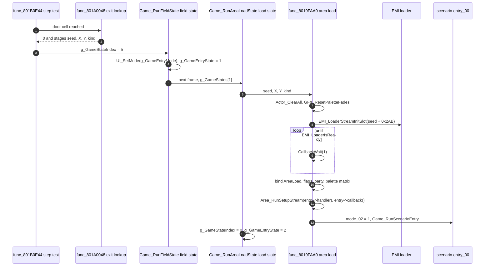

# Areas and the field

*Read this if you work on maps: how an area loads, runs and unloads.*

How the game enters an area, builds it from the area image, steps it every frame and leaves it.
"Area" means one of the 200 `WORLDnn/AREAnnn.EMI` maps (town, dungeon, world map, battlefield,
fishing pond, fairy village, camp). One resident engine in `emi/etc/game/00` runs all of them.

Static reading of the game code. Tags: `[read]` is code or assembly read directly,
`[inferred]` is deduced from several reads, `[unknown]` is not established. Image names omit the
`emi/` prefix. Byte layouts of the area archives are in [area format](../../formats/area.md); the
entity row fields are in [field](../field.md); the map-kind flag table is in
[runtime](../runtime.md#map-modes-and-the-shared-map-engine). This page does not repeat them.

## Entry points

| Symbol                   | Image@address                | Role                                                                                             | Status   |
| ------------------------ | ---------------------------- | ------------------------------------------------------------------------------------------------ | -------- |
| `Game_RunAreaLoadState`  | `emi/etc/game/00@0x801971E8` | `g_GameStates[1]`: load the requested area, then enter the field                                 | `[read]` |
| `func_8019FAA0`          | `emi/etc/game/00@0x8019FAA0` | the only area load: stream the archive, bind the area record, run the setup stream               | `[read]` |
| `Game_RunFieldState`     | `emi/etc/game/00@0x80197378` | `g_GameStates[2]`: the field state; runs scenario and area per frame, then maps the request code | `[read]` |
| `Area_RunFrame`          | `emi/etc/game/00@0x801991B8` | per-frame area update and draw                                                                   | `[read]` |
| `func_801B0E44`          | `emi/etc/game/00@0x801B0E44` | party step test; on a door cell calls `func_801A0048`                                            | `[read]` |
| `func_801A0048`          | `emi/etc/game/00@0x801A0048` | find the exit rectangle at a cell and stage the destination                                      | `[read]` |
| `Game_RequestAreaChange` | `emi/etc/game/00@0x8019FA28` | stage a destination from code (scenarios, camp exit) and request a transition                    | `[read]` |
| `Area_RunSetupStream`    | `emi/etc/game/00@0x801A3E50` | run the area's setup stream from `AreaLoad.handler`                                              | `[read]` |
| `Actor_Create`           | `emi/etc/game/00@0x8019615C` | stage one scene object from a type-`E` setup record                                              | `[read]` |
| `Actor_DispatchAll`      | `emi/etc/game/00@0x8019A0E4` | run every staged scene object through `D_801C7C70[type]`                                         | `[read]` |

## Load and transition

`g_GameStates[1]` runs after any request that sets `g_GameStateIndex = 5` and passes through
`Game_RunFieldState` case 5. The staged destination (`g_GameContextSeed` = area id,
`g_GameEntryPosX/Y` = 16.16 position, `g_GameContextKind`) is read by `Game_RunAreaLoadState` and passed to
`func_8019FAA0`. `[read]`

The load order inside `func_8019FAA0`, from the assembly call sequence. `[read]`

| Step | Call                                                                             | Effect                                                                                                                                                                  |
| ---: | -------------------------------------------------------------------------------- | ----------------------------------------------------------------------------------------------------------------------------------------------------------------------- |
|    1 | `Actor_ClearAll`, `GFX_ResetPaletteFades`                                        | free the 20 staged scene objects, clear palette fades                                                                                                                   |
|    2 | `SND_StartBgm(g_GamePrevSelection, 100, 8)`                                      | start the BGM chosen for the previous cell, or set `g_SndBgmId = 0xFF` when none                                                                                        |
|    3 | `EMI_LoaderStreamInitSlot(seed + 0x2AB)` and poll                                | only when the id differs from `g_GameAreaId` and `g_GameStateIndex == 5`; blocking in the callback thread                                                               |
|    4 | read `g_AreaLoads[g_GameAreaId]`                                                 | only under the step 3 condition (block `0x8019FBD0-0x8019FC0C`): copy `AreaLoad.flag_32` to `g_GameRequestFlags`, set the pending flag                                  |
|    5 | `GFX_ResetPalette`, `func_801BFF9C`                                              | `GFX_ResetPalette` runs only under the step 3 condition; `func_801BFF9C` places the party rows from the map kind (world map, battlefield, fishing, camp or walked area) |
|    6 | `func_801A0348`, `func_80153DE8`, `SetColorMatrix`                               | cache the cell-kind byte; map setup; GTE colour matrix from `AreaLoad.matrix` (or the default `D_8018214C` when null)                                                   |
|    7 | `Scene_Start` when `g_SceneState.flags_01 & 0x80`                                | advance the story chapter (see [scenario](scenario.md#chapter-advance))                                                                                                 |
|    8 | `Area_RunSetupStream(AreaLoad.handler)`, `AreaLoad.callback()`                   | build the area's objects and run its own setup code                                                                                                                     |
|    9 | `SYS_ClearFlag(g_SceneEventFlags, 0x1C)`, `mode_02 = 1`, `Game_RunScenarioEntry` | let the scenario react to the arrival                                                                                                                                   |

`Game_RunAreaLoadState` then sends fishing areas (`flag_32 & 8`) to entry state 8, and everything else to
entry state 2 with `g_GameStateIndex = 0`. `UI_SetMode(g_GameRequestKind)` plays the arrival
effect; `g_GameRequestKind` is 11 when the id is among the first 11 words of `D_801C8384`, else 1.
`[read]` The fishing and fairy-village screens are in [screens](screens.md).

### Doors

An exit is a rectangle record. `func_801A0048` takes a cell (x, y) and walks the current area's
exit list from the last entry down to entry 0. `[read]`

| Offset | Field  | Meaning, from `func_801A0048`                                                                                              |
| -----: | ------ | -------------------------------------------------------------------------------------------------------------------------- |
| `0x00` | `cx`   | first cell x                                                                                                               |
| `0x01` | `cy`   | first cell y                                                                                                               |
| `0x02` | `key`  | destination area id, or `0xFFFF` for a conditional list                                                                    |
| `0x04` | `idx`  | destination x, `(idx << 8) & 0xFF8000` as 16.16                                                                            |
| `0x06` | `alt`  | destination y, same encoding; for `0xFFFF` the index of the conditional list                                               |
| `0x08` | `mode` | 0: span runs along x; otherwise along y                                                                                    |
| `0x09` | `span` | number of cells from `(cx, cy)`                                                                                            |
| `0x0A` | `kind` | bits 4-6 go to the work byte at `+1` of the scratchpad record; the low bits and bit 7 go to `g_GameContextKind` (`& 0x8F`) |

A conditional entry points into a list of 10-byte rows. The first row whose flag is set wins; a
row reads the flag as `SYS_TestFlag(g_SceneFlagWords + (b[-1] << 3), b[0])`, that is bit `b[0]`
of scenario `b[-1]`'s flag word, so doors can depend on story flags. `[read]` for the walk,
`[inferred]` for the row order from the loop. A hit returns 0 and `func_801B0E44` sets
`g_GameStateIndex = 5`; no hit returns 1 and the party stays. Bit 7 of the kind sets
bit 15 (`0x8000`) of `g_AreaWalkFlags` in `func_8019FAA0`, which selects the world-map arrival path. `[read]`

## Per-frame update

`Game_RunFieldState` runs every frame in entry state 2. First `Game_RunScenarioEntry` (the scenario's
`entry_00`, then the event stage, see [scenario](scenario.md)), then `Area_RunFrame`, then it maps
`g_GameStateIndex` to the next entry state: 1 to 3, 2 to 4, 3 to 5 (battle), 4 to 6, 5 to 1 (area load),
6 to 7, 7 to 9, 8 to 10, 9 to 11. Roles are in [phases](phases.md). `[read]`

`Area_RunFrame` order. `[read]`

| Order | Call                          | Role                                                                                        | Status                      |
| ----: | ----------------------------- | ------------------------------------------------------------------------------------------- | --------------------------- |
|     1 | `func_801C57F4`               | party input and movement setup                                                              | `[unknown]` beyond the name |
|     2 | `func_8015A7E8`               | publish the current actor pointer (`0x80146884`)                                            | `[inferred]`                |
|     3 | `func_80199440`               | camera and scroll target                                                                    | `[unknown]`                 |
|     4 | `func_801A06D8`               | run the 30 entity rows (`g_Actors`)                                                         | `[read]`                    |
|     5 | `func_801527E4`               | calls `func_801F2C04` when the area id is `0xBD` (see [area format](../../formats/area.md)) | `[read]`                    |
|     6 | `Area_RunParty`               | step the party rows                                                                         | `[inferred]`                |
|     7 | `func_801BDAB8`               | party follow and formation                                                                  | `[unknown]`                 |
|     8 | `func_801A0514`               | stamp draw mode on the entity rows and run per-row draw helpers                             | `[read]`                    |
|     9 | `Actor_DispatchAll`           | run the staged scene objects                                                                | `[read]`                    |
|    10 | `GFX_UpdatePaletteAnimations` | advance palette animation                                                                   | `[read]`                    |
|    11 | `func_8019625C`               | not read                                                                                    | `[unknown]`                 |
|    12 | `Area_DrawScene`              | draw cells, entities and party                                                              | `[read]` call               |

`func_801A06D8` walks 30 rows. A row is skipped unless its in-use bit is set. A row with a script
pending (`flags_74`) goes to `func_801A18C8`, which calls `Game_DispatchScenarioRecord` when the
row has a `callback_index`. Otherwise the row runs `D_801C83D8[unk_01]`, an 11-entry per-kind
handler table in resident data. `[read]` Row fields: [field](../field.md#actor-rows).

## Setup stream

`AreaLoad.handler` (offset `0x00` of the area record) is a pointer to a byte stream in the
area program. `Area_RunSetupStream` clears the 4-entry table `D_80147A58`, runs `func_801A3F3C` on the
stream, then clears every entity row after the last one created. `func_801A3F3C` reads one opcode
at a time until `0xFF`. `[read]`

| Opcode            | Handler                            | Reading                                                                                                                     | Status                                   |
| ----------------- | ---------------------------------- | --------------------------------------------------------------------------------------------------------------------------- | ---------------------------------------- |
| `0x00..0xEF`      | `func_801A4BF8`                    | record kind is the high nibble; the record length is `s_ScriptOpcodeLengths[nibble]`                                        | `[read]`                                 |
| high nibble `0`   | `func_801A4D54`                    | a map entity: scene record id in bytes 1-2, position in bytes 6-9, writes one row of `g_Actors`; ignored when 30 rows exist | `[read]`                                 |
| high nibble `E`   | `Actor_Create`                     | a staged scene object: type byte 1, position bytes 2-5, link byte 6                                                         | `[read]`                                 |
| high nibble `D`   | `func_801A72E8`                    | set the current row's `callback_index` (byte 1 nonzero) or its word `unk_7C`                                                | `[read]`                                 |
| high nibble `C`   | `func_801A72B0`                    | calls `func_801C601C` with byte 1                                                                                           | `[read]` call                            |
| nibbles 1-9, A, B | `func_801A50C0` .. `func_801A6C98` | one handler each (not decoded here)                                                                                         | `[unknown]`                              |
| `0xF0`, `0xF1`    | `func_801A3FC0`, `func_801A4158`   | conditional block: a test from the 32-entry table at `D_8018217C` selects a branch, `0xFE` ends it                          | `[read]` structure, `[inferred]` meaning |
| `0xF4`            | `func_801A4518`                    | multi-branch conditional; `0xF5` ends it, `0xF6` and `0xF7` switch branch                                                   | `[read]` structure                       |
| `0xF9`, `0xFA`    | `func_801A4400`                    | set `D_8014820C` to a byte or to the scenario id                                                                            | `[read]`                                 |

`D_8014820C` starts as the scenario id (`func_801A3F3C`). Its readers were not followed.
`[unknown]` The conditional blocks let one area hold different entity sets for different story
states. This is `[inferred]` from the test table being the same one scenario code uses; the table
entries were not decoded.

Staged scene objects (`Actor_Create`) live in `g_ActorSlots`, 20 slots of `0x74` bytes
(`Actor_Alloc` returns `0xFF` when full, and `Actor_Create` then drops the record silently).
`Actor_DispatchAll` runs each active slot as `D_801C7C70[slot->type]()`. That table has 187 entries
whose targets sit in four places: the resident image (`0x8019....`), the `0x801D0C00` overlay
window, the area window `0x801F2C00` and the scenario window `0x801F6C00`. A given type therefore
runs different code depending on which overlay is loaded. `[read]`

## Data and limits

| Limit or hardcoded value            | Value                                                                                                                                                                                                    | Code or data                                                                                                   | Status   |
| ----------------------------------- | -------------------------------------------------------------------------------------------------------------------------------------------------------------------------------------------------------- | -------------------------------------------------------------------------------------------------------------- | -------- |
| Area count and EMI slot             | 200 areas, slot `0x2AB + id`                                                                                                                                                                             | `g_AreaLoads[200]` (`slus@0x8017F974`), `func_8019FAA0`                                                        | `[read]` |
| Area record address                 | absolute pointer per area into `0x801F2C00..0x801F6C00`                                                                                                                                                  | `g_AreaLoads` is `const` data in the executable; each entry is an absolute address                             | `[read]` |
| Area record size                    | at least `0x44` bytes (64 unproven)                                                                                                                                                                      | `handler +0x00`, `flag_32 +0x32`, `steps +0x34`, `matrix +0x38`, `callback +0x40`                              | `[read]` |
| Map kind                            | `flag_32`: bit 0 world, 1-2 battlefield, 3 fishing, 4 fairy, 6 camp                                                                                                                                      | `func_8019FAA0`, `func_801BFF9C`, `func_801976EC`                                                              | `[read]` |
| Entity rows                         | 30 of `0x98` bytes                                                                                                                                                                                       | `ENTITY_MAX`, `func_801A4D54`, `func_801A06D8`                                                                 | `[read]` |
| Staged scene objects                | 20 of `0x74` bytes; type 0-186                                                                                                                                                                           | `ACTOR_SLOT_COUNT`, `Actor_Alloc`, `D_801C7C70[187]`                                                           | `[read]` |
| Setup record length per kind nibble | 16 bytes in `s_ScriptOpcodeLengths` (`0x11,0x10,0x13,0x12,...`)                                                                                                                                          | `s_ScriptOpcodeLengths` at `0x801C8444` in `etc/game/00`                                                       | `[read]` |
| Setup condition tests               | 32 (index `& 0x1F`)                                                                                                                                                                                      | `D_8018217C` via `func_801A3FC0`                                                                               | `[read]` |
| Exit cell coordinates               | 8-bit x and y; at most 256 entries per area (`outer` is a `u8`)                                                                                                                                          | `GameLocaleBank.outer`, `func_801A0048`                                                                        | `[read]` |
| Exit destination position           | `(idx << 8) & 0xFF8000`: 0-255 whole cells plus a half cell                                                                                                                                              | `func_801A0048`                                                                                                | `[read]` |
| BGM and cell-kind table             | `D_80181164[area]`: a list of 8-byte rectangles whose byte `+4` (`rate`) is the encounter step class read by `Area_RollEncounterThreshold`; it is also the encounter zone list; the scan has no end test | `func_801A0490`, `func_801A0348`, `func_801A0380`                                                              | `[read]` |
| Map cell grid                       | 5,000 bytes: 10,000 4-bit cells at `0x80032000`                                                                                                                                                          | `func_801C6FD4`; [area format](../../formats/area.md)                                                          | `[read]` |
| Area program window                 | `0x801F2C00..0x801F6C00` (16,384 bytes)                                                                                                                                                                  | [memory](memory.md)                                                                                            | `[read]` |
| Event and object tables             | `g_SceneEvents[64]`, `g_SceneObjects[66]`, `D_801C86F8[28]` hold absolute function addresses, many inside the area window                                                                                | `g_SceneEvents` (`emi/etc/game/00@0x801C84BC`), `g_SceneObjects` (`@0x801C85F0`), `D_801C86F8` (`@0x801C86F8`) | `[read]` |
| Per-area dispatch                   | `func_801A8728` switches on the area id and calls fixed addresses (`0x24`, `0x2A`, `0x2E`, `0x31`, ...)                                                                                                  | `emi/etc/game/00@0x801A8728`                                                                                   | `[read]` |

What an edited area must keep:

- **Code and data placement.** The executable and `etc/game/00` hold absolute pointers into the area
  window: the 200 `g_AreaLoads` entries, the `g_SceneEvents`, `g_SceneObjects`, `D_801C7C70` and
  `D_801C86F8` tables, and the `func_801A8728` switch. Moving an `AreaLoad` record or a handler
  inside an area program breaks those pointers unless the tables are rebuilt. `[read]`
- **Window size.** The area program must fit 16,384 bytes at `0x801F2C00`. Only `AREA030` loads
  other programs elsewhere ([area format](../../formats/area.md)). `[read]`
- **Entities.** More than 30 map entities are dropped; more than 20 staged objects are dropped.
  `[read]`
- **Cells.** The grid, scene table and encounter table sit in fixed windows; see
  [memory](memory.md) and [loading](loading.md) for the sizes the loader accepts.
- **BGM and kind lookup.** The rectangle table for the area lives in the executable, not the area
  image. Adding a map region outside every rectangle makes `func_801A0490` run past the list. `[read]`
- **Streaming time.** The load blocks the callback thread until the CD stream finishes, one frame
  per poll ([loading](loading.md)). A larger archive lengthens the black frame. `[inferred]`

Editor workflow, asset tools and round-trip rules: [editor guide](editor-guide.md),
[disc and files](disc-and-files.md).

## Key data

| Symbol               | Address                    | Width     | Meaning                                               |
| -------------------- | -------------------------- | --------- | ----------------------------------------------------- |
| `g_GameAreaId`       | `0x80143F00`               | u16       | current area; `0xFFFF` forces the next load           |
| `g_GameContextSeed`  | `0x80143F10`               | u16       | staged destination area                               |
| `g_GameEntryPosX/Y`  | `0x80143F14`, `0x80143F18` | s32       | staged destination 16.16                              |
| `g_GameContextKind`  | `0x80143F1C`               | u8        | staged kind byte; bit 7 selects the world-map arrival |
| `g_GameRequestFlags` | `0x80143F02`               | u8        | `AreaLoad.flag_32` of the loaded area                 |
| `g_GameStateIndex`   | `0x80143BB0`               | u8        | request code; 5 means change area                     |
| `g_GameEntryState`   | `0x80143B90`               | u16       | index into `g_GameStates[12]`                         |
| `g_Actors`           | `0x80146888`               | 30x`0x98` | entity rows                                           |
| `g_ActorSlots`       | `0x80143FC8`               | 20x`0x74` | staged scene objects                                  |

## Connections

- State machine and request codes: [phases](phases.md). Callback slot that runs this loop: [scheduler](scheduler.md).
- Archive loading and windows: [loading](loading.md), [memory](memory.md).
- Scenario hooks called from this page's functions: [scenario](scenario.md).
- Encounters leave this state through `g_GameStateIndex = 3`: [battle](battle.md).
- Text and menus drawn on top: [ui](ui.md). Per-image function inventory: [responsibilities](responsibilities.md).

## Gaps

| Gap                                                                 | What would prove it                                                              |
| ------------------------------------------------------------------- | -------------------------------------------------------------------------------- |
| Setup record kinds 1-9, A, B (`func_801A50C0` .. `func_801A6C98`)   | read each handler and match fields to the entity row                             |
| Meaning of condition tests in `D_8018217C`                          | read the 32 entries and the scenario code that shares them                       |
| Meaning of `D_8014820C` and the 4-entry `D_80147A58`                | find readers                                                                     |
| `func_801C57F4`, `func_80199440`, `func_801BDAB8`, `func_8019625C`  | read the four functions                                                          |
| Conditional exit row order                                          | trace the loop in `func_801A0048` against a retail area                          |
| Whether `func_8019FAA0` waits for the palette `LoadImage` to finish | read `GFX_ResetPalette` and the following upload                                 |
| Owner of each `g_SceneEvents`/`g_SceneObjects` target               | map each address to an area program with the list of unresolved symbol addresses |
