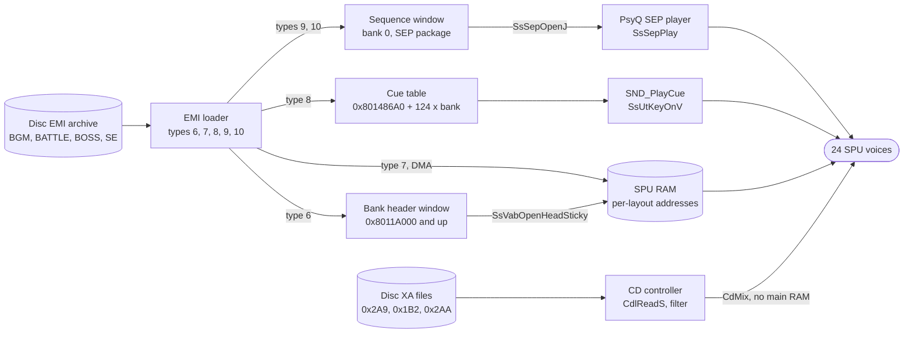

# Audio

*Read this if you work on music, sound effects or XA streams at run time.*

How sound reaches the SPU: music (VAB banks and SEP sequences), sound effects (cues keyed on a VAB bank), and
XA streams played by the CD hardware. The file formats are in [audio formats](../../formats/audio.md) and
the loader steps in [loading](loading.md); this page covers the runtime between them.

Static reading of the game code. Tags: `[read]` is code or data read directly, `[inferred]` is deduced from
several reads or from the PsyQ library contract (external), `[unknown]` is not established.

## Entry points

| Symbol                      | Image@address                | Role                                                                          | Status   |
| --------------------------- | ---------------------------- | ----------------------------------------------------------------------------- | -------- |
| `SND_Init`                  | `exe/slus_004_22@0x8015CD00` | `SsInit`, 60 Hz tick, room reverb, 16 reserved voices, SEP table              | `[read]` |
| `SND_Start`                 | `exe/slus_004_22@0x8015CE70` | `SsStart2`, master volume `0x7F`, serial (CD) volume `0x6E`                   | `[read]` |
| `SND_Exit`                  | `exe/slus_004_22@0x8015CEBC` | key off, close seven VABs and SEP owners, reverb off, `SsEnd`                 | `[read]` |
| `SND_SetBankLayout`         | `exe/slus_004_22@0x80161808` | RAM windows and SPU addresses of the seven bank records, one of three layouts | `[read]` |
| `SND_StartBgm`              | `exe/slus_004_22@0x80161B24` | request, wait for the loader, play                                            | `[read]` |
| `SND_RequestBgm`            | `exe/slus_004_22@0x80161BBC` | stream the music archive of a track id when it differs from the active one    | `[read]` |
| `SND_PlayBgm`               | `exe/slus_004_22@0x80161C20` | start sequence and fade it in, publish `g_SndBgmId`                           | `[read]` |
| `SND_FadeOutBgm`            | `exe/slus_004_22@0x80161CD0` | fade out and stop the track's sequence                                        | `[read]` |
| `SND_PlaySequence`          | `exe/slus_004_22@0x8015D300` | `SsSepStop`, volume, `SsSepPlay` for one (owner, sequence)                    | `[read]` |
| `SND_FadeInSequence`        | `exe/slus_004_22@0x8015D49C` | `SsSepSetCrescendo`                                                           | `[read]` |
| `SND_StartDecrescendo`      | `exe/slus_004_22@0x8015D4F8` | `SsSepSetDecrescendo`                                                         | `[read]` |
| `SND_PlayCue`               | `exe/slus_004_22@0x8015DF18` | split a cue id, run the bank reader, key up to four voices                    | `[read]` |
| `SND_QueueCueVolume`        | `exe/slus_004_22@0x8015D7C8` | load left and right volume from `D_80182288`, then `SND_PlayCue`              | `[read]` |
| `SND_UpdateVoiceStatus`     | `exe/slus_004_22@0x8015D044` | per frame: `SpuGetKeyStatus` for voices 0 to 23                               | `[read]` |
| `SND_StartXaStream`         | `exe/slus_004_22@0x801636A0` | arm an XA stream by key                                                       | `[read]` |
| `SND_ServiceXa`             | `exe/slus_004_22@0x801638B0` | per frame: XA state machine                                                   | `[read]` |
| `EMI_LoaderLoadVabHeader`   | `exe/slus_004_22@0x80162790` | EMI type 6                                                                    | `[read]` |
| `EMI_LoaderLoadVabBody`     | `exe/slus_004_22@0x80162898` | EMI type 7                                                                    | `[read]` |
| `EMI_LoaderLoadVabCues`     | `exe/slus_004_22@0x801629F0` | EMI type 8                                                                    | `[read]` |
| `EMI_LoaderLoadSequence`    | `exe/slus_004_22@0x80162A6C` | EMI types 9 and 10                                                            | `[read]` |
| `EMI_LoaderTransferVabBody` | `exe/slus_004_22@0x80163418` | ring state 4: body to the SPU, then `SsSepOpenJ`                              | `[read]` |

## Data to SPU

Three routes lead to the SPU. Music and effects both pass through the EMI loader; XA does not touch main RAM.

The diagram follows `EMI_LoaderLoadVabHeader`, `EMI_LoaderLoadVabBody`, `EMI_LoaderTransferVabBody`,
`EMI_LoaderLoadVabCues`, `EMI_LoaderLoadSequence`, `SND_PlayCue` and `SND_StartXaStream`. The CD controller mixes
XA into the audio output itself; `SND_SetCdVolume` sets that mix with `CdMix`. `[read]`

## Mechanism

### Initialisation

`SYS_StartFrontend` calls `SND_Init`, `SND_SetBankLayout(0)` and later `SND_Start`. `[read]`
([boot](boot.md)).

- `SND_Init` calls `SsInit`, `SsSetTableSize(D_80148A50, 2, 4)`, `SsSetTickMode(SS_TICK60)`, room reverb on,
  `SsSetAutoKeyOffMode(0)` and `SsSetReservedVoice(0x10)`. It sets the seven VAB ids `D_80148FB0..FB6` to 0
  through 6, sets the seven SEP owners `g_SelectionFxVoices[0..6]` (`0x80148FC0`) to `-1`, and calls
  `SpuSetVoiceAttr` to set volume `0x3FFF` on voices 16 to 23 (`SPU_16CH` to `SPU_23CH`). `[read]`
- The tick mode makes the sequencer step at 60 Hz, the NTSC frame rate. That is the PsyQ meaning of
  `SS_TICK60` (external). `[inferred]`
- The first `SsSetTableSize` argument is the sequence table. `func_80197C94` and `func_80197F48`
  save and restore 1,376 bytes of it, so the table is `0x560` bytes at `0x80148A50`. `[read]`

### Banks

Seven bank records (`EmiBank`, `0x14` bytes each, at `0x8014677C`) tie a VAB id to a RAM window, a SPU address and
a cue table. `SND_SetBankLayout(n)` fills them from three static layouts and lays two RAM windows per bank
back to back from `0x8011A000`: a header window (`D_8018239C[n][bank]`), then a sequence window
(`D_801823F0[n][bank]`). The SPU address comes from `D_80182348[n][bank]`. The cue table pointer is
`0x801486A0 + 124 * bank`. `[read]`

Which layout is active decides what fits in SPU RAM:

| Layout | Set by (image@function)                                                                                                                     | Banks in use | When                         |
| -----: | ------------------------------------------------------------------------------------------------------------------------------------------- | -----------: | ---------------------------- |
|      0 | `exe@SYS_StartFrontend`, `emi/etc/game/01@Game_StartSelectedGame`, `Game_LeaveTitle`, `emi/battle/battle/03@func_801D6A14`, `func_801D6F28` |            3 | menus, field, after a battle |
|      1 | `emi/etc/game/00@func_80197AA4`                                                                                                             |            7 | battle                       |
|      2 | `emi/etc/game/01@Game_BeginTitle`                                                                                                           |            2 | title screen                 |

`[read]` Bank 0 carries the music in every layout, with a different window size in each. Layout details are in [memory](memory.md#sound-memory) and
[loading](loading.md#audio-banks).

An EMI audio entry reaches its bank record like this. `[read]`

1. Type 6 (`EMI_LoaderLoadVabHeader`) copies the VAB header (VH) into the bank's header window. If the bank
   already owns a SEP (`g_SelectionFxVoices[bank] != -1`), it calls `SsUtAllKeyOff(0)`, `SsSepClose`, and
   resets the owner to `-1`.
2. Types 9 and 10 (`EMI_LoaderLoadSequence`) copy the SEP package into the bank's sequence window and set
   record flag bit 1 (value 2).
3. Type 8 (`EMI_LoaderLoadVabCues`) copies the cue table into the bank's cue chunk.
4. Type 7 (`EMI_LoaderLoadVabBody`) sets SPU DMA mode, calls `SsVabClose` and
   `SsVabOpenHeadSticky(header window, vab id, spu address)`. Ring state 4 then runs
   `EMI_LoaderTransferVabBody`: `SsVabTransBodyPartly` pushes each ring sector of the body to the SPU and
   `SsVabTransCompleted` waits for the DMA.
5. After the transfer, when the record flag is set, `SsSepOpenJ(sequence window, vab id, 4)` opens the
   package with four sequences and stores the result in `g_SelectionFxVoices[bank]`. The flag clears.
   A `-1` result sets the loader error state.

Which bank record an archive's entries target comes from the entry's load argument. The `BGM` archives hold
types 6, 10 and 7 only, and their `BgmTrack.sep_slot` is 0 in all 165 rows, so music lives in bank 0. `[read]`
The bank targets of the sound-effect archives (`COMN_SE`, `BATL_SE`) are not traced. `[unknown]`

### Music

`BgmTrack` rows (`D_80181EB8`, `0x80181EB8`, 165 rows of 4 bytes: `bank_slot`, `sep_slot`, `sequence`)
connect a track id to an archive and a sequence. `[read]` All 165 rows use `sep_slot` 0; their `bank_slot`
values are 81 distinct archives from `0xD1` to `0x121`, the `BGM` family; `sequence` runs 0 to 3 (a SEP
package holds four). `[read]`

`SND_StartBgm(id, level, shape)` is the field-side entry. `[read]`

1. `SND_RequestBgm(id)` compares `bank_slot` of `id` and of `g_SndBgmId`. If they differ, or nothing is
   active, it calls `EMI_LoaderStreamInitSlot(bank_slot)` and returns 1. If they match, the archive
   is already in bank 0.
2. If it returned 1, `SND_StartBgm` polls `EMI_LoaderIsReady` with `CallbackWait(1)`.
3. If `g_SndBgmId != id`, `SND_PlayBgm` runs `SND_PlaySequence(sep_slot, sequence, 0, 0)`, then
   `SND_FadeInSequence(sep_slot, sequence, level, shape)`, stores `D_80143F20 = level`, and sets
   `g_SndBgmId`.

Two tracks of one archive share the load: the second `SND_RequestBgm` returns 0 and only the sequence changes.
`[read]` `0xFF` (`GAME_NONE`) means no track. `[read]`

Who starts a track:

| Source                 | Code (image@function)                                                                                                                                                                                                           | Status   |
| ---------------------- | ------------------------------------------------------------------------------------------------------------------------------------------------------------------------------------------------------------------------------- | -------- |
| Area arrival           | `emi/etc/game/00@func_8019FAA0` calls `SND_StartBgm(g_GamePrevSelection, 100, 8)`; `0xFF` clears `g_SndBgmId`                                                                                                                   | `[read]` |
| Area track id          | `func_801A0380` writes `g_GamePrevSelection` from byte 6 of the area record at the player's cell, or through a flag-conditioned list when byte 7 is nonzero (`D_80181E40`); it keeps the active track when `g_GameFlags & 0x80` | `[read]` |
| Event script           | `emi/etc/game/00@func_801A96E4` opcodes `0xB4` (`SND_PlayBgm`), `0xB5` (`SND_FadeOutBgm`), `0xBE` (`SND_StartBgm`)                                                                                                              | `[read]` |
| Scenario and area code | direct `SND_PlayBgm`, `SND_RequestBgm`, `SND_FadeOutBgm` calls in `scena00`, `scena16`, area overlays                                                                                                                           | `[read]` |
| Title                  | `Game_BeginTitle` (`emi/etc/game/01@0x801D0C90`) calls `SND_PlayBgm(0x8D, 100, 8)`                                                                                                                                              | `[read]` |

The name `g_GamePrevSelection` is misleading. `func_801A0380` writes the track of the area that is about to
load, and `func_8019FAA0` reads it. `[read]`

When the area changes to a different track, `Game_RunFieldState` case 5 calls `SND_StartDecrescendo` on the old
track (level 100, shape 16) and `SND_StopSequence` after the transition effect. `func_801985C8` does the same
for the other exit path. `[read]`

### Music across a battle

A battle replaces bank 0 and then restores it. `[read]`

1. `emi/etc/game/00@func_80197C94` (battle entry) checks `g_BattleOptions & 0x40` (keep the field music).
   When it is clear it sets bit `0x40` of `g_EmiStreamFlags`, whether or not a track is active; when a track is
   active it also pauses the field sequence with `SsSepPause`, copies the 1,376-byte sequence table
   `D_80148A50` into `D_8018E268` and stops the sequence. It then streams the battle archive (slot 6 or 7, or the boss slot).
2. `EMI_LoaderTransferVabBody` sees bit `0x40` and the bank match (`D_80146855`, `D_80146856` are 0, 0) and calls
   `SND_PlaySequence(0, 0, 100, 100)` as soon as the battle bank is open (the same call restarts the field
   track after a battle when `func_801D7234` stored its owner and sequence in `D_80146855`, `D_80146856`). The battle music is therefore the SEP
   package inside the `BATTLE`/`BOSS` archive.
3. At the battle end `emi/battle/battle/03@func_801D7234` waits for the loader, runs the end hook, and when
   `KEEP_BGM` is clear calls `SND_StopAllSequences`, sets `g_EmiStreamFlags` bit `0x20` and, when the result has bit
   `0x10`, bit `0x40` too. It then re-streams the field track's archive (`D_80181EB8[g_SndBgmId].bank_slot`).
   Bit `0x20` makes `EMI_LoaderNextRead` skip every entry of type below 6, so only audio entries load.
4. `emi/etc/game/00@func_80197F48` (battle exit) copies `D_8018E268` back into `D_80148A50` and calls
   `SsSepReplay`, `SND_SetSequenceVolume` and `SND_FadeInSequence` on the field track.
   `[inferred]` that steps 3 and 4 together resume the field track either from a reloaded bank or from the
   restored table; the code does not say which path wins when both run.

`[read]` for each call. The bits of `g_EmiStreamFlags` are: `0x20` audio-only reload, `0x40` auto-play on load. See [battle](battle.md) for the entry and exit states.

### Sound effects

A cue is a 16-bit id: bank in bits 8 to 11, record index in bits 0 to 7. `SND_PlayCue(id)` stores bank and index, then calls
`g_SndCueReaders[bank]`, one of seven readers (`func_8015E994`, `func_8015EFAC`, `func_8015F5C8`, `func_8015FBE4`,
`func_80160200`, `func_8016081C`, `func_80160E38`). The reader decodes the 4-byte cue record (voice, program,
tone) into up to four voice slots; `SND_PlayCue` then calls `SsUtKeyOnV` once per slot (modes 0 to 3) and, when
`D_8018B3F4 == 0x80`, `SsUtSetDetVVol` with the volume cells `D_8018B3D8`, `D_8018B3DC`. `[read]`
Record layout and bank readers: [audio formats](../../formats/audio.md#emi-type-8-cue-records).

- A cue's bank must be 0 to 6; the table has seven entries and the code does not range-check a larger bank
  nibble. `[read]` (no check in `SND_PlayCue`).
- Event scripts reach cues by opcodes `0xB0` to `0xB3` (`SND_PlayCue(byte | bank << 8)`, banks 0 to 3) and `0xBC`
  (`SND_QueueCueVolume`, 16-bit id). `[read]` (`func_801A96E4`). `SND_PlayCue` and `SND_QueueSelectionFx` have 627 call sites in the game code read;
  240 source units call `SND_PlayCue` (counted by text search). `[read]`
- The volume cells come from `D_80182288` and the tables after it (`D_80182290` to `D_80182308`): 16-bit
  `0xXXFF` pairs, a stepped ladder. Their use beyond `SND_QueueCueVolume` is not traced. `[unknown]`
- `SND_QueueSelectionFx` clears the four voice-slot cells to `-1`, calls `SND_PlayCue`, and packs the first
  four voice numbers (5 bits each) into the caller's actor record at `+0x70`, setting flag bit 3. So actors
  remember the voices they own. `[read]`

Sequence control of effect packages: `SND_StopSequence`, `SND_SetSequenceVolume`, `SND_StopAllSequences`
(stops the four sequences of every live owner) and `SND_FindFreeFxVoice` (scans the four sequences of
owner 0 with `SsIsEos`; its outer loop ends after index 0). `[read]` Event opcodes `0xB8` to `0xBB` call
the sequence functions with script bytes. `[read]`

### Voices and loudness

- `SND_UpdateVoiceStatus` stores `SpuGetKeyStatus(1 << i)` for `i = 0..23` into `D_8018E140` each frame (from
  `SYS_Main`). `[read]`
- The PlayStation SPU has 24 voices. `SsSetReservedVoice(0x10)` reserves 16 of them for the library
  (PsyQ meaning, external); voices 16 to 23 are prepared as the effect voices. `[inferred]`
- `D_80144954` is a duck gate: while nonzero, `SND_PlaySequence` starts sequences at volume 0 and the fade-in
  and decrescendo calls return. It is cleared in `SYS_StartFrontend` and in `emi/etc/start/08@func_801E18D0`. Who
  sets it is not traced. `[unknown]`
- `D_80144951` selects mono: when nonzero, `SND_SetCdVolume` halves all four `CdMix` bytes (each output gets
  half the level on both channels). Who sets it is not traced. `[read]` for the effect, `[unknown]` for the
  writer.

### XA streams

XA plays speech and long effects from three disc files by key. `[read]`

`SND_StartXaStream(key, _)` sets `g_EmiServiceMode = 2` (XA mode in `EMI_LoaderService`), `g_EmiStreamState = 0` (so
`EMI_LoaderIsReady` is false), clears the request block, calls `SND_ResolveXaStream(key)`, converts the start
LBA with `CdIntToPos`, and installs `SND_StoreXaSyncResult` as the CD sync callback. The second argument is
unused. `[read]`

`SND_ResolveXaStream(key)`:

- group = `key >> 12`; index = `key & 0xFFF`. The file is `g_EmiSlotLbas[D_80183230[group]]`, that is loader slot
  `0x2A9` (group 0), `0x1B2` (group 1, `BMAG_XA`) or `0x2AA` (group 2). `[read]`
- Each group has a `u16` table (`D_8018323C[group]`: `D_801839C4`, `D_801832C4`, `D_80183298`). The code walks
  `index` entries; an entry with bit 15 set skips one extra `u16` and adds 1 to a channel counter
  (`D_80146835`). `[read]`
- The start sector is `base + (entry & 0x7FFF) * scale + channel`, with `scale` 8 for group 0 and `0x10` for
  the others. The stop bound is the same expression for the next entry, minus `0x96` (150 sectors).
  `[read]` for the arithmetic. `[inferred]` for the meaning: the 150 is the CD pregap offset of the position
  conversion, one table entry is a track start in units of interleaved sectors, and the counter is the XA channel.
- `CdlSetfilter` is sent with file `1` and that channel. `[inferred]` from the parameter block at
  `D_80146834`.

`SND_ServiceXa` runs one state of `g_XaStateFuncs[state]` per frame (called by `EMI_LoaderService` while
`g_EmiServiceMode == 2`), then increments a timer `D_8014681C`. `[read]`

| State | Function                  | Action                                                                                                   |
| ----: | ------------------------- | -------------------------------------------------------------------------------------------------------- |
|     0 | `SND_XaStateIdle`         | clear timer and status                                                                                   |
|     1 | `SND_XaStateSeek`         | `CdlSetmode` double speed, real time, subheader filter (`CdlModeSpeed\|CdlModeRT\|CdlModeSF`), `CdSeekP` |
|     2 | `SND_XaStateSeekResult`   | negative status retries state 1 or goes to 8; success goes to 3                                          |
|     3 | `SND_XaStateRead`         | `CdlSetfilter`, `CdlReadS`                                                                               |
|     4 | `SND_XaStateReadProgress` | negative status retries 3 or goes to 8; success goes to 5                                                |
|     5 | `SND_XaStateReadResult`   | `CdlGetlocL` every second call; when the position reaches the stop bound go to 6                         |
|     6 | `SND_XaStatePause`        | `SND_FadeCdVolume(0)`, `CdPause`                                                                         |
|     7 | `SND_XaStatePauseResult`  | success: state 0, `g_EmiStreamState = 3`, clear the sync callback                                        |
|     8 | `SND_XaStateWaitSync`     | wait for `CdSync`, then back to 6                                                                        |

A timer above `0xB5` ticks returns to state 1 and counts a retry; the sixth retry, or a CD error bit,
sends the machine to state 8. `[read]` Streaming ends by stopping at the stop bound, not by an end marker
in the data. `[read]` Because state 7 sets the loader's ready byte to 3, `EMI_LoaderIsReady` is false for the
whole stream. None of the callers waits for it first. `[read]` ([loading](loading.md#xa-audio)).

XA callers: scene scripts (opcode `0x89` in `func_801AB458`, key from the script), `Scene_RunShopSaveEvent` (key 0),
`func_801A83DC` (key 9), shop and save screens (key 0), `commu00` (keys 8 and 10) and battle
(`emi/battle/battle/03@func_801DDF50`, key `0x1000 + n` from an effect table). `[read]`

## Data and limits

| Limit                     | Value                                                                                                       | Code                                       | Status                  |
| ------------------------- | ----------------------------------------------------------------------------------------------------------- | ------------------------------------------ | ----------------------- |
| Track ids                 | 165 (`BGM_TRACK_COUNT`), 81 archives `0xD1`..`0x121`, `sequence` 0..3                                       | `D_80181EB8`                               | `[read]`                |
| Sequences per package     | 4                                                                                                           | `SsSepOpenJ(.., 4)`, `SND_FindFreeFxVoice` | `[read]`                |
| Open SEP packages         | seven owner slots, `SsSetTableSize(.., 2, 4)`                                                               | `g_SelectionFxVoices[7]`, `SND_Init`       | `[read]`                |
| Concurrent sequence limit | 2 packages by the table size; the PsyQ meaning of the arguments is external                                 | `SND_Init`                                 | `[inferred]`            |
| Sequence table            | `0x560` bytes at `0x80148A50`                                                                               | copies in `func_80197C94`, `func_80197F48` | `[read]`                |
| VAB banks                 | 7 (ids 0 to 6)                                                                                              | `SND_Exit`, `SND_SetBankLayout`            | `[read]`                |
| SPU voices                | 24 polled; 16 reserved; effect voices 16 to 23 prepared                                                     | `SND_UpdateVoiceStatus`, `SND_Init`        | `[read]` / `[inferred]` |
| Cue banks and records     | bank nibble indexes 7 readers; 31 records per bank chunk (`124` bytes); a disc entry has at most 24 records | `g_SndCueReaders`                          | `[read]`                |
| Voices per cue            | 1 to 4 `SsUtKeyOnV` calls (layer bits)                                                                      | `SND_PlayCue`                              | `[read]`                |
| XA files                  | three: slots `0x2A9`, `0x1B2`, `0x2AA`; keys use 12 bits of index                                           | `D_80183230`, `SND_ResolveXaStream`        | `[read]`                |
| XA tables                 | group 0 about 30 entries, group 1 about 896, group 2 about 22 (spacing of symbols)                          | `D_801839C4`, `D_801832C4`, `D_80183298`   | `[inferred]`            |
| XA timeout                | `0xB5` ticks, 6 retries                                                                                     | `SND_ServiceXa`                            | `[read]`                |
| Volume                    | master `0x7F`, serial `0x6E`                                                                                | `SND_Start`                                | `[read]`                |

### RAM and SPU budget per layout

Each bank has a header window and a sequence window in main RAM (sizes in bytes, from `D_8018239C` and
`D_801823F0`) and a SPU start address (`D_80182348`). The SPU body of a bank may extend up to the next
bank's start. `[read]` for the tables; the spans are subtractions. `[inferred]`

| Layout | Bank | Header window | Sequence window | SPU start | SPU span to next bank               |
| -----: | ---: | ------------: | --------------: | --------: | ----------------------------------- |
|      0 |    0 |      `0x2A20` |        `0xC3A0` |  `0x1010` | `0x3D090` (250,000)                 |
|      0 |    1 |      `0x1020` |               0 | `0x3E0A0` | `0x11170` (70,000)                  |
|      0 |    2 |      `0x1220` |        `0x1000` | `0x4F210` | to the end of SPU RAM, `<= 0x30DF0` |
|      1 |    0 |      `0x2620` |        `0x8D60` |  `0x1010` | `0x3D090` (250,000)                 |
|      1 |    1 |       `0xE20` |               0 | `0x3E0A0` | `0x14050` (82,000)                  |
|      1 |    2 |       `0xC20` |               0 | `0x520F0` | `0x9080` (36,992)                   |
|      1 |    3 |      `0x1020` |               0 | `0x5B170` | `0x7920` (31,008)                   |
|      1 |    4 |      `0x1020` |               0 | `0x62A90` | `0x7910` (30,992)                   |
|      1 |    5 |      `0x1020` |               0 | `0x6A3A0` | `0x7920` (31,008)                   |
|      1 |    6 |      `0x1A20` |               0 | `0x71CC0` | to the end, `<= 0xE340`             |
|      2 |    0 |      `0x3020` |        `0xD3A0` |  `0x1010` | `0x6B6C0` (440,000)                 |
|      2 |    1 |      `0x1220` |               0 | `0x6C6D0` | to the end, `<= 0x13930`            |

The round decimal spans (250,000, 70,000, 82,000, 440,000) suggest designed budgets. `[inferred]`

What an edited audio asset must stay within:

- **VAB header (VH).** A VH is `0xA20 + ps * 0x200` bytes ([audio formats](../../formats/audio.md#bank-layout)).
  The header window sets the program count: bank 0 allows `ps <= 16` in layout 0, `<= 14` in layout 1 and
  `<= 19` in layout 2; layout 0 bank 1 allows 3 and bank 2 allows 4. `[inferred]` (the loader functions
  copy sectors with no size check that this reading found).
- **VAB body (VB).** It must fit the SPU span of its bank and layout above. SPU RAM is 512 KiB (`0x80000`)
  and the table starts at `0x1010`; the reverb work area also occupies the top of SPU RAM under `SsUtSetReverbType`
  room mode (PsyQ contract, external). `[inferred]` The loader reports an error only when `SsVabOpenHeadSticky`
  or `SsSepOpenJ` returns -1. `[read]`
- **SEP package.** It must fit the bank's sequence window (bank 0: `0xC3A0` in layout 0, `0x8D60` in layout 1,
  `0xD3A0` in layout 2) and hold 4 sequences. A track archive replaces bank 0, so battle music (`BATTLE`,
  `BOSS` archives) uses the layout 1 limit. `[inferred]`
- **Cue table.** At most 24 records per disc entry and 31 per bank chunk; each record's voice field is 0 to 23. `[read]`
- **Track ids.** Adding a track needs a new row in `D_80181EB8` (executable data, 165 fixed rows) and the
  archive slot in the disc table `g_EmiSlotLbas` ([disc and files](disc-and-files.md)). `[read]` for the table
  shapes; the path to enlarge them is a code change. See [editor guide](editor-guide.md).
- **XA.** A key resolves to a table entry, a file and a channel; new speech needs table entries and sectors
  at the matching positions. The channel interleave factor is 8 (group 0) or 16 (other groups). `[inferred]`

## Connections

- Boot order and the first `SND_Init`: [boot](boot.md). Where the loader runs per frame: [frame loop](frame-loop.md).
- Loader states and the type-6 to type-10 handlers: [loading](loading.md). RAM windows: [memory](memory.md#sound-memory).
- Area arrival music: [area](area.md). Scenario music calls: [scenario](scenario.md). Battle audio swap: [battle](battle.md).
- File layouts: [audio formats](../../formats/audio.md).

## Gaps

| Gap                                                                           | What would prove it                                                                  |
| ----------------------------------------------------------------------------- | ------------------------------------------------------------------------------------ |
| Bank targets of `COMN_SE` and `BATL_SE`, and which archives fill banks 1 to 6 | Read the load arguments in those archives' type-6 and type-8 entries                 |
| Whether the loader checks any window or SPU size                              | Trace `EMI_LoaderCopySector` and the ring stage for a bound against the window sizes |
| Concurrent open SEP count (`SsSetTableSize` meaning)                          | PsyQ sound library documentation, or a trace of `SsSepOpenJ` returning -1            |
| Which of `func_801D7234` and `func_80197F48` resumes the field track          | Trace the order of both with `KEEP_BGM` clear and result bit `0x10` set              |
| Writers of `D_80144954` (duck gate) and `D_80144951` (mono)                   | Search overlays and `start/08` for stores to `0x80144954` and `0x80144951`           |
| Meaning of cue volume ladders `D_80182290` to `D_80182308`                    | Find readers of those tables                                                         |
| XA group sizes, group 2 callers, and the content of each table entry          | Read the three tables against the XA file sector map                                 |
| The seven bank readers' per-bank differences                                  | Read `func_8015E994` to `func_80160E38`                                              |
| Opcode `0xBD` (`func_8015D820`) in event scripts                              | Read `func_8015D820`                                                                 |
