# Battle: entry, state machine and exit

*Read this if you need the control flow of a battle, from entry to exit.*

How a battle starts, which code and overlays run it frame by frame, and how it ends. This page owns the
control flow. Battler record layouts, status words and the reprisal exchange are in [battle (records)](../battle.md).

Static reading of the game code; nothing here was run on an emulator. Tags: `[read]` is code or
assembly read directly, `[inferred]` is deduced from several reads, `[unknown]` is not established.
Image names omit the `emi/` prefix; addresses are image-local.

## Terms

| Term            | Meaning in this wiki                                                                                                                         |
| --------------- | -------------------------------------------------------------------------------------------------------------------------------------------- |
| Encounter       | A random battle: `g_BattleEncounter == 0`. The enemies come from the area's 8-row table at `0x800E4000`.                                     |
| Scripted battle | `g_BattleEncounter != 0` (a record index of `s_BattleModeRecords`). The enemies and a boss module come from an archive chosen by the record. |
| Mode            | `g_BattleMode` (`0x801462E0`): one of 6 rows of `g_BattlePhases`.                                                                            |
| Step, sub-step  | `g_BattleStep` (`0x801462E1`), `g_BattleSubStep` (`0x801462E2`): the second and third index inside a mode.                                   |
| UI step         | `g_BattleUiStep` (`0x801462E3`): the index the BATL_END and BATL_OVR overlays dispatch on.                                                   |
| Entry substate  | `g_GameEntrySubstate` while `g_GameEntryState == 5`: index into `g_GameModeHandlers[8]` (`0x801C7B54`). One of them runs `Battle_Update`.    |
| Boss module     | The ETC code image of `BOSSnnn.EMI` loaded at `0x800C1800`; it publishes three hooks.                                                        |

## Entry points

| Symbol                        | Image@address                             | Role                                                                   | Status   |
| ----------------------------- | ----------------------------------------- | ---------------------------------------------------------------------- | -------- |
| `Area_CanStartEncounter`      | `emi/etc/game/00@0x801B3EB0`              | gate: should this step start a random battle                           | `[read]` |
| `Area_RollEncounterThreshold` | `emi/etc/game/00@0x801B3CCC`              | roll the step threshold for the current zone                           | `[read]` |
| `Area_BuildEncounter`         | `emi/etc/game/00@0x801C60E0`              | roll a formation and drop enemies that do not fit                      | `[read]` |
| `func_801B2B6C`               | `emi/etc/game/00@0x801B2B6C`              | actor step: request index 3 (battle)                                   | `[read]` |
| `Battle_StartScripted`        | `emi/etc/game/00@0x801C7A54`              | start a scripted battle from a record index                            | `[read]` |
| `Game_RunFieldState`          | `emi/etc/game/00@0x80197378`              | field state: case 3 zeroes the mode bytes, enters state 5              | `[read]` |
| `Game_RunBattleState`         | `emi/etc/game/00@0x80197A24`              | entry state 5: `g_GameModeHandlers[substate]()`                        | `[read]` |
| `Battle_Update`               | `emi/battle/battle/03@0x801D1014`         | one battle frame (substate 5)                                          | `[read]` |
| `Battle_DispatchMode`         | `emi/battle/battle/03@0x801D112C`         | call `g_BattlePhases[g_BattleMode]`                                    | `[read]` |
| `Battle_DispatchStep`         | `emi/battle/battle/03@0x801D11D8`         | mode 0: step 0 reset, step 1 entrance                                  | `[read]` |
| `Battle_DispatchEntrance`     | `emi/battle/battle/03@0x801D17C4`         | mode 0 step 1: four entrance sub-steps                                 | `[read]` |
| `Battle_StreamEndOverlay`     | `emi/battle/battle/03@0x801D6A14`         | mode 5: choose BATL_END or BATL_OVR and stream it                      | `[read]` |
| `Battle_WriteBackParty`       | `emi/battle/battle/03@0x801D7350`         | mode 5 exit: revive KO party rows, reset bytes, advance entry substate | `[read]` |
| `Battle_GrantQueuedItems`     | `emi/battle/batl_end/00@0x801EF870`       | victory: grant queued items, jump to step 4                            | `[read]` |
| `Battle_RunGameOver`          | `emi/battle/batl_ovr/00@0x801EF0A8`       | game over: `SND_Exit`, `CallbackReplace(SYS_StartFrontend)`            | `[read]` |
| `Boss_InstallBattleHooks`     | `boss/bossNNN/16` (30 modules), `/13` (5) | publish the three boss hooks                                           | `[read]` |

## Start of a battle

### Random encounter

The player's field step handler `func_801B146C` counts steps and asks `Area_CanStartEncounter` on every move. A
yes sets the actor step byte to 5 and clears its state (`func_801B146C`). The two-entry table `D_801CD118`
(`func_801B2AB4`, then `func_801B2B6C`) has the shape of that step's state table; `func_801B2B6C` writes
`g_GameStateIndex = 3`. `[read]` for the writes; that `D_801CD118` is the step-5 table is `[inferred]`.

`Area_CanStartEncounter` returns 0 (no battle) when any of these holds. `[read]`

| Test                                                                                    | Meaning                                            |
| --------------------------------------------------------------------------------------- | -------------------------------------------------- |
| `g_GameFlags & 0x20`                                                                    | encounters are switched off by a script flag       |
| the zone's `rate` byte yields threshold 0                                               | town, safe zone (see below)                        |
| step counter `D_80143F22` (scaled by 7/10 when `D_80145FAC < 4`) is below `D_80145FB8`  | not enough steps yet                               |
| `D_80145FBC & 1`                                                                        | suppressed by another state                        |
| not on the world map and `D_80143EFC >= 0xF1`                                           | gate on a game counter; its meaning is `[unknown]` |
| a party battler row has `flags_00` bit `0x40` (hidden)                                  | a party member is off screen                       |
| `Area_BuildEncounter(4, 0)` fails, or a party member has no free cell (`func_801C472C`) | no enemy fits around the party                     |

The threshold lives in the area's rectangle list. `D_80181164[g_GameAreaId]` selects a list of 8-byte
`EncounterZone` records; `func_801B3C3C` scans it for the rectangle that holds the party cell. `Area_RollEncounterThreshold`
reads byte `+4` (`rate`) of that record: `threshold = s_EncounterStepThresholds[rate * 2]`, plus a random part
`min(rand() & 0x1F, s_EncounterStepThresholds[rate * 2 + 1])`. The sum doubles when any party member has trait
`(3, 0x15)` (`func_801C38F4`), and halves when any party member has trait `(3, 0x14)`. `[read]` Which two
abilities those traits are is `[unknown]`.

`s_EncounterStepThresholds` holds `00 00 | 78 3C | 60 30 | 48 24 | 18 0C | 10 08 | 08 04 | 00 00`: eight
`(base, cap)` pairs for `rate` 0 to 7. `rate` 0 and 7 give base 0, which means no encounters. `[read]`

### Formation and enemies

`Area_BuildEncounter` (`emi/etc/game/00@0x801C60E0`) builds the field-side description of the battle. `[read]`
It calls the formation roll and the enemy copy, tests each party cell, and clears every enemy that does not
fit. It returns 1 only when a gate passes and at least one enemy remains; otherwise it returns 0. `[read]`

1. `func_801C6A7C` rolls `rand() & 0xF` + 1 and walks the eight 9-byte formation records at `0x800E4000`,
   adding byte 8 (the weight) until the running sum reaches the roll. A roll past all eight returns formation 0.
2. `func_801C6AEC` copies the record's 8 enemy ids into `D_801463DC` (8 `EncounterEnemy` of 12 bytes). An id
   other than `0xFF` stays active when `(rand() & 0xF) + 1 <= s_EntitySpawnChances[slot]`. The chances are
   `16,16,16,10,8,6,4,2`, so slots 0 to 2 always stay and slot 7 stays 2 times in 16. No active enemy: no battle.
3. `func_801C6BB4` places each active enemy. The offset comes from `D_801CD620[n(n-1)/2 + placed]` for `n`
   active enemies, which is why the table has `1 + 2 + ... + 8 = 36` entries. The code then tries up to 49
   cells (`s_EntitySpawnOffsets`) around the party until `func_801C7518` and `func_801C6EE0` accept one. An
   enemy with no cell is dropped. The last two functions of the chain (`func_801C6DCC`, `func_801C7244`)
   adjust positions for the scroll direction `g_BattleScrollDir`. `[read]` for steps 1 and 2 and for the table
   indexing in step 3; the placement tests `[inferred]`.

The enemy record layout (`0x800E4048 + id * 0x88`, 8 records) is in [area format](../../formats/area.md).

### Scripted battle

`Battle_StartScripted(mode_byte)` stores `g_BattleEncounter = mode_byte`, sets `g_BattleSurprise = 0`, and copies byte 0 of
record `s_BattleModeRecords[mode_byte * 4]` (56 records of 4 bytes, `0x801CD78C`) to `g_BattleOptions`. It also
sets bit 12 (`0x1000`) of `g_AreaWalkFlags`. Its only caller in the code read is `func_801FA7D8` (`emi/scenario/scena00/00@0x801FA7D8`); callers in
scenario overlays not read are not searched. `[read]` Byte 3 of the record is the archive column used at stream time
(see below). `g_GameStateIndex` is then set to 3 by the scenario or the actor step. `[inferred]`

`g_BattleOptions` bits that the entry and exit substates test: `0x01` skip the camera pitch change, `0x02` skip
the scroll restore at exit, `0x10` skip the BPLU/BPLD character bank stream, `0x40` keep the field BGM
(`g_BattleOptions` bit `0x40`, keep the field music). `[read]`

## Entry state 5

`Game_RunFieldState` case 3 zeroes `g_BattleMode`, `g_BattleStep`, `g_BattleSubStep`, increments `g_BattleCount`,
and sets `g_GameEntryState = 5`, `g_GameEntrySubstate = 0`. `Game_RunBattleState` then calls
`g_GameModeHandlers[g_GameEntrySubstate]` once per frame. `[read]`

| Substate | Function (`etc/game/00`)       | Work                                                                                                    | Status   |
| -------: | ------------------------------ | ------------------------------------------------------------------------------------------------------- | -------- |
|        0 | `func_80197A60`                | `func_801BEDD0`, field redraw, advance                                                                  | `[read]` |
|        1 | `func_80197AA4`                | wait for the field to be ready; camera pitch; stream BPLU (scroll dir bit 1) or BPLD char bank; advance | `[read]` |
|        2 | `func_80197C1C`                | wait for loader and camera                                                                              | `[read]` |
|        3 | `func_80197C94`                | pause BGM, save sequence table, stream the battle archive, reset the battle bytes                       | `[read]` |
|        4 | `func_80197E54`                | wait for the archive; set `g_BattlePartyCount = Party_CountOrder(1)`                                    | `[read]` |
|        5 | `Battle_Update` (`0x801D1014`) | the battle itself, every frame                                                                          | `[read]` |
|        6 | `func_80197EFC`                | field-side redraw, advance                                                                              | `[read]` |
|        7 | `func_80197F48`                | restore BGM and scroll, clear `g_BattleOptions` and `g_BattleEncounter`, state 2                        | `[read]` |

The archive that `func_80197C94` streams is `D_801CD86C[s_BattleModeRecords[g_BattleEncounter * 4 + 3]]` for a
scripted battle, `6` (BATTLE) when `g_SceneState.scenario_id < 8` and `7` (BATTLE2) otherwise. `D_801CD86C` has 42
`u16` entries: slot `6`, then the BOSS slots `0x1B3..0x1DA` in a game-specific order, then `0xFFFF`. `[read]`
Unless `g_BattleOptions & 0x40` (keep the field music) is set, substate 3 also copies `0x560` bytes of the sequence table
(`D_80148A50` to `D_8018E268`) and substate 7 copies them back ([audio](audio.md)).

`Battle_Update` does not change the entry substate. The advance from 5 to 6 happens in `func_801D7350`
(mode 5, step 4, sub-step 2). `[read]`

## State machine

`Battle_Update` runs once per frame. Its order is fixed. `[read]`

1. `Battle_DispatchMode`, only when `g_BattleState` bit `0x0002` (boss window busy) is clear, no panel task 0 is live (or mode is 5),
   and `g_BattleEventFlags & 2` is clear (or mode is 5).
2. `Battle_RunParty`, `Battle_RunEnemies`, `Battle_RunEvents`, `func_801527E4`, `Battle_RunEffects`.
3. `Battle_UpdatePartyActors`, `Battle_UpdateEnemyActors`.
4. `func_801A0514` (scripted) or `func_801A061C` (random): the battle scene draw.
5. `Area_RunParty`, `Actor_DispatchAll`, `GFX_UpdatePaletteAnimations`, `func_8019625C`, `Menu_RunPanelTasks`,
   `Area_DrawScene`.

`Battle_DispatchMode` calls `g_BossBattleEventHook(3)` first when `g_BattleEncounter != 0` and the mode is not 0,
then `g_BattlePhases[g_BattleMode]`. Mode 0 calls `Battle_DispatchStep`; modes 1 to 5 read a step table by
`g_BattleStep`; some steps read a sub-table by `g_BattleSubStep`. `[read]`

```mermaid
stateDiagram-v2
    direction LR
    [*] --> M0: entry substate 3 zeroes the bytes
    state "mode 0: reset and entrance" as M0
    state "mode 1: party commands" as M1
    state "mode 2: turn order" as M2
    state "mode 3: actions" as M3
    state "mode 4: round end" as M4
    state "mode 5: result" as M5
    M0 --> M1: Battle_EnterIntro
    M1 --> M2: func_801D1D10 or armed command
    M2 --> M3: func_801D2A24
    M3 --> M4: func_801D43EC or func_801D2B58
    M4 --> M1: func_801D656C, result 0
    M4 --> M5: func_801D656C, result nonzero
    M5 --> [*]: func_801D7350 to entry substate 6
```

| Mode | Handler (`battle/battle/03`) | Steps | Step table                                                                                    | Status   |
| ---: | ---------------------------- | ----: | --------------------------------------------------------------------------------------------- | -------- |
|    0 | `Battle_DispatchStep`        |     2 | `func_801D1228` (reset), `Battle_DispatchEntrance` (4 sub-steps)                              | `[read]` |
|    1 | `func_801D1C54`              |     5 | `D_801EABB8`; step 3 and 4 use sub-tables `D_801EABD8[3]` and `D_801EABE4[8]`                 | `[read]` |
|    2 | `func_801D2740`              |     3 | `D_801EAC04`                                                                                  | `[read]` |
|    3 | `func_801D2AA8`              |     5 | `D_801EAC10`; sub-tables `D_801EAC24[2]`, `D_801EAC2C[6]`, `D_801EACA4`, `D_801EACB0[3]`      | `[read]` |
|    4 | `func_801D4AC0`              |     3 | `D_801EACBC`; sub-table `D_801EACC8[3]`                                                       | `[read]` |
|    5 | `func_801D6774`              |     5 | `D_801EACD4`; sub-tables `D_801EACE8`, `D_801EACF4`, `D_801EAD00`, `D_801EAD0C`, `D_801EAD20` | `[read]` |

Mode 3 also clears `g_BattleState` bit `0x0010` (command armed) when a button in `D_80145AC4` is held. `[read]` The mode names
in the diagram (`party commands`, `turn order`, `actions`, `round end`, `result`) come from the shape of
the steps and from `func_801D656C`, which returns to mode 1 or leaves for mode 5. They are `[inferred]`.

Some step functions (for example `Battle_WaitUiMode` and `func_801D7234`) advance their sub-step through a pointer
that is written during the wait. `[read]`

### Mode 0: reset and entrance

`func_801D1228` (step 0) clears the battle state block, counts living party slots, copies the party stat
blocks, uploads palettes `0x1A` and `0x1B`, and, when `g_BattleEncounter == 0`, streams
slot `0x9 + g_GameAreaId` with `EMI_LoaderStreamInitSlot`. For a scripted battle it calls
`g_BossBattleEventHook(6)` instead. It then increments `g_BattleStep`. `[read]`

`Battle_DispatchEntrance` (step 1) runs four sub-steps from `g_BattleEntrances` (`0x801D0C1C`):
`Battle_ReserveStagePanels` (arm the selection panels, write the initiative text for `g_BattleSurprise` 1 or 2),
`Battle_WaitUiMode`, `Battle_InitPanels`, `Battle_EnterIntro`. The last waits for `EMI_LoaderIsReady` and the
intro helper, calls `func_801D93E4` with 1 (2 when `g_BattleSurprise >= 2`) and `func_801D9428(2)`, zeroes the
step and sub-step and increments `g_BattleMode` to 1. `[read]`

### Modes 1 to 4: one round

Mode 1 collects party commands, mode 2 orders the actors, mode 3 runs each action, and mode 4 closes the round.
The mode-1 sub-table `D_801EABE4` points partly at the battle overlay at `0x800968xx`
(`func_80096A74`, `func_80096F00`, `func_8009834C`, `func_800980A8`): the command menus live in the second
battle overlay (`battle/battle/15`). `[read]` for the table; the menu role is `[inferred]`.

`func_801D656C` ends mode 4. It waits until the 8 bytes `D_8018E140[16..23]` are zero, then calls
`g_BossBattleEventHook(2)` in a scripted battle (an early `return` while the hook answers `0xFF`). A nonzero
`g_BattleResult` sets mode 5, step 0. Otherwise it streams slot 8 (`COMN_SE`, when no command is armed), marks
free party slots as step 2, clears `g_BattleSurprise` and returns to mode 1. `[read]`

The boss hook is called with seven event codes. `[read]` for the call sites; the meaning of each code is `[unknown]`.

| Code | Caller                                          |
| ---: | ----------------------------------------------- |
|    0 | `func_801D43EC` (mode 3, last step)             |
|    1 | `func_801D2FC0` (mode 3, step 0 sub-step 1)     |
|    2 | `func_801D656C` (mode 4, round end)             |
|    3 | `Battle_DispatchMode` (every frame in mode 1-5) |
|    4 | `func_801D3F6C` (mode 3)                        |
|    5 | `func_801D43EC` (mode 3, last step)             |
|    6 | `func_801D1228` (reset)                         |

### Mode 5: result and exit

`D_801EACD4` has five steps, each a sub-table. `[read]`

| Step | Sub-table (`battle/battle/03`) | Role                                                                                            | Status   |
| ---: | ------------------------------ | ----------------------------------------------------------------------------------------------- | -------- |
|    0 | `D_801EACE8`                   | the third sub-step is `func_801D6A14`, the chooser                                              | `[read]` |
|    1 | `D_801EACF4`                   | ends in `func_801EEC58`, the BATL_END entry (victory)                                           | `[read]` |
|    2 | `D_801EAD00`                   | ends in `func_801EEC04`, the BATL_OVR entry (defeat)                                            | `[read]` |
|    3 | `D_801EAD0C`                   | reloads the area slot (slot `0x2AB + area`), then sets step 4                                   | `[read]` |
|    4 | `D_801EAD20`                   | exit: free battlers, stream slot `0x256` (`AFLDKWA`), restore BGM, `func_801D7350`, wait window | `[read]` |

`func_801D6A14` waits until no party row has bit `0x2000` and `g_BattleRowCursor == g_BattlePartyCount`. If the
result is not defeat it ANDs every party member's status with `0xBF5F` (keeps KO `0x4000`, poisoned `0x80` and confused `0x20`); a member with status bit `0x800` first gets HP, AP and
willpower set to their maximums. For a random battle it sets step 2 on defeat (`g_BattleResult` bit 0) and step 1 on
victory (bit 1), then calls `g_BattleChooseEndingHook`, `SND_SetBankLayout(0)` and streams
slot 1 (`BATL_END`) for step 1 or slot 2 (`BATL_OVR`) for step 2. A scripted battle lets
`g_BattleChooseEndingHook` set the step. `[read]` for the code; that the boss hook sets the step is `[inferred]`.

Victory: BATL_END runs at `0x801EEC00`. Its entry is the head plus `0x58`; it dispatches on `g_BattleUiStep`.
`func_801EF870` grants the queued items (`D_80146327`: count, 16 item words, 16 levels) through `Party_AddItem`
and sets `g_BattleStep = 4`. `[read]` The experience and money payout code is in the same image and is not
traced here. `[unknown]`

Defeat: BATL_OVR runs at `0x801EEC00`. Its entry is the head plus 4. `func_801EF0A8` fades the screen, frees the
palette rows, clears `g_BattleEncounter`, `g_BattleOptions`, the mode bytes, and runs `SND_Exit` and
`CallbackReplace(SYS_StartFrontend)`: the game returns to the first load and the title. `[read]`

Exit: step 4 sub-step 2 (`func_801D7350`) revives party rows with status bit `0x4000` (KO): current HP and
willpower become 1, `fatigue` rises by 1 while it is below 5, the status loses bit `0x4000` and the flag byte loses bit `0x04`.
Living rows are untouched. It then zeroes all battle bytes and increments `g_GameEntrySubstate` to 6. Substate 7 hands control back to the field (`g_GameEntryState = 2`). `[read]`

Default hooks: for a random battle `func_801E320C` (the first enemy step handler, `D_801EB3B0[0]`) installs
`func_801E5768` as `g_BattleChooseEndingHook` and `func_801E57C8` as `g_BattleEndHook`. In area `0xBD`
(`D_80143F04 == 0xBD`) a defeat does not go to game over: the hooks request a scene (`D_80146875 = 0x19`) and a
screen effect. `[read]` The scene meaning is `[unknown]`.

## Boss modules

`Boss_InstallBattleHooks` stores `Boss_ChooseBattleEnding`, `Boss_EndBattle` and `Boss_HandleBattleEvent` into
`g_BattleChooseEndingHook` (`0x801463A4`), `g_BattleEndHook` (`0x801463A8`) and `g_BossBattleEventHook`
(`0x801463AC`). The same installer is built into 35 boss modules; the table below gives its address in each. `[read]`

Nothing calls it with a `jal`. `Battle_RunEnemies` runs, for each of the 8 enemy slots, `D_801EB298[enemy->unk_F0]()`
in a scripted battle and `D_801EB294[enemy->unk_F0]()` (one entry, `func_801E31C8`) otherwise. `D_801EB298` has 63
entries; the targets are all in the boss window (`func_800C1804` and following). For boss015 the target
`func_800C18F0` is the installer's address. So the installer runs as the per-frame enemy handler of a boss
whose kind index matches. `[read]` for the table and the address match; that every module is reached this way is
`[inferred]`, and the table-to-module match for the other 34 is `[unknown]`.

Installer address per module (`func_800C....`, window `0x800C1800`):

| Address      | Modules          |
| ------------ | ---------------- |
| `0x800C18F0` | boss015, boss029 |
| `0x800C18FC` | boss037, boss042 |
| `0x800C1908` | boss050          |
| `0x800C1930` | boss054          |
| `0x800C1984` | boss023          |
| `0x800C19C4` | boss017          |
| `0x800C19C8` | boss031, boss032 |
| `0x800C19DC` | boss030          |
| `0x800C19E8` | boss014, boss024 |
| `0x800C19F4` | boss040, boss049 |
| `0x800C1A08` | boss022          |
| `0x800C1A0C` | boss007          |
| `0x800C1A14` | boss051          |
| `0x800C1AD0` | boss021          |
| `0x800C1B0C` | boss052          |
| `0x800C1B40` | boss028          |
| `0x800C1B4C` | boss035          |
| `0x800C1B68` | boss012          |
| `0x800C1B7C` | boss038          |
| `0x800C1C0C` | boss004          |
| `0x800C1D50` | boss002          |
| `0x800C1D70` | boss033          |
| `0x800C1D78` | boss036          |
| `0x800C1E50` | boss001          |
| `0x800C1F9C` | boss008          |
| `0x800C200C` | boss013          |
| `0x800C2114` | boss018          |
| `0x800C2340` | boss034          |
| `0x800C24A0` | boss055          |
| `0x800C2B60` | boss025          |

Six modules (boss002, boss004, boss008, boss014, boss018, boss024) also carry a second installer
that publishes the `...2` variants of the three hooks: `0x800C1A94` (boss014), `0x800C1AB0` (boss024),
`0x800C1E3C` (boss002), `0x800C1FB0` (boss004), `0x800C2088` (boss008), `0x800C23F8` (boss018). Four
of them (boss002, boss004, boss008, boss018) carry a third installer for the `...3` variants:
`0x800C1F08` (boss002), `0x800C234C` (boss004), `0x800C2184` (boss008), `0x800C26DC` (boss018).

The boss image sits at `0x800C1800` and is entry 16 of `BOSSnnn.EMI` (entry 13 for boss001, boss004, boss022, boss025 and boss031). It is not present for random battles.
BATL_END and BATL_OVR follow the same ETC head convention: a word that equals the TOC's cached first word, then
the entries named above. `[read]` for BOSS001 and boss004/boss015 heads.

## Overlays and archives in a battle

| Archive (slot)                         | Loaded by                                         | Window                                      | Status   |
| -------------------------------------- | ------------------------------------------------- | ------------------------------------------- | -------- |
| BPLU `0x1EE` or BPLD `0x1DB` family    | entry substate 1 (`EMI_StreamFamilyArchive`)      | character bank                              | `[read]` |
| BATTLE `6`, BATTLE2 `7`, BOSS `0x1B3+` | entry substate 3 (`func_80197C94`)                | battle overlay; boss module at `0x800C1800` | `[read]` |
| ENEMY `0x9 + area`                     | `func_801D1228` (random battle)                   | enemy bank                                  | `[read]` |
| BATL_SE `5`                            | `func_801D277C`, `func_801D25A0`, `func_8009B488` | sound bank                                  | `[read]` |
| BATL_RET `4`, BATL_RE2 `3`             | `func_801D3E80`; `battle/battle/15` several sites | effect banks                                | `[read]` |
| BATL_DRA `0`                           | `func_800A4700` (`battle/battle/15`)              | effect bank                                 | `[read]` |
| COMN_SE `8`                            | `func_801D656C`                                   | sound bank                                  | `[read]` |
| BATL_END `1` or BATL_OVR `2`           | `func_801D6A14`                                   | `0x801EEC00`                                | `[read]` |
| AREA `0x2AB + area`, AFLDKWA `0x256`   | mode 5 steps 3 and 4                              | area image, field sound                     | `[read]` |

The loader streams one archive at a time; callers wait on `EMI_LoaderIsReady`. See [loading](loading.md).
The windows of the overlays are in [memory](memory.md).

## Data and limits

What edited battle data must stay within. The enemy record fields and the party battler layout are in
[battle (records)](../battle.md); the encounter block layout is in [area format](../../formats/area.md).

| Limit                       | Value                                                            | Code or data                                                          | Status       |
| --------------------------- | ---------------------------------------------------------------- | --------------------------------------------------------------------- | ------------ |
| Party battlers              | 3 (`BATTLE_PARTY_SLOT_COUNT`), row stride `0x140`                | `Battle_RunParty`, `func_801D1228`                                    | `[read]`     |
| Enemy battlers              | 8 (`Battle_RunEnemies` loop), row stride `0x118` at `0x801EB630` | `Battle_RunEnemies`                                                   | `[read]`     |
| Formations per area         | 8 records of 9 bytes at `0x800E4000`                             | `func_801C6A7C`                                                       | `[read]`     |
| Formation weights           | roll `1..16` against the running sum of the eight weights        | `func_801C6A7C` (a roll above the total gives formation 0)            | `[read]`     |
| Enemy slots per formation   | 8 ids, `0xFF` empty                                              | `func_801C6AEC`                                                       | `[read]`     |
| Enemy slot spawn chance     | `16,16,16,10,8,6,4,2` out of 16                                  | `s_EntitySpawnChances`                                                | `[read]`     |
| Enemy records per area      | 8 of `0x88` bytes at `0x800E4048`                                | `func_801C6BB4`, `Area_BuildEncounter`                                | `[read]`     |
| Enemy position slots        | 36 (`1+2+...+8`), 49 candidate cells each                        | `D_801CD620[36]`, `s_EntitySpawnOffsets`                              | `[read]`     |
| Step threshold              | base `0x00..0x78`, random part capped by the pair's second byte  | `s_EncounterStepThresholds[16]`                                       | `[read]`     |
| Zone `rate`                 | 0 to 7 (index `rate * 2` into a 16-byte table)                   | `Area_RollEncounterThreshold`, `EncounterZone`                        | `[read]`     |
| Encounter zone lists        | 200 lists, 666 records of 8 bytes                                | `D_80181164[200]`, `g_AreaEncounterZones[666]`                        | `[read]`     |
| Scripted battle records     | 56 of 4 bytes                                                    | `s_BattleModeRecords[224]`                                            | `[read]`     |
| Battle archive table        | 42 `u16` entries, last is `0xFFFF`                               | `D_801CD86C[42]`                                                      | `[read]`     |
| Boss enemy kinds            | 63 handler entries                                               | `D_801EB298[63]`                                                      | `[read]`     |
| Boss modules with the hooks | 35                                                               | `Boss_InstallBattleHooks`                                             | `[read]`     |
| Battle modes                | 6                                                                | `g_BattlePhases[6]`                                                   | `[read]`     |
| Entrance sub-steps          | 4                                                                | `g_BattleEntrances[4]`                                                | `[read]`     |
| End-of-battle item queue    | 16 entries (struct member sizes 32 and 16 bytes)                 | `PartyGrantQueue` in `func_801EF870`                                  | `[inferred]` |
| Sequence table copy         | `0x560` bytes at `0x80148A50`                                    | `func_80197C94`, `func_80197F48`                                      | `[read]`     |
| Target pick tables          | partial party `{9,7}, {12,4}, {8,8}`; full party six rows of 3   | `s_BattlePartialPartyTargetWeights`, `s_BattleFullPartyTargetWeights` | `[read]`     |
| Random ability pools        | 32 slots each (`Recall`, `MagicShuffle`)                         | `g_BattleRecallAbilities`, `g_BattleMagicShuffleAbilities`            | `[read]`     |

An edited formation table should total 16 in its weights: a total below 16 sends the high rolls to formation 0,
and a total above 16 makes the last formations unreachable. A formation with no enemy id in slots 0 to 2 can roll
no active enemy, and the field step then continues without a battle. An edited zone must keep `rate` at 7 or
less. A new scripted battle needs a record in `s_BattleModeRecords`, an
archive column that exists in `D_801CD86C`, and a boss module in the BOSS archive when its enemies use a boss
handler. `[inferred]` from the loops above.

## Connections

- Request code 3 and the field state that sends it: [phases](phases.md). Callback slots: [scheduler](scheduler.md).
- Archives, the CD ring and the one-stream rule: [loading](loading.md). Overlay windows and arenas: [memory](memory.md).
- Zone rectangles, area flags and the field step: [area](area.md). Window panels used by the command menus: [ui](ui.md).
- Battle music and the sequence table: [audio](audio.md). Save-visible results (fatigue, HP): [saving](saving.md), [state](state.md).
- Where the edits live for each limit: [editor guide](editor-guide.md), [disc and files](disc-and-files.md), [responsibilities](responsibilities.md).

## Gaps

| Gap                                                                       | What would prove it                                                   |
| ------------------------------------------------------------------------- | --------------------------------------------------------------------- |
| Mode-5 step 3 writer (`D_801EAD0C`: area reload) is not reached by a read | search the batl_end and boss overlays for `g_BattleStep = 3`          |
| Meaning of the seven boss event codes                                     | read `Boss_HandleBattleEvent` in several modules                      |
| Per-boss `D_801EB298` index to module mapping (34 of 35)                  | read each module's head for the installer address, match to the table |
| Reward payout (experience, money, drops) in BATL_END                      | read the BATL_END functions after `func_801EF870`                     |
| Trait ids `(3, 0x14)` and `(3, 0x15)` for the step threshold              | read `func_801C38F4` and the ability trait table                      |
| Meaning of the `D_80143EFC >= 0xF1` gate                                  | find its writers in the field engine                                  |
| Scene `0x19` requested by the area `0xBD` defeat hook                     | read the scenario that owns it                                        |
| Mode names (party commands, turn order, actions, round end, result)       | read mode 1 to 4 steps in full, or an emulator trace                  |
| Scripted-battle starts in asm-only scenario overlays                      | search the scenario overlays for calls to `Battle_StartScripted`      |
