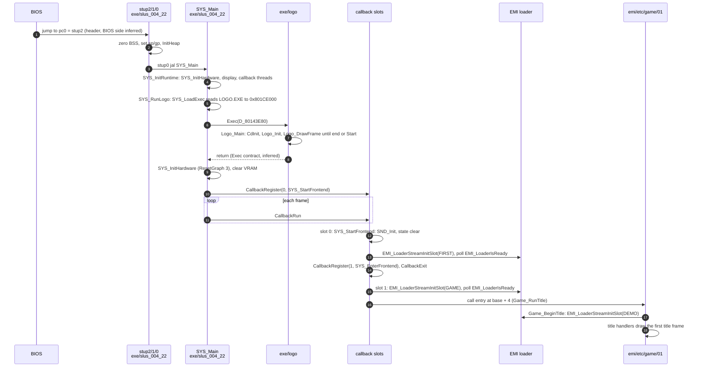

# Boot

*Read this if you need the path from power-on to the title.*

The path from the BIOS handoff to the first game screen: the PS-X header, the C runtime stubs, the
`LOGO.EXE` program, SDK initialization, and the first callback that loads the title overlay.

Static reading of the game code; nothing here was run on an emulator. Tags: `[read]` is code or
assembly read directly, `[inferred]` is deduced from several reads, `[unknown]` is not established.
Overlay addresses are image-local; `exe/logo` and `exe/slus_004_22` are separate address spaces.

## Entry points

| Symbol              | Image@address                         | Role                                                           | Status   |
| ------------------- | ------------------------------------- | -------------------------------------------------------------- | -------- |
| PS-X header `pc0`   | `exe/slus_004_22@0x80096800` (header) | points at `stup2`                                              | `[read]` |
| `stup2`             | `exe/slus_004_22@0x8014AA0C`          | clears the BSS range, falls into `stup1`                       | `[read]` |
| `stup1`             | `exe/slus_004_22@0x8014AA30`          | sets `sp`, `gp`, `fp`, calls `InitHeap`, falls into `stup0`    | `[read]` |
| `stup0`             | `exe/slus_004_22@0x8014AAAC`          | `jal SYS_Main`; a `break` follows                              | `[read]` |
| `SYS_Main`          | `exe/slus_004_22@0x8014AAC8`          | boot sequence, then the permanent frame loop                   | `[read]` |
| `SYS_InitRuntime`   | `exe/slus_004_22@0x8014ACA0`          | hardware, display records, callback threads, first frame setup | `[read]` |
| `SYS_InitHardware`  | `exe/slus_004_22@0x8014AD28`          | SDK and BIOS init; runs twice (before and after the logo)      | `[read]` |
| `SYS_RunLogo`       | `exe/slus_004_22@0x8014AEE0`          | loads and `Exec`s `LOGO.EXE`, then rebuilds the display        | `[read]` |
| `SYS_LoadExec`      | `exe/slus_004_22@0x8014E0FC`          | reads a PS-X executable from disc in two steps                 | `[read]` |
| `__SN_ENTRY_POINT`  | `exe/logo@0x801CE724`                 | clears the logo BSS, sets `gp`, jumps to `Logo_Main`           | `[read]` |
| `Logo_Main`         | `exe/logo@0x801CEDFC`                 | plays the logo movie, returns                                  | `[read]` |
| `SYS_StartFrontend` | `exe/slus_004_22@0x8014EA80`          | first callback: sound, `FIRST.EMI`, state clear                | `[read]` |
| `SYS_EnterFrontend` | `exe/slus_004_22@0x8014EC64`          | second callback: loads `GAME.EMI`, calls its entry             | `[read]` |
| `Game_RunTitle`     | `emi/etc/game/01@0x801D0C04`          | title loop; first game mode                                    | `[read]` |

## Executable header and C runtime

The header of `SLUS_004.22` names `pc0 = 0x8014AA0C`, `t_addr = 0x80096800`, `t_size = 0x160800` and
`sp = 0x801FFFF0`. The `logo` header names `pc0 = 0x801CE724`, `t_addr = 0x801CE000`, `t_size = 0x1D800`
and `sp = 0x801FFFF0`. `[read]` from the extracted executable headers. That the BIOS copies
`t_size` bytes to `t_addr` and jumps to `pc0` is BIOS behaviour outside the game files.
`[inferred]`

The `SLUS_004.22` payload is larger than its resident code. Resident code and data occupy
`0x80149800..0x8018B2B8` plus the BSS to `0x80190C60`. The payload is zero-filled elsewhere, apart from a few
stamp words: `0x80096800..0x80149800` (four overlay slots) and `0x8018B2B8..0x801F7000` (the area that
`GAME.EMI` entry 0 and the overlay arena later fill). `[read]` from the executable's region map
and a zero-byte count over the extracted payload. The map is in [memory](memory.md).

| Stub    | Address (`exe/slus_004_22`) | What it does                                                                                                                                           | Status   |
| ------- | --------------------------: | ------------------------------------------------------------------------------------------------------------------------------------------------------ | -------- |
| `stup2` |                `0x8014AA0C` | zero-fills `0x8018B2B8..0x80190C60` (the BSS)                                                                                                          | `[read]` |
| `stup1` |                `0x8014AA30` | `sp = 0x80200000` (the first word of the table at `0x8014AAB8`, ORed with `0x80000000`), `gp = 0x8018B2B4`, `fp = sp`, `InitHeap(0x80190C64, 0x673A0)` | `[read]` |
| `stup0` |                `0x8014AAAC` | `jal SYS_Main`                                                                                                                                         | `[read]` |

`stup1` subtracts the word at `0x801845E8` (`0x8000`) from the stack top before it sizes the heap, so the
stack spans `0x801F8000..0x80200000`. `[read]` The heap range `0x80190C64..0x801F8004` overlaps the
resident overlay at `0x80195800` and the overlay arena at `0x801D0C00`. The executable has no `malloc`,
`free`, `calloc` or `realloc` thunk (searched in the `exe/slus_004_22` assembly), so the heap is declared and
unused. `[read]` for the missing thunks; `[inferred]` for "unused".

`__main` (`exe/slus_004_22@0x8014AA04`) is a bare `jr $ra`. `[read]`

## Boot sequence

`SYS_Main` runs the boot in this SYS_Main (`exe/slus_004_22@0x8014AAC8`). `[read]`

1. `__main`; clear `g_SysHardwareInitialized`.
2. `SYS_InitRuntime`: `SYS_InitHardware`, `SYS_InitDisplay`, `SYS_ResetDisplayFrame` for both render
   records, `CallbackInitThreads`, `GFX_ClearRect(0, 0, 0x400, 0x200)` (all of VRAM), `DrawSync(0)`,
   `SetDispMask(1)`, `SYS_PrepareFrame`.
3. `SYS_RunLogo`.
4. `DrawSyncCallback(SYS_CaptureDrawTime)`; `CallbackRegister(0, SYS_StartFrontend)`.
5. Enter the permanent loop ([frame loop](frame-loop.md)). The first `CallbackRun` opens slot 0.

### SDK and hardware initialization

`SYS_InitHardware` (`exe/slus_004_22@0x8014AD28`) `[read]`:

| Step | Call                                                                                                                                                                                |
| ---: | ----------------------------------------------------------------------------------------------------------------------------------------------------------------------------------- |
|    1 | `ResetCallback`, then `EMI_LoaderInit` (`exe/slus_004_22@0x80161F58`: loops on `CdInit` until it succeeds, `VSync(3)`, clears the 24 loader slot states)                            |
|    2 | first call only: `VSync(0)`, `ResetGraph(0)`, `SetVideoMode(MODE_NTSC)`, sets `g_SysHardwareInitialized`, opens and enables the CPU trap event whose handler is `SYS_ShowException` |
|    2 | later calls: `VSync(0)`, `ResetGraph(3)` (the display is kept)                                                                                                                      |
|    3 | `InitGeom`, `SetGeomScreen(0x3E8)`, `SetGeomOffset(0xA0, 0x78)`                                                                                                                     |
|    4 | `PadInit(0)`, `SYS_InitCard` (seven software and hardware card events, `InitCARD(1)`, `StartCARD`, `_bu_init`), `ChangeClearPAD(0)`                                                 |

`SYS_ShowException` (`exe/slus_004_22@0x8014B3C4`) is the trap event handler: it draws a register dump on a
double-buffered screen and never returns. `[read]` Sound is not initialized here; `SYS_StartFrontend` does
it. The SPU and CD audio state at this point is the logo's concern.

`SYS_InitDisplay` (`@0x8014AE08`) sets two draw and display environment pairs: 320 x 240, one buffer at
`y = 0` and one at `y = 0xF0`, each draw environment paired with the display environment of the other
buffer. `[read]`

### Logo program

`SYS_RunLogo` (`exe/slus_004_22@0x8014AEE0`) `[read]`:

1. `SYS_LoadExec(s__LOGO_LOGO_EXE_1_80149800)`: `CdSearchFile`, `CdControl(CdlSetloc)`, read one header
   sector into the buffer at `D_801459F8` with `SYS_ReadCd`, copy ten header words to `D_80143E70`, then
   seek one sector on and read `t_size` bytes to `t_addr`. Failures retry up to ten times and return `-1`.
2. Set the stack field of the exec block `D_80143E80` to `0x801FF000` (`D_80143EA0`) and its size to 0.
3. `StopCallback`, `PadStop`, `StopCARD`, then inside a critical section `Exec(D_80143E80, 0, 0)`.
4. After `Exec` returns: `SYS_InitHardware` again (the `ResetGraph(3)` path), clear and draw two
   ordering tables, `GFX_ClearRect` of all VRAM, `DrawSync(0)`, `SetDispMask(1)`.

`LOGO.EXE` loads at `0x801CE000` and runs to `0x801ECEC0` including its BSS. The main executable's payload
holds only zero bytes over that range apart from two stamp words (`0x801CE400` = 7, `0x801D0C00` = `0xB`), so the logo
overwrites no resident bytes. `[read]` (zero-byte count of the payload). No overlay has been loaded yet at this point: the first
`EMI_LoaderStreamInitSlot` call is in `SYS_StartFrontend`, after the logo. `[read]`

`exe/logo` runs `__SN_ENTRY_POINT` (`@0x801CE724`: zero `0x801EB430..0x801ECEC0`, `gp = 0x801EB430`, `j Logo_Main`)
and `Logo_Main` (`@0x801CEDFC`). `[read]` `Logo_Main`:

- `CdInit`, then `Logo_Init(0x8003B800, D_801D8BB0)`. `D_801D8BB0` holds the literal LBA `0x2D78C`; no file
  name is looked up. `[read]` The file at that LBA is `CAPCOM30.STR`. `[inferred]`
- `Logo_Init` (`@0x801CE760`) carves three buffers out of `0x8003B800` (`+0x2D00`, `+0xA500`, `+0x10480`),
  `PadInit`, `Logo_InitDisplay` (own `ResetGraph(0)`, NTSC, two 320 x 240 buffers, VRAM clear),
  `Logo_StartStream`, `Logo_FadeInAudio` (CD mix 0 to 0x80). `[read]`
- `Logo_StartStream` (`@0x801CE930`) sets a 15-sector ring, a CD stream read (`CdlSetfilter`, `CdlSetloc`,
  `CdRead2`), and decodes frame 0 through `DecDCTvlc`. `Logo_DrawFrame` (`@0x801CEA98`) pulls a frame with
  `StGetNext`, runs MDEC (`DecDCTin`, `DecDCTout`), uploads 24-pixel-wide slices from the
  `Logo_DecodeSlice` callback (`@0x801CECA4`) with `LoadImage`, then `VSync(2)` and a display flip. `[read]`
- The loop in `Logo_Main` ends when the stream reports its last frame or `PADstart` is held.
  `Logo_StopStream` fades the audio, frees the ring, pauses the CD. `StopCallback`, `PadStop`,
  `SetDispMask(0)` follow, and `Logo_Main` returns. `[read]`
- That a return from `Logo_Main` resumes `SYS_RunLogo` after `Exec` follows the BIOS `Exec` contract,
  which is outside the game files. `[inferred]`

`exe/logo` does not link against the main executable. It carries its own copy of the PsyQ libraries
(only `exe/slus_004_22` and `emi/etc/game/00` are resident images; a
standalone binary links only its own maps; [runtime](../runtime.md#psyq-sdk)). `[read]`

## First game callback

After the logo, `SYS_Main` registers `SYS_StartFrontend` in callback slot 0. The two first callbacks run as
kernel threads ([scheduler](scheduler.md)). `[read]`

`SYS_StartFrontend` (`exe/slus_004_22@0x8014EA80`):

1. `GFX_ClearRect(0, 0, 0x400, 0x200)`; `CallbackWait(1)` (yield one frame).
2. `SND_Init`, `SND_SetBankLayout(0)`.
3. `EMI_LoaderStreamInitSlot(0x261)` (`FIRST`), then `CallbackWait(1)` until
   `EMI_LoaderIsReady`. See [loading](loading.md).
4. `SsUtSetReverbDepth(0x28, 0x28)`, `SsSetRVol(0x28, 0x28)`, `SND_Start`.
5. Zero `4272` bytes from `D_801448D8`; set `g_EmiLoadedCharacterIndex = 0xFF`, `g_GameFlags = 0`,
   `g_AreaWalkFlags = 0`, `D_80144950 = 1` and the six bytes after it to 0; copy nine halfwords from
   `D_8017F56C` into `g_InputMasks`.
6. `Menu_ResetPanelTasks`, `GFX_ResetPaletteFades`, `GFX_FreeAllPaletteSlots`, `g_AreaDrawFlags`,
   `g_AreaDrawMode = 6`, `g_ScriptBank`, `GFX_ResetPalette`, `g_GfxPalettePending += 1`.
7. `CallbackRegister(1, SYS_EnterFrontend)`; `CallbackExit` ends slot 0's thread.

`SYS_EnterFrontend` (`exe/slus_004_22@0x8014EC64`) streams slot `0x262` (`GAME`), waits with
`CallbackWait(1)` for `EMI_LoaderIsReady`, then calls `func_801D0C04`, the entry at the load base `+4` of
`emi/etc/game/01` (named `Game_RunTitle` in `emi/etc/game/01`). `[read]`

`Game_RunTitle` (`emi/etc/game/01@0x801D0C04`) clears its title state, calls `func_8014BA04`, then loops:
`CallbackWait(1)`, `UI_HandleStartButton`, one of eight title handlers selected by `g_UiTitleState`, then the
banner and window fades. The first handler, `Game_BeginTitle` (`@0x801D0C90`), selects sound bank layout 2,
streams slot `0x25F` (`DEMO`), resets the palette stage and starts BGM cue `0x8D`. `[read]` The title and its exits
are in [phases](phases.md).

## Boot to first playable frame

The diagram follows `SYS_Main`, `SYS_RunLogo`, `SYS_StartFrontend` and `SYS_EnterFrontend`. The "first
playable frame" is the first frame in which `Game_RunTitle` draws the title with input enabled; the
fade and input gate states that follow `Game_BeginTitle` are in [phases](phases.md). `[read]` for calls,
`[inferred]` for the BIOS arrows.

## Key data

| Object                     | Address (`exe/slus_004_22`) | Role                                                               | Status   |
| -------------------------- | --------------------------- | ------------------------------------------------------------------ | -------- |
| `g_SysHardwareInitialized` | `0x8018B300`                | selects the first or later `SYS_InitHardware` path                 | `[read]` |
| `g_GfxDisplayFrames`       | `0x80143D48`                | two `0x90`-byte render records                                     | `[read]` |
| `g_FrameBufferIndex`       | `0x80143D44`                | index of the record being built                                    | `[read]` |
| `D_80143E80`               | `0x80143E80`                | exec block `SYS_LoadExec` fills and `SYS_RunLogo` passes to `Exec` | `[read]` |
| `D_80143B40`               | `0x80143B40`                | four callback slots, `0x80` bytes each                             | `[read]` |
| `g_EmiRequestedSlotId`     | `0x80146468`                | slot id of the active EMI request                                  | `[read]` |

## Connections

- The loop that the boot enters: [frame loop](frame-loop.md). Callback slots and threads:
  [scheduler](scheduler.md).
- Slot ids, the loader and what `EMI_LoaderIsReady` tests: [loading](loading.md).
- Address layout, reservations, stack and heap: [memory](memory.md).
- The title, New Game and Load Game: [phases](phases.md).
- Existing description of this path: [runtime](../runtime.md#boot-and-frame-loop).

## Gaps

| Gap                                                                                | What would prove it                                                                                         |
| ---------------------------------------------------------------------------------- | ----------------------------------------------------------------------------------------------------------- |
| BIOS load and `Exec` return semantics are assumed from PS1 BIOS behaviour          | A trace of a run, or the BIOS source; static reading of the code cannot show it                             |
| The logo movie file name; only the literal LBA `0x2D78C` is read                   | Resolve LBA `0x2D78C` against the disc directory ([disc and files](disc-and-files.md))                      |
| Whether `InitHeap` memory is ever used by SDK internals                            | Search the PsyQ objects linked into the executable for heap users                                           |
| Whether other code reads `D_80143EFC` (the `DrawSync` callback's `VSync(1)` value) | `Area_CanStartEncounter` (`emi/etc/game/00@0x801B3EB0`) is the only reader found; search the other overlays |
| Why `g_SysResetHoldFrames` waits for `EMI_LoaderIsReady` before the soft reset     | Read the loader state machine in [loading](loading.md)                                                      |
