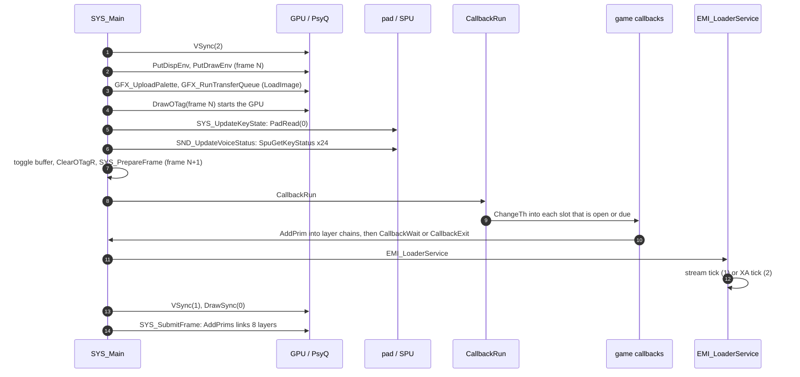

# Frame loop

*Read this if you need to know what runs each frame and in which order.*

The permanent loop in `SYS_Main`: what runs once per frame, in which order, how the two render records and
their ordering tables alternate, where input is read, and where game code gets control.

Static reading of the game code; nothing here was run on an emulator. Tags: `[read]` is code or
assembly read directly, `[inferred]` is deduced from several reads, `[unknown]` is not established.

## Entry points

| Symbol                  | Image@address                | Role                                                      | Status   |
| ----------------------- | ---------------------------- | --------------------------------------------------------- | -------- |
| `SYS_Main`              | `exe/slus_004_22@0x8014AAC8` | the loop body (`for (;;)`)                                | `[read]` |
| `SYS_UpdateKeyState`    | `exe/slus_004_22@0x8014AFC0` | `PadRead(0)` into the held and pressed words              | `[read]` |
| `SYS_PrepareFrame`      | `exe/slus_004_22@0x8014B020` | resets the primitive cursor and the per-layer chain heads | `[read]` |
| `SYS_SubmitFrame`       | `exe/slus_004_22@0x8014B0F0` | links the eight layer chains into the ordering table      | `[read]` |
| `CallbackRun`           | `exe/slus_004_22@0x8014B73C` | gives the four callback threads their turn                | `[read]` |
| `EMI_LoaderService`     | `exe/slus_004_22@0x80163010` | per-frame CD loader tick                                  | `[read]` |
| `SYS_CaptureDrawTime`   | `exe/slus_004_22@0x8014B17C` | `DrawSync` callback; stores `VSync(1)`                    | `[read]` |
| `GFX_UploadPalette`     | `exe/slus_004_22@0x8014E22C` | stage palette to VRAM when pending                        | `[read]` |
| `GFX_RunTransferQueue`  | `exe/slus_004_22@0x8014E6D0` | queued VRAM uploads                                       | `[read]` |
| `SND_UpdateVoiceStatus` | `exe/slus_004_22@0x8015D044` | polls the 24 SPU voice key states                         | `[read]` |

## Order of one frame

`SYS_Main` runs these steps in this order, every iteration. `[read]`

| Step | Call                                                                            | Effect                                                                                                |
| ---: | ------------------------------------------------------------------------------- | ----------------------------------------------------------------------------------------------------- |
|    1 | `VSync(2)`                                                                      | wait until two vertical blanks have passed since the previous `VSync` call                            |
|    2 | `rand()`                                                                        | advance the PsyQ random state once                                                                    |
|    3 | `PutDispEnv(frame)`, `PutDrawEnv(frame + 0x14)`                                 | apply the environments of the record built in the previous iteration                                  |
|    4 | `GFX_UploadPalette`, `GFX_RunTransferQueue`                                     | stage palette, then queued uploads, to VRAM                                                           |
|    5 | `DrawOTag(frame + 0x8C)`                                                        | start the GPU on the previous iteration's ordering table                                              |
|    6 | `SYS_UpdateKeyState`                                                            | read controller 1                                                                                     |
|    7 | `SND_UpdateVoiceStatus`                                                         | refresh the 24 voice status bytes                                                                     |
|    8 | toggle `g_FrameBufferIndex`; `ClearOTagR(record + 0x70, 8)`; `SYS_PrepareFrame` | select and reset the other render record                                                              |
|    9 | reset-combo check on `g_InputHeld`                                              | Select and Start held request the soft reset when the hold counter reaches 60, on the 61st held frame |
|   10 | `CallbackRun`                                                                   | game logic: each active callback thread runs until it yields                                          |
|   11 | `EMI_LoaderService`                                                             | CD loader or XA tick                                                                                  |
|   12 | `g_SysLastVSync = VSync(1)`; `DrawSync(0)`; `SYS_SubmitFrame`; `g_FrameCount++` | wait for the GPU, link the new layer chains                                                           |

The GPU drawing started in step 5 runs while steps 6 to 11 execute. `DrawSync(0)` in step 12 waits for it.
Game code builds primitives in step 10 into the record chosen in step 8; the next iteration draws them.
`[read]` order; `[inferred]` overlap (the DMA runs asynchronously by PsyQ contract, which the game files
do not contain).

`VSync(2)` caps the loop at one iteration per two vertical blanks (30 per second on an NTSC display set by
`SetVideoMode(MODE_NTSC)` in `SYS_InitHardware`); a frame that takes longer runs slower. `[read]` for the
call and the video mode; `[inferred]` for the rate.

## Render records and ordering tables

`SYS_InitRuntime` initializes two `0x90`-byte records at `g_GfxDisplayFrames` (`0x80143D48`) and `+0x90`.
`g_GfxCurrentDisplayFrame` (`0x80143E68`) points at the active one. `[read]`

| Offset | Content                                                    | Evidence                                      |
| -----: | ---------------------------------------------------------- | --------------------------------------------- |
| `0x00` | `DISPENV`                                                  | `SYS_InitDisplay`, `PutDispEnv` in `SYS_Main` |
| `0x14` | `DRAWENV`                                                  | `SYS_InitDisplay`, `PutDrawEnv` in `SYS_Main` |
| `0x70` | ordering table, 8 words, reverse-cleared with `ClearOTagR` | `SYS_Main`, `SYS_ResetDisplayFrame`           |
| `0x8C` | the table's last word, the address passed to `DrawOTag`    | `SYS_Main`                                    |

The two records draw into the two 320 x 240 buffers at `y = 0` and `y = 0xF0` and display the other one.
`[read]` (`SYS_InitDisplay`).

`SYS_PrepareFrame` (`@0x8014B020`) per buffer index `b`: `[read]`

- sets `g_GfxPrimCursor` to `0x80020000 + b * 0x9000`;
- seeds eight layer chain heads (`D_801459D0`) from the packet table (`D_80145990`), `b * 0x20` bytes in;
- resets 56 cell records of `0x30` bytes at `D_80142CC0` for the area map engine `[inferred]`;
- sets `D_801459F8 = 0x800E4800` and `D_801459FC = 0x800F5000` (the area work window and code base).

`GFX_AddPrim` (`@0x8014E5A0`) appends the primitive at the cursor to layer chain `ot_index` through `CatPrim`
and advances the cursor, but only while the new cursor stays below `0x80028FCC + b * 0x9000`. When the
arena is full it does nothing: the primitive is dropped without a signal. `[read]` (`GFX_AddPrim`, no else
branch). `SYS_SubmitFrame` (`@0x8014B0F0`) calls `AddPrims` eight times to splice each layer chain into
the corresponding table word. `[read]` Layer order, primitive layouts and the arena: [rendering](rendering.md).

## Input

`SYS_UpdateKeyState` stores `PadRead(0)` as two halfword pairs: held and previously held for each half of
the 32-bit result, then the newly pressed bits (`pad & (pad ^ previous)`). `g_InputHeld` (`0x80145AA4`) and
`g_InputPressed` (`0x80145AA8`) are the words the rest of the game reads. `[read]` Only controller 1 is
polled. `[read]` (`PadRead(0)` returns both ports in one word; the second pad's half is stored but this
page found no reader, `[unknown]`.)

The soft reset needs `g_InputHeld & (PADselect | PADstart) == 0x900` for 61 consecutive frames (the hold counter reaches 60)
(`g_SysResetHoldFrames`) and `EMI_LoaderIsReady() != 0`. It then runs `SND_Exit`, `CallbackStopAll` and
`CallbackRegister(0, SYS_StartFrontend)`: the boot's first callback again, without a new logo. `[read]`
The bit values are the PsyQ macros `PADselect` and `PADstart` (`0x100` and `0x800`). `[read]`
PsyQ also names the same bits `PADk` and `PADh`.

## Game logic entry

`CallbackRun` (step 10) is the only place game code runs. Its four threads, their states and the dispatch
tables above them are in [scheduler](scheduler.md). `EMI_LoaderService` (step 11) dispatches on
`g_EmiServiceMode`: `1` runs `EMI_LoaderServiceStream` (disc reads for overlays and data), `2` runs `SND_ServiceXa`
(CD-XA playback state machine); any other value does nothing. `[read]` The loader is in
[loading](loading.md), XA in [audio](audio.md).

## One frame

Arrow 4 to arrow 13 follow `SYS_Main` line by line; arrows 9 and 10 depend on the callback
(`CallbackRun`, [scheduler](scheduler.md)), and arrows 11 and 12 are the loader. The GPU runs from arrow 4 to arrow 13; its overlap with arrows 5 to 12 is inferred from the
PsyQ contract. `[read]` for the calls, `[inferred]` for the overlap.

## Data and limits

| Limit                              | Value                                                        | Code                                                                                                                    | Status   |
| ---------------------------------- | ------------------------------------------------------------ | ----------------------------------------------------------------------------------------------------------------------- | -------- |
| Ordering table layers              | 8                                                            | `ClearOTagR(..., 8)` in `SYS_Main`; `index < 8` in `SYS_PrepareFrame`, `SYS_SubmitFrame`                                | `[read]` |
| Primitive arena per buffer         | `0x80020000 + b * 0x9000`, ends `0x80028FCC + b * 0x9000`    | `SYS_PrepareFrame`, `GFX_AddPrim`                                                                                       | `[read]` |
| Display size                       | 320 x 240, buffers at `y = 0` and `y = 0xF0`                 | `SYS_InitDisplay`                                                                                                       | `[read]` |
| Queued VRAM uploads per frame      | 20                                                           | `GFX_RunTransferQueue` reads rectangle halves from `D_80145A54[0..19]` and `D_80145A54[20..39]`                         | `[read]` |
| Upload kinds                       | 3: raw `LoadImage`, RGB555 expand (`1`), LZSS (`2`)          | `GFX_RunTransferQueue`, `GFX_ExpandRgb555`, `GFX_DecodeLzss`                                                            | `[read]` |
| Stage palette                      | `0x100 x 0x20` pixels at VRAM `(0, 0x1E0)` from `0x80037800` | `GFX_UploadPalette`, `AREA_PALETTE_WORK`                                                                                | `[read]` |
| Frame period                       | two vertical blanks minimum                                  | `VSync(2)` in `SYS_Main`                                                                                                | `[read]` |
| Reset hold                         | 61 frames (counter reaches 60)                               | `SYS_Main`                                                                                                              | `[read]` |
| Random encounters pause under load | `D_80143EFC >= 0xF1`                                         | `Area_CanStartEncounter` (`emi/etc/game/00@0x801B3EB0`) returns 0 when that holds and `g_GameRequestFlags & 1` is clear | `[read]` |

`D_80143EFC` is the `VSync(1)` value `SYS_CaptureDrawTime` stores when drawing completes. By the PsyQ
contract `VSync(1)` returns elapsed horizontal-blank counts since the previous `VSync` call. So an
encounter does not start in a frame whose draw ended later than 240 scan lines after the last `VSync`.
`[inferred]` (contract is external; the comparison and the store are `[read]`). The queue length check on
the producer side of `D_80145A00` is not read: whether a 21st upload overflows is `[unknown]`.

What an edited asset must respect here: every sprite, window, text glyph and map cell of a frame competes
for one `0x8FCC`-byte primitive arena and eight layers; draws past the arena vanish silently. Palette and
graphics budgets are in [rendering](rendering.md).

## Connections

- Boot into this loop: [boot](boot.md). Threads and dispatch: [scheduler](scheduler.md).
- Primitives and layers: [rendering](rendering.md). CD loader and XA: [loading](loading.md),
  [audio](audio.md).
- Existing summary: [runtime](../runtime.md#boot-and-frame-loop).

## Gaps

| Gap                                                     | What would prove it                                                             |
| ------------------------------------------------------- | ------------------------------------------------------------------------------- |
| Overflow behaviour of the 20-entry VRAM upload queue    | Read the producers that increment `D_80145A00` and check for a bound            |
| Second controller use                                   | Search readers of the high halves written by `SYS_UpdateKeyState`               |
| Real frame time and the GPU/CPU overlap                 | A run with timing; static reading cannot measure                                |
| The unit of `D_80143EFC` (hsync count by PsyQ contract) | PsyQ `VSync` documentation or the PsyQ library object, then compare with `0xF1` |
