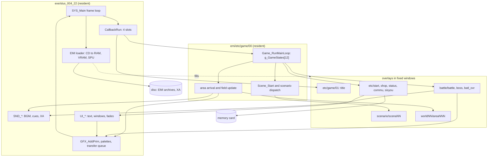

# Game architecture

*Read this first if you want to understand how the whole game runs.*

How Breath of Fire III runs, from power-on to the end credits: what
runs each frame, which code is in RAM when, how data reaches code, and which limits the code fixes. Start
here, then follow the reading order.

The pages describe the retail NTSC-U executable and its overlays by static reading of the program code.
Nothing here was run on hardware or an emulator.

## Evidence tags

Every behavioural claim names its function and `image@address` and carries one tag ([glossary](../../glossary.md#evidence-citations)).

| Tag          | Meaning                                                                |
| ------------ | ---------------------------------------------------------------------- |
| `[read]`     | read directly in the code                                              |
| `[inferred]` | deduced from several reads, or from PsyQ behaviour the code relies on  |
| `[unknown]`  | not established; each page ends with a gaps table that names the proof |

## The shape of the game

One executable owns the frame. Everything else is an overlay streamed from the disc into a fixed window.

The arrows follow calls and data flow that the pages below prove. `SYS_Main` runs `CallbackRun` once per
frame; slot 0 runs `Game_RunMainLoop`, which calls one handler of `g_GameStates` per frame. The handler
for the field calls the area update; the handler for battle calls `Battle_Update`. Overlays do not run on
their own: resident code calls into them after the EMI loader fills their window. `[read]`
Details: [frame loop](frame-loop.md), [scheduler](scheduler.md), [phases](phases.md).

## Reading order

| Order | Page                         | It answers                                                                               |
| ----: | ---------------------------- | ---------------------------------------------------------------------------------------- |
|     1 | [Boot](boot.md)              | What runs between the BIOS handoff and the first title frame.                            |
|     2 | [Frame loop](frame-loop.md)  | What happens in one frame, in what order, and where game code gets control.              |
|     3 | [Scheduler](scheduler.md)    | How the four callback slots and the state-byte tables run game logic.                    |
|     4 | [Memory](memory.md)          | Which image owns which RAM range, and which overlays share a window.                     |
|     5 | [Loading](loading.md)        | How each kind of data gets from the disc to RAM, VRAM or the SPU, and what blocks.       |
|     6 | [Phases](phases.md)          | Every phase from power-on to the end credits, with its entry, code and exits.            |
|     7 | [Scenario](scenario.md)      | How the 20 story controllers sit on the field and advance the chapters.                  |
|     8 | [Area](area.md)              | How an area loads, arrives, updates each frame and hands over to another area.           |
|     9 | [Battle](battle.md)          | How a battle starts, runs and returns to the field.                                      |
|    10 | [Screens](screens.md)        | How menus, shops, fishing, the fairy village and the master screen are entered and left. |
|    11 | [UI](ui.md)                  | How a string gets from disc data to a window on screen.                                  |
|    12 | [Rendering](rendering.md)    | How RAM becomes pixels: primitives, VRAM, palettes and sprite colors.                    |
|    13 | [Audio](audio.md)            | How music, effects and XA reach the SPU, and the budgets they must fit.                  |
|    14 | [Saving](saving.md)          | What the memory card holds, from which RAM, and what the load path rebuilds.             |
|    15 | [Persistent state](state.md) | Where the party, inventory, flags and clock live and what survives an overlay swap.      |
|    16 | [Open questions](gaps.md)    | What the pages above do not establish, with the proof each gap needs.                    |

Companion pages:

| Page                                    | It answers                                            |
| --------------------------------------- | ----------------------------------------------------- |
| [Responsibilities](responsibilities.md) | Which code image owns which job.                      |
| [Disc and files](disc-and-files.md)     | What the disc holds and where each file sits.         |
| [Editor guide](editor-guide.md)         | What an editor must keep intact for each asset class. |

## Reading order for an editor

Pick the topic, read the pages left to right: how the game uses it, the file format, then the editor
guide section with the limits, what is proven about writing it back and the open questions.

| Topic      | How the game uses it                                          | File format                                                                                 | Editor guide                                                                                                                              | Open                                          |
| ---------- | ------------------------------------------------------------- | ------------------------------------------------------------------------------------------- | ----------------------------------------------------------------------------------------------------------------------------------------- | --------------------------------------------- |
| UI         | [ui](ui.md), [screens](screens.md), [rendering](rendering.md) | [graphics](../../formats/graphics.md)                                                       | [1 UI layouts](editor-guide.md#1-ui-layouts-and-windows)                                                                                  | argument units, style table, per-screen owner |
| Sound      | [audio](audio.md)                                             | [audio](../../formats/audio.md#emi-type-8-cue-records)                                      | [4 Sound effects](editor-guide.md#4-sound-effects)                                                                                        | cue byte 2 low nibble, SPU RAM budget         |
| Music      | [audio](audio.md)                                             | [audio](../../formats/audio.md#sep-package)                                                 | [5 Music sequences](editor-guide.md#5-music-sequences-and-midi-conversion)                                                                | area-to-BGM map, loop semantics               |
| Soundbanks | [audio](audio.md)                                             | [audio](../../formats/audio.md#vab-bank)                                                    | [6 Soundbanks](editor-guide.md#6-soundbanks-vab-tones-samples)                                                                            | SPU RAM base addresses                        |
| MIDI       | [audio](audio.md)                                             | [audio](../../formats/audio.md#sep-package), [conversion](../../formats/conversion.md)      | [5 Music sequences](editor-guide.md#5-music-sequences-and-midi-conversion)                                                                | the source has no tempo event                 |
| Characters | [state](state.md), [battle](battle.md)                        | [character](../../formats/character.md), [records](../records.md#character-and-master-data) | [8 Sprites](editor-guide.md#8-character-and-monster-sprites-animation-palettes), [9 Stats](editor-guide.md#9-character-and-monster-stats) | node pixel format, animation, `unk_` spans    |
| Strings    | [ui](ui.md#the-string-path)                                   | [text](../text.md)                                                                          | [3 Strings](editor-guide.md#3-strings-and-dialogue)                                                                                       | glyph-less bytes, id-to-string map            |
| Records    | [state](state.md)                                             | [records](../records.md)                                                                    | [10 Items and records](editor-guide.md#10-items-skills-magic-shops-drops-and-other-records)                                               | unnamed bytes, ability flag bits              |
| Maps       | [area](area.md)                                               | [area](../../formats/area.md#0x80104000-map-bundle)                                         | [11 Maps](editor-guide.md#11-maps-collision-area-and-event-scripts)                                                                       | cell classes, map `unk_` spans                |
| Scripts    | [scenario](scenario.md), [area](area.md#setup-stream)         | [area](../../formats/area.md#0x800d3800-area-script-bank)                                   | [11 Maps](editor-guide.md#11-maps-collision-area-and-event-scripts)                                                                       | script opcodes are not decoded                |
| Saves      | [saving](saving.md), [state](state.md)                        | [save](../../formats/save.md)                                                               | [13 Save data](editor-guide.md#13-save-data)                                                                                              | unnamed payload bytes                         |

Before changing any data, read how archives rebuild and its limits in the editor guide
([rebuilding archives](editor-guide.md#rebuilding-archives-and-the-disc), [readiness](editor-guide.md#readiness)).

## Terms

One spelling per concept across the pages.

| Term            | Meaning                                                                       | Defined in                             |
| --------------- | ----------------------------------------------------------------------------- | -------------------------------------- |
| Slot (callback) | One of four scheduler records at `D_80143B40`.                                | [scheduler](scheduler.md)              |
| EMI slot id     | The index of one archive in the disc file list (`0x261` FIRST, `0x262` GAME). | [loading](loading.md)                  |
| Overlay window  | A fixed RAM range that one overlay at a time fills.                           | [memory](memory.md)                    |
| Entry state     | `g_GameEntryState`, the index into `g_GameStates`.                            | [phases](phases.md)                    |
| State index     | `g_GameStateIndex`, the request code that the next entry state follows.       | [phases](phases.md)                    |
| Scenario        | One of `SCENA00` to `SCENA19`, a story controller overlay.                    | [scenario](scenario.md)                |
| Area            | One of 200 `WORLDnn/AREAnnn` maps.                                            | [area](area.md)                        |
| Panel           | One of 22 `g_MenuPanelTasks` records.                                         | [scheduler](scheduler.md), [ui](ui.md) |

## Data and limits

Each system page has a "Data and limits" section. It lists, with the code that fixes them, the counts,
sizes and addresses an edited asset must stay within: RAM windows, the primitive arena, VRAM rows, palette
cells, SPU RAM, sound banks, actor tables, panel slots and CD timing. Use those sections, with the
[editor guide](editor-guide.md), before changing any asset.
