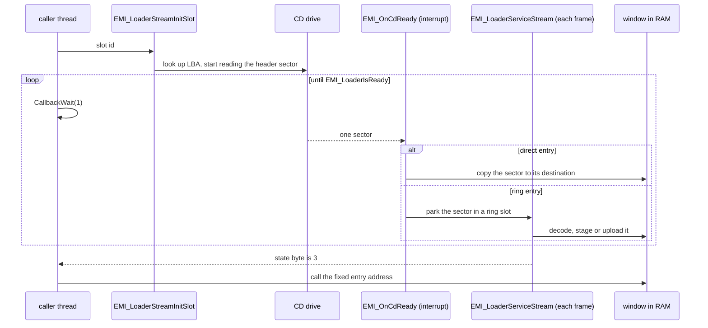

# Loading

Almost everything the game runs or draws comes off the disc during play: overlay code, area maps, battle data, character graphics, sound banks and the story scenes. The game holds only the main executable and the resident game program permanently. Everything else is requested when needed and written into a fixed [memory](memory.md) window. This page follows one load request from the call to the first byte in RAM, then describes the load paths of each kind of data.

## How a load request flows

A load request names one archive by its slot id. Seven steps take it from that name to usable data.

1. **Request.** Game code calls `EMI_LoaderStreamInitSlot (exe/slus_004_22@0x80161FDC)` with a slot id. The slot id is the index of the archive in the disc file list. The call looks up the archive's disc address in the table `g_EmiSlotLbas (exe/slus_004_22@0x80182444)`, installs two CD callbacks, and starts the drive. It returns at once.
2. **Wait.** The calling thread polls with `CallbackWait(1)` until `EMI_LoaderIsReady` returns nonzero. The other callback threads keep running, so a load blocks only its caller. In battle, a step machine polls instead of a loop.
3. **Table of contents.** The first sector of every EMI archive is its table of contents. `EMI_LoaderReadToc` checks the `MATH_TBL` tag and computes the first sector of each entry.
4. **Entries.** The loader reads the entries in order. Each has a type that says where its bytes go: copied to a RAM address, decompressed to a RAM address, uploaded to VRAM, or sent to the SPU. The entry's load argument holds the address.
5. **Sectors.** Each sector raises a CD-ready interrupt. `EMI_OnCdReady (exe/slus_004_22@0x80162230)` either copies the sector straight to its destination, or parks it in a ring slot for the main loop to process.
6. **Tick.** Once per frame, step 11 of the [frame loop](frame-loop.md) calls `EMI_LoaderService`. In mode 1 it runs `EMI_LoaderServiceStream`, which advances the CD steps and drains the ring slots: it decodes, stages or uploads each parked sector.
7. **Ready.** After the last entry, the loader pauses the CD. One frame with no ring slot left to drain later, the stream state byte becomes 3. `EMI_LoaderIsReady` returns true, the waiting thread wakes and calls into the new code at its fixed address.

Two properties follow. First, only one stream owns the CD at a time. A new request overrides the old one, and nothing queues. `[inferred]` Second, the loader does not know what the window held before. A later load at the same address overwrites the overlay, and no guard stops a load into a window whose previous overlay is still running. `[unknown]` for any guard in code not read.

### A worked example

Take the first area, `AREA001`, the archive for slot `0x2AB + 1`. Its table of contents lists 14 entries:

| Entries |    Type | Load argument                                          | What the loader does                                                         |
| ------- | ------: | ------------------------------------------------------ | ---------------------------------------------------------------------------- |
| 0, 1, 2 | 6, 8, 7 | `0x2` (bank index)                                     | sound bank header, cue table and sample body, to the bank record and SPU RAM |
| 3, 4    |       0 | `0x800E3800`, `0x800D3800`                             | copy the scene table and the script bank                                     |
| 5, 7    |       3 | `0x0E001000`, `0x0A081000`                             | upload two graphics blocks to VRAM                                           |
| 6, 8    |       0 | `0x80035800`, `0x80033E00`                             | copy two palette slices to the palette arena                                 |
| 9 to 12 |       0 | `0x80032000`, `0x800E4000`, `0x80010000`, `0x80104000` | copy the area table, encounter table, text bank and map bundle               |
| 13      |       0 | `0x801F2C00`                                           | copy the area program, last                                                  |

The program is last, so the stream is ready only after the program is in place. `[inferred]` That is why the caller can call into it the moment the wait ends. The type-3 load arguments are packed: for `0x0E001000` the top byte holds the start column (14), the next byte the row (0) and the third byte the number of columns before the upload wraps (16). Each column is 32 pixels wide, so this block starts at VRAM x = 448.

## Slot ids

A slot id is the archive's index in the disc file list, in ascending disc order. Fixed archives have fixed ids. Numbered series start at a base slot, and archive n of a series sits at base + n.

| Slot id            | Archive                                                                                                                                                                                                                    |
| ------------------ | -------------------------------------------------------------------------------------------------------------------------------------------------------------------------------------------------------------------------- |
| `0` to `8`         | `BATL_DRA`, `BATL_END`, `BATL_OVR`, `BATL_RE2`, `BATL_RET`, `BATL_SE`, `BATTLE`, `BATTLE2`, `COMN_SE`                                                                                                                      |
| `0x254` to `0x269` | `A085SE2`, `A108SE2`, `AFLDKWA`, `BATE`, `COMMU00`, `COMMU01`, `COMMU02`, `COMMU02B`, `COMMU03`, `COMMU04`, `COMMU05`, `DEMO`, `ENDKANJI`, `FIRST`, `GAME`, `MTEST`, `RTEST`, `SHISU`, `SHOP`, `SISYOU`, `START`, `STATUS` |

`FIRST` is `0x261`, `GAME` is `0x262`, `DEMO` is `0x25F`, `START` is `0x268`, `STATUS` is `0x269` and `SHOP` is `0x266`.

| Base slot | Series                      |
| --------- | --------------------------- |
| `0x9`     | `ENEMY` (`BENEMY/ENEMYnnn`) |
| `0xD1`    | `BGM`                       |
| `0x122`   | `MAGIC` (`BMAGIC/MAGICnnn`) |
| `0x1B2`   | `MAGIC_STREAM` (`BMAG_XA`)  |
| `0x1B3`   | `BOSS`                      |
| `0x1DB`   | `BPLD`                      |
| `0x1EE`   | `BPLU`                      |
| `0x26A`   | `PL`                        |
| `0x27D`   | `PLP`                       |
| `0x295`   | `SCENA`                     |
| `0x2AB`   | `AREA`                      |

The table `g_EmiSlotLbas` has 887 entries, one per disc file, so the slot ids run from 0 to `0x376`. The XA files and the movie have slots too, but they are not read through the EMI stream. `EMI_StreamFamilyArchive (exe/slus_004_22@0x8016728C)` turns a character family and an index into a slot id: family 0 is `PL`, 1 is `BPLD`, 2 is `BPLU` and 3 is `PLP`. The file layout of an archive is in [EMI](../../formats/emi.md).

## Entry types

The table of contents gives each entry a type from 0 to 10. The type selects a handler from `g_EmiEntryHandlers (exe/slus_004_22@0x80183248)`. The type names below are the handler names, because the loader does not name the types. `[inferred]`

|  Type | Handler                   | Path                 | Effect                                            |
| ----: | ------------------------- | -------------------- | ------------------------------------------------- |
|     0 | `EMI_LoaderCopyPayload`   | direct               | copy the sectors to the load address              |
|  1, 2 | `EMI_LoaderQueuePayload`  | ring, states 1 and 2 | LZ77 decode to the load address                   |
|     3 | `EMI_LoaderLoadGraphics`  | ring, state 3        | upload each sector to VRAM                        |
|     4 | `EMI_LoaderReadToc`       | direct               | second table-of-contents state; no caller traced  |
|     5 | `EMI_LoaderReadToc`       | ring                 | the header sector, the first read of every stream |
|     6 | `EMI_LoaderLoadVabHeader` | direct               | sound bank header to the bank record              |
|     7 | `EMI_LoaderLoadVabBody`   | ring, state 4        | sound bank body to SPU RAM                        |
|     8 | `EMI_LoaderLoadVabCues`   | direct               | cue table to the bank record                      |
| 9, 10 | `EMI_LoaderLoadSequence`  | direct               | music sequence to the bank's sequence buffer      |

Direct types (0, 4, 6, 8, 9, 10) are copied at interrupt time by `EMI_LoaderCopySector`. Ring types (1, 2, 3, 5, 7) go through 23 ring slots of `0x800` bytes at `g_EmiRingBase + (slot << 11)`, where `g_EmiRingBase` is `0x800E4800`. The ring keeps the order. If the target ring slot is still occupied, or the first word of a sector differs from the first word that the table of contents recorded, the loader flags the read for a retry. If a stream makes no progress for about 300 frames, the loader rearms the read. The drain functions, one per ring state, are in `g_EmiSlotDrainFuncs (exe/slus_004_22@0x80149C60)`: 1 `EMI_LoaderStageSector`, 2 `EMI_LoaderReadSector`, 3 `EMI_LoaderUploadSector`, 4 `EMI_LoaderTransferVabBody`.

### Decode

A compressed entry (types 1 and 2) is decoded as it arrives. `EMI_LoaderReadSector` calls `EMI_DecodeBegin (exe/slus_004_22@0x80164028)` with the destination. `EMI_LoaderStageSector` then copies each sector to the scratchpad as two `0x400`-byte halves and calls `EMI_DecodeStep (exe/slus_004_22@0x80164064)` for each half. The decoder context sits at `0x800327A0`, its source pointer starts at scratchpad offset 6 and its limit is offset `0x400`. The format is in [LZ77](../../formats/lz77.md).

### The CD steps

The CD itself runs as a small state machine, `g_EmiCdSteps (exe/slus_004_22@0x80149C3C)`. Its steps are, in order: idle, set speed, seek, finish seek, start read, finish read, pause, finish pause, idle. `EMI_LoaderBeginRead (exe/slus_004_22@0x80162178)` converts an LBA to a CD position and arms the first step.

### The end of a stream

After the last entry, `EMI_LoaderEndStream` sets the pause step. `EMI_LoaderFinishPause` then sets the state byte to 2 and removes the ready callback. `EMI_LoaderServiceStream` moves the byte from 2 to 3 on a frame with no ring slot to drain. The stream is therefore ready one frame after the pause, not at the last sector.

### One stream at a time

`g_EmiServiceMode (exe/slus_004_22@0x80146840)` holds the CD owner: 0 idle, 1 EMI stream, 2 XA audio. `EMI_LoaderService` runs `EMI_LoaderServiceStream` in mode 1 and `SND_ServiceXa` in mode 2. When an EMI stream starts while XA is playing, `EMI_LoaderStreamInitSlot` makes one non-blocking `CdSync(1)` check. If the status has any of the bits `0xE0` set, the read starts at the pause step instead of the speed step. The new stream takes over at once. Nothing waits for the XA stream to end.

Bit `0x20` of `g_EmiStreamFlags (exe/slus_004_22@0x80146854)` shortens a load. `EMI_LoaderNextRead` then ends the stream at the first entry with a type below 6, so only the leading sound bank entries load. The loader clears the flag when the stream reaches state 3. Several overlay functions set it, for example the battle return path `func_801D7108 (emi/battle/battle/03@0x801D7108)`, which reloads the area's audio without reloading its data.

## When overlays swap

A swap overwrites the old overlay's code and its own variables, which do not survive. Only the persistent block and the executable's variables outlive it ([memory](memory.md#overlay-windows)). Every swap starts with one `EMI_LoaderStreamInitSlot` call. Code outside battle mostly waits in a `CallbackWait` loop. Battle code polls `EMI_LoaderIsReady` from a step machine and advances `g_BattleSubStep` when the stream is ready. The table lists the call sites read. Functions not read are not covered.

| Trigger                | Caller                                                       | Slot                                                                                                                                 | Waits for                               |
| ---------------------- | ------------------------------------------------------------ | ------------------------------------------------------------------------------------------------------------------------------------ | --------------------------------------- |
| First start, reset     | `SYS_StartFrontend`                                          | `FIRST` (`0x261`)                                                                                                                    | the `CallbackWait` loop                 |
| Title                  | `SYS_EnterFrontend`                                          | `GAME` (`0x262`)                                                                                                                     | the same loop                           |
| Title demo             | `Game_BeginTitle (emi/etc/game/01@0x801D0C90)`               | `DEMO` (`0x25F`)                                                                                                                     | the same loop                           |
| Start menu, menus      | `Game_LoadCampMenu`, `func_80197620`, `Game_LoadShopOverlay` | `START` `0x268`, `STATUS` `0x269`, `SHOP` `0x266`; `SHISU`, `BATE`, `SISYOU` from other callers                                      | the same loop                           |
| Dialogue               | `func_801976EC`, `func_801983D8`; `emi/etc/commu00/00`       | `COMMU00` (`0x258`); `COMMU01` to `COMMU05`                                                                                          | loop for `COMMU00`; the rest not traced |
| Scenario               | `Scene_Start` to `Scene_RequestOverlay`                      | `SCENA` + scenario id (`0x295 + id`)                                                                                                 | the same loop                           |
| Area change            | `func_8019FAA0 (emi/etc/game/00@0x8019FAA0)`                 | `AREA` + area seed (`0x2AB + seed`)                                                                                                  | the same loop                           |
| Audio-only area reload | `func_801D7108`                                              | `AREA` + `g_GameAreaId`, with flag bit `0x20`                                                                                        | battle step machine                     |
| Inside battle          | `battle/03`, `battle/15`                                     | `BATL_SE`, `BATL_RET`, `BATL_END`, `BATL_OVR`, `BATL_DRA`, `BATL_RE2`, `COMN_SE`, `ENEMY` + area, `AFLDKWA`, `BPLD`, `BPLU`, `MAGIC` | battle step machines                    |
| Battle entry           | `func_80197AA4`, `func_80197C94`                             | `BPLD`, `BPLU`, then `BATTLE` (6) or `BATTLE2` (7)                                                                                   | the same loop                           |
| Music                  | `SND_RequestBgm (exe/slus_004_22@0x80161BBC)`                | the id at `D_80181EB8[request * 4]`                                                                                                  | the caller                              |
| Character graphics     | `EMI_StreamFamilyArchive`                                    | `PL` `0x26A`, `BPLD` `0x1DB`, `BPLU` `0x1EE`, `PLP` `0x27D`, plus the index                                                          | `EMI_LoaderStreamFamily` waits          |

## Load paths

### Area

`func_8019FAA0` is the area loader. It clears the actors and the palette fades, restarts the music with `SND_StartBgm`, and, only when the area id differs from the loaded one and `g_GameStateIndex` is 5, calls `EMI_LoaderStreamInitSlot(seed + 0x2AB)` and waits. The conditions that choose an area change are in [area](area.md). The entries of an area archive follow the worked example above. Some areas add a code block at `0x801EEC00` or `0x80117000`, and `area030` has 23 entries, with code at `0x801D0C00` and a companion at `0x800F5000`.

The functions `Resource_RequestArea`, `Resource_Resolve`, `Area_RequestCellRows` and `Area_LoadPaletteBank` do not read the disc. `Resource_Resolve (exe/slus_004_22@0x801502D0)` looks up a message in the table at `0x8001A000`. `Area_RequestCellRows` queues cell row ids. `Area_LoadPaletteBank` copies palette records in RAM. See [area](area.md).

### Scenario

`Scene_Start (emi/etc/game/00@0x801A7704)` sets the scenario state and calls `Scene_RequestOverlay (emi/etc/game/00@0x801A7804)`, which calls `EMI_LoaderStreamInitSlot(scenario_id + 0x295)`. It waits with `CallbackWait`, then calls `Game_RunScenarioEntry`, which calls `entry_00` of `g_SceneScenes[scenario_id]` and then `Game_RunSceneUpdate`. Each `SCENA` archive is one type-0 entry at `0x801F6C00`.

### Battle

`g_GameModeHandlers` runs eight functions in order: `func_80197A60`, `func_80197AA4`, `func_80197C1C`, `func_80197C94`, `func_80197E54`, `Battle_Update`, `func_80197EFC`, `func_80197F48`. The loads happen in two of them:

1. `func_80197AA4` streams `BPLD` and `BPLU`, the party's battle sprites, and sets sound bank layout 1.
2. `func_80197C94` pauses the music and saves the sequence state (`0x560` bytes from `D_80148A50` to `D_8018E268`). It streams the battle archive `D_801CD86C[D_801CD78F[encounter * 4]]` for an encounter. Otherwise it streams slot 6 when `scenario_id` is below 8, and slot 7 if not.
3. The archive writes `battle/03` to `0x801D0C00`, `battle/15` to `0x80096800` and the script bank to `0x800F0800`. `Battle_Update` then runs each frame.
4. `func_80197F48` restores the music and returns `g_GameEntryState` to 2.

`BATTLE.EMI` and `BATTLE2.EMI` are byte-identical. [Battle](battle.md) covers the flow.

### Graphics to VRAM

Three paths reach VRAM:

- **Archive graphics (type 3).** `EMI_LoaderLoadGraphics` unpacks the load argument into a start column, a row and a column count before wrap. `EMI_LoaderUploadSector` then calls `LoadImage` for each `0x800`-byte sector as a 32 by 32 block, bounded to x below 1001 and y below 501.
- **The palette.** `GFX_UploadPalette` runs each frame. When `g_GfxPalettePending` is set it uploads the rectangle (0, 0x1E0, 0x100, 0x20) from `0x80037800`.
- **The transfer queue.** `GFX_RunTransferQueue` runs each frame and walks `D_80145A00`. Kind 1 expands RGB555, kind 2 decodes LZSS, anything else is a `LoadImage`.

No wait for `LoadImage` to finish was found in the loader. Whether a `DrawSync` elsewhere covers it is `[unknown]`. The image formats are in [graphics](../../formats/graphics.md).

### Audio banks

`SND_SetBankLayout(layout)` runs before a bank stream. Layout 0 is set by `SYS_StartFrontend` and `Game_StartSelectedGame`, layout 2 by `Game_BeginTitle` and layout 1 by the battle entry. The tables are in [memory](memory.md#sound-memory). A bank archive then carries three entries:

- Type 6 copies the header into the bank record and closes the old sequence with `SsSepClose`.
- Type 7 sets SPU DMA mode, calls `SsVabClose` and `SsVabOpenHeadSticky` with the bank record. In ring state 4, `EMI_LoaderTransferVabBody` moves the body with `SsVabTransBodyPartly` and `SsVabTransCompleted`, opens the sequence with `SsSepOpenJ`, and may call `SND_PlaySequence`.
- Type 8 copies the cue table. Types 9 and 10 copy the sequence and set flag bit 2.

`BGM` archives hold only types 6, 10 and 7, and no code. [Audio](audio.md) covers the banks.

### XA audio

XA audio plays straight from the disc to the SPU and never passes through main RAM. `SND_StartXaStream (exe/slus_004_22@0x801636A0)` sets `g_EmiServiceMode` to 2 and `g_EmiServiceState` to 1. It resolves the start and end of the stream with `SND_ResolveXaStream` from the three files' slot ids (`0x2A9`, `0x1B2`, `0x2AA`) and installs `SND_StoreXaSyncResult` as the CD-sync callback.

`SND_ServiceXa (exe/slus_004_22@0x801638B0)` runs one state per frame from `g_XaStateFuncs (exe/slus_004_22@0x80183274)`: 0 idle, 1 seek, 2 seek result, 3 set filter and start reading, 4 progress, 5 read the position until it reaches the end bound, 6 pause with a CD volume fade, 7 pause result, 8 wait for sync. A timeout of `0xB5` ticks allows up to 6 retries. `SND_StartXaStream` clears the state byte, so `EMI_LoaderIsReady` is false until state 7. None of the seven functions that call `SND_StartXaStream` polls `EMI_LoaderIsReady`.

### Movie

The only movie code is in `LOGO.EXE`, which [boot](boot.md#the-logo-program) describes. `Logo_Main` calls `CdInit`, `Logo_Init` and a loop of `PadRead` and `Logo_DrawFrame`. `Logo_StartStream` sets a stream ring and starts a CD stream read. Frames come from `StGetNext`, `DecDCTvlc`, `DecDCTin` and `DecDCTout`, and the `DecDCTout` callback `Logo_DecodeSlice` uploads 24-wide slices with `LoadImage`. The main executable has no `DecDCT` or `StSetStream` call, so the game has no other movie. `[inferred]` The movie format is in [STR](../../formats/str.md).

### Executable load

`SYS_LoadExec (exe/slus_004_22@0x8014E0FC)` is the only direct disc read outside the stream. It is blocking: `SYS_ReadCd` calls `CdRead`, then loops on `CdReadSync(1)` and `VSync(0)`, with up to 10 attempts. No thread runs and no frame is drawn while it reads. It loads `LOGO.EXE` once, at boot ([boot](boot.md)).

## Key data

| Data                  | Address                      | Role                                                      |
| --------------------- | ---------------------------- | --------------------------------------------------------- |
| `g_EmiSlotLbas`       | `exe/slus_004_22@0x80182444` | slot id to LBA                                            |
| `g_EmiEntryHandlers`  | `exe/slus_004_22@0x80183248` | entry type to handler                                     |
| `g_EmiCdSteps`        | `exe/slus_004_22@0x80149C3C` | CD step functions                                         |
| `g_EmiSlotDrainFuncs` | `exe/slus_004_22@0x80149C60` | ring slot state to drain function                         |
| `g_EmiServiceMode`    | `exe/slus_004_22@0x80146840` | CD owner: 0 idle, 1 EMI, 2 XA                             |
| `g_EmiStreamState`    | `exe/slus_004_22@0x80146494` | stream state byte; 3 means ready                          |
| `g_EmiStreamFlags`    | `exe/slus_004_22@0x80146854` | stream flags; bit `0x20` loads only leading audio entries |
| `g_EmiRingBase`       | `exe/slus_004_22@0x80146464` | ring base, `0x800E4800`                                   |
| `g_XaStateFuncs`      | `exe/slus_004_22@0x80183274` | XA state table                                            |
| `g_GameModeHandlers`  | `emi/etc/game/00@0x801C7B54` | battle mode functions                                     |
| `g_SceneScenes`       | `emi/etc/game/00@0x801C8454` | the 20 scenario controller pointers                       |

## Gaps

| Gap                                                                                               | What would settle it                                                                            |
| ------------------------------------------------------------------------------------------------- | ----------------------------------------------------------------------------------------------- |
| Whether anything awaits the completion of a `LoadImage`                                           | Read the draw and loader code for a `DrawSync` after the upload                                 |
| Whether a wider game state keeps `SND_StartXaStream` from starting during an EMI stream           | No check exists in its callers; trace a run that plays XA during a load                         |
| What restores the non-audio data after a battle                                                   | `func_801D7108` reloads only area audio, and `BATTLE.EMI` writes the text table at `0x8001A000` |
| Callers of the slots `0x1B3` (`BOSS`), `0x260` (`ENDKANJI`), `0x263` (`MTEST`), `0x264` (`RTEST`) | Only `0x260` has a use, in `scena17`; find where the others are built                           |
| The conditions in `func_8019FAA0` that choose a world or area change                              | The function branches on state values not yet traced                                            |
