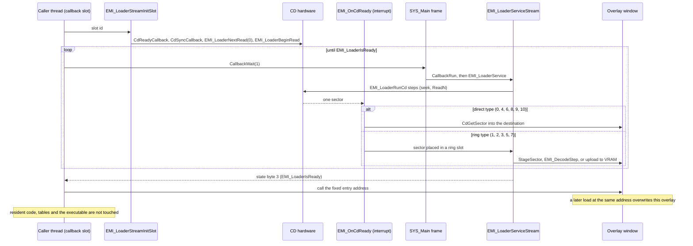

# Loading

*Read this if you need to know how archives, graphics and sound reach RAM, VRAM and the SPU.*

How code and data reach RAM, VRAM and the SPU: the executable and `LOGO.EXE` read, the EMI archive stream
that fills overlays, area data, battle data, graphics and sound banks, and the XA audio stream. Each load
kind has one traced call chain with what blocks and what runs on interrupts. The address ranges are on the
[memory page](memory.md).

Static reading of the game code; nothing here was run on an emulator. Tags: `[read]` is code,
assembly or a header read directly, `[inferred]` is deduced from several reads, `[unknown]` is not
established. Overlay addresses are image-local; `exe/logo` and `exe/slus_004_22` are separate programs
that share one RAM.

## Entry points

| Symbol                     | Image@address                | Role                                                             | Status   |
| -------------------------- | ---------------------------- | ---------------------------------------------------------------- | -------- |
| `SYS_LoadExec`             | `exe/slus_004_22@0x8014E0FC` | reads a PS-X executable: header sector, then the text segment    | `[read]` |
| `SYS_ReadCd`               | `exe/slus_004_22@0x8014E0A8` | blocking sector read with retries                                | `[read]` |
| `EMI_LoaderStreamInitSlot` | `exe/slus_004_22@0x80161FDC` | starts an archive stream for a slot id                           | `[read]` |
| `EMI_LoaderBeginRead`      | `exe/slus_004_22@0x80162178` | converts an LBA to a CD position and arms the CD steps           | `[read]` |
| `EMI_OnCdReady`            | `exe/slus_004_22@0x80162230` | CD-ready callback: one call per sector, dispatches by entry type | `[read]` |
| `EMI_OnCdSync`             | `exe/slus_004_22@0x801621E8` | CD-sync callback                                                 | `[read]` |
| `EMI_LoaderIsReady`        | `exe/slus_004_22@0x80162D00` | true when the stream state byte is 3                             | `[read]` |
| `EMI_LoaderService`        | `exe/slus_004_22@0x80163010` | per-frame tick; picks the EMI or the XA service by CD mode       | `[read]` |
| `EMI_LoaderServiceStream`  | `exe/slus_004_22@0x8016305C` | per-frame drain of the ring slots and the CD steps               | `[read]` |
| `EMI_DecodeBegin`          | `exe/slus_004_22@0x80164028` | sets up the LZ77 decode of one entry                             | `[read]` |
| `EMI_DecodeStep`           | `exe/slus_004_22@0x80164064` | decodes one 0x400-byte half sector                               | `[read]` |
| `SND_StartXaStream`        | `exe/slus_004_22@0x801636A0` | starts an XA audio stream                                        | `[read]` |
| `SND_ServiceXa`            | `exe/slus_004_22@0x801638B0` | per-frame XA state machine                                       | `[read]` |
| `SND_SetBankLayout`        | `exe/slus_004_22@0x80161808` | selects the sound-bank layout before banks stream                | `[read]` |
| `SND_RequestBgm`           | `exe/slus_004_22@0x80161BBC` | maps a music request to a `BGM` slot and streams it              | `[read]` |
| `EMI_StreamFamilyArchive`  | `exe/slus_004_22@0x8016728C` | maps a character family and index to a slot id                   | `[read]` |
| `CallbackWait`             | `exe/slus_004_22@0x8014B87C` | yields the calling callback thread for n frames                  | `[read]` |
| `Scene_Start`              | `emi/etc/game/00@0x801A7704` | loads a scenario overlay and enters it                           | `[read]` |
| `Scene_RequestOverlay`     | `emi/etc/game/00@0x801A7804` | streams `SCENA` slot `scenario_id + 0x295`                       | `[read]` |
| `Game_RunScenarioEntry`    | `emi/etc/game/00@0x801A782C` | calls `entry_00` of the loaded scenario controller               | `[read]` |
| `Logo_Main`                | `exe/logo@0x801CEDFC`        | movie playback of `LOGO.EXE`                                     | `[read]` |

## Load kinds

| Kind             | Entry chain                                                           | Blocking                               | Destination                              |
| ---------------- | --------------------------------------------------------------------- | -------------------------------------- | ---------------------------------------- |
| Executable       | `SYS_RunLogo` to `SYS_LoadExec` to `SYS_ReadCd`                       | blocks the whole program               | `0x801CE000`                             |
| EMI overlay      | caller to `EMI_LoaderStreamInitSlot`, then a `CallbackWait` loop      | blocks the calling thread only         | table address, for example `0x801D0C00`  |
| Area data        | `func_8019FAA0` to `EMI_LoaderStreamInitSlot`                         | blocks the calling thread only         | `WORLD`/`AREA` table addresses           |
| Battle data      | `func_80197C94` to `EMI_LoaderStreamInitSlot`                         | blocks the calling thread only         | `0x801D0C00`, `0x80096800`, `0x800F0800` |
| Graphics to VRAM | ring type 3 to `EMI_LoaderUploadSector`; queue `GFX_RunTransferQueue` | per frame; no wait on completion found | VRAM                                     |
| Audio banks      | `SND_SetBankLayout`, then types 6, 7, 8, 9, 10 in the stream          | part of the overlay wait               | RAM bank records and SPU RAM             |
| XA audio         | `SND_StartXaStream` to `SND_ServiceXa`                                | does not block; the caller polls       | SPU through the CD hardware              |
| Movie            | `Logo_StartStream` to `Logo_DecodeSlice`                              | runs inside `LOGO.EXE`                 | VRAM                                     |

## Executable load: `SYS_LoadExec`

`SYS_RunLogo` loads `LOGO.EXE` once, early in boot. The sequence is below; [boot](boot.md) places it in the
start-up order. `[read]`

1. `SYS_LoadExec(path)` calls `CdSearchFile`, then `CdlSetloc` for the file.
2. `SYS_ReadCd` reads the header sector (`0x800` bytes) to the buffer `D_801459F8` (`0x800E4800`). It copies
   `0x28` header bytes to `D_80143E70`.
3. `SYS_ReadCd` reads `t_size` bytes from the next sector to `t_addr`.
4. `SYS_RunLogo` sets the stack to `0x801FF000`, calls `StopCallback`, `PadStop`, `StopCARD`,
   `EnterCriticalSection`, and then `Exec` with the header block at `D_80143E80`. When `Exec` returns, it
   calls `ExitCriticalSection` and `SYS_InitHardware`, and clears the display.

`SYS_ReadCd` is blocking: `CdRead`, then a loop of `CdReadSync(1)` and `VSync(0)`, with up to 10 attempts.
`[read]` No callback thread runs and no frame is drawn during the read.

`LOGO.EXE` has `t_addr` `0x801CE000`, size `0x1D800`, `pc` `0x801CE724`. `__SN_ENTRY_POINT` clears BSS
`0x801EB430` to `0x801ECEC0` and jumps to `Logo_Main`. `[read]`

## Overlay load: the EMI stream

All other loads go through `EMI_LoaderStreamInitSlot(slot_id)`. A slot id names one archive. The LBA comes
from `g_EmiSlotLbas[slot_id]`. `[read]` The slot ids are the index of the archive in the disc file list. Single
archives:

| Slot id | Archive                                                                                               |
| ------- | ----------------------------------------------------------------------------------------------------- |
| `0`-`8` | `BATL_DRA`, `BATL_END`, `BATL_OVR`, `BATL_RE2`, `BATL_RET`, `BATL_SE`, `BATTLE`, `BATTLE2`, `COMN_SE` |
| `0x254` | `A085SE2`                                                                                             |
| `0x255` | `A108SE2`                                                                                             |
| `0x256` | `AFLDKWA`                                                                                             |
| `0x257` | `BATE`                                                                                                |
| `0x258` | `COMMU00`                                                                                             |
| `0x259` | `COMMU01`                                                                                             |
| `0x25A` | `COMMU02`                                                                                             |
| `0x25B` | `COMMU02B`                                                                                            |
| `0x25C` | `COMMU03`                                                                                             |
| `0x25D` | `COMMU04`                                                                                             |
| `0x25E` | `COMMU05`                                                                                             |
| `0x25F` | `DEMO`                                                                                                |
| `0x260` | `ENDKANJI`                                                                                            |
| `0x261` | `FIRST`                                                                                               |
| `0x262` | `GAME`                                                                                                |
| `0x263` | `MTEST`                                                                                               |
| `0x264` | `RTEST`                                                                                               |
| `0x265` | `SHISU`                                                                                               |
| `0x266` | `SHOP`                                                                                                |
| `0x267` | `SISYOU`                                                                                              |
| `0x268` | `START`                                                                                               |
| `0x269` | `STATUS`                                                                                              |

Numbered series start at a base slot; archive `n` of a series is at `base + n`:

| Base slot | Series                      |
| --------- | --------------------------- |
| `0x9`     | `ENEMY` (`BENEMY/ENEMYnnn`) |
| `0xD1`    | `BGM`                       |
| `0x122`   | `MAGIC` (`BMAGIC/MAGICnnn`) |
| `0x1B2`   | `MAGIC_STREAM` (`BMAG_XA`)  |
| `0x1B3`   | `BOSS`                      |
| `0x1DB`   | `BPLD`                      |
| `0x1EE`   | `BPLU`                      |
| `0x26A`   | `PL`                        |
| `0x27D`   | `PLP`                       |
| `0x295`   | `SCENA`                     |
| `0x2AB`   | `AREA`                      |

The character family argument of `EMI_StreamFamilyArchive` selects the series: 0 `PL`, 1 `BPLD`, 2 `BPLU`,
3 `PLP`. For the file layout
see [../../formats/emi.md](../../formats/emi.md).

Each message maps to code:

| Message                                | Code                                                                                                                                  | Tag      |
| -------------------------------------- | ------------------------------------------------------------------------------------------------------------------------------------- | -------- |
| Caller to `Init`                       | `EMI_LoaderStreamInitSlot(slot_id)` sets the ring base `g_EmiRingBase` to `0x800E4800`, looks up the LBA                              | `[read]` |
| `Init` to CD                           | installs `EMI_OnCdReady` and `EMI_OnCdSync`, calls `EMI_LoaderNextRead(0)` (header state, size `0x800`)                               | `[read]` |
| `CallbackWait(1)` loop                 | `CallbackWait(1)` repeated until `EMI_LoaderIsReady` returns nonzero, in `SYS_EnterFrontend`, `Scene_Start`, `func_8019FAA0`          | `[read]` |
| `CallbackRun` then `EMI_LoaderService` | two steps of the `SYS_Main` loop; the service runs after all callback threads have had a turn                                         | `[read]` |
| `EMI_LoaderRunCd` steps                | `g_EmiCdSteps[D_8014648A]`: idle, set speed, seek, finish seek, `CdlReadN`, finish read, pause, finish pause, idle                    | `[read]` |
| CD to `EMI_OnCdReady`                  | CD-ready interrupt; checks the sector position against `D_80146808`, then runs `g_EmiEntryHandlers[type]`                             | `[read]` |
| Direct types                           | `EMI_LoaderCopySector` copies at interrupt time to `D_80146458`                                                                       | `[read]` |
| Ring types (1, 2, 3, 5, 7)             | 23 ring slots at `g_EmiRingBase + (slot << 11)`; state 1 stage, 2 first sector, 3 graphics, 4 VAB body                                | `[read]` |
| Ring drain                             | `g_EmiSlotDrainFuncs`: 1 `EMI_LoaderStageSector`, 2 `EMI_LoaderReadSector`, 3 `EMI_LoaderUploadSector`, 4 `EMI_LoaderTransferVabBody` | `[read]` |
| State byte 3                           | `EMI_LoaderIsReady` reads the byte at `0x80146494` and compares it with 3                                                             | `[read]` |
| Call the fixed entry address           | for example `SYS_EnterFrontend` calls `func_801D0C04`; `Game_RunScenarioEntry` calls `entry_00`                                       | `[read]` |

### Entry types

`EMI_LoaderReadToc` reads the first sector of the archive. It checks the tag at `g_EmiHeaderTag`
(`MATH_TBL`), builds cumulative sector offsets in `D_80146678[]`, and sets `D_80146844` and `D_80146848`.
`EMI_LoaderNextRead(slot)` then loads size, `load_arg`, first word and type for the next entry. `[read]`

|  Type | Handler (`g_EmiEntryHandlers`) | Path                 | Effect                                                       |
| ----: | ------------------------------ | -------------------- | ------------------------------------------------------------ |
|     0 | `EMI_LoaderCopyPayload`        | direct               | copies sectors to the `load_arg` address                     |
|  1, 2 | `EMI_LoaderQueuePayload`       | ring, states 1 and 2 | LZ77 decode to the `load_arg` address                        |
|     3 | `EMI_LoaderLoadGraphics`       | ring, state 3        | uploads each sector to VRAM                                  |
|     4 | `EMI_LoaderReadToc`            | direct               | second `EMI_LoaderReadToc` state; no caller of it was traced |
|     5 | `EMI_LoaderReadToc`            | ring                 | header sector of the archive (first read of every stream)    |
|     6 | `EMI_LoaderLoadVabHeader`      | direct               | VAB header to the bank record                                |
|     7 | `EMI_LoaderLoadVabBody`        | ring, state 4        | VAB body to SPU RAM                                          |
|     8 | `EMI_LoaderLoadVabCues`        | direct               | cue table to the bank record                                 |
| 9, 10 | `EMI_LoaderLoadSequence`       | direct               | sequence to the bank's `sequence_buffer`                     |

The type names above are the function names; the loader code does not name the types. `[inferred]`

The direct types are 0, 4, 6, 8, 9 and 10. `[read]` Ring slots protect order. If the target slot is occupied, or the first word of the sector differs from the
cached `first_word` of the table, the read is flagged for retry (`D_80146480` set to 1). A counter of 300
frames rearms the read when progress stalls. `[read]`

### Decode

For a compressed entry (types 1 and 2), `EMI_LoaderReadSector` calls `EMI_DecodeBegin(dest)` and then
`EMI_LoaderStageSector`. `StageSector` copies each sector as two `0x400`-byte halves to the scratchpad
(`0x1F800000`) and calls `EMI_DecodeStep` for each half. The decode context is at `0x800327A0`. The source
pointer starts at scratchpad offset 6 and the limit is offset `0x400`. `[read]` The format is on [../../formats/lz77.md](../../formats/lz77.md).

### End of a stream

After the last entry, `EMI_LoaderEndStream` sets CD step 6 (pause) and `D_8014648B` to 2. `EMI_LoaderFinishPause`
then sets the state byte to 2 and removes the ready callback. `EMI_LoaderServiceStream` moves the state byte
from 2 to 3 on a frame with no ring slot to drain. `[read]` The stream is therefore ready one frame after
the last data, not at the last sector.

### CD service mode

`g_EmiServiceMode` holds the CD service mode: 0 idle (`EMI_LoaderInit`), 1 EMI stream
(`EMI_LoaderStreamInitSlot`), 2 XA stream (`SND_StartXaStream`). `EMI_LoaderService` runs
`EMI_LoaderServiceStream` in mode 1 and `SND_ServiceXa` in mode 2. `[read]` Only one stream owns
the CD at a time. When an EMI stream starts in mode 2, `EMI_LoaderStreamInitSlot` makes one non-blocking
`CdSync(1)` check. If the status has any of the bits `0xE0` set, it sets `D_8014648B` to 1 and
`EMI_LoaderBeginRead` starts at the pause step instead of the speed step. `[read]` The new stream takes over
mode and callbacks at once; nothing waits for the XA stream to end. `[read]`

## When overlays swap

Every swap starts with one `EMI_LoaderStreamInitSlot` call. Code outside battle mostly waits in a
`CallbackWait` loop. Battle code polls `EMI_LoaderIsReady` from a step machine instead: `func_801D7108`
(`emi/battle/battle/03@0x801D7108`) starts a stream only when the loader is ready and advances `g_BattleSubStep`. `[read]`
The table groups the call sites in the code read; functions not read are not covered.

| Trigger                | Caller                                                          | Slot                                                                                                                                     | Waits for                               | Tag      |
| ---------------------- | --------------------------------------------------------------- | ---------------------------------------------------------------------------------------------------------------------------------------- | --------------------------------------- | -------- |
| First start, reset     | `SYS_StartFrontend` (`exe/slus_004_22@0x8014EA80`)              | `FIRST` (`0x261`)                                                                                                                        | `EMI_LoaderIsReady`                     | `[read]` |
| Title                  | `SYS_EnterFrontend` (`exe/slus_004_22@0x8014EC64`)              | `GAME` (`0x262`)                                                                                                                         | `EMI_LoaderIsReady`                     | `[read]` |
| Camp menu pages        | `Game_LoadCampMenu`, `func_80197620`, `Game_LoadShopOverlay`    | `START` `0x268`, `STATUS` `0x269`, `SHOP` `0x266`; `SHISU`, `BATE`, `SISYOU` by other callers                                            | the same loop                           | `[read]` |
| Dialogue               | `func_801976EC`, `func_801983D8`; `etc/commu00/00` for the rest | `COMMU00` (`0x258`); `COMMU01` to `COMMU05`                                                                                              | loop for `COMMU00`; the rest not traced | `[read]` |
| Title demo             | `Game_BeginTitle` (`emi/etc/game/01@0x801D0C90`)                | `DEMO`                                                                                                                                   | not traced                              | `[read]` |
| Scenario               | `Scene_Start` to `Scene_RequestOverlay`                         | `SCENA` + scenario id (`0x295 + id`)                                                                                                     | the same loop                           | `[read]` |
| Area change            | `func_8019FAA0` (`emi/etc/game/00@0x8019FAA0`)                  | `AREA` + area seed (`0x2AB + seed`)                                                                                                      | the same loop                           | `[read]` |
| Audio-only area reload | `func_801D7108` (`emi/battle/battle/03@0x801D7108`)             | `AREA` + `g_GameAreaId`, with `g_EmiStreamFlags` bit `0x20`                                                                              | battle step machine                     | `[read]` |
| Inside battle          | `battle/03`, `battle/15`                                        | `BATL_SE`, `BATL_RET`, `BATL_END`, `BATL_OVR`, `BATL_DRA`, `BATL_RE2`, `COMN_SE`, `ENEMY` + area, `AFLDKWA`, `BPLD`, `BPLU`, `MAGIC` ids | battle step machines                    | `[read]` |
| Battle entry           | `func_80197AA4`, `func_80197C94`                                | `BPLD`, `BPLU`, then `BATTLE` (6) or `BATTLE2` (7)                                                                                       | the same loop                           | `[read]` |
| Music                  | `SND_RequestBgm`                                                | `D_80181EB8[request * 4]`                                                                                                                | `SND_StartBgm` waits                    | `[read]` |
| Character graphics     | `EMI_StreamFamilyArchive`                                       | `PL` `0x26A`, `BPLD` `0x1DB`, `BPLU` `0x1EE`, `PLP` `0x27D` plus index                                                                   | `EMI_LoaderStreamFamily` waits          | `[read]` |

`func_8019FAA0` loads area data only when `g_GameAreaId` differs from the seed and `g_GameStateIndex` is 5.
`Scene_Start` waits, and also runs `func_801992B8` while it waits when the area id is valid and
`g_GameStateIndex` is not 5. `[read]` The conditions that decide when a change of area happens are on the
[area page](area.md) and [scenario page](scenario.md).

Bit `0x20` of `g_EmiStreamFlags` makes `EMI_LoaderNextRead` end the stream at the first entry with a type below 6, so
only the leading audio entries load. `EMI_LoaderServiceStream` clears the flag at the end of the stream.
`[read]` `func_801976EC`, `func_801983D8`, `func_801985C8`, `Master_RunSceneEvent`, `func_801D7108`, `func_801D7234` and
`func_801F1824` set it.

## Traced chains

### Title

`SYS_Main` registers `SYS_StartFrontend` in slot 0 at boot. `[read]`

1. `SYS_StartFrontend` calls `GFX_ClearRect`, `CallbackWait(1)`, `SND_Init`, `SND_SetBankLayout(0)`, and
   `EMI_LoaderStreamInitSlot(0x261)` with a wait loop. It then sets reverb, calls `SND_Start`, clears
   `4272` bytes at `D_801448D8`, resets the game flags, and calls `CallbackRegister(1, SYS_EnterFrontend)`
   and `CallbackExit`.
2. `SYS_EnterFrontend` calls `EMI_LoaderStreamInitSlot(0x262)` with a wait loop, then calls `func_801D0C04`,
   which is `Game_RunTitle` at `emi/etc/game/01@0x801D0C04`. `Game_RunTitle` never returns.
3. `Game_StartSelectedGame` (`emi/etc/game/01@0x801D0E54`) calls `Scene_Start(16)` and
   `CallbackRegister(0, Game_RunMainLoop)`.

A soft reset (select and start held for 61 frames, with `EMI_LoaderIsReady`) calls `SND_Exit` and
`CallbackStopAll`, then `CallbackRegister(0, SYS_StartFrontend)`, so `FIRST.EMI` and `GAME.EMI` stream
again. `[read]`

### Scenario

`Scene_Start(id)` sets the scenario state and calls `Scene_RequestOverlay`, which calls
`EMI_LoaderStreamInitSlot(scenario_id + 0x295)`. It waits with `CallbackWait`, then calls
`Game_RunScenarioEntry`, which calls `g_SceneScenes[scenario_id]->entry_00()` and then
`Game_RunSceneUpdate`. Each `SCENA` archive is one type-0 entry at `0x801F6C00`. `[read]`

### Area

`func_8019FAA0` clears the actors and palette fades and restarts the music with `SND_StartBgm`. If the area
changes, it calls `EMI_LoaderStreamInitSlot(seed + 0x2AB)` and waits. A typical `WORLD`/`AREA` archive has
14 entries: audio bank 2 (types 6, 8, 7), the scene table, the script bank, graphics, three palette slices,
the area table, the encounter table, the text bank, the map bundle, and the area program at `0x801F2C00`
last. Some areas add a code block at `0x801EEC00` or `0x80117000`. `area030` has 23 entries, with code at
`0x801D0C00` and a companion at `0x800F5000`. `[read]` Because the area program is the last entry, the
stream is ready only after the program has been written. `[inferred]`

`Resource_RequestArea`, `Resource_Resolve`, `Area_RequestCellRows` and `Area_LoadPaletteBank` do not read
the disc. `Resource_Resolve` looks up a message in the table at `0x8001A000`; `Area_RequestCellRows` queues
cell row ids; `Area_LoadPaletteBank` copies palette records in RAM. `[read]` See [../field.md](../field.md)
and [../../formats/area.md](../../formats/area.md).

### Battle

The battle mode table `g_GameModeHandlers[8]` (`emi/etc/game/00@0x801C7B54`) runs these entries in order:
`func_80197A60`, `func_80197AA4`, `func_80197C1C`, `func_80197C94`, `func_80197E54`, `Battle_Update`
`Battle_Update (emi/battle/battle/03@0x801D1014)`, `func_80197EFC`, `func_80197F48`. `[read]`

1. `func_80197AA4` streams `BPLD` and `BPLU` and calls `SND_SetBankLayout(1)`.
2. `func_80197C94` pauses the music and saves the sequence state (`0x560` = 1376 bytes from `D_80148A50` to
   `D_8018E268`). It streams the battle archive `D_801CD86C[D_801CD78F[enc * 4]]`, or slot 6 when
   `scenario_id` is below 8, otherwise slot 7. `[read]`
3. The archive writes `battle/03` to `0x801D0C00`, `battle/15` to `0x80096800` and the script bank to
   `0x800F0800`. `Battle_Update` then runs from the table.
4. `func_80197F48` restores the music and sets `g_GameEntryState` back to 2.

`BATTLE.EMI` and `BATTLE2.EMI` are byte-identical. `[read]` See [../battle.md](../battle.md) and the
[battle page](battle.md).

### Graphics to VRAM

There are three paths. `[read]`

- Ring type 3: `EMI_LoaderLoadGraphics` unpacks `load_arg` into a start column `(arg >> 24) & 0x3F`, a row
  `(arg >> 16) & 0x1F` and a column count before wrap `(arg >> 8) & 0x3F`. `EMI_LoaderUploadSector` then
  calls `LoadImage` for each `0x800`-byte sector as a 32 by 32 block, bounded to x below 1001 and y below
  501.
- Palette: `GFX_UploadPalette` runs every frame in `SYS_Main`. When `g_GfxPalettePending` is set it calls
  `LoadImage` for rect (0, `0x1E0`, `0x100`, `0x20`) from `0x80037800`.
- Queue: `GFX_RunTransferQueue` runs every frame. It walks `D_80145A00`: kind 1 `GFX_ExpandRgb555`, kind 2
  `GFX_DecodeLzss`, otherwise `LoadImage`.

No wait for the completion of `LoadImage` was found in the loader. `[unknown]` Whether another `DrawSync`
covers it is open. See [../../formats/graphics.md](../../formats/graphics.md).

### Audio banks

`SND_SetBankLayout(layout)` runs before a bank stream. Layout 0 is set by `SYS_StartFrontend` and
`Game_StartSelectedGame`, layout 2 by `Game_BeginTitle`, layout 1 by the battle entry. `[read]` The archive
then carries three entries per bank:

- Type 6 `EMI_LoaderLoadVabHeader` copies the header into the bank record and closes the old sequence with
  `SsSepClose`.
- Type 7 `EMI_LoaderLoadVabBody` sets SPU DMA mode, calls `SsVabClose`, and `SsVabOpenHeadSticky` with the
  bank record. In ring state 4, `EMI_LoaderTransferVabBody` moves the body with `SsVabTransBodyPartly` and
  `SsVabTransCompleted`, opens the sequence with `SsSepOpenJ`, and may call `SND_PlaySequence`.
- Type 8 `EMI_LoaderLoadVabCues` copies the cue table. Types 9 and 10 `EMI_LoaderLoadSequence` copy the
  sequence and set flag bit 2.

`BGM` archives hold only types 6, 10 and 7, with no code.
`[read]` See [audio](audio.md) and [../../formats/audio.md](../../formats/audio.md).

### XA audio

`SND_StartXaStream(key, _)` sets `g_EmiServiceMode` to 2 and `g_EmiServiceState` to 1, and resolves the start and
end of the stream with `SND_ResolveXaStream` (slot ids `0x2A9`, `0x1B2`, `0x2AA` from `D_80183230`; offset
tables `D_8018323C`). It installs `SND_StoreXaSyncResult` as the CD-sync callback. `[read]`

`SND_ServiceXa` runs one state per frame from `g_XaStateFuncs`: 0 idle, 1 seek (mode `0xC8`, `CdSeekP`), 2 seek
result, 3 `CdlSetfilter` and `CdlReadS`, 4 progress, 5 `getlocL` until the position reaches the end bound, 6
`CdlPause` with a CD volume fade, 7 pause result (sets the state byte to 3), 8 wait for sync. The timeout is
`0xB5` ticks with up to 6 retries. `[read]` The sound goes from the CD to the SPU; no sample reaches main
RAM. `SND_StartXaStream` clears the state byte, so `EMI_LoaderIsReady` is false until state 7. None of the seven
functions that call `SND_StartXaStream` calls `EMI_LoaderIsReady`. `[read]`

### Movie

The only movie code is in `LOGO.EXE`. `Logo_Main` calls `CdInit`, `Logo_Init(0x8003B800, D_801D8BB0)` and a
loop of `PadRead` (start skips) and `Logo_DrawFrame`; `Logo_StopStream` fades the audio. `Logo_StartStream`
calls `StSetRing`, `StSetStream`, `CdlSetfilter` and `CdRead2` in stream mode. Frames come from `StGetNext`,
`DecDCTvlc`, `DecDCTin` and `DecDCTout`; the `DecDCTout` callback `Logo_DecodeSlice` loads 24-wide slices
with `LoadImage`. `D_801D8BB0` (`0x0002D78C`) is the base LBA of `CAPCOM30.STR`. `[read]` The main
executable has no `DecDCT` or `StSetStream` call, so the game has no other movie. `[inferred]` See
[../../formats/str.md](../../formats/str.md).

## Key data

| Data                  | Address                      | Role                                                      |
| --------------------- | ---------------------------- | --------------------------------------------------------- |
| `g_EmiSlotLbas`       | `exe/slus_004_22@0x80182444` | slot id to LBA                                            |
| `g_EmiEntryHandlers`  | `exe/slus_004_22@0x80183248` | entry type to handler                                     |
| `g_EmiCdSteps`        | `exe/slus_004_22@0x80149C3C` | CD step functions                                         |
| `g_EmiSlotDrainFuncs` | `exe/slus_004_22@0x80149C60` | ring slot state to drain function                         |
| `g_EmiServiceMode`    | `exe/slus_004_22@0x80146840` | CD service mode                                           |
| `g_EmiStreamState`    | `exe/slus_004_22@0x80146494` | stream state byte (3 means ready)                         |
| `g_EmiStreamFlags`    | `exe/slus_004_22@0x80146854` | stream flags; bit `0x20` loads only leading audio entries |
| `g_EmiRingBase`       | `exe/slus_004_22@0x80146464` | ring base, `0x800E4800`                                   |
| `g_XaStateFuncs`      | `exe/slus_004_22@0x80183274` | XA state table                                            |
| `g_GameModeHandlers`  | `emi/etc/game/00@0x801C7B54` | battle mode functions                                     |
| `g_SceneScenes`       | `emi/etc/game/00`            | 20 scenario controller pointers                           |

`g_EmiSlotLbas` holds 887 LBAs (slot ids reach `0x2AD`).

## Connections

- [memory](memory.md): address ranges and windows. [boot](boot.md), [frame-loop](frame-loop.md),
  [scheduler](scheduler.md): the callers and the per-frame tick.
- [phases](phases.md), [scenario](scenario.md), [area](area.md), [battle](battle.md),
  [screens](screens.md), [rendering](rendering.md), [audio](audio.md).
- [../runtime.md](../runtime.md), [../battle.md](../battle.md), [../field.md](../field.md),
  [../records.md](../records.md).
- [../../formats/emi.md](../../formats/emi.md), [../../formats/area.md](../../formats/area.md),
  [../../formats/audio.md](../../formats/audio.md), [../../formats/graphics.md](../../formats/graphics.md),
  [../../formats/str.md](../../formats/str.md), [../../formats/lz77.md](../../formats/lz77.md).

## Gaps

- `[unknown]` Whether `LoadImage` completion is awaited anywhere in the loader.
- `[unknown]` Whether a wider game state keeps `SND_StartXaStream` from starting during an EMI stream; no check exists in its callers.
- `[unknown]` What restores non-audio data after a battle. `func_801D7108` reloads only area audio, and `BATTLE.EMI` writes the text table at `0x8001A000`.
- `[unknown]` Callers of the `BOSS` slot (`0x1B3`), `ENDKANJI` (`0x260`), `MTEST` (`0x263`) and `RTEST`
  (`0x264`); none found in the code read.
- `[unknown]` Exact conditions in `func_8019FAA0` that choose a world or area change; the function is long and branches on state values not traced.
- `[unknown]` Whether a load into a window can start while its previous overlay still runs. No guard was
  found.
