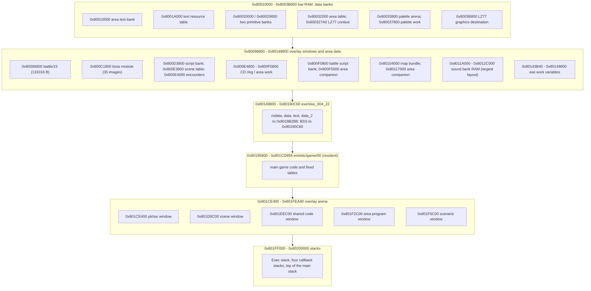

# Memory

*Read this if you need the RAM map, or want to know which overlay sits where.*

The main-RAM map of the running game: which image owns which address range, which overlays replace each
other at the same address, and where the scratchpad, stacks, ring buffer and sound banks sit. The
[loading page](loading.md) shows how each range gets filled.

Static reading of the game code; nothing here was run on an emulator. Tags: `[read]` is code,
assembly, a header or a config read directly, `[inferred]` is deduced from several reads, `[unknown]` is
not established. Overlay addresses are image-local; `exe/logo` and `exe/slus_004_22` are separate programs
that share one RAM.

## Entry points

| Symbol                     | Image@address                | Role                                                                       | Status   |
| -------------------------- | ---------------------------- | -------------------------------------------------------------------------- | -------- |
| PS-X header                | `exe/slus_004_22@0x80096800` | `t_addr`, `t_size`, `pc0`, `s_addr` of the main executable                 | `[read]` |
| `SYS_PrepareFrame`         | `exe/slus_004_22@0x8014B020` | sets the primitive cursor and the CD sector buffer pointers                | `[read]` |
| `SYS_RunLogo`              | `exe/slus_004_22@0x8014AEE0` | sets the `Exec` stack to `0x801FF000`                                      | `[read]` |
| `CallbackInitThreads`      | `exe/slus_004_22@0x8014B6B4` | seeds each callback thread with its stack top (`0x801FF400 + 0x200*(i+1)`) | `[read]` |
| `stup2`                    | `exe/slus_004_22@0x8014AA0C` | clears the BSS `0x8018B2B8..0x80190C60`                                    | `[read]` |
| `stup1`                    | `exe/slus_004_22@0x8014AA30` | sets `sp` to `0x80200000` and declares the heap                            | `[read]` |
| `SND_SetBankLayout`        | `exe/slus_004_22@0x80161808` | builds the seven sound-bank records from three layouts                     | `[read]` |
| `EMI_LoaderStreamInitSlot` | `exe/slus_004_22@0x80161FDC` | sets the ring base `0x800E4800`                                            | `[read]` |
| `EMI_DecodeBegin`          | `exe/slus_004_22@0x80164028` | sets the LZ77 context at `0x800327A0` and the scratchpad window            | `[read]` |
| `GFX_ResetPalette`         | `exe/slus_004_22@0x8014E284` | clears the palette arena and refills the palette work area                 | `[read]` |

## Memory map

The arrows only order the blocks by address. The diagram does not show a call or data flow.

### Ranges

Sizes are the sizes of the extracted images or
archive table sizes; "up to" is the largest value seen across images.

| Range                           | Owner                                 | Content                                                                                                                                                                                  | Tag          |
| ------------------------------- | ------------------------------------- | ---------------------------------------------------------------------------------------------------------------------------------------------------------------------------------------- | ------------ |
| `0x1F800000` +0x400             | scratchpad                            | `g_SpadWork` cell at `0x1F800044`; EMI decode window                                                                                                                                     | `[read]`     |
| `0x80010000` up to +0xA000      | area archive entry 11                 | per-area text bank                                                                                                                                                                       | `[read]`     |
| `0x8001A000` up to +0x41E8      | `FIRST.EMI` and `BATTLE.EMI` entry 11 | text resource table (`RESOURCE_TABLE_BASE`)                                                                                                                                              | `[read]`     |
| `0x80020000` .. `0x80032000`    | `SYS_PrepareFrame`                    | two primitive banks of `0x9000` bytes, picked by buffer index                                                                                                                            | `[read]`     |
| `0x80032000` +0x1388            | area archive                          | area table, read as nibbles by `func_801C6FD4`                                                                                                                                           | `[read]`     |
| `0x800327A0`                    | `EMI_DecodeBegin`                     | LZ77 decoder context                                                                                                                                                                     | `[read]`     |
| `0x80033800` +0x4000            | `GFX_ResetPalette`                    | palette arena; archives load CLUT slices at `0x80033A00`, `0x80033C00`, `0x80033E00`, `0x80035800`, `0x80036C00`, `0x80036E00`                                                           | `[read]`     |
| `0x80037800` +0x4000            | `g_GraphicsPaletteDst`                | palette work: 32 rows of `0x200` bytes, uploaded by `GFX_UploadPalette`                                                                                                                  | `[read]`     |
| `0x8003B800`                    | `PLCHAR`, `BPLCHAR`, `START` graphics | LZ77 destination for character graphics; `LOGO_WORK_BASE`                                                                                                                                | `[read]`     |
| `0x80096800` +`0x208C4`         | `battle/15`                           | battle data module, loaded with `battle/03`                                                                                                                                              | `[read]`     |
| `0x800C1800` (window `0x33800`) | boss modules (35 images)              | boss code, at most `0x1E14` bytes of the window; the rest is data                                                                                                                        | `[inferred]` |
| `0x800D3800` up to +0x40A8      | area archive                          | area script bank                                                                                                                                                                         | `[read]`     |
| `0x800E3800`                    | area archive                          | scene table (`SCENE_TABLE_BASE`)                                                                                                                                                         | `[read]`     |
| `0x800E4000` +0x488             | area archive                          | encounter table                                                                                                                                                                          | `[read]`     |
| `0x800E4800` .. `0x800F0800`    | `EMI_LoaderStreamInitSlot`            | CD ring: slot 0 for the header, 23 ring slots of `0x800` bytes                                                                                                                           | `[read]`     |
| `0x800F0800` +0xE6C             | battle archives                       | battle script bank                                                                                                                                                                       | `[read]`     |
| `0x800F5000`, `0x80117000`      | single area archives                  | extra area code blocks (`area030/05`, `area049/13`)                                                                                                                                      | `[read]`     |
| `0x80104000` up to +0x1126C     | area archive                          | map bundle                                                                                                                                                                               | `[read]`     |
| `0x8011A000` .. `0x8012C000`    | `SND_SetBankLayout`                   | sound-bank RAM; the end depends on the layout                                                                                                                                            | `[inferred]` |
| `0x80143B40` .. `0x80149800`    | `exe/slus_004_22`                     | work variables below the code, for example `D_80143B40`, `g_EmiRingBase`, `D_80148A50`; the lower bound is the lowest one seen                                                           | `[read]`     |
| `0x80149800` .. `0x8018B2B8`    | `exe/slus_004_22`                     | rodata, data, text, data_2                                                                                                                                                               | `[read]`     |
| `0x8018B2B8` .. `0x80190C60`    | `exe/slus_004_22`                     | BSS, cleared by `stup2`                                                                                                                                                                  | `[read]`     |
| `0x80195800` +`0x38158`         | `emi/etc/game/00`                     | resident game code and tables, from `GAME.EMI` entry 0                                                                                                                                   | `[read]`     |
| `0x801CE000` +`0x1D800`         | `exe/logo`                            | `LOGO.EXE` image, ending at `0x801EB800` (BSS to `0x801ECEC0`); overlaps only the plchar window (`0x801CE400`) and the scene window (`0x801D0C00`), not the shared window (`0x801EEC00`) | `[read]`     |
| `0x801CE400`                    | `PLCHAR/PLP012`                       | character code (up to 9932 bytes over 19 images)                                                                                                                                         | `[read]`     |
| `0x801D0C00` .. `0x801EDAD0`    | scene window                          | one scene overlay (18 images, largest `battle/03`: extracted size `0x1CDD0`; the earlier figure `0x1CED0` is `[unknown]`, possibly a TOC size)                                           | `[read]`     |
| `0x801EEC00`                    | shared code window                    | 128 images (battle end and overlay, magic, `commu00`, `start/09`); up to 16076 bytes                                                                                                     | `[read]`     |
| `0x801F2C00`                    | area program window                   | 200 area programs; up to 16324 bytes                                                                                                                                                     | `[read]`     |
| `0x801F6C00` .. `0x801FEA80`    | scenario window                       | 20 scenario controllers; up to 32384 bytes                                                                                                                                               | `[read]`     |
| `0x801FF000`                    | `SYS_RunLogo`                         | stack for the `Exec` of `LOGO.EXE`                                                                                                                                                       | `[read]`     |
| `0x801FF400` .. `0x801FFC00`    | `CallbackInitThreads`                 | four `0x200`-byte thread stacks for callback slots 0 to 3                                                                                                                                | `[read]`     |
| `0x801F8000` .. `0x80200000`    | `stup1`                               | main stack reservation of `0x8000` bytes; it overlaps the scenario window and the thread stacks                                                                                          | `[read]`     |

## Executable image

The header of `SLUS_004.22` states `t_addr` `0x80096800`, `t_size` `0x160800`, `pc0` `0x8014AA0C`
(`stup2`) and `s_addr` `0x801FFFF0`. RAM address equals `0x80096000` plus the file offset. `[read]`

The first `0xB3000` bytes of the image are zeroes with a few stamp words. They reserve RAM for later loads.
The real code and data sit at `0x80149800` to `0x8018B2B8`. The reserved slots are `0x80096800` (`0x2B000`),
`0x800C1800` (`0x33800`), `0x800F5000` (`0x22000`) and `0x80117000` (`0x32800`). The file also holds zeroes
from `0x8018B2B8` to `0x801D0400`, apart from stamp words at `0x80195800` and `0x801CE400`, and a tail pad
at `0x801F6800`. `[read]` The stamp words run `6` to `0xF`; their meaning is `[unknown]`.

The main executable therefore does not occupy its `t_addr`. The first loaded data at `0x80096800` is
`battle/15`, and the resident `emi/etc/game/00` lands in the zero gap at `0x80195800`. `[read]`

## Overlay windows

Each window is one fixed address. A load writes to the address in the archive table entry. No eviction or
unload code was found, so a later load at the same address overwrites the earlier one. `[inferred]` The
loader checks only the first word of each entry against the table, not what was there before.

| Window       | Occupants, one at a time                                                                             | Replaced when                              |
| ------------ | ---------------------------------------------------------------------------------------------------- | ------------------------------------------ |
| `0x801CE400` | `PLCHAR` and `PLP` character code                                                                    | another character archive loads            |
| `0x801D0C00` | title (`GAME.EMI` entry 1), `START`, `STATUS`, `SHOP`, `SISYOU`, `BATE`, `battle/03`, some area code | the next menu, battle or area archive      |
| `0x801EEC00` | `START` entry 9, `SHOP` entry 8, `COMMU00`, `BMAGIC`, `BATL_END`, `BATL_OVR`, some area code         | the next archive with code at this address |
| `0x801F2C00` | the area program of the current area                                                                 | the next `AREA` or `WORLD` archive         |
| `0x801F6C00` | the scenario controller of the current scenario                                                      | the next `SCENA` archive                   |
| `0x800C1800` | boss module                                                                                          | the next `BOSS` archive                    |

Which occupant is live follows from the last archive loaded for the window. `[inferred]` Nothing in the code
records the live occupant, so the resident code reaches into a window by fixed address and relies on the
caller to have loaded the right archive. `[inferred]`

- The area script opcode table `D_801C7C70[187]` and the scene event table `g_SceneEvents[64]` mix handlers
  in the resident image (`0x8019xxxx`, `0x801Axxxx`) with handlers in the scene window (`0x801Dxxxx`), the
  area program window (`0x801F2Cxx` and up) and the scenario window (`0x801F6xxx` and up). `[read]`
- `g_SceneScenes[20]` holds 20 pointers into the scenario window, and `Game_RunScenarioEntry`
  `Game_RunScenarioEntry (emi/etc/game/00@0x801A782C)` calls `entry_00` of the selected one. `[read]`
- `g_GameModeHandlers[8]` (`emi/etc/game/00@0x801C7B54`) holds `Battle_Update`
  `Battle_Update (emi/battle/battle/03@0x801D1014)` at index 5. `[read]`
- `battle/03` (`0x801D0C00`) and `battle/15` (`0x80096800`) come from the same battle archive and coexist.
  `[read]` BATTLE.EMI and BATTLE2.EMI are byte-identical.

The logo image (`0x801CE000` to `0x801EB800`) ends below the shared code window (`0x801EEC00`) and overlaps only the plchar window
(`0x801CE400`) and the scene window (`0x801D0C00`). Both are empty while the logo runs. `[read]` (addresses); `[inferred]` (empty)

## Scratchpad

The scratchpad is `0x400` bytes at `0x1F800000`. `g_SpadWork` is a pointer cell at
`0x1F800044`. `[read]` `EMI_DecodeBegin` points the LZ77 source at scratchpad offset 6 and its limit at
offset `0x400`, so the decoder uses the whole scratchpad as a sector window. `[read]` The share between
`g_SpadWork` users and the decoder is `[unknown]`; the decoder runs only during a load.

## Stacks

| Stack                      | Top                            | Set by                                                | Tag      |
| -------------------------- | ------------------------------ | ----------------------------------------------------- | -------- |
| Main                       | `0x80200000`                   | `stup1`; it replaces the header `s_addr` `0x801FFFF0` | `[read]` |
| `LOGO.EXE` `Exec`          | `0x801FF000`                   | `SYS_RunLogo` (`D_80143EA0`)                          | `[read]` |
| Callback slot `i` (0 to 3) | `0x801FF400 + 0x200 * (i + 1)` | `CallbackInitThreads`                                 | `[read]` |

The thread stacks occupy `0x801FF400` to `0x801FFC00`. The main stack has `0x400` bytes above them, so a deeper
main stack writes into slot 3. `[inferred]` `SYS_Main` does its game work through the threads, and its real
depth is `[unknown]`. The `Exec` stack lies below the thread stacks and is used only while the logo runs. `[read]`

## Heap and buffers

- `stup1` calls `InitHeap` with the range `0x80190C64..0x801F8004`. That range overlaps the resident overlay and the overlay arena, and the executable has no allocator thunk, so the heap is unused. See [boot](boot.md). `[inferred]`
- Primitive banks: `SYS_PrepareFrame` sets `g_GfxPrimCursor` to `0x80020000 + buffer_index * 0x9000`, so two
  banks end at `0x80032000`. `[read]`
- CD ring: `g_EmiRingBase` is `0x800E4800`. The 23 ring slots of `0x800` bytes end at `0x800F0800`. Slot 0
  receives the header sector. `[read]` `SYS_LoadExec` reads its header sector to the same address through
  `D_801459F8`. `[read]`
- `D_801459FC` is `0x800F5000` (`AREA_CODE_BASE`) and `AREA_WORK_WINDOW_ADDRESS` is `0x800E4800`. The area
  work window and the CD ring share the range, so no area work data is safe in it while an archive streams.
  `[inferred]`
- Palette arena: `GFX_ResetPalette` zeroes rows 28 to 31 of the 16 KB arena at `0x80033800`, then copies 32
  rows of `0x200` bytes to `0x80037800`. `GFX_UploadPalette` sends rect (0, 0x1E0, 0x100, 0x20) from there
  to VRAM when `g_GfxPalettePending` is set. `[read]`

## Sound memory

`SND_SetBankLayout` starts at `0x8011A000` and advances by two per-bank sizes, `D_8018239C` and `D_801823F0`.
SPU RAM addresses come from `D_80182348[3][7]`. `[read]` The sums put the end of the bank RAM at `0x8012C000`
(layout 0), `0x8012B840` (layout 1) and `0x8012B5E0` (layout 2). `[inferred]`

| Layout | Caller                                        | Banks used | SPU addresses                                                              |
| -----: | --------------------------------------------- | ---------: | -------------------------------------------------------------------------- |
|      0 | `SYS_StartFrontend`, `Game_StartSelectedGame` |          3 | `0x1010`, `0x3E0A0`, `0x4F210`                                             |
|      1 | battle entry `func_80197AA4`                  |          7 | `0x1010`, `0x3E0A0`, `0x520F0`, `0x5B170`, `0x62A90`, `0x6A3A0`, `0x71CC0` |
|      2 | `Game_BeginTitle`                             |          2 | `0x1010`, `0x6C6D0`                                                        |

All three layouts put bank 0 at SPU address `0x1010`, so a layout change reuses SPU RAM. `[inferred]` The
[audio page](audio.md) covers the banks. XA audio does not use main RAM: the CD hardware sends it to the
SPU. `[read]`

## VRAM

The code addresses VRAM only through `LoadImage` rects. Three uses are fixed in code:

| Rect                                                          | Source                    | Writer                                                            | Tag      |
| ------------------------------------------------------------- | ------------------------- | ----------------------------------------------------------------- | -------- |
| (0, 0x1E0, 0x100, 0x20)                                       | `0x80037800` palette work | `GFX_UploadPalette`                                               | `[read]` |
| 32 by 32 blocks at `x = column * 32`, `y = (row & 0x3F) * 32` | ring sectors              | `EMI_LoaderUploadSector`, bounded to x below 1001 and y below 501 | `[read]` |
| 24-wide slices                                                | logo decode buffer        | `Logo_DecodeSlice`                                                | `[read]` |

The full VRAM split between frame buffers, textures and palettes is `[unknown]`; see [rendering](rendering.md).

## Connections

- [loading](loading.md): how each range is filled.
- [boot](boot.md), [frame-loop](frame-loop.md), [scheduler](scheduler.md): stacks, buffers and the callback
  threads.
- [rendering](rendering.md), [audio](audio.md): primitive banks, VRAM, sound banks.
- [../runtime.md](../runtime.md), [../battle.md](../battle.md), [../field.md](../field.md),
  [../records.md](../records.md).
- [../../formats/emi.md](../../formats/emi.md), [../../formats/area.md](../../formats/area.md),
  [../../formats/audio.md](../../formats/audio.md), [../../formats/graphics.md](../../formats/graphics.md),
  [../../formats/lz77.md](../../formats/lz77.md).

## Gaps

- `[unknown]` Meaning of the stamp words `6` to `0xF` in the executable file.
- `[unknown]` Whether the area table at `0x80032000` is live while the LZ77 context at `0x800327A0` is in
  use; the two ranges overlap.
- `[unknown]` The final VRAM split.
- `[unknown]` The field each per-bank size block feeds, the end of the used SPU RAM, and the real main stack depth.
- `[unknown]` Whether anything below `0x80143B40` and above `0x8012C000` is used; `D_8012D880` (the cell-row pool) is the one symbol seen there.
- `[unknown]` Which occupant of a shared window is live at a given moment; the code does not record it.
- `[unknown]` Callers of the `BOSS` slot `0x1B3`; none found in the code read, assembly not searched exhaustively.
