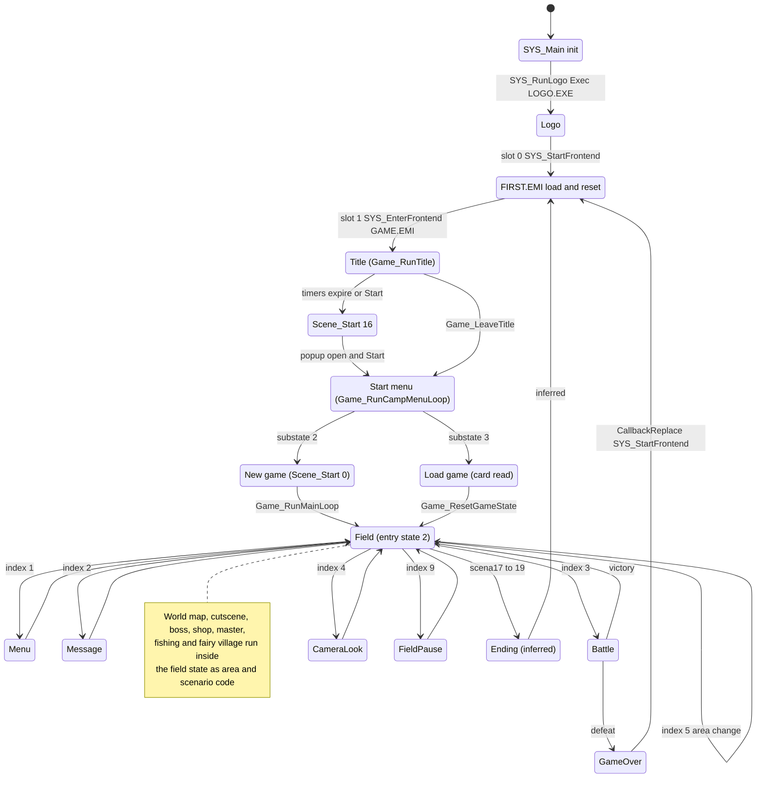
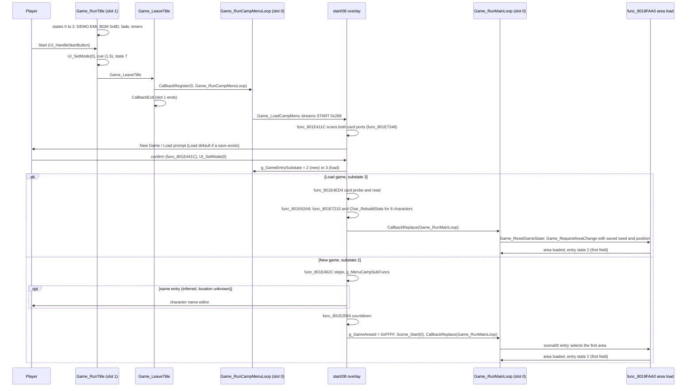
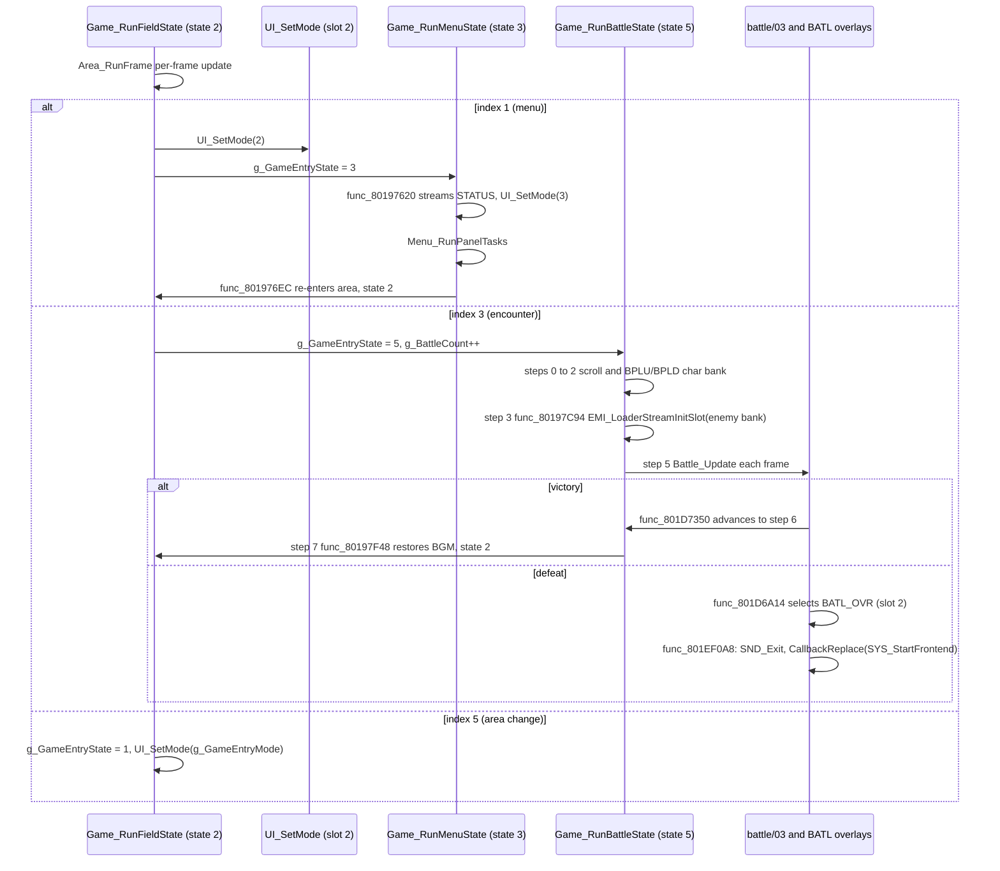

# Game phases and the top-level state machine

*Read this if you need the top-level game states and how control passes between them.*

This page lists every game phase from power-on to the end credits, the code that runs each one,
which overlays are in RAM, and how control passes from one phase to the next. It also documents the
three mechanisms that carry the transitions: the callback slots, the entry-state table
`g_GameStates`, and the request code `g_GameStateIndex`.

Static reading of the game code; nothing here was run on an emulator.

Tags: `[read]` the code was read and the claim follows from it; `[inferred]` the claim follows from
names, data shape or neighbouring code, not from a complete trace; `[unknown]` nothing in the
the code proves it. Overlay addresses are image-local.

## Entry points

| Symbol                 | Image@address                     | Role                                                               | Status   |
| ---------------------- | --------------------------------- | ------------------------------------------------------------------ | -------- |
| `SYS_Main`             | `exe/slus_004_22@0x8014AAC8`      | power-on entry: init, logo, register slot 0, per-frame loop        | `[read]` |
| `SYS_RunLogo`          | `exe/slus_004_22@0x8014AEE0`      | load and `Exec` `LOGO/LOGO.EXE` (separate image)                   | `[read]` |
| `SYS_StartFrontend`    | `exe/slus_004_22@0x8014EA80`      | slot-0 boot job: load FIRST, reset game state, hand over to slot 1 | `[read]` |
| `SYS_EnterFrontend`    | `exe/slus_004_22@0x8014EC64`      | slot-1 job: stream GAME.EMI, call the title                        | `[read]` |
| `Game_RunTitle`        | `emi/etc/game/01@0x801D0C04`      | title state loop (8 states)                                        | `[read]` |
| `Game_RunCampMenuLoop` | `emi/etc/game/00@0x80196F78`      | start menu (New Game / Load) loop, slot 0                          | `[read]` |
| `Game_RunMainLoop`     | `emi/etc/game/00@0x80197068`      | in-game state machine, slot 0                                      | `[read]` |
| `Game_ResetGameState`  | `emi/etc/game/00@0x801970EC`      | entry state 0: first field entry after boot or load                | `[read]` |
| `UI_SetMode`           | `exe/slus_004_22@0x8014ECAC`      | start a screen transition effect (slot 2)                          | `[read]` |
| `UI_DispatchLocalMode` | `exe/slus_004_22@0x8014ED6C`      | slot-2 body: run effect `g_UiLocalMode` from a 21-entry table      | `[read]` |
| `Scene_Start`          | `emi/etc/game/00@0x801A7704`      | select scenario overlay `scenaNN`, run its entry                   | `[read]` |
| `Battle_Update`        | `emi/battle/battle/03@0x801D1014` | one battle frame per call from entry state 5                       | `[read]` |

## Mechanism

### Callback slots as the carrier

The game runs on four cooperative callback slots (`D_80143B40`, 0x80 bytes each, built on PsyQ
kernel threads; see [scheduler.md](scheduler.md)). A phase change replaces the function in a slot.
`CallbackRegister(slot, fn)` starts a job, `CallbackReplace(fn)` swaps the current slot's job,
`CallbackWait(n)` yields n frames, `CallbackExit` ends the current job, and `CallbackRun` runs the
slots once per frame from `SYS_Main`. `[read]`

Which function each slot runs in each phase: [scheduler](scheduler.md#slot-use).

The title tests slot 0 for "empty" (`D_80143B40 == 0`) to know that the game program has ended
and the title may restart. `[read]`

### `UI_SetMode` and `UI_DispatchLocalMode`

`UI_SetMode(local_mode)` (`exe/slus_004_22@0x8014ECAC`) returns at once when `g_UiWindowEffectBusy`
(`0x80143C40`) is nonzero. Otherwise it stores `g_UiLocalMode` (`0x80143C90`) and registers
`UI_DispatchLocalMode` (`exe/slus_004_22@0x8014ED6C`) in slot 2. The dispatcher indexes
`g_UiLocalModeFuncs` (21 entries at `exe/slus_004_22@0x801499AC`). The entries are full-screen tint,
fade, zoom and camera-angle wipes (`func_8014EDF0` to `func_8014F460`, helpers `func_8014F514`,
`func_8014F5F0`, `func_8014F704`). `[read]`

The table is a transition-effect table. It is not a table of game phases. Phase code calls
`UI_SetMode` at a boundary and waits for `g_UiWindowEffectBusy` to clear. `[read]`

| Call                          | Where                                                                    | Meaning                                        |
| ----------------------------- | ------------------------------------------------------------------------ | ---------------------------------------------- |
| `UI_SetMode(0)`               | title, start menu, new-game tail                                         | leave-screen effect `[inferred]`               |
| `UI_SetMode(4)`               | `UI_WaitTitleInput` (`emi/etc/game/01@0x801D0F00`)                       | choice-confirm effect `[inferred]`             |
| `UI_SetMode(2)`               | entry state 2, index 1 `Game_RunFieldState (emi/etc/game/00@0x80197378)` | menu-open effect `[inferred]`                  |
| `UI_SetMode(3)`               | `func_80197620` (`emi/etc/game/00@0x80197620`)                           | menu entry after streaming STATUS `[inferred]` |
| `UI_SetMode(g_GameEntryMode)` | area reload                                                              | field entry effect                             |
| `UI_SetMode(0x13)`            | `func_801EEC40` (`emi/battle/batl_ovr/00@0x801EEC40`)                    | game-over screen `[inferred]`                  |

`g_GameEntryMode` (`0x80143F1E`) is the effect index chosen on field entry: 10 when the area load
flag word has bit 0 (world map), 20 for area `0xBD`, else 0 (`Game_RunAreaLoadState`,
`Game_RunAreaLoadState (emi/etc/game/00@0x801971E8)`). `[read]`

### `g_GameEntryState`: the top-level state machine

`Game_RunMainLoop` (`emi/etc/game/00@0x80197068`) runs in slot 0. Each frame it calls
`g_GameStates[g_GameEntryState]()` (12 entries at `0x801C7B14`), then `func_80198CAC`
(`emi/etc/game/00@0x80198CAC`, play clock and timers), then `CallbackWait(1)`. The play clock does
not advance while `g_GameStateIndex == 9`. `g_GameEntrySubstate` (`0x80143B92`) selects a handler
inside the states that own a sub-table. `[read]`

| State | Function (`emi/etc/game/00`)                          | Role                                                                                                                                                                                              | Tag          |
| ----- | ----------------------------------------------------- | ------------------------------------------------------------------------------------------------------------------------------------------------------------------------------------------------- | ------------ |
| 0     | `Game_ResetGameState` `@0x801970EC`                   | clear draw flags, `g_GameAreaId = 0xFFFF`, call `Game_RequestAreaChange` with the saved seed and position, go to 1                                                                                | `[read]`     |
| 1     | `Game_RunAreaLoadState` `@0x801971E8`                 | area load through `func_8019FAA0`; apply load flags; `UI_SetMode`; `g_GameStateIndex = 0`; go to 2                                                                                                | `[read]`     |
| 2     | `Game_RunFieldState` `@0x80197378`                    | field: `Game_RunScenarioEntry`, per-frame update `Area_RunFrame`, then dispatch on `g_GameStateIndex`                                                                                             | `[read]`     |
| 3     | `Game_RunMenuState` `@0x801975E4`                     | menu: stream STATUS, run menu panels, return to field                                                                                                                                             | `[read]`     |
| 4     | `func_801979D4` `@0x801979D4`                         | wait until the message window closes, then back to 2                                                                                                                                              | `[read]`     |
| 5     | `Game_RunBattleState` `@0x80197A24`                   | battle: 8-step chain `g_GameModeHandlers`                                                                                                                                                         | `[read]`     |
| 6     | `func_80198170` `@0x80198170`                         | camera look mode (D-pad orbit), back to 2 when restored                                                                                                                                           | `[read]`     |
| 7     | `Game_RunShopState` (`emi/etc/game/00@0x80198234`)    | runs `g_GameStateHandlers[substate]`; substate 0 `Game_LoadShopOverlay` streams SHOP and advances, or returns to state 2 at once for a shop actor of kind 9                                       | `[read]`     |
| 8     | `Game_RunFishingState` (`emi/etc/game/00@0x801984AC`) | runs `g_GameSubstateHandlers[substate]`; entered from `Game_RunAreaLoadState` when `g_GameRequestFlags` bit 3 (value 8) is set; the pond overlay `emi/world00/area030/04` holds substates 1 and 3 | `[read]`     |
| 9     | `Game_RunAbilityMenuState` `@0x80198744`              | 3-handler table `g_MenuAbilityOpen`; name suggests the ability menu                                                                                                                               | `[inferred]` |
| 10    | `Game_RunStatusMenuState` `@0x80198904`               | 3-handler table `g_MenuStatusOpen`; name suggests the status menu                                                                                                                                 | `[inferred]` |
| 11    | `Game_RunSceneCameraState` `@0x80198AC4`              | 3-handler table `g_GameFlowHandlers`: scene dispatch with camera control, camera reset, back to 2                                                                                                 | `[read]`     |

### `g_GameStateIndex`: the request code

`g_GameStateIndex` (`0x80143BB0`, u8) is a request code. Field, actor, message and scenario code
write it. Entry state 2 reads it after the per-frame update and switches state. `[read]`

| Index | Written by (`emi/etc/game/00`)                                                                                                                         | Entry state 2 does                                                                                     | Tag                                                        |
| ----- | ------------------------------------------------------------------------------------------------------------------------------------------------------ | ------------------------------------------------------------------------------------------------------ | ---------------------------------------------------------- |
| 0     | idle; reset by many handlers                                                                                                                           | nothing                                                                                                | `[read]`                                                   |
| 1     | `func_801B2A00` (`@0x801B2A00`)                                                                                                                        | `UI_SetMode(2)`, `func_80198BC4(0)`, state 3 (menu)                                                    | `[read]`; trigger is `[inferred]` as the menu-open request |
| 2     | `Message_*` and scenario, area, commu, sisyou, fairy handlers (about a dozen)                                                                          | state 4 (message window wait)                                                                          | `[read]`                                                   |
| 3     | `func_801B2B6C` (`@0x801B2B6C`)                                                                                                                        | zero battle mode, step, substep bytes; `g_BattleCount++`; state 5                                      | `[read]`                                                   |
| 4     | `func_801B5884` (`@0x801B5884`): button held and `!(g_GameFlags & 0x2000)`                                                                             | state 6 (camera look)                                                                                  | `[read]`                                                   |
| 5     | `Game_RequestAreaChange` and six field handlers (`func_801B0E44`, `func_801B146C`, `func_801B7988`, `func_801B7E74`, `func_801B830C`, `func_801B9100`) | area change: set entry flag, fade BGM if the selection changed, `UI_SetMode(g_GameEntryMode)`, state 1 | `[read]`                                                   |
| 6     | `Party_JoinMember` (`@0x801C187C`, party overflow)                                                                                                     | state 7                                                                                                | `[read]`; meaning `[unknown]`                              |
| 7     | no literal writer found in the assembly of the overlays or the executable                                                                              | state 9                                                                                                | `[unknown]`                                                |
| 8     | no literal writer found                                                                                                                                | state 10                                                                                               | `[unknown]`                                                |
| 9     | `func_801B5910` (`@0x801B5910`): Start pressed and `!(g_GameRequestFlags & 0x69)`; `func_80167428` (`exe/slus_004_22@0x80167428`)                      | state 11                                                                                               | `[read]`; Start-in-field meaning `[inferred]`              |

`Game_RequestAreaChange` (`emi/etc/game/00@0x8019FA28`) is the area-change request: it stores the seed,
position and kind in `0x80143F10..0x80143F1C`, calls `func_801A02E8` and `func_801A0380`, and sets
index 5. `[read]`

## Flow: power-on to field

Soft reset: holding Start and Select (`g_InputHeld & 0x900 == 0x900`) for 61
frames makes `SYS_Main` call `SND_Exit`, `CallbackStopAll`, then `CallbackRegister(0,
SYS_StartFrontend)` once the loader is ready. The result is a jump back to the "FIRST.EMI load" node
from any phase. `[read]`

## Phases

The table lists each phase. "Overlays in RAM" always includes the exe and the resident
`emi/etc/game/00` (`0x80195800`). The window at `0x801D0C00` holds one overlay at a time. World
area overlays load at `0x801F2C00`, scenario overlays (`SCENA`) at `0x801F6C00`, and
`bmagic`/`batl_end`/`batl_ovr` at `0x801EEC00`. `[read]`

| Phase         | Entry condition                                                                               | Code that runs it                                                                                                                                                  | Overlays in RAM beyond resident                                             | Exits                                                                           | Tag                                                                 |
| ------------- | --------------------------------------------------------------------------------------------- | ------------------------------------------------------------------------------------------------------------------------------------------------------------------ | --------------------------------------------------------------------------- | ------------------------------------------------------------------------------- | ------------------------------------------------------------------- |
| Boot          | console reset                                                                                 | `SYS_Main` (`exe/slus_004_22@0x8014AAC8`), `SYS_InitRuntime` (`@0x8014ACA0`)                                                                                       | none                                                                        | `SYS_RunLogo`                                                                   | `[read]`                                                            |
| Logo          | end of init                                                                                   | `SYS_RunLogo` (`@0x8014AEE0`), `SYS_LoadExec` (`@0x8014E0FC`, retries up to 10)                                                                                    | `exe/logo` replaces the program image for the call                          | `Exec` runs the logo; `SYS_Main` then registers slot 0 `SYS_StartFrontend`      | `[read]`                                                            |
| First load    | logo done; soft reset; game over                                                              | `SYS_StartFrontend` (`@0x8014EA80`): slot `0x261` (`FIRST`), SND init, clear game state block `0x801448D8..0x80145988`                                             | FIRST                                                                       | `CallbackRegister(1, SYS_EnterFrontend)`, `CallbackExit`                        | `[read]`                                                            |
| Title         | `SYS_EnterFrontend` streams GAME.EMI (0x262) and calls `Game_RunTitle`                        | `Game_RunTitle` (`emi/etc/game/01@0x801D0C04`), `UI_HandleStartButton` (`@0x801D104C`)                                                                             | `game/00` at `0x80195800`, `game/01` at `0x801D0C00`, DEMO (0x25F)          | states 3 to 4 (attract); state 7 to start menu                                  | `[read]`                                                            |
| Attract       | title timers: 360 ticks, then 900 ticks, then `Game_StartSelectedGame` (`@0x801D0E54`)        | `Scene_Start(16)`, scenario `scena16/00`, `CallbackRegister(0, Game_RunMainLoop)`                                                                                  | `scena16` at `0x801F6C00`                                                   | loops in scenario 16; Start with popup open goes to the start menu `[inferred]` | `[inferred]` for "attract"                                          |
| Start menu    | `Game_LeaveTitle` (`emi/etc/game/01@0x801D1000`): `CallbackRegister(0, Game_RunCampMenuLoop)` | `Game_RunCampMenuLoop` (`emi/etc/game/00@0x80196F78`), `Game_LoadCampMenu` (`@0x80196FFC`), START.EMI#8 (`emi/etc/start/08`, slot 0x268)                           | `start/08` at `0x801D0C00`                                                  | New Game or Load Game by `g_GameEntrySubstate` 2 or 3                           | `[read]`                                                            |
| New game      | menu choice `D_801ED7EC != 0` (no save chosen or none available)                              | `func_801E462C` (`emi/etc/start/08@0x801E462C`) and `g_MenuCampSubFuncs`; tail `func_801E2584` calls `Scene_Start(0)`, `CallbackReplace(Game_RunMainLoop)`         | `start/08`, then `scena00`                                                  | field, first scenario                                                           | `[read]` to the tail; name entry `[unknown]`                        |
| Load game     | menu choice `D_801ED7EC == 0`, a BOF3 save found on either card port                          | `func_801E4ED4` (card probe and read), `func_801E62A8` (`@0x801E62A8`) restores 8 characters, `CallbackReplace(Game_RunMainLoop)`                                  | `start/08`                                                                  | `Game_ResetGameState` re-enters the saved area                                  | `[read]`                                                            |
| Field         | entry state 1 finished (`func_8019FAA0` loaded the area)                                      | entry state 2 `Game_RunFieldState`: `Area_RunFrame` (party, actors, scene draw) plus `Game_RunScenarioEntry`                                                       | area overlay at `0x801F6C00`/`0x801F2C00`, char bank, scenario              | `g_GameStateIndex` codes 1 to 9                                                 | `[read]`                                                            |
| World map     | area load flag word bit 0 (`g_GameRequestFlags & 1`)                                          | entry state 1 sets `g_GameEntryMode = 10`; world-map logic runs as area code (`emi/world*`)                                                                        | world area overlay at `0x801F2C00`                                          | area change (index 5)                                                           | flag `[read]`; world-map code `[inferred]`                          |
| Cutscene      | scenario entry or area script sets `g_GameStateIndex`, or scenario updates run                | `Game_RunScenarioEntry` (`@0x801A782C`) calls `g_SceneScenes[scenario_id]->entry_00`; `Game_RunSceneUpdate` (`@0x801A7BF0`)                                        | `scenaNN` at `0x801F6C00`; effect overlays `SCE10EFF` 0x290, 0x291 to 0x294 | message wait (index 2); area change                                             | `[read]` for the call path; which scenes are cutscenes `[inferred]` |
| Battle        | `g_GameStateIndex = 3` from `func_801B2B6C`                                                   | entry state 5, `g_GameModeHandlers` 0 to 7; step 5 `Battle_Update` (`emi/battle/battle/03@0x801D1014`)                                                             | BATTLE (6) or BATTLE2 (7) or encounter slot; BPLU/BPLD char bank            | victory: steps 6, 7 restore field; defeat: game over                            | `[read]`                                                            |
| Boss          | encounter with a boss entry in `D_801EB298` of `emi/battle/battle/03`                         | same chain as Battle; boss module called from the table                                                                                                            | boss module at `0x80096800` window                                          | as Battle                                                                       | `[inferred]`                                                        |
| Menu          | index 1                                                                                       | entry state 3: `func_80197620` streams STATUS (0x269); `func_80199368`, `Menu_RunPanelTasks`; return `func_801976EC`                                               | STATUS (same bytes as `start/08`) at `0x801D0C00`                           | `func_801976EC` re-streams the char bank, re-enters the area, state 2           | `[read]`                                                            |
| Shop          | not traced                                                                                    | SHOP overlay slot 0x266 exists (`emi/etc/shop/00`); `scena17` also loads it                                                                                        | SHOP at `0x801D0C00`                                                        | not traced                                                                      | `[unknown]`                                                         |
| Master        | not traced                                                                                    | SISYOU overlay slot 0x267 (`emi/etc/sisyou/00`)                                                                                                                    | SISYOU at `0x801D0C00`                                                      | not traced                                                                      | `[unknown]`                                                         |
| Fishing       | area load flag `0x08` (`flag_32`)                                                             | area code in the fishing area overlay (`emi/world00/area030`)                                                                                                      | world area overlay                                                          | not traced                                                                      | `[inferred]`                                                        |
| Fairy village | area load flag `0x10` (`AREA_LOAD_FLAG_FAIRY_VILLAGE`)                                        | `func_801976EC` loads COMMU00 (0x258) on menu return; commu code in `emi/etc/commu00`                                                                              | COMMU00 at `0x801D0C00`                                                     | not traced                                                                      | flag `[read]`; rest `[inferred]`                                    |
| Game over     | battle result defeat (`g_BattleResult & 1`), `g_BattleEncounter == 0`                         | `Battle_StreamEndOverlay` (`emi/battle/battle/03@0x801D6A14`) picks BATL_OVR (slot 2); `func_801EEC40`, `Battle_RunGameOver` (`emi/battle/batl_ovr/00@0x801EF0A8`) | BATL_OVR at `0x801EEC00`                                                    | `SND_Exit; CallbackReplace(SYS_StartFrontend)`: back to First load and title    | `[read]`                                                            |
| Ending        | scenarios 17 to 19                                                                            | `scena17` loads ENDKANJI (0x260) and SHOP (0x266); scena17 to 19 are mostly assembly                                                                               | `scena17` to `scena19`, ENDKANJI                                            | not proven                                                                      | load `[read]`; ending `[unknown]`                                   |

### Why Attract is inferred

`Game_StartSelectedGame` (`emi/etc/game/01@0x801D0E54`) does not start a selected game. After the
selection effect is idle it clears actors, zeroes `g_PlayClock`, calls `Scene_Start(16)` and
`CallbackRegister(0, Game_RunMainLoop)`. Scenario 16 draws title backgrounds for areas 4, 2 and
`0x1F` with scripted text and loops. The progression counter skips scenario 16 (see below). Both the
timers and the Start button reach this function when the choice popup is not open. That scenario 16
is an attract or demo scene is `[inferred]` from this shape. `[read]` for the call chain.

## Flow: new game and load game

New game and load game share `Camp_EnterMainLoop` (`emi/etc/start/08@0x801E62A8`). For load it replaces
the slot-0 job with `Game_RunMainLoop`. For a new game it increments `g_GameEntryState` and the
camp loop continues through `g_MenuCampSubFuncs`. `func_801E2444` finishes the new-game branch and
`func_801E2584` runs the countdown, then calls `Scene_Start(0)`. `[read]` for these functions.
`Game_RunMainLoop` entry state 0 reads the saved seed from `D_801448FC`, `D_80144900`, `D_80144904`,
`D_801448FF` on the load path. `[read]` Which of those the new-game path sets is `[unknown]`.

The in-game menu reuses the same overlay bytes: `emi/etc/start/08` is byte-identical to
`STATUS.EMI#0` `[read]`

## Flow: field, menu and battle

Battle entry stream argument (`func_80197C94`, `emi/etc/game/00@0x80197C94`): for an encounter it is
`D_801CD86C[D_801CD78F[g_BattleEncounter * 4]]`; otherwise 6 (BATTLE.EMI) when
`g_SceneState.scenario_id < 8`, else 7 (BATTLE2.EMI). `[read]` After victory the exit from BATL_END
into the field goes through `func_801D7350` and entry state 5 steps 6 and 7. `[inferred]` for the
BATL_END part of the chain.

## Key data

| Symbol                 | Address      | Width    | Meaning                                                                                                |
| ---------------------- | ------------ | -------- | ------------------------------------------------------------------------------------------------------ |
| `g_GameEntryState`     | `0x80143B90` | u16      | index into `g_GameStates[12]` (`0x801C7B14`)                                                           |
| `g_GameEntrySubstate`  | `0x80143B92` | u16      | handler index inside states with sub-tables; also the New/Load choice (2 or 3)                         |
| `g_GameStateIndex`     | `0x80143BB0` | u8       | request code 0 to 9 (see above)                                                                        |
| `g_GameEntryMode`      | `0x80143F1E` | u8       | field-entry effect index passed to `UI_SetMode`                                                        |
| `g_GameRequestFlags`   | `0x80143F02` | u8       | area load `flag_32`: bit 0 world map, 0x08 fishing, 0x10 fairy village, 0x40 camp                      |
| `g_UiLocalMode`        | `0x80143C90` | u8       | current transition effect index                                                                        |
| `g_UiWindowEffectBusy` | `0x80143C40` | u8       | nonzero while an effect runs; blocks `UI_SetMode`                                                      |
| `g_SceneState`         | `0x80146870` | 16 B     | `scenario_id`, `flags_01`, `mode_02`, `state_04`, `step_05`, `timer_06`                                |
| `g_SceneFlagWords`     | `0x80144E88` | 20 x 8 B | per-scenario flag words; `Scene_Start` clears flags 0-31 (one `sw`) of the new scenario's 8-byte entry |
| `g_GameAreaId`         | `0x80143F00` | u16      | current area; `0xFFFF` forces a reload                                                                 |
| `D_80143B40`           | `0x80143B40` | 4 x 0x80 | callback slot table                                                                                    |

`Game_ResetGameState` and the new-game tail set `g_GameAreaId` to `0xFFFF`. `[read]`

## Story progression

`Scene_Start(n)` (`emi/etc/game/00@0x801A7704`) sets `g_SceneState.scenario_id`, clears that
scenario's flag word, and calls `Scene_RequestOverlay` (`@0x801A7804`), which streams
slot `n + 0x295`. When the loader is ready, `Game_RunScenarioEntry` (`@0x801A782C`)
calls `g_SceneScenes[n]->entry_00` and `Game_RunSceneUpdate` (`@0x801A7BF0`) runs
`g_SceneStates[...]`. `[read]`

The progression step is in the area loader. `func_8019FAA0` (`emi/etc/game/00@0x8019FAA0`) checks
`g_SceneState.flags_01 & 0x80`. When set, it increments `scenario_id` (a result of 16 becomes 17)
and calls `Scene_Start`. `Scene_RequestChapterAdvance` (`@0x801A78F8`) sets that bit. Its callers include
`scena00/00` (after `Game_RequestAreaChange(9, 0x570000, 0x40000, 7)`) and, in assembly, `scena08`,
`scena10` and `scena15`. `[read]` for the mechanism and these callers. The chapter each scenario
represents is `[unknown]` here; see [scenario.md](scenario.md).

There are 20 scenario overlays, `SCENA00` to `SCENA19`. Scenario 16 is the title scene and is
skipped by the counter. Effect overlays: `scena10` loads slot 0x290 (SCE10EFF), `scena15` loads
0x291 to 0x294, `scena07` 0x254 (A085SE2), `scena08` 0x255 (A108SE2), `scena17` 0x260 (ENDKANJI) and
0x266 (SHOP). `[read]` XA streaming (`SND_StartXaStream`) is called from `scena01`, `scena08`,
`scena12`, `scena14`, `commu00`, `shop` and two area overlays. No MDEC or STR call was found in the
exported assembly, so full-motion video playback is not shown. `[unknown]`

Whether the scenario number is saved with the save data is for [saving.md](saving.md).

## Connections

- [area.md](area.md): area loading and walking
- [battle.md](battle.md): battle internals behind `Battle_Update`
- [screens.md](screens.md): menu, shop and status screens
- [scenario.md](scenario.md): scenario overlays and flag words
- [saving.md](saving.md): memory card paths for load game
- [loading.md](loading.md): loader, EMI slots and streams
- [scheduler.md](scheduler.md): callback slots and the frame loop
- [responsibilities.md](responsibilities.md), [disc-and-files.md](disc-and-files.md)
- [boot.md](boot.md), [frame-loop.md](frame-loop.md), [../runtime.md](../runtime.md), [../battle.md](../battle.md), [../field.md](../field.md)

## Gaps

| Gap                                                           | What would prove it                                                                      |
| ------------------------------------------------------------- | ---------------------------------------------------------------------------------------- |
| entry states 7 and 8 and indices 7 and 8: writers and purpose | a runtime write watch on `0x80143BB0`, or a data-flow read of `func_801B5910` callers    |
| menu trigger for index 1 and Start-in-field for index 9       | read callers of `func_801B2A00` and the Start handling `func_801B5910`                   |
| name entry location                                           | read `g_MenuCampSubFuncs` tables `D_801ECCF8`, `D_801ECD1C` and `D_801ED138` steps       |
| entry paths for shop, master (SISYOU), fishing, fairy village | callers of `EMI_LoaderStreamInitSlot` with 0x266, 0x267, 0x258 and the area flags        |
| world map code                                                | read the world area overlays selected by flag bit 0                                      |
| boss entry                                                    | read the callback table `D_801EB298` of `emi/battle/battle/03` and its callers           |
| ending and credits                                            | finish `scena17` to `scena19` assembly and ENDKANJI users                                |
| BATL_END exit to the field                                    | read `batl_end/00` exit calls                                                            |
| whether scenario 16 is an attract demo                        | runtime check of the title idle path                                                     |
| FMV playback                                                  | search for MDEC and STR use in the executable image and in code outside the EMI overlays |
