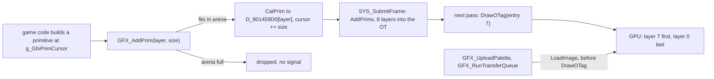
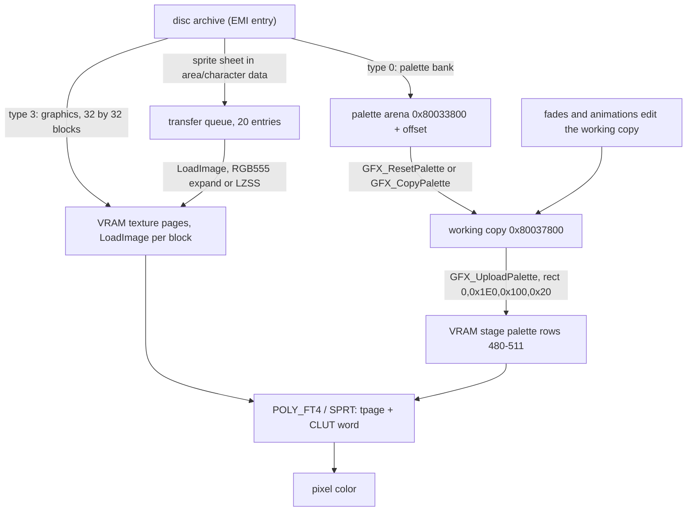

# Rendering

*Read this if you need to know how sprites, textures and palettes reach the screen.*

How the game turns RAM into pixels: the primitive arena and ordering table, the VRAM layout, the way textures
and palettes reach VRAM, and how a sprite picks its colors. The last part answers the editor question "why is
my texture the wrong color".

Static reading of the game code; nothing here was run on hardware. Tags:
`[read]` code read directly, `[inferred]` deduced from several reads or from PsyQ behaviour outside the game files,
`[unknown]` not established. Names with an address are `image@address`; `exe` is `exe/slus_004_22`.

## Terms

| Term          | Meaning in this wiki                                                                                     |
| ------------- | -------------------------------------------------------------------------------------------------------- |
| Primitive     | One GPU packet (`SPRT`, `POLY_FT4`, `DR_MODE`, `DR_AREA`) built at `g_GfxPrimCursor`.                    |
| Arena         | The RAM block that holds one frame's primitives. Two arenas, one per render record.                      |
| Layer         | One of 8 ordering-table entries. `GFX_AddPrim` appends a primitive to one layer's chain.                 |
| Cell          | A 16-color palette unit: 16 VRAM words of one palette row. A 256-color palette is 16 cells.              |
| Palette arena | RAM block `0x80033800` (loaded banks). Its working copy `0x80037800` is what the GPU sees.               |
| Stage palette | VRAM rectangle (0, 0x1E0, 0x100, 0x20): 32 palette rows of 256 words.                                    |
| Sprite record | The work record (`Actor`) at scratchpad `work_ptr` whose bytes `+0x24..+0x29` pick page, CLUT and layer. |

## Entry points

| Symbol                        | Image@address                | Role                                                              | Status   |
| ----------------------------- | ---------------------------- | ----------------------------------------------------------------- | -------- |
| `SYS_PrepareFrame`            | `exe@0x8014B020`             | reset layer chains, primitive cursor and scene packet table       | `[read]` |
| `GFX_AddPrim`                 | `exe@0x8014E5A0`             | append the primitive at the cursor to a layer, advance the cursor | `[read]` |
| `SYS_SubmitFrame`             | `exe@0x8014B0F0`             | link the 8 layer chains into the ordering table                   | `[read]` |
| `GFX_UploadPalette`           | `exe@0x8014E22C`             | stage palette to VRAM when pending                                | `[read]` |
| `GFX_RunTransferQueue`        | `exe@0x8014E6D0`             | queued sprite-sheet uploads, 20 per frame                         | `[read]` |
| `GFX_ResetPalette`            | `exe@0x8014E284`             | clear rows 28-31, copy the arena to the working copy              | `[read]` |
| `GFX_CopyPalette`             | `exe@0x8014E3A0`             | copy one `0x200`-byte row from arena to working copy              | `[read]` |
| `Actor_SelectScriptBank`      | `exe@0x8014DC08`             | queue a sprite sheet for upload and pick the cell list            | `[read]` |
| `Area_BuildClut`              | `exe@0x8014CE78`             | sprite record fields to a CLUT word                               | `[read]` |
| `Area_DrawScene`              | `exe@0x8014BA54`             | draw cell layers, sorted sprites and object packets for one frame | `[read]` |
| `Area_DrawObjectSprite`       | `exe@0x8014C4D4`             | one sprite record to `POLY_FT4` or plain cells                    | `[read]` |
| `GFX_AllocPaletteCell`        | `emi/etc/game/00@0x801968BC` | find free palette cells in the 4 by 16 map                        | `[read]` |
| `GFX_UpdatePaletteAnimations` | `emi/etc/game/00@0x80196C8C` | step the 8 palette animation slots                                | `[read]` |

## Frame pipeline

The order of one frame is in [frame loop](frame-loop.md). The rendering part:

1. `SYS_PrepareFrame` points `g_GfxPrimCursor` at `0x80020000 + b * 0x9000` (`b` = `g_FrameBufferIndex`),
   resets the 8 layer tail pointers `D_801459D0[0..7]` to 8 dummy head words at `D_80145990 + b * 0x20`, and
   resets 56 scene packet records (`0x30` bytes each at `D_80142CC0`). `[read]`
2. Game code builds each primitive in place at the cursor, then calls `GFX_AddPrim(layer, size)`. The call
   links the primitive behind the layer's tail and advances the cursor by `size`. `[read]`
3. `SYS_SubmitFrame` calls the PsyQ `AddPrims` once per layer: ordering-table entry `i` of the render record
   (`record + 0x70 + 4 * i`) is linked to layer `i`'s chain. `[read]`
4. On the next loop pass `SYS_Main` calls `DrawOTag(record + 0x8C)`, which is entry 7. `[read]` Entry 7 is the
   start of the chain, so layer 7 draws first (back) and layer 0 last (front). `[inferred]` from the PsyQ
   `ClearOTagR` semantics, which link each entry to the one below it.

The diagram follows `GFX_AddPrim`, `SYS_SubmitFrame` and `SYS_Main`. `LoadImage` calls run in the loop step
before `DrawOTag`; whether the GPU finished each copy before the draw starts is `[unknown]`.

### Layers in use

`GFX_AddPrim` is called with a literal layer in these counts across the game code read: layer 1 about 200 calls, layer 2
about 30, layer 6, 7 and 3 a handful. `[read]` (counted by text search on the first argument). Text and menu sprites
go to layer 1. Scene sprites take the layer from the sprite record byte `+0x29`; the map engine takes it from
`g_AreaDrawMode`. `[read]` What each layer number means for ordering (for example, which layer is the HUD) is
`[unknown]` beyond "1 is in front of 2".

## Display and VRAM

`SYS_InitDisplay` (`exe/slus_004_22@0x8014AE08`) sets two 320 by 240 draw and display environments. Record 0 draws to
(0, 0) and shows (0, 240); record 1 draws to (0, 240) and shows (0, 0). `[read]` `SYS_InitHardware` sets
`SetGeomScreen(0x3E8)` and `SetGeomOffset(0xA0, 0x78)`: projection distance 1000, screen centre (160, 120).
`[read]`

| VRAM region (x, y, w, h)    | Use                                                                     | Evidence                      | Status                             |
| --------------------------- | ----------------------------------------------------------------------- | ----------------------------- | ---------------------------------- |
| (0, 0, 320, 480)            | the two frame buffers                                                   | `SYS_InitDisplay`             | `[read]`                           |
| (0, 0x1E0, 0x100, 0x20)     | stage palette, 32 CLUT rows                                             | `GFX_UploadPalette`           | `[read]`                           |
| 64 by 256 texture pages     | 16 columns by 2 rows: page `p` is x `(p % 16) * 64`, y `(p / 16) * 256` | `Area_DrawObjectSprite` tpage | `[read]`                           |
| (960, 0) texture page       | font sheets, 4 bits per pixel                                           | `func_8014FC00` tpage `0x2F`  | `[read]`                           |
| (0x340, 0x100, 0xC0, 0x100) | draw area for sprites with record flag `0x08`; purpose of the area      | `Area_DrawObjectSprite`       | `[read]` rect, `[unknown]` purpose |
| 32 by 32 blocks             | graphics payloads, x up to 1000 and y up to 500                         | `EMI_LoaderUploadSector`      | `[read]`                           |

Text uses CLUT word `0x7800 | n`, which is VRAM row `0x7800 >> 6 = 480` and column `n * 16`: the first cells of
stage palette row 0. `[read]` (`UI_DrawGlyphString`, `UI_DrawTextGlyphs`). The texture page word `0x2F`
is column 15 (x 960), row 0, semi-transparency mode 1, 4 bits per pixel; this follows the PsyQ `tpage` layout,
which is outside the game files. `[inferred]`

The full allocation of the page area between area sheets, character sheets, battle sheets and the font is
`[unknown]`: no table lists it; each payload names its own rectangle. See [loading](loading.md) for the
loader paths and [memory](memory.md) for RAM.

## Textures, TIMs and palettes

Where the colors come from, in order. The game loads no TIM files: payloads have no TIM header and go to VRAM
as raw 16-bit words (the only TIM data is the memory-card save icon, which is never uploaded). `[read]` per
[graphics formats](../../formats/graphics.md).

The diagram follows `EMI_LoaderCopyPayload`, `EMI_LoaderUploadSector`, `GFX_CopyPalette`,
`GFX_UploadPalette` and `GFX_RunTransferQueue`. `[read]`

### The chain for one color

1. **Palette bank.** A type-0 EMI entry is copied to the RAM address in its table row: arena offsets
   `+0x000`, `+0x200`, `+0x400`, `+0x600`, `+0x2000` and `+0x3600` are used ([area formats](../../formats/area.md)
   has the table). `[read]`
2. **Working copy.** `GFX_ResetPalette` zeroes arena rows 28 to 31, then copies all 32 rows (`0x200` bytes each)
   to `0x80037800`. `GFX_CopyPalette(row)` copies one row. Both raise `g_GfxPalettePending`. `[read]` Code that
   needs a palette to change (fades, animations, battle row moves) writes the working copy, not the arena.
3. **VRAM.** `SYS_Main` calls `GFX_UploadPalette` every frame; it uploads the whole 256 by 32 rectangle only if
   `g_GfxPalettePending` is set. `[read]` A palette edit takes effect one frame later.
4. **Texture.** Pixels reach a texture page by the loader or by the sprite-sheet queue. The page and the
   bit depth are chosen when the primitive is built, not stored with the pixels. `[read]`
5. **CLUT word.** The primitive's `clut` field names the palette row and column. For sprite records it comes
   from `Area_BuildClut` (next section); for text it is `0x7800 | n`. `[read]`

If a texture shows the wrong colors, one of these four items disagrees with the others: the palette bank is
at another arena offset, the CLUT word names another row or column, the bit depth (4 or 8) differs from the
pixel data, or the working copy was overwritten after upload by a fade or animation. `[inferred]`

### Sprite CLUT word: `Area_BuildClut`

`Area_BuildClut` (`exe/slus_004_22@0x8014CE78`) builds the word from three bytes of the sprite record: flags `+0x24`
(bit `0x04`), selector `+0x27` (`sel`) and kind `+0x28`. `base` is `0x1E0`, or `0x1F0` when flag bit `0x04`
is set. `[read]`

| Kind (`+0x28`) | CLUT word                                       | Palette size          | Cells per row |
| -------------: | ----------------------------------------------- | --------------------- | ------------: |
|              0 | `((base + (sel >> 4)) << 6) \| (sel & 0xF)`     | 1 cell, 16 colors     |            16 |
|              1 | `(base + sel) << 6`                             | whole row, 256 colors |             1 |
|              2 | `((base + (sel >> 3)) << 6) \| ((sel & 7) * 2)` | 2 cells               |             8 |
|              3 | `((base + (sel >> 2)) << 6) \| ((sel & 3) * 4)` | 4 cells               |             4 |
|              4 | `((base + (sel >> 1)) << 6) \| ((sel & 1) * 8)` | 8 cells               |             2 |

The row is `word >> 6` and the column `(word & 0x3F) * 16`. The cell counts match the table
`s_PaletteFadeColorCounts = {1, 16, 2, 4, 8}` used by the fade code. `[read]` The texture depth follows the
kind: `Area_DrawObjectSprite` passes `tp = (kind != 0)`, so kind 0 is a 4-bit texture and kinds 1 to 4 are
8-bit. `[read]` That kinds 2 to 4 are 8-bit textures that use only the first 32, 64 or 128 colors of a CLUT
placed at a multiple of its width is `[inferred]`.

The transparency mode in the page word is the low two bits of record byte `+0x5C` (`tint.bytes.flags`), and
the vertex color is `byte - 0x80` for `+0x5D`, `+0x5E`, `+0x5F`. `[read]`

### Texture page and sheet upload

`Area_DrawObjectSprite` takes the page from record byte `+0x25` (plus a bank offset `-1, 0 or 1` when kind is
nonzero, chosen from the cell's `u`: below `0x28` -1, `0xA1` and above 1). The page word for graph type 0 is
`(tp << 7) | (abr << 5) | ((y & 0x100) >> 4) | ((x & 0x3FF) >> 6)` with `x = (page % 16) << 6` and
`y = (page / 16) << 8`. `v` is cell `v` plus record byte `+0x26`. `[read]` Graph types 1 and 2 use another
page encoding; the US disc selects type 0 ([graphics formats](../../formats/graphics.md)). `[read]` in that page.

`Actor_SelectScriptBank` queues the sheet for the record unless record flag `0x02` is set: x is
`level << 6` for `level = +0x25` up to `0x10`, and `(level - 0x10) << 6` with `y + 0x100` above that; y is
`+0x26`. `[read]` Page `0x10` gives x = 1024 in this formula, but the draw code maps page 16 to x = 0 and
y = 256, so the two formulas disagree at that one value. `[unknown]` which is used by shipped data.

## Palette runtime

| Object          | Address      | Size                              | Role                                                                  | Status   |
| --------------- | ------------ | --------------------------------- | --------------------------------------------------------------------- | -------- |
| cell map        | `D_80145D54` | 4 rows by 16 bytes, `0xFF` = free | one byte per 16-color cell; holds the fade record id that owns it     | `[read]` |
| fade records    | `D_80145BD4` | 32 records of `0x0C` bytes        | `GFX_AllocPaletteFade` fills the first record with bit 0 clear        | `[read]` |
| animation slots | `D_80145D94` | 8 slots                           | `GFX_StartPaletteAnimation`, stepped by `GFX_UpdatePaletteAnimations` | `[read]` |

`GFX_AllocPaletteCell(mode)` scans the map row by row and returns the first run of free cells that fits:
mode 0 one cell, 1 a whole row, 2 two cells (even column), 3 four (column multiple of 4), 4 eight. `[read]` The
result is a selector for `Area_BuildClut` of the same kind. Mode 0 returns `cell - 0x40` as a byte. With
record flag `0x04` set, `Area_BuildClut` turns that into rows `0x1FC` to `0x1FF`. `[read]` Those are the same
rows (28 to 31) that `GFX_ResetPalette` zeroes, so the dynamic cells live in the last four rows of the stage
palette. `[inferred]` A fade (`GFX_AllocPaletteFade`) takes a free cell run for the sprite record, remembers the record's old
selector in the fade record, and `GFX_FreePaletteFade` restores it and frees the cells. `[read]`
`GFX_UploadPaletteRows` sets bit `0x8000` (the PSX STP bit) on every color of the record's cells. `[read]`
The code that interpolates colors during a fade is in overlays (`world00/area036/13`, `world02/area085/13`,
`world02/area108/14`, `bmagic/magic064/03`), not in the resident core; it was not read for this page.
`[unknown]` Palette animations read 4-byte steps (`dst`, `src`, `count`, `wait`) and copy `count` colors from
`src` to `dst` inside one row of the working copy; a step whose first byte is `GAME_NONE` loops back by its
second byte. `[read]` (`GFX_StepPaletteAnimation`, `GFX_UploadPaletteAnimation`)

## Sprite sheet queue

`GFX_RunTransferQueue` runs once per frame after the palette upload. Each of up to 20 entries holds an `x` and
`y` (`D_80145A54[0..19]`, `D_80145A54[20..39]`) and a record pointer (`D_80145A04[0..19]`). The record is
`w`, `h`, a kind word and the payload at `+8`. Kind 1 expands packed RGB555 to 24-bit and uploads it, kind 2
decodes LZSS then uploads, any other kind is a raw `LoadImage`. The count `D_80145A00` is then cleared. `[read]`
`Actor_SelectScriptBank` does not test the count before it queues, so a 21st entry in one frame writes past
the table. `[read]`

## Scene drawing

`Area_DrawScene` (`exe/slus_004_22@0x8014BA54`) switches the stack to the top of the scratchpad (`0x1F800400`), then runs
three steps and clears the two record counters. Field and battle both call it. `[read]`

1. `Area_RunBundleRecords` (`exe/slus_004_22@0x801584A4`): when `g_AreaDrawFlags` bit 2 (cell layers) is set, walks the
   map-bundle record list at `0x80104000 + D_80104022 * 4`, dispatching each record's opcode through
   `D_8017F8FC`. `[read]`
2. `Area_DrawActors` (`exe/slus_004_22@0x8014BB20`): when flag bit 0 is set, bubble-sorts the active records
   (`D_80148214`) by depth and calls `Area_DrawObjectSprite` for each. `[read]`
3. `func_8014BC70` (`exe/slus_004_22@0x8014BC70`): sorts the object list by layer key and depth, and for each of `0x37`
   scenes merges objects with the packet list `D_80143740` into the ordering table. The description comes from a partial reading. `[inferred]`

`Area_DrawObjectSprite` hides records that are off the 448 by 368 window, skips flagged records, and emits one
primitive per cell: plain cells through `Area_DrawSpriteCell`, flipped or scaled cells as `POLY_FT4`. `[read]`
Cell size comes from `g_SpriteSizes[16][2]` (`exe@0x8017F53C`), so a cell is one of 16 fixed sizes. `[read]`

## Key data

| Object                 | Address                   | Role                                                                        | Status   |
| ---------------------- | ------------------------- | --------------------------------------------------------------------------- | -------- |
| `g_GfxPrimCursor`      | `exe@0x8014598C`          | next free primitive byte                                                    | `[read]` |
| `D_801459D0`           | `exe`                     | 8 layer tail pointers                                                       | `[read]` |
| `D_80145990`           | `exe`                     | 2 by 8 layer head words                                                     | `[read]` |
| `g_GfxPalettePending`  | `exe@0x80145988`          | set when the working palette must be uploaded                               | `[read]` |
| `g_GraphicsPaletteDst` | `0x80037800`              | working copy of the stage palette                                           | `[read]` |
| `g_AreaDrawFlags`      | `exe` (`g_AreaDrawFlags`) | bit 0 sprites, 1 negative depth, 2 cell layers, 3 and 4 appended primitives | `[read]` |
| `g_SpriteSizes`        | `exe@0x8017F53C`          | 16 cell width and height pairs                                              | `[read]` |

## Data and limits

| Limit                 | Value                                                         | Code                                                 | Asset must stay within                                                                          | Status                               |
| --------------------- | ------------------------------------------------------------- | ---------------------------------------------------- | ----------------------------------------------------------------------------------------------- | ------------------------------------ |
| Primitive arena       | `0x8FCC` bytes (36,812) per buffer, `0x80020000 + b * 0x9000` | `SYS_PrepareFrame`, `GFX_AddPrim`, `PRIM_ARENA_BASE` | at most about 920 `POLY_FT4`, 1,840 `SPRT` or 2,300 `SPRT_8` per frame, all primitives together | `[read]`                             |
| Overflow behaviour    | the primitive is dropped; no error                            | `GFX_AddPrim`                                        | too many cells or glyphs make sprites vanish, not crash                                         | `[read]`                             |
| Primitive size        | one byte                                                      | `GFX_AddPrim` `u8 size`                              | a packet over 255 bytes is not supported                                                        | `[read]`                             |
| Layers                | 8; no range check on the argument                             | `D_801459D0[8]`                                      | sprite record layer byte `+0x29` stays in 0 to 7                                                | `[read]`                             |
| Frame size            | 320 by 240                                                    | `SYS_InitDisplay`                                    | UI coordinates are in this space                                                                | `[read]`                             |
| Sprite cull window    | x in -64 to 384, y in -64 to 304                              | `Area_DrawObjectSprite` (`0x1C0`, `0x170`)           | sprites outside are skipped                                                                     | `[read]`                             |
| Stage palette         | 256 by 32 words = 16 KB, from `0x80037800`                    | `GFX_UploadPalette`                                  | all palette banks fit the arena offsets above                                                   | `[read]`                             |
| Dynamic palette cells | 4 rows by 16 cells = 64 cells                                 | `D_80145D54`, `GFX_AllocPaletteCell`                 | fades and animated sprites share these 64 cells; free-run search, no compaction                 | `[read]`                             |
| Fade records          | 32                                                            | `GFX_AllocPaletteFade` (`0x20`)                      | returns `0xFF` when full                                                                        | `[read]`                             |
| Palette animations    | 8                                                             | `GFX_StartPaletteAnimation`                          | returns `0xFF` when full                                                                        | `[read]`                             |
| Sheet upload queue    | 20 per frame                                                  | `GFX_RunTransferQueue`, `D_80145A00`                 | at most 20 sprite records change sheets in one frame; no overflow check                         | `[read]`                             |
| Texture pages         | 16 columns by 2 rows of 64 by 256                             | `Area_DrawObjectSprite`                              | record page byte `+0x25` below 32                                                               | `[read]`                             |
| Cell shapes           | 16 sizes                                                      | `g_SpriteSizes`                                      | sprite sheet cells use these sizes only                                                         | `[read]`                             |
| Scene packet records  | 56 per frame, loop bound `0x37`                               | `SYS_PrepareFrame`, `func_8014BC70`                  | at most 55 or 56 scene layers in an area map                                                    | `[read]` count, `[inferred]` meaning |
| Graphics block upload | x up to 1000, y up to 500                                     | `EMI_LoaderUploadSector`                             | type-3 blocks beyond this are not uploaded                                                      | `[read]`                             |

## Connections

- Where each step runs in the frame: [frame loop](frame-loop.md). Loader paths: [loading](loading.md). RAM
  addresses of the arenas: [memory](memory.md).
- Text, windows and the glyph sheets: [ui](ui.md). Field sprites and the map bundle: [area](area.md).
  Battle drawing: [battle](battle.md).
- Asset layout for editors: [editor guide](editor-guide.md), [disc and files](disc-and-files.md),
  [graphics formats](../../formats/graphics.md), [area formats](../../formats/area.md).

## Gaps

| Gap                                                                  | What would prove it                                                             |
| -------------------------------------------------------------------- | ------------------------------------------------------------------------------- |
| Ordering meaning of each layer number                                | List every `GFX_AddPrim` layer literal per overlay and compare with screenshots |
| VRAM page allocation between area, character, battle and font sheets | A VRAM dump from an emulator at each phase                                      |
| Whether `LoadImage` finishes before `DrawOTag` in the same frame     | PsyQ `LoadImage` queue behaviour or a trace of the GPU DMA                      |
| Purpose of the (0x340, 0x100, 0xC0, 0x100) draw area                 | Trace which records set record flag `0x08`                                      |
| Page 16 mismatch between sheet upload and draw formulas              | Read the page bytes of shipped sprite records                                   |
| Behaviour of `func_8014BC70`                                         | A full read of its assembly                                                     |
| Layers above 7 passed to `GFX_AddPrim`                               | Search call sites for non-literal layer values                                  |
