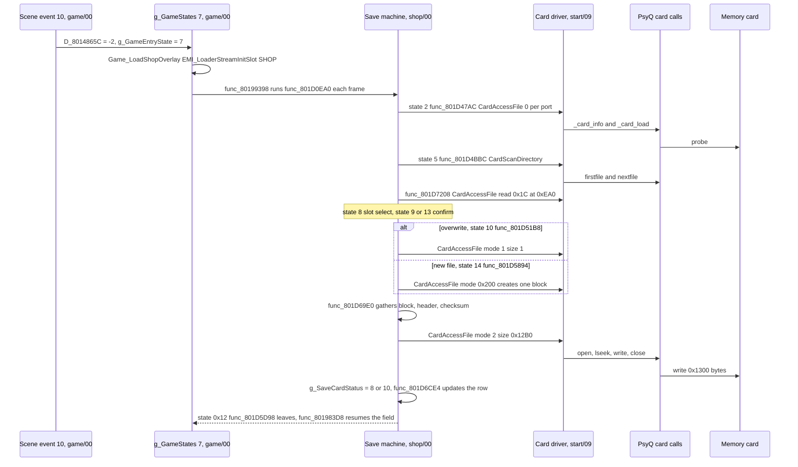
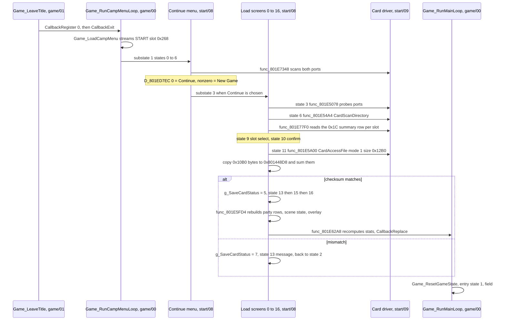

# Saving and loading

*Read this if you need the memory card save and load flow.*

This page documents how the game writes its state to a PlayStation memory card and reads it back:
what is saved, from which RAM, in what layout, which code runs the card transfers, how the file is
validated, what the game rebuilds after a load, and what happens on each error. Three images share
the work. A card driver in `emi/etc/start/09` does the transfers. The save screens live in
`emi/etc/shop/00`. The load screens live in `emi/etc/start/08`. The resident `emi/etc/game/00` only
hands control to them. The state being saved is mapped in [state.md](state.md).

Static reading of the game code; nothing here was run on an emulator.

Tags: `[read]` the code was read and the claim follows from it; `[inferred]` the claim follows from
names, data shape or neighbouring code, not from a complete trace; `[unknown]` nothing in the
the code proves it. `image@address` names the load image of the function. Functions without a
descriptive name keep their address name (`func_XXXXXXXX`).

## Entry points

| Symbol                   | Image@address                 | Role                                                                       | Status   |
| ------------------------ | ----------------------------- | -------------------------------------------------------------------------- | -------- |
| `SYS_InitCard`           | `exe/slus_004_22@0x8014B1A4`  | open and enable the seven card events, `InitCARD`, `StartCARD`, `_bu_init` | `[read]` |
| `SYS_InitHardware`       | `exe/slus_004_22@0x8014AD28`  | calls `SYS_InitCard` on every hardware init                                | `[read]` |
| `Scene_RunShopSaveEvent` | `emi/etc/game/00@0x801A802C`  | scene event 10: start the save screens from the field                      | `[read]` |
| `Game_LoadShopOverlay`   | `emi/etc/game/00@0x80198270`  | entry substate 0: stream `SHOP.EMI`, advance                               | `[read]` |
| `SAVE_DispatchState`     | `emi/etc/shop/00@0x801D46A4`  | dispatch the 21-state save machine `D_801E530C` by `D_80148652`            | `[read]` |
| `SAVE_BuildSlotImage`    | `emi/etc/shop/00@0x801D69E0`  | gather live state, build the card header, checksum, publish the slot row   | `[read]` |
| `Game_RunCampMenuLoop`   | `emi/etc/game/00@0x80196F78`  | start-menu loop that hosts the load screens                                | `[read]` |
| `SAVE_RunLoadVerify`     | `emi/etc/start/08@0x801E5A00` | load state 11: read the file, copy the block, verify the checksum          | `[read]` |
| `SAVE_RunLoadRestore`    | `emi/etc/start/08@0x801E5FD4` | load state 16: rebuild party rows, scene state, scenario overlay           | `[read]` |
| `Camp_EnterMainLoop`     | `emi/etc/start/08@0x801E62A8` | camp substate 4: recompute stats, enter the main loop                      | `[read]` |
| `CardAccessFile`         | `emi/etc/start/09@0x801EEC30` | wait for the card, load it, open a file, transfer                          | `[read]` |
| `CardOpenFile`           | `emi/etc/start/09@0x801EF96C` | `open` with 120 retries, capacity report                                   | `[read]` |
| `CardTransferFile`       | `emi/etc/start/09@0x801EFB44` | `lseek`, then `read` or `write` of whole `0x80` units, 60 retries          | `[read]` |
| `CardScanDirectory`      | `emi/etc/start/09@0x801EFCA8` | `firstfile`/`nextfile` into the 15-entry table `D_8018E990`                | `[read]` |
| `CardFormatDevice`       | `emi/etc/start/09@0x801EF200` | `format` the selected port                                                 | `[read]` |
| `CardBuildFileHeader`    | `emi/etc/start/09@0x801EF27C` | write the `SC` header, title and icons into the staging buffer             | `[read]` |

`SAVE_BuildSlotImage` (`emi/etc/shop/00@0x801D69E0`) is read from its disassembly, where the loop limits `0x10B0` and `0x1E00` and the
`CardBuildFileHeader` call are present. `[read]`

## Where the code lives

| Image                                         | Load address              | Holds                             | Status   |
| --------------------------------------------- | ------------------------- | --------------------------------- | -------- |
| `exe/slus_004_22`                             | work variables, `0x8014…` | card events, persistent block     | `[read]` |
| `emi/etc/game/00`                             | `0x80195800`              | hand-off, `Game_ResetGameState`   | `[read]` |
| `emi/etc/start/08` (`START.EMI` slot `0x268`) | `0x801D0C00`              | load screens, new-game defaults   | `[read]` |
| `emi/etc/shop/00` (`SHOP.EMI` slot `0x266`)   | `0x801D0C00`              | save screens, state gather        | `[read]` |
| `emi/etc/start/09`                            | `0x801EEC00`              | card driver, save-icon pixel data | `[read]` |

The driver payload also exists as `BIN/ETC/SHOP.EMI#8` with the same SHA-256 and `5268` bytes,
so the save screens load it from `SHOP.EMI` and the load
screens from `START.EMI`. `[read]` for the copy; `[inferred]` that the slot stream loads that entry
at `0x801EEC00` each time. The `0x801EEC00` window is shared with battle effect modules, which have
unrelated code at the same addresses, so the driver is usable only while the save or load screens
own the window ([memory.md](memory.md)). `[inferred]`

The staging buffer `g_SaveBuffer` is at `0x800C1A00`, the payload half of the 0x2000-byte frame at
`0x800C1800`. That address is the boss-module window, so a boss load overwrites it. Save and load
always refill it before use. `[inferred]`

## Save file

One file per slot, named `BASLUS-00422BOF3` plus a two-digit slot `00`, `01` or `02`, created with
one card block. `[read]` (`D_801D0C20` format string; `CardOpenFile` passes block count `1` through
`(blocks << 16) | 0x200`). The slot list has three rows. `[read]`

| File offset | Size        | Content                                                                   | Source                        | Status   |
| ----------: | ----------- | ------------------------------------------------------------------------- | ----------------------------- | -------- |
|     `+0x00` | 2           | magic `SC`                                                                | `CardBuildFileHeader`         | `[read]` |
|     `+0x02` | 1           | icon frame count flag, `0x13` for the game's header                       | argument of the call          | `[read]` |
|     `+0x03` | 1           | block count, `1`                                                          | argument of the call          | `[read]` |
|     `+0x04` | to `+0x43`  | title text, built by `func_801D7080` from slot, play time and Ryu's level | `strcpy` in the builder       | `[read]` |
|     `+0x44` | `0x1C`      | cleared                                                                   | `CardBuildFileHeader`         | `[read]` |
|     `+0x60` | `0x20`      | icon palette                                                              | copy of the icon 0 CLUT       | `[read]` |
|     `+0x80` | 3 × `0x80`  | three icon frames                                                         | copies of the icon pixel data | `[read]` |
|    `+0x200` | `0x10B0`    | the persistent block, [state.md](state.md#one-persistent-block)           | `func_801D69E0`               | `[read]` |
|    `+0x270` | 2           | checksum halfword, inside the block at block `+0x70`                      | `func_801D69E0`               | `[read]` |
|    `+0xEA0` | `0x1C`      | slot summary row, read alone for the slot list                            | block `+0xCA0`                | `[read]` |
|   `+0x12B0` | to `0x1300` | zero pad up to the next `0x80` multiple                                   | staging fill                  | `[read]` |

The title is a full-width Shift-JIS string built from `D_801D0C98` with seven text arguments, listed in
[save](../../formats/save.md#title). `[read]` The icon flag value
`0x13` and block count `1` match the standard PlayStation save header (`0x11`-`0x13` select one to
three frames). `[inferred]` The builder also handles `0x11` and `0x12`, which show icon 0 for all
frames and icon 0 plus icon 1, but the caller passes only `0x13`. `[read]`

The transfer size is `0x12B0`, which `CardTransferFile` rounds up to `0x1300`. The staging fill
zeroes the payload up to frame offset `0x2000`, but only `0x1300` bytes reach the card. `[read]`
(`CardTransferFile` rounds `size` up to a multiple of `0x80`; `func_801D69E0` zeroes to `0x1E00`.)

## Save flow

The save screen opens from the field, runs inside the main loop, and returns to the field.

Reads behind the diagram:

- Scene event 10 is `Scene_RunShopSaveEvent`, entry 10 of `g_SceneEvents`
  `g_SceneEvents (emi/etc/game/00@0x801C84BC)`. Its cases 6 and 23 set `D_8014865C = -2` and
  `g_GameEntryState = 7`. `[read]` Which scripts or objects select scene event 10 was not traced.
  `[unknown]`
- `g_GameStates[7]` is `Game_RunShopState`, which runs `g_GameStateHandlers[g_GameEntrySubstate]`.
  Substate 0 `Game_LoadShopOverlay` streams the `SHOP` slot `0x266`, substate 1 `func_80199398` runs the
  field frame and `func_801D0EA0`, substate 2 `func_801983D8` reloads the character archive and
  returns to entry state 2. `[read]`
- `func_801D0EA0` dispatches `D_801E5144` by `D_80148650`. `func_801D0EDC` sets `D_80148650` to
  `D_80148698 + 2`, which is `3` for the save case and selects `func_801D39BC`; entry 3 of
  `D_801E52C4` is `func_801D46A4`, which dispatches `D_801E530C` by `D_80148652`. `[read]`
- The overwrite path opens the existing file with mode `1` and size `1` first, a read of the first
  `0x80` bytes; success proves the file exists. `[read]` (`func_801D51B8`)
- The new-file path asks `CardAccessFile` for mode `0x200`. The driver creates the file, closes it,
  reopens it with mode `1` and issues a zero-length read. `[read]` (`CardAccessFile`)

### Save machine states

`D_801E530C` has 21 states selected by `D_80148652`. `[read]`

| State | Function        | Role                                                                        |
| ----: | --------------- | --------------------------------------------------------------------------- |
|     0 | `func_801D46E0` | draw, advance                                                               |
|     1 | `func_801D472C` | set the text id `0x17`, go through wait state 19                            |
|     2 | `func_801D47AC` | probe port 0 and port 1; pick the usable one or fail with message           |
|     3 | `func_801D4970` | slide animation                                                             |
|     4 | `func_801D4A3C` | port select (up/down); confirm → 5, cancel → 6                              |
|     5 | `func_801D4BBC` | scan directory, build the three slot rows                                   |
|     6 | `func_801D4CF0` | slide out                                                                   |
|     7 | `func_801D4DB4` | slide in the slot list                                                      |
|     8 | `func_801D4E74` | slot select; empty slot → 13 if a free block exists, else error 4; used → 9 |
|     9 | `func_801D50C0` | overwrite confirm → 10                                                      |
|    10 | `func_801D51B8` | overwrite write                                                             |
|    11 | `func_801D5390` | cancel animation                                                            |
|    12 | `func_801D543C` | status message for `g_SaveCardStatus`                                       |
|    13 | `func_801D5790` | new-file confirm → 14                                                       |
|    14 | `func_801D5894` | create and write                                                            |
|    15 | `func_801D5AD0` | unformatted card prompt                                                     |
|    16 | `func_801D5BB0` | format confirm → 17                                                         |
|    17 | `func_801D5CB0` | format the card                                                             |
|    18 | `func_801D5D98` | leave the machine or ask to continue                                        |
|    19 | `func_801D5E88` | timed wait, then jump to `D_801E6094`                                       |
|    20 | `func_801D6018` | continue prompt                                                             |

## Load flow

The load screen runs only from the start menu, before any game exists.

### Load screen states

`D_801ED148` has 17 states selected by `D_801ED860`, run by `func_801E4ED4` as camp substate 3.
`[read]` (table bytes decoded from `D_801EB514`, `emi/etc/start/08@0x801EB514`)

| State | Function        | Role                                               |
| ----: | --------------- | -------------------------------------------------- |
|     0 | `func_801E4F10` | `UI_SetMode(1)`                                    |
|     1 | `func_801E4F50` | panel slide-in                                     |
|     2 | `func_801E4FFC` | message wait, then to state 3                      |
|     3 | `func_801E5078` | probe port 0 and port 1                            |
|     4 | `func_801E524C` | slide                                              |
|     5 | `func_801E5320` | port select; confirm → 6, cancel → camp substate 1 |
|     6 | `func_801E54A4` | scan directory, build rows                         |
|     7 | `func_801E55B8` | slide                                              |
|     8 | `func_801E5674` | slide in the slot list                             |
|     9 | `func_801E5738` | slot select; an empty row plays the error cue      |
|    10 | `func_801E590C` | confirm                                            |
|    11 | `func_801E5A00` | read, copy, verify                                 |
|    12 | `func_801E5BCC` | slide back, to state 2                             |
|    13 | `func_801E5C68` | message for `g_SaveCardStatus`                     |
|    14 | `func_801E5E30` | timed wait, then `D_801ED800`                      |
|    15 | `func_801E5F34` | `UI_SetMode(0)`, 30-frame wait                     |
|    16 | `func_801E5FD4` | rebuild and hand over                              |

The continue menu is substate 1 (`D_801ED11C`, 7 states). `func_801E411C` calls `func_801E7348`,
which scans each port and returns one status byte per port. A port with a BOF3 file gives `0`, a
usable card with no BOF3 file gives `1` (or `3` when all 15 blocks are used), and a missing card
gives `2`. `[read]` When either port has a file the menu allows Continue; otherwise it forces New
Game. `D_801ED7EC` is `0` for Continue and nonzero for New Game, and
`func_801E45CC` sends the first to substate 3 and the second to substate 2. `[read]`

### Hand-off after the file is read

`func_801E5FD4` runs, in this order: `[read]`

1. Restore the nine button masks from the block into `g_InputMasks`.
2. Set `g_PartySize` from the field order array (`Party_CountOrder(0)`).
3. Stream the `PLP` and `PL` character archives for `g_EmiLoadedCharacterIndex`.
4. `Party_BuildBattlers(0)`: build the per-party rows in `g_BattlePartyBattlers` from the loaded records.
5. Copy the first `0x10` block bytes into `g_SceneState` and point `g_SceneFlags` at the scenario's
   flag word.
6. Restore the four script variable bytes.
7. `Scene_RequestOverlay`: stream the scenario overlay for `scenario_id`.
8. Set camp substate 4.

`func_801E62A8` then runs `func_801E7210` and `Char_RebuildStats` for each of the eight records, so all
live stats come from base stats and equipment, and calls `CallbackReplace(Game_RunMainLoop)`.
`Game_RunMainLoop` starts at entry state 0, `Game_ResetGameState`, which reads the saved area id,
position and kind from the block, sets `g_GameAreaId = 0xFFFF`, calls `Game_RequestAreaChange` to store the
entry context and set `g_GameStateIndex = 5`, and advances to entry state 1. `[read]`

`func_801E5A00` also sets stereo or mono sound from the byte at `0x80144951`, a block field
(`SsSetStereo` or `SsSetMono`), and restores `g_GameFlags` from `D_80145025`. `[read]`

## Validation and errors

The checksum is the low 16 bits of the byte sum of the `0x10B0` payload bytes, with the halfword at
payload `+0x70` (frame `+0x270`) taken as zero. The save writes it with a 16-bit running sum; the
load sums into 32 bits and compares the low halfword. `[read]` There is no other check: no version
field, no per-record check, and no magic test on load. `[read]`

**The load copies before it verifies.** `func_801E5A00` copies the `0x10B0` bytes into live RAM
and restores `g_GameFlags` while it sums them. A mismatch sets status `7` after the copy. Because
the load screen runs before a game exists, the damage is limited to the camp-menu state. `[read]`

`g_SaveCardStatus` (`exe/slus_004_22@0x8018E228`) carries two vocabularies. Values `0`-`4` come
from the driver; higher values are set by the screens, and their meaning differs by image. `[read]`

| Value | Driver meaning (`CardEvent`)       | Load screens (`start/08`)       | Save screens (`shop/00`)                   |
| ----: | ---------------------------------- | ------------------------------- | ------------------------------------------ |
|   `0` | event OK                           | usable                          | usable                                     |
|   `1` | timeout                            | message                         | message, no card                           |
|   `2` | new card                           | treated as usable by the probes | routes to the format prompt (states 15-17) |
|   `3` | error                              | message                         | message; after a failed write becomes `6`  |
|   `4` | capacity (directory would be full) | message                         | message; also "no free block" at state 8   |
|   `5` | -                                  | file read and verified          | no save file in the slot list              |
|   `6` | -                                  | no BOF3 file on the card        | write failed with error                    |
|   `7` | -                                  | checksum mismatch               | format failed                              |
|   `8` | -                                  | neither port usable             | overwrite saved                            |
|   `9` | -                                  | -                               | format done                                |
|  `10` | -                                  | -                               | new file saved                             |
|  `11` | -                                  | -                               | message; setter not found                  |

The text of each message is a resource id (`Resolve(status + 0x85)` in the save screens and
`Resolve(code + 0xA6)` in the load screens). The strings were not read. `[unknown]`

Driver behaviour, in `CardAccessFile`: `[read]`

- Up to 30 attempts at `CardPollInfo` and `CardPollSoftwareEvents`; if the status stays pending or
  timeout, return `-1`.
- Status OK: `CardPollLoad` (60 frames), then open and transfer. A `CardPollLoad` failure returns
  `-1`.
- Status NEW: call `func_801EF148`, which clears the card (`_card_clear`) and waits for the hardware
  event, up to 60 tries, then proceed as for OK.
- Status timeout or other: return `-1`.
- `CardOpenFile` retries `open` 120 times with one `VSync` between tries; on failure it re-polls
  the card. When creating, it scans the directory and sets status `4` if the summed file sizes plus one
  block exceed the capacity bound, else status `3`; the final pass of the loop decides. `[read]`
  (the test is `total + (blocks << 13) > 0x1E000`, the same test as the [save file](../../formats/save.md))
- `CardTransferFile` retries a failed `read` or `write` once per `CardPollInfo`, up to 60 times,
  and returns `-1` when the card reports a timeout.

No card: the probe reports timeout and the screen shows its message. Unformatted card: the save
screen prompts to format and calls `format("bu00:")` or `format("bu10:")` (`CardFormatDevice`); the
load screen finds no BOF3 file and reports status `6`. Full card: creation fails with status `4`.
Corrupt file: status `7` from the checksum. `[read]`

## Key data

| Symbol / address                     | Content                                                                | Status   |
| ------------------------------------ | ---------------------------------------------------------------------- | -------- |
| `g_SaveCardStatus` `0x8018E228`      | shared status word                                                     | `[read]` |
| `g_SaveCardPort`                     | selected port, `0` or `1`; the card id passed to PsyQ is `port * 0x10` | `[read]` |
| `D_8018E990`                         | 15-entry directory table, `0x18` bytes each (name `0x14`, size)        | `[read]` |
| `g_SaveSlots`                        | three slot-list rows; byte `0xFF` marks an empty row                   | `[read]` |
| `g_SaveSlotFirst`, `g_SaveSlotCount` | cursor and count, in both screen images                                | `[read]` |
| `D_801E60FC` (`shop/00`)             | free blocks: `15` minus the blocks the BOF3 files use                  | `[read]` |
| `D_801D0C20`, `D_801D0EC8`           | the file-name format string                                            | `[read]` |
| `0x800C1800`, `0x800C1A00`           | staging buffer, header and payload halves                              | `[read]` |
| `D_801EEC00`                         | card-name constants `bu00:`, `bu10:`, `BASLUS`, patterns               | `[read]` |

Used blocks are the sum of file sizes divided by `0x2000`, rounded up per file. Opening a file for
reading sends `open(path, 1)`; writing sends `open(path, 2)`; creating sends `(1 << 16) | 0x200`.
The mode values follow PsyQ conventions. `[inferred]`

## Connections

- [state.md](state.md): the persistent block that this page saves and loads.
- [phases.md](phases.md): where the start menu and `Game_RunMainLoop` fit in the phase order.
- [screens.md](screens.md): the camp and shop screens that host the save and load UI.
- [loading.md](loading.md): `EMI_LoaderStreamInitSlot` and the overlay streams the screens start.
- [scheduler.md](scheduler.md): `CallbackReplace` and the slot that runs `Game_RunMainLoop`.
- [area.md](area.md): the area load that follows `Game_ResetGameState`.
- [disc-and-files.md](disc-and-files.md): `START.EMI` and `SHOP.EMI` as disc files.
- [../records.md](../records.md#save-layout): field offsets inside the save frame.
- [../runtime.md](../runtime.md): load addresses and the shared `0x801EEC00` window.
- [../../formats/graphics.md](../../formats/graphics.md): the save-icon TIMs.
- [../../formats/emi.md](../../formats/emi.md): the archive container that carries the screens.

## Gaps

- Which scripts or objects select scene event 10, and whether other callers set `D_8014865C = -2`,
  are not traced. `[unknown]`
- No game-over, continue or autosave path to the card was found. `[unknown]`
- The setter of save status `11`, the meaning of `D_801E6110` and `D_80143BB4` in state 18, and the
  strings behind each message id are not read. `[unknown]`
- Scene-event bytes at `0x801448EB`-`ED` are inside the saved block. A save taken during the
  save-point event stores `D_801448EC` as it stood while the screens ran (case 7 of `Scene_RunShopSaveEvent`
  waits for entry state 2). Whether a load resumes that event is not traced. `[unknown]`
- `func_801D69E0` is read from its disassembly only; a loop shape other than the one read from asm could change
  the fill length. The constants `0x10B0` and `0x1E00` are in the asm. `[read]`
- The driver's `open`, `format` and `_card_*` semantics follow PsyQ documentation, not a read of
  the library. `[inferred]`
- The icon pixels and the title text were not decoded. `[unknown]`
