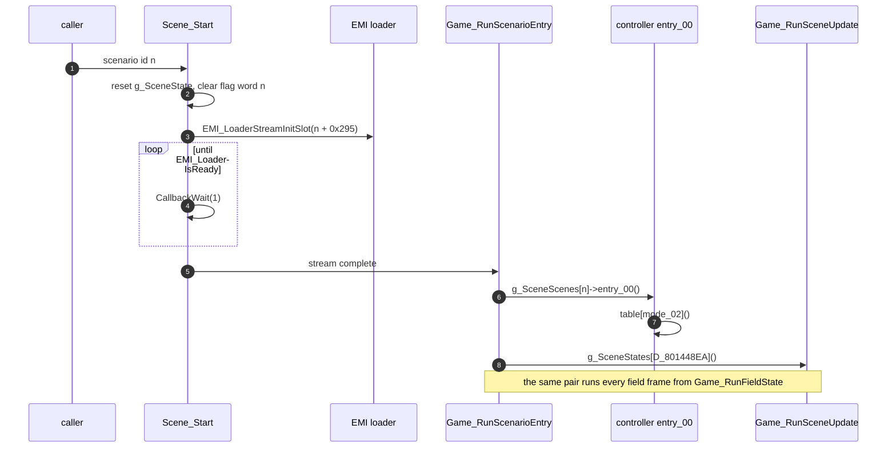

# Scenario engine

*Read this if you work on the story layer: chapters, scenes and scenario overlays.*

How the story layer sits on top of the field. A scenario is one of 20 controller overlays,
`SCENA00` to `SCENA19`, each loaded into the window at `0x801F6C00`. The resident code in
`emi/etc/game/00` calls into the loaded controller at fixed points of the field loop. A second
layer, the event stage, runs one-off event handlers selected by an event id.

Static reading of the game code. Tags: `[read]` is code or assembly read directly,
`[inferred]` is deduced from several reads, `[unknown]` is not established. Image names omit the
`emi/` prefix. What each scenario means in the story is not established here.

## Entry points

| Symbol                        | Image@address                | Role                                                                                   | Status                                             |
| ----------------------------- | ---------------------------- | -------------------------------------------------------------------------------------- | -------------------------------------------------- |
| `Scene_Start`                 | `emi/etc/game/00@0x801A7704` | reset `g_SceneState`, clear the scenario's flag word, stream its controller, run entry | `[read]`                                           |
| `Scene_RequestOverlay`        | `emi/etc/game/00@0x801A7804` | `EMI_LoaderStreamInitSlot(scenario_id + 0x295)`                                        | `[read]`                                           |
| `Game_RunScenarioEntry`       | `emi/etc/game/00@0x801A782C` | call `entry_00` of the loaded controller, then `Game_RunSceneUpdate`                   | `[read]`                                           |
| `Game_DispatchScenarioRecord` | `emi/etc/game/00@0x801A7878` | call `entry_04` (or `Scene_DispatchObject`) for an entity with a callback index        | `[read]`                                           |
| `Area_IsStepBlocked`          | `emi/etc/game/00@0x801A7914` | call `entry_08`, fall back to `func_801A8728`                                          | `[read]`                                           |
| `func_801A79A4`               | `emi/etc/game/00@0x801A79A4` | call `entry_0C`, fall back to `func_801A8B84`                                          | `[read]`                                           |
| `Game_CallScenarioHandler`    | `emi/etc/game/00@0x801A7A34` | call `entry_10` if set, fall back to `func_801A8CB4`                                   | `[read]`                                           |
| `Scene_RequestChapterAdvance` | `emi/etc/game/00@0x801A78F8` | set `g_SceneState.flags_01                                                             | = 0x80`: advance the chapter at the next area load | `[read]` |
| `Game_RunSceneUpdate`         | `emi/etc/game/00@0x801A7BF0` | run `g_SceneStates[D_801448EA]`                                                        | `[read]`                                           |
| `Scene_ResetEventState`       | `emi/etc/game/00@0x801A7C2C` | event stage reset                                                                      | `[read]`                                           |
| `Scene_RunEventHandler`       | `emi/etc/game/00@0x801A7CAC` | run `g_SceneEvents[D_801448EB]`                                                        | `[read]`                                           |
| `Scene_DispatchObject`        | `emi/etc/game/00@0x801A86D4` | run `g_SceneObjects[callback_index](record, g_SceneEventFlags)`                        | `[read]`                                           |

## Start and per-frame run

`Scene_Start(n)` writes `g_SceneState.scenario_id = n` and zeroes `mode_02`, `unk_03`, `state_04`,
`step_05`, `timer_06`, `flags_01` and `unk_08`. It clears the first 32 flags (one `sw`) of the 8-byte flag word of scenario `n`
and points `g_SceneFlags` (`0x8014686C`) at it. It streams slot `n + 0x295`, waits with
`CallbackWait(1)` (calling `func_801992B8` each frame once an area is loaded and the state index is
not 5), then runs `Game_RunScenarioEntry`. `[read]`

Callers of `Scene_Start`. `[read]`

| Caller                                                  | Argument                       | When                                                                                                                         |
| ------------------------------------------------------- | ------------------------------ | ---------------------------------------------------------------------------------------------------------------------------- |
| `Game_StartSelectedGame` (`emi/etc/game/01@0x801D0E54`) | 16                             | title selection ends; also registers `Game_RunMainLoop` in slot 0                                                            |
| `Start_RunNewGame` (`emi/etc/start/08@0x801E2584`)      | 0                              | New Game: sets `D_801448EA = 0`, `g_GameAreaId = 0xFFFF`, clears the 20 flag words, then `CallbackReplace(Game_RunMainLoop)` |
| `func_8019FAA0` (`emi/etc/game/00@0x8019FAA0`)          | `scenario_id + 1`, skipping 16 | chapter advance, see below                                                                                                   |

After the first entry, `Game_RunFieldState` (`emi/etc/game/00@0x80197378`, entry state 2) runs
`Game_RunScenarioEntry` once per frame. `func_80199230` and `func_80199368` also call it. `[read]`
`func_8019FAA0` sets `mode_02 = 1` just before its own call, so a controller sees mode 1 on every
arrival in a new area. `[read]` (assembly)

## The controller overlay

`g_SceneScenes[20]` (`emi/etc/game/00@0x801C8454`) holds 20 absolute pointers, one per scenario, into
the window `0x801F6C00..0x801FEA80`. The first word of each loaded image is its module id
(`0x105` for `SCENA00` to `0x118` for `SCENA19`; the type-0 loader checks it against the archive
TOC, see [loading](loading.md)). `[read]` The pointer targets are a **handler block**. `[read]`

| Offset | Slot       | Caller                                             | Contract                                                                                                            |
| -----: | ---------- | -------------------------------------------------- | ------------------------------------------------------------------------------------------------------------------- |
| `0x00` | `entry_00` | `Game_RunScenarioEntry`                            | per-frame controller; `SCENA00` and `SCENA16` read `mode_02` and call `table[mode]`                                 |
| `0x04` | `entry_04` | `Game_DispatchScenarioRecord`                      | `void (record)`: talk or touch an entity whose `callback_index` is set                                              |
| `0x08` | `entry_08` | `func_801B0E44` through `Area_IsStepBlocked`       | `s8 (x, y)`: nonzero blocks a step into the cell; zero falls back to `func_801A8728` (area-id switch)               |
| `0x0C` | `entry_0C` | `func_801B146C` through `func_801A79A4`            | `s8 (x, y)`: nonzero overrides the cell test; zero falls back to `func_801A8B84`                                    |
| `0x10` | `entry_10` | `func_801B6258` through `Game_CallScenarioHandler` | `s8 (a, b)`: optional; negative or null falls back to `func_801A8CB4`, which reads the area hook table `D_801C86F8` |

In `SCENA00` the five words are at `0x801FC9FC` and the mode table follows at `0x801FCA10`; `entry_00`
(`0x801F913C`) loads `D_80146872` (`mode_02`) and jumps through that table. `SCENA16` stores its
handler block as one array: slots 0-4, then mode handlers from index 5, then state handlers from
index 8, then three `(record, state)` event handlers. `[read]` for both. The other 18 controllers
were not individually decoded; `entry_00` starting with a `mode_02` jump is `[inferred]` for them.

`SceneState` (`g_SceneState`, `0x80146870`, 16 bytes). `[read]`

| Field         | Offset | Use                                                                                                  |
| ------------- | -----: | ---------------------------------------------------------------------------------------------------- |
| `scenario_id` | `0x00` | index into `g_SceneScenes`, and the EMI slot offset                                                  |
| `flags_01`    | `0x01` | bit `0x80` chapter advance (set by `Scene_RequestChapterAdvance`); bit `0x20` set by `func_8019A904` |
| `mode_02`     | `0x02` | dispatch byte of the controller                                                                      |
| `state_04`    | `0x04` | second-level state (used by `SCENA16` and others)                                                    |
| `step_05`     | `0x05` | third-level step                                                                                     |
| `timer_06`    | `0x06` | countdown for the step                                                                               |

`SAVE_RunLoadRestore` (`emi/etc/start/08@0x801E5FD4`) copies 0x10 bytes from `D_801448D8` into `g_SceneState`
on load. The 20 flag words (`0x80144E88`, 8 bytes each) and the event-flag block (`0x80144F28`) lie
inside the same 4,272-byte block boot zeroes from `D_801448D8` ([boot](boot.md)). Whether the save
image carries them is in [saving](saving.md). `[read]` for the copy and the addresses.

### Chapter advance

`Scene_RequestChapterAdvance` sets `flags_01 |= 0x80`. `func_8019FAA0` tests the bit on the next area load and,
if set, increments `scenario_id` (a result of 16 becomes 17) and calls `Scene_Start` with it.
`Scene_Start` clears `flags_01`, so one call advances one chapter. `[read]` (assembly at
`0x8019FD18..0x8019FD68`)

Callers of `Scene_RequestChapterAdvance` are present in `SCENA00` to `SCENA15` (each overlay's assembly) and absent
from `SCENA16` to `SCENA19`. `[read]` Together this gives a linear chain `SCENA00` to `SCENA15`,
then `SCENA17` (16 is skipped). What the 16 scenarios correspond to in the story is `[unknown]`.

### Which scenario does what

| Scenario             | Evidence                                                                                                                                                                                           | Status                                       |
| -------------------- | -------------------------------------------------------------------------------------------------------------------------------------------------------------------------------------------------- | -------------------------------------------- |
| `SCENA00`            | New Game start; calls `Game_RequestAreaChange(9, 0x570000, 0x40000, 7)` ([phases](phases.md))                                                                                                      | `[read]`                                     |
| `SCENA07`            | streams slot `0x254` (`A085SE2`)                                                                                                                                                                   | `[read]`                                     |
| `SCENA08`            | streams slot `0x255` (`A108SE2`)                                                                                                                                                                   | `[read]`                                     |
| `SCENA10`            | streams slot `0x290` (`SCE10EFF`) into `0x801D0C00`; waits 30 frames (`D_80146876 = 0x1E`) then `Message_StartAreaMessage`                                                                         | `[read]`                                     |
| `SCENA15`            | streams `0x291`, `0x292` and `0x294` (effect overlays `SCE15EF*`)                                                                                                                                  | `[read]`                                     |
| `SCENA16`            | started by title selection; enters area 4 at `(0x1A0000, 0x88000)` with BGM 6; mode 1 branches on the area id (2, 4 or 31); three-level `mode_02`/`state_04`/`step_05` machine; no chapter advance | `[read]`; attract or intro role `[inferred]` |
| `SCENA17`            | streams `0x260` (`ENDKANJI`) and `0x266` (`SHOP`); no chapter advance                                                                                                                              | `[read]`; ending role `[inferred]`           |
| `SCENA18`, `SCENA19` | stubs: mode setters and an empty handler                                                                                                                                                           | `[read]`                                     |
| others               | not decoded                                                                                                                                                                                        | `[unknown]`                                  |

The effect overlays run in the shared window at `0x801D0C00`. `Scene_RunEffect`
`Scene_RunEffect (emi/scenario/sce10eff/00@0x801D0C10)` picks one of three handlers (begin, end, run) by byte 1 of
`g_SpadWork`. Its begin handler stages scene objects of type `0x69` through `Actor_Alloc`. The
call site that enters it is `[unknown]`.

## Event stage

`Game_RunSceneUpdate` indexes the 2-entry table `g_SceneStates` by `D_801448EA`. State 0 is
`Scene_ResetEventState`, which sets `D_801448EA = 1`, clears the event bytes `D_801448E8..F0` and
reloads `g_SceneEventFlags[0..15]` from `s_EventFlagsReset` (`0x08`, `0x00`, `0x00`, `0x0A`, then
zeros). State 1 is `Scene_RunEventHandler`: it calls `g_SceneEvents[D_801448EB]`. `[read]`

`D_801448EB` is the event id. Field code writes it (`func_801B6674` writes `0x37` and `0x1B`);
handler 0 (`func_801A7CE8`) is the idle handler, and each active handler returns the stage to 0
by clearing `D_801448EB`. Handlers keep their own sub-step in `D_801448EC`. `[read]`

|             Event id | Handler                                                                                                       | Reading                                                                          | Status             |
| -------------------: | ------------------------------------------------------------------------------------------------------------- | -------------------------------------------------------------------------------- | ------------------ |
|                    0 | `func_801A7CE8`                                                                                               | idle                                                                             | `[inferred]`       |
|                    4 | `Master_RunSceneEvent`                                                                                        | master screen: stream `SISYOU`, then `func_801D25D8`; restores the party archive | `[read]`           |
| 5, 6, 10, 27, 44, 55 | `func_801A7E54`, `func_801A82F8`, `Scene_RunShopSaveEvent`, `func_801A839C`, `func_801A83DC`, `func_801A852C` | resident event handlers                                                          | `[unknown]` roles  |
|               others | addresses in `0x801F....`                                                                                     | area or overlay code at fixed addresses                                          | `[read]` addresses |

`Scene_DispatchObject` is the same idea for entities: `g_SceneObjects[callback_index](record,
g_SceneEventFlags)`, used when `unk_7C & 0x4000` is set in the record (`Game_DispatchScenarioRecord`).
`callback_index` is written by setup-stream opcode `D` ([area](area.md#setup-stream)). `[read]`

## Flags

Three bit arrays, all read with `SYS_TestFlag(bits, bit)` (`bit` is a `u8`, so 256 bits per
array). `[read]`

| Array               | Address      | Size            | Use                                                                                  |
| ------------------- | ------------ | --------------- | ------------------------------------------------------------------------------------ |
| `g_SceneFlagWords`  | `0x80144E88` | 20 words of 8 B | one 8-byte entry per scenario; `Scene_Start` clears its flags 0-31 (one `sw`)        |
| `g_SceneFlags`      | `0x8014686C` | pointer         | the current scenario's word, used as `SYS_SetFlag(g_SceneFlags, bit)` by controllers |
| `g_SceneEventFlags` | `0x80144F28` | `0x28` B        | event flags; the first 16 bytes are reset by `Scene_ResetEventState`                 |

Exit doors can test any scenario's word: `func_801A0048` reads `SYS_TestFlag(g_SceneFlagWords +
(b << 3), bit)` for a row's scenario byte `b` ([area](area.md#doors)). `[read]`

## Data and limits

| Limit or hardcoded value           | Value                                                                                                            | Code or data                                                                                     | Status   |
| ---------------------------------- | ---------------------------------------------------------------------------------------------------------------- | ------------------------------------------------------------------------------------------------ | -------- |
| Scenario count and EMI slot        | 20, slot `0x295 + id` (`0x295..0x2A8`)                                                                           | `Scene_RequestOverlay`, `g_SceneScenes[20]`                                                      | `[read]` |
| Controller window                  | `0x801F6C00..0x801FEA80`, largest 32,384 bytes                                                                   | [memory](memory.md)                                                                              | `[read]` |
| Controller address table           | `g_SceneScenes[20]` holds absolute addresses, for example `0x801FC9FC` for `SCENA00`, `0x801F8538` for `SCENA16` | `g_SceneScenes` (`emi/etc/game/00@0x801C8454`)                                                   | `[read]` |
| Handler block shape                | 5 fixed slots, then a mode table, at the pointed address                                                         | `entry_00` of `SCENA00`; `SCENA16` block                                                         | `[read]` |
| Module id check                    | first word `0x105 + id`                                                                                          | `D_801F6C00` in each scenario                                                                    | `[read]` |
| Chapter chain                      | `SCENA00..15` then 17; 16 is skipped                                                                             | `func_8019FAA0`                                                                                  | `[read]` |
| Flag words                         | 20 x 8 bytes (64 flags per scenario)                                                                             | `g_SceneFlagWords`, `Scene_Start` clears flags 0-31 of one entry; `func_801E2584` clears all 20s | `[read]` |
| Event flag block                   | `0x28` bytes; 16 bytes reset at stage start                                                                      | `g_SceneEventFlags`, `s_EventFlagsReset`                                                         | `[read]` |
| Event handlers and object handlers | 64 and 66 entries; absolute addresses                                                                            | `g_SceneEvents`, `g_SceneObjects`                                                                | `[read]` |
| Effect overlays                    | slots `0x290..0x294` into `0x801D0C00`                                                                           | `SCENA10`, `SCENA15`                                                                             | `[read]` |

What an edited scenario must keep:

- **Handler block address.** The executable-side table in `etc/game/00` points at fixed addresses.
  A rebuilt controller must put its handler block at the address in `g_SceneScenes[n]`, or that
  table must change. The first word must stay `0x105 + n`. `[read]`
- **Window size.** The controller must fit the 32,384 byte window; the largest shipped one is that
  size ([memory](memory.md)). `[read]`
- **Slot semantics.** `entry_08` and `entry_0C` must return zero to let the resident fallback run;
  `entry_10` must return a negative value for the same. `[read]`
- **Flag budget.** 64 flags per scenario word. Using a bit outside a word reads or writes the next
  scenario's word. `[read]` (`SYS_TestFlag` masks the bit to a byte index, not to the word).
- **Event ids.** An event handler address in `g_SceneEvents` or `g_SceneObjects` that lies in the area
  window runs whatever the loaded area program places there ([area](area.md#data-and-limits)). `[read]`
- **Save compatibility.** `scenario_id` and the flag words are part of state restored on load
  ([saving](saving.md)).

Tools and formats: [editor guide](editor-guide.md), [disc and files](disc-and-files.md).

## Connections

- Frame order that calls the controller: [frame loop](frame-loop.md), [phases](phases.md).
- Area transitions that advance chapters: [area](area.md).
- Callback slot and dispatch idiom (`SYS_DISPATCH_BYTE`): [scheduler](scheduler.md).
- Controller and effect overlay placement: [memory](memory.md), [loading](loading.md).
- Battle hooks that scenarios drive through `g_GameStateIndex`: [battle](battle.md).
- Text shown by `Message_StartAreaMessage`: [ui](ui.md). Per-image inventory: [responsibilities](responsibilities.md).

## Gaps

| Gap                                                                       | What would prove it                                                            |
| ------------------------------------------------------------------------- | ------------------------------------------------------------------------------ |
| Story meaning of each scenario and each flag bit                          | read each controller's mode table and the `SYS_SetFlag` sites                  |
| Mode and state counts of the 18 undecoded controllers                     | read the five-word block and the table after it for each                       |
| Caller that enters `Scene_RunEffect` and the `SCE15EF*` overlays          | find the call into `0x801D0C10` from `SCENA10` and `SCENA15`                   |
| Purpose of `SCENA16` and `SCENA17`                                        | trace the title idle path and the ending path                                  |
| Roles of event ids 5, 6, 10, 27, 44, 55 and the `0x801F....` handlers     | read each handler and the writers of `D_801448EB` (`func_801B6674` and others) |
| Whether the save image carries `g_SceneFlagWords` and `g_SceneEventFlags` | [saving](saving.md) save writer                                                |
| Reader of the `flags_01 & 0x20` bit set by `func_8019A904`                | find its readers                                                               |
