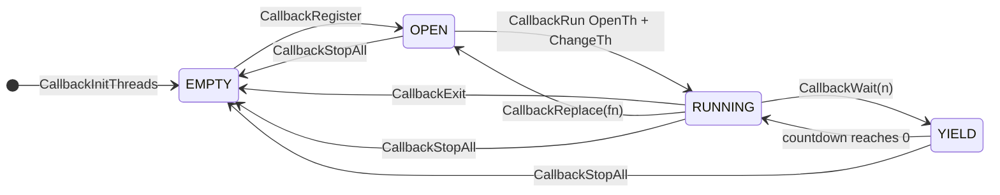

# Scheduler and tasks

*Read this if you need to know how game code is scheduled between frames.*

How game code runs between frames: the four callback slots (cooperative kernel threads), the state-byte
dispatch tables that sit on top of them, and the fixed-size work-record tables that overlays share.

Static reading of the game code; nothing here was run on an emulator. Tags: `[read]` is code or
assembly read directly, `[inferred]` is deduced from several reads, `[unknown]` is not established.

## Terms

| Term        | Meaning in this wiki                                                                                                                               |
| ----------- | -------------------------------------------------------------------------------------------------------------------------------------------------- |
| Slot        | One of the four `CallbackSlot` records at `D_80143B40` (`0x80` bytes each).                                                                        |
| Callback    | The function a slot runs as a PsyQ kernel thread. It loops forever, yields with `CallbackWait`, and ends with `CallbackExit` or `CallbackReplace`. |
| Thread      | The kernel thread (`OpenTh`, `ChangeTh`, `CloseTh`) that carries one callback.                                                                     |
| State byte  | A byte a callback reads to index a handler table (`g_UiTitleState`, `g_GameEntryState`, the byte at `+1` of a work record).                        |
| Work record | A fixed-stride record in RAM that a table of handlers steps (actor rows, panel tasks, battlers).                                                   |

## Entry points

| Symbol                 | Image@address                | Role                                                             | Status   |
| ---------------------- | ---------------------------- | ---------------------------------------------------------------- | -------- |
| `CallbackInitThreads`  | `exe/slus_004_22@0x8014B6B4` | seeds the four slots                                             | `[read]` |
| `CallbackRegister`     | `exe/slus_004_22@0x8014B854` | stores a callback in a slot and marks it open                    | `[read]` |
| `CallbackRun`          | `exe/slus_004_22@0x8014B73C` | per-frame pass over the slots                                    | `[read]` |
| `CallbackWait`         | `exe/slus_004_22@0x8014B87C` | yield for `n` passes                                             | `[read]` |
| `CallbackExit`         | `exe/slus_004_22@0x8014B8B0` | end the current slot's thread                                    | `[read]` |
| `CallbackReplace`      | `exe/slus_004_22@0x8014B954` | end the current thread and reopen the slot with another callback | `[read]` |
| `CallbackCloseThread`  | `exe/slus_004_22@0x8014B900` | empty one slot and close its thread                              | `[read]` |
| `CallbackStopAll`      | `exe/slus_004_22@0x8014B33C` | empty and close every occupied slot                              | `[read]` |
| `UI_SetMode`           | `exe/slus_004_22@0x8014ECAC` | choose a UI local mode and arm slot 2                            | `[read]` |
| `UI_DispatchLocalMode` | `exe/slus_004_22@0x8014ED6C` | slot 2 callback: run one of 21 local-mode handlers               | `[read]` |

## Slots

`CallbackInitThreads` writes, for slot `i` in `0..3`: state `0`; at `+0x0C`, the address of kernel work
block `i + 1` (`kernel[0x10] + (i + 1) * 0xC0`, where `kernel[0x10]` is the word at `0x80000110`); at `+0x10`,
the stack word `0x801FF400 + (i + 1) * 0x200`; and `0x40000404` into the work block at `+0x94`. `[read]`
The four stack words are `0x801FF600`, `0x801FF800`, `0x801FFA00` and `0x801FFC00`. `CallbackRun` passes the
words at `+0x10` and `+0x44` to `OpenTh` as its second and third arguments. `[read]` That these are the
stack and `gp` arguments follows the PsyQ `OpenTh(func, sp, gp)` signature, which is external. `[inferred]`

State values: `EMPTY 0`, `YIELD 1`, `OPEN 2`, `SWITCH 4`,
`IDLE 0x7F`. `[read]` `RUNNING` in the diagram is the `IDLE` value: `CallbackRun` writes it just before
`ChangeTh`, and the slot keeps it while its thread runs. `[read]`

`CallbackRun` (`@0x8014B73C`) points the cursor `g_CallbackSlot` at slot 0 and walks slots `0..3` once. The
cursor is the "current slot" that `CallbackWait`, `CallbackExit` and `CallbackReplace` act on, so it must
still point at the running slot when a callback calls them. `[read]`

| Slot state | Action                                                                                                      |
| ---------- | ----------------------------------------------------------------------------------------------------------- |
| `OPEN`     | `OpenTh(callback, +0x10 word, +0x44 word)` in a critical section, store `thread_id`, set `IDLE`, `ChangeTh` |
| `YIELD`    | decrement the countdown; at zero set `IDLE` and `ChangeTh`                                                  |
| `SWITCH`   | set `IDLE` and `ChangeTh`                                                                                   |
| other      | skip                                                                                                        |

A callback hands control back to `CallbackRun` through `CallbackWait`, `CallbackExit` or `CallbackReplace`.
Each calls `ChangeTh(0xFF000000)` (`CALLBACK_FORCE_SWITCH`). That this value switches back to the thread that
called `CallbackRun` is PsyQ kernel behaviour that the code relies on. `[inferred]` `CallbackWait` stores the
countdown and `YIELD` first; `CallbackExit` stores `EMPTY` and closes the thread; `CallbackReplace` stores
`OPEN` and the new callback, closes the thread, and `CallbackRun` reopens the slot on its next pass. `[read]`
No function read writes `SWITCH` (4). `[read]` for the search of the functions read; overlays not read: `[unknown]`.

`CallbackWait(n)` resumes the thread after `n` passes of `CallbackRun`, so `CallbackWait(1)` is "run again
next frame". Waiting loops use it to poll the loader: they call `CallbackWait(1)` until
`EMI_LoaderIsReady` returns nonzero (`SYS_StartFrontend`, `SYS_EnterFrontend`, `Game_BeginTitle`). `[read]`

### Slot use

| Slot | Registered by (image@address)                                              | Callback it runs                                                                                                    | Status                                                                           |
| ---: | -------------------------------------------------------------------------- | ------------------------------------------------------------------------------------------------------------------- | -------------------------------------------------------------------------------- |
|    0 | `SYS_Main` (`exe/slus_004_22@0x8014AAC8`) at boot and on soft reset        | `SYS_StartFrontend` (`exe/slus_004_22@0x8014EA80`)                                                                  | `[read]`                                                                         |
|    0 | `Game_StartSelectedGame` (`emi/etc/game/01@0x801D0E54`)                    | `Game_RunMainLoop` (`emi/etc/game/00@0x80197068`): the in-game loop                                                 | `[read]`                                                                         |
|    0 | `Game_LeaveTitle` (`emi/etc/game/01@0x801D1000`)                           | `Game_RunCampMenuLoop` (`emi/etc/game/00@0x80196F78`): the start-menu loop                                          | `[read]`                                                                         |
|    0 | `CallbackReplace` in `emi/etc/start/08` (`func_801E2584`, `func_801E62A8`) | replaces the current slot's callback with `Game_RunMainLoop`                                                        | `[read]` for the call, `[inferred]` that the running slot is 0                   |
|    1 | `SYS_StartFrontend`                                                        | `SYS_EnterFrontend` (`exe/slus_004_22@0x8014EC64`), which then calls `Game_RunTitle` (`emi/etc/game/01@0x801D0C04`) | `[read]`                                                                         |
|    2 | `UI_SetMode`; `UI_SetModeWait` (`exe/slus_004_22@0x8014ECEC`)              | `UI_DispatchLocalMode`                                                                                              | `[read]`                                                                         |
|    3 | no `CallbackRegister(3, ...)` call in the functions read                   | none found                                                                                                          | `[read]` for the search of the functions read, `[unknown]` for overlays not read |

`Game_StartSelectedGame` and `Game_LeaveTitle` run on slot 1's thread (inside `Game_RunTitle`). They register
slot 0 and the title thread keeps going until `Game_LeaveTitle` calls `CallbackExit`. `[read]`

`CallbackReplace` outside the kernel: `emi/etc/start/08` (two sites, both install `Game_RunMainLoop`),
`emi/battle/batl_ovr/00` (`func_801EF0A8` installs `SYS_StartFrontend`, the game-over restart) and
`emi/scenario/scena17/00` (`func_801F9490`). Call sites in functions read; overlays not read are not searched.
[read] See [phases](phases.md).

The soft reset in `SYS_Main` also writes slot 0. When `g_InputHeld & (PADselect | PADstart)`
equals `0x900` for 61 frames (the counter reaches 60) and `EMI_LoaderIsReady()` is true, it calls `SND_Exit`, `CallbackStopAll`
and `CallbackRegister(0, SYS_StartFrontend)`. `[read]`

`Game_RunTitle` runs on slot 1's stack frame inside `SYS_EnterFrontend`'s thread. It loops forever, so slot 1
ends only through `CallbackExit` inside a title handler (`Game_LeaveTitle`). `[read]`

## State-byte dispatch

Every mode-like loop has the same shape: a callback loops, reads a state byte, calls
`table[state]()`, then yields. Table size and state byte differ per loop. `[read]` for the rows below.

| Loop (image@address)                                      | State byte                        | Table                                               |                          Entries |
| --------------------------------------------------------- | --------------------------------- | --------------------------------------------------- | -------------------------------: |
| `Game_RunTitle` (`emi/etc/game/01@0x801D0C04`)            | `g_UiTitleState` (`0x80143C10`)   | `s_TitleStates` (static in `emi/etc/game/01`)       |                                8 |
| `Game_RunMainLoop` (`emi/etc/game/00@0x80197068`)         | `0x80143B90` (`g_GameEntryState`) | `g_GameStates` (`emi/etc/game/00@0x801C7B14`)       |                               12 |
| `Game_RunCampMenuLoop` (`emi/etc/game/00@0x80196F78`)     | `g_GameEntryState`                | `g_GameCampMenuLoad` (`emi/etc/game/00@0x801C7B08`) |                                3 |
| `UI_DispatchLocalMode` (`exe/slus_004_22@0x8014ED6C`)     | `g_UiLocalMode`                   | `g_UiLocalModeFuncs` (`exe/slus_004_22@0x801499AC`) |                               21 |
| `Battle_DispatchMode` (`emi/battle/battle/03@0x801D112C`) | `g_BattleMode` (`0x801462E0`)     | `g_BattlePhases`                                    | 6 rows (per [battle](battle.md)) |

`g_GameStates` holds 12 entries. The two loops differ in
order: `Game_RunMainLoop` calls the handler, then `func_80198CAC`, then `CallbackWait(1)`;
`Game_RunCampMenuLoop` waits first, then calls the handler, then `Menu_RunPanelTasks`. Both zero
`g_GameEntryState` and `g_GameEntrySubstate` and call `Menu_ResetPanelTasks` on entry. `[read]` Meaning of
each entry state: [phases](phases.md) and [screens](screens.md).

Two dispatch forms express the same idiom. `[read]`

By byte, the handler table is indexed by the state byte itself. By task, it is indexed by a byte of a work record.

The by-byte form takes the state value itself. The index keeps its own signedness: a signed scenario
mode byte loads as a signed byte, an unsigned step byte as an unsigned byte. Overlays pass a byte of
the work record, for example byte `+1` of the record that scratchpad offset `0x44` points at. The
by-task form takes a work record and a byte offset; boss, shop, start-menu, commu, master and area
overlays use it.

`work_ptr` at scratchpad offset `0x44` (`0x1F800044`) points at the record the running handler steps. Its type
depends on the overlay: `PartyBattler` in battle, `Actor` in the field, `SceneBandEffect` in scenario.
Handlers read its step bytes (`+0x01`, `+0x02`, `+0x04`) through these forms.
`[read]` The by-task form appears in 210 code read and the by-byte form in 439, mostly boss and area overlays. `[read]`

Handlers advance by writing the state byte: setting a step writes byte `+0x01` of the `g_SpadWork` record,
and clearing the state writes `0` to byte `+0x02` (`state_02`). A handler that wants another turn leaves the
byte alone; the table runs it again next frame. `[read]`

## Work-record tables

| Table                        | Address                     | Stride x count | Allocator / walker                                                                                                                                               | Status         |
| ---------------------------- | --------------------------- | -------------- | ---------------------------------------------------------------------------------------------------------------------------------------------------------------- | -------------- |
| `g_ActorSlots` (`ActorSlot`) | `0x80143FC8` (resident RAM) | slot x 20      | `Actor_FindFreeSlot` (`emi/etc/game/00@0x8019601C`) first slot with `flags_00 == 0`, else `0xFF`; `Actor_Free` (`@0x801960C0`); `Actor_ClearAll` (`@0x8019611C`) | `[read]`       |
| `g_Actors` (`Actor`)         | `0x80146888` (resident RAM) | `0x98` x 30    | `Actor_FindFree` (`exe/slus_004_22@0x8015CA48`) first record with first byte 0, else `0xFF`                                                                      | `[read]`       |
| `g_MenuPanelTasks`           | resident RAM                | `0x24` x 22    | `Menu_ArmPanelTask` (`exe/slus_004_22@0x80158DB8`), `Menu_ResetPanelTasks` (`@0x80158E50`), `Menu_RunPanelTasks` (`@0x80158C80`)                                 | `[read]`       |
| battlers                     | see [battle](battle.md)     | per overlay    | `Battle_RunParty`, `Battle_RunEnemies` in `emi/battle/battle/03`                                                                                                 | `[read]` names |

`Menu_RunPanelTasks` makes one pass per mode value from `g_MenuPanelMode` up to 2 (nothing runs when the mode
is 3 or more). In each pass it calls, for every one of the 22 records whose first byte is nonzero and whose
mode byte (`+0x0F`, `D_8014833F`) equals the pass, the handler `g_MenuPanels[record[1]]`. A panel is
a task, so there are at most 22 live panels. `[read]`
Panel contents and drawing: [ui](ui.md). Actor use during field play: [area](area.md).

## Local UI modes

`UI_SetMode(m)` returns without effect while `g_UiWindowEffectBusy` is nonzero. Otherwise it
stores `m & 0xFF` into `g_UiLocalMode` (`0x80143C90`) and registers `UI_DispatchLocalMode` in slot 2.
`UI_DispatchLocalMode` copies the 21-entry table to the stack and calls entry `g_UiLocalMode` once. `[read]`
Each entry is a small function. Twelve of them (for example `func_8014EDF0`, the one line `func_8014F514(0x800, 1, 0)`)
call `func_8014F514`, the fade body: it loops with `CallbackWait(1)` and ends the thread with `CallbackExit`.
The other entries (`func_8014EF80`, `func_8014F024`, `func_8014F24C`, `func_8014F2F0`, `func_8014F460`) end
through their own `CallbackWait`/`CallbackExit` calls. Effect catalogue: [ui](ui.md). `[read]` `UI_SetModeWait` is a variant of `UI_SetMode` that
also waits with `CallbackWait(1)` until the effect ends. `[read]`

The area transition uses it as the screen effect: `Game_RunFieldState` (`emi/etc/game/00@0x80197378`) case 5 calls
`UI_SetMode(g_GameEntryMode)`. Handler roles are screen fades and wipes per the area fork's notes:
[area](area.md). `[read]` for the call.

## Data and limits

| Limit                        | Value                                                 | Code                                                                   | Status   |
| ---------------------------- | ----------------------------------------------------- | ---------------------------------------------------------------------- | -------- |
| Callback slots               | 4                                                     | `CallbackInitThreads`, `CallbackStopAll` (`slot_end = D_80143B40 + 4`) | `[read]` |
| Thread stack                 | `0x200` bytes per slot, tops `0x801FF600..0x801FFC00` | `CallbackInitThreads`                                                  | `[read]` |
| Title state handlers         | 8                                                     | `s_TitleStates[8]` in `emi/etc/game/01`                                | `[read]` |
| UI local modes               | 21                                                    | `UI_DispatchLocalMode` copy of `callbacks[21]`                         | `[read]` |
| Panel task slots             | 22, handlers 9                                        | `Menu_ResetPanelTasks`, `Menu_RunPanelTasks`                           | `[read]` |
| Actor rows (field)           | 30 rows of `0x98`                                     | `Actor_FindFree`                                                       | `[read]` |
| Actor slots (frontend table) | 20                                                    | `ACTOR_SLOT_COUNT`, `Actor_Alloc`                                      | `[read]` |

A callback runs on `0x200` bytes of stack. A deeper call chain would run over the neighbouring slot's stack,
since the four stacks are adjacent. Whether any real chain does is `[unknown]`.

## Connections

- Where `CallbackRun` is called: [frame loop](frame-loop.md). First two callbacks: [boot](boot.md).
- Game-state transitions that choose the next table row: [phases](phases.md).
- Panel tasks and windows: [ui](ui.md). Field actors: [area](area.md). Battle step tables: [battle](battle.md).

## Gaps

| Gap                                                                  | What would prove it                                              |
| -------------------------------------------------------------------- | ---------------------------------------------------------------- |
| The `0x200`-byte stack is enough for the deepest real call chain     | Static worst-case stack analysis, or a run with stack watermarks |
| Writers of `CALLBACK_SLOT_SWITCH`                                    | Search the overlays for stores of `4` to the slot state halfword |
| Slot 3 purpose                                                       | Find any code that writes `D_80143B40 + 0x180`                   |
| Callers of `CallbackRegister`/`CallbackReplace` in overlays not read | Search the overlays not read for `jal` to the two symbols        |
