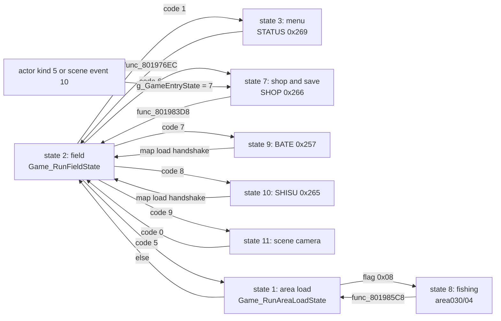

# Screens: menus, shops, fishing, fairy village, master and world map

*Read this if you need to find the code and overlay behind a menu, shop, fishing or other full screen.*

Which game state opens each full-screen mode, which overlay holds its code, and how control returns to the
field. This page owns the mapping from request codes and entry states to screens. The save and load card paths
are in [saving](saving.md); window and panel drawing is in [ui](ui.md); the field state they all return to is in
[area](area.md).

Static reading of the game code; nothing here was run on an emulator. Tags: `[read]` is code or
assembly read directly, `[inferred]` is deduced from several reads, `[unknown]` is not established.
Image names omit the `emi/` prefix; addresses are image-local.

## Terms

| Term            | Meaning in this wiki                                                                                                                           |
| --------------- | ---------------------------------------------------------------------------------------------------------------------------------------------- |
| Request code    | `g_GameStateIndex` (`0x80143BB0`). Field, actor and scenario code write it; entry state 2 reads it and switches state.                         |
| Entry state     | `g_GameEntryState`: index into `g_GameStates[12]` (`0x801C7B14`). One state per full-screen mode.                                              |
| Entry substate  | `g_GameEntrySubstate`: index into the 3 or 4 handler table that the state owns.                                                                |
| Menu step bytes | `D_80148650`, `D_80148651`, `D_80148652`: the step and sub-steps that STATUS, SHOP, BATE and SHISU dispatch on, each indexing a handler table. |
| Scene event     | An entry of `g_SceneEvents[64]` (`0x801C84BC`), selected by `D_801448EB` and stepped by `D_801448EC`. It runs inside the field state.          |

## Entry points

| Symbol                     | Image@address                  | Role                                                     | Status   |
| -------------------------- | ------------------------------ | -------------------------------------------------------- | -------- |
| `Game_RunFieldState`       | `emi/etc/game/00@0x80197378`   | state 2: map each request code to the next entry state   | `[read]` |
| `Game_RunAreaLoadState`    | `emi/etc/game/00@0x801971E8`   | state 1: load the area; area flag `0x08` enters state 8  | `[read]` |
| `Game_RunMenuState`        | `emi/etc/game/00@0x801975E4`   | state 3 (menu): `g_GameEntryHandlers[substate]`          | `[read]` |
| `Game_RunShopState`        | `emi/etc/game/00@0x80198234`   | state 7 (shop and save): `g_GameStateHandlers[substate]` | `[read]` |
| `Game_RunFishingState`     | `emi/etc/game/00@0x801984AC`   | state 8 (fishing): `g_GameSubstateHandlers[substate]`    | `[read]` |
| `Game_RunAbilityMenuState` | `emi/etc/game/00@0x80198744`   | state 9: `g_MenuAbilityOpen[substate]` (BATE)            | `[read]` |
| `Game_RunStatusMenuState`  | `emi/etc/game/00@0x80198904`   | state 10: `g_MenuStatusOpen[substate]` (SHISU)           | `[read]` |
| `Game_RunSceneCameraState` | `emi/etc/game/00@0x80198AC4`   | state 11: `g_GameFlowHandlers[substate]`                 | `[read]` |
| `Scene_RunShopSaveEvent`   | `emi/etc/game/00@0x801A802C`   | scene event 10: shop and save from a script              | `[read]` |
| `Master_RunSceneEvent`     | `emi/etc/game/00@0x801A7CF0`   | scene event 4: load SISYOU and run the master menu       | `[read]` |
| `func_801A18C8`            | `emi/etc/game/00@0x801A18C8`   | actor step: an actor of kind 5 opens the shop state      | `[read]` |
| `Party_JoinMember`         | `emi/etc/game/00@0x801C187C`   | party add; a full party writes request code 6            | `[read]` |
| `Shop_DispatchStep`        | `emi/etc/shop/00@0x801D0EA0`   | SHOP step dispatch: `D_801E5144[D_80148650]`             | `[read]` |
| `Menu_DispatchStep`        | `emi/etc/start/08@0x801D1740`  | STATUS step dispatch: `D_801EC35C[D_80148650]`           | `[read]` |
| `Master_DispatchMenu`      | `emi/etc/sisyou/00@0x801D25D8` | SISYOU step dispatch: `g_MasterMenuFuncs[g_MasterStep]`  | `[read]` |

## From request to screen

`Game_RunFieldState` (entry state 2, the field) maps the request codes; codes 2 to 5 (message wait, battle, camera,
area change) are in [phases](phases.md). The rows below are the screens. `[read]`

| Request or trigger                                                        | Entry state | Overlay (slot)                   | Screen                                                     | Status                                       |
| ------------------------------------------------------------------------- | ----------: | -------------------------------- | ---------------------------------------------------------- | -------------------------------------------- |
| code 1, written by `func_801B2A00` (actor step table `D_801CD110`)        |           3 | STATUS (`0x269`), start/08       | the in-game menu                                           | `[read]`; the button trigger `[unknown]`     |
| code 6, written by `Party_JoinMember` when the party is full              |           7 | SHOP (`0x266`)                   | step 6 (`func_801DE188`): `[inferred]` a party-swap screen | `[read]` for the path; role `[inferred]`     |
| actor of kind 5 (`func_801A18C8`)                                         |           7 | SHOP                             | step = actor field `+0x18` plus 2                          | `[read]`                                     |
| scene event 10 cases 6 and 23 (`Scene_RunShopSaveEvent`)                  |           7 | SHOP                             | step = `D_80148698` plus 2; step 3 is the save screen      | `[read]` (save per [saving](saving.md))      |
| code 7, written by scena06 (`func_801F97C0@0x801F98D8`)                   |           9 | BATE (`0x257`)                   | list screen, selector `D_8018E244`                         | `[read]` for the write; screen `[inferred]`  |
| code 8, written by scena11 (`func_801F8B84@0x801F8D2C`)                   |          10 | SHISU (`0x265`)                  | status-style screen                                        | `[read]` for the write; screen `[inferred]`  |
| code 9, Start in the field (`func_801B5910`, `func_80167428`)             |          11 | none (field overlay)             | scene dispatch with camera control                         | `[read]`; Start meaning `[inferred]`         |
| area load flag `0x08` (`g_GameRequestFlags & 8`, `Game_RunAreaLoadState`) |           8 | area030/04 at `0x801D0C00`       | the fishing pond                                           | `[read]`                                     |
| scene event 4 (`g_SceneEvents[4]`)                                        |   2 (stays) | SISYOU (`0x267`)                 | the master menu                                            | `[read]`; trigger `[unknown]`                |
| area load flag `0x10`                                                     |   2 (stays) | COMMU00 (`0x258`), COMMU01 to 05 | the fairy village                                          | `[read]` for the flag and loads              |
| area load flag `0x01`                                                     |  2, mode 10 | world area overlay               | the world map                                              | `[read]` for the flag; map code `[inferred]` |

Every screen state follows the same frame shape. Substate 0 starts the overlay stream and waits for
`EMI_LoaderIsReady`; the middle substate runs one frame of the screen and `Menu_RunPanelTasks`; the last
substate re-streams the character bank (`EMI_StreamFamilyArchive(..., EMI_FAMILY_PL)`) and returns to state 2
with `g_GameEntrySubstate = 0` and `g_GameStateIndex = 0`. `[read]`

## In-game menu (entry state 3)

Code 1 calls `UI_SetMode(2)` and `func_80198BC4(0)`, then sets state 3, substate 0. The substates are
`g_GameEntryHandlers` (`0x801C7B44`). `[read]`

| Substate | Function (`etc/game/00`) | Work                                                                                        | Status   |
| -------: | ------------------------ | ------------------------------------------------------------------------------------------- | -------- |
|        0 | `func_80197620`          | stream STATUS, copy palettes 1 and 2, `D_80148650 = 0`, `UI_SetMode(3)`, `func_80198C38(1)` | `[read]` |
|        1 | `func_80199368`          | `Game_RunScenarioEntry`, `func_801D1740`, `Menu_RunPanelTasks`                              | `[read]` |
|        2 | `func_801976EC`          | leave: restore the character bank, fairy village load, re-enter the area, state 2           | `[read]` |

`func_801D1740` dispatches `D_801EC35C[D_80148650]`, nine step functions. The program is the STATUS archive
entry 0; the start menu (New Game, Load Game) runs the same bytes from START.EMI entry 8 (a copy of
`BIN/ETC/STATUS.EMI#0`). Names for the nine steps are not established. `[read]` for the
table; roles `[unknown]`. The load-game steps are in [saving](saving.md).

`func_801976EC` leaves in one of three ways. `[read]`

| Condition                                                              | Result                                                                                     |
| ---------------------------------------------------------------------- | ------------------------------------------------------------------------------------------ |
| `D_8014869C != 0`, `D_8014504A == 0`, and the world map or area `0xBD` | save the party position and area in `D_80145040..D_80145048`, request the staged area      |
| `D_8014869C != 0`, any other case                                      | clear the flag bytes at `D_8014504A - 0x122`, request the saved area `D_80145048` (kind 4) |
| `D_8014869C == 0`, `D_8014869D != 0`                                   | `Game_RequestAreaChange(D_8014869D, 0x430000, 0x160000, 4)`: jump to that area             |
| both zero                                                              | `g_GameStateIndex = 0`; the field resumes                                                  |

`D_8014869C` and `D_8014869D` are set elsewhere (writers not traced); their meaning is `[unknown]`.

## Shop and save (entry state 7)

`g_GameStates[7]` is `Game_RunShopState`, which runs `g_GameStateHandlers` (`0x801C7B7C`). `[read]`

| Substate | Function (`etc/game/00`) | Work                                                                                                            | Status   |
| -------: | ------------------------ | --------------------------------------------------------------------------------------------------------------- | -------- |
|        0 | `Game_LoadShopOverlay`   | with a shop actor selected and its `+0x18` equal to 9: back to state 2 at once; else stream SHOP, palettes 1, 2 | `[read]` |
|        1 | `func_80199398`          | field frame, `Area_RunParty`, panels, `func_801D0EA0`                                                           | `[read]` |
|        2 | `func_801983D8`          | restore the character bank; stream COMMU00 when the area has flag `0x10`; state 2                               | `[read]` |

The SHOP program dispatches `D_801E5144[11]` by `D_80148650`: entry 0 `func_801D0EDC` is the selector. It reads
`D_8014865C`. A negative value (script or code origin) sets the step to `D_80148698 + 2`. A shop-actor index
copies the actor row's `+0x18` and adds 2, and copies `+0x1C` to `D_80148699` (actor kind 9 never reaches
the screen; see `Game_LoadShopOverlay`). The remaining ten entries are
the screens. Only step 3 is identified: the save screen ([saving](saving.md)). Steps 2 and 4 to 10 are the shop and
related screens; their individual roles are `[unknown]`. `[read]` for the selector; roles `[unknown]`.

## BATE and SHISU (entry states 9 and 10)

States 9 and 10 have the same shape. Substate 0 (`func_80198780`, `func_80198940`) is one
sequence, stream and stage palette: `UI_SetMode(2)`, two `CallbackWait`, stream the slot (BATE `0x257`,
SHISU `0x265`), copy palettes 1 and 2, advance. Substate 1 (`func_801993F0`, `func_80199418`) runs
`func_801D0D9C` or `func_801D0D80` plus `Menu_RunPanelTasks`. Substate 2 (`GameRunMapLoadHandshake`) streams the
character bank, `UI_SetMode(3)`, waits for the effect, and returns to state 2. `[read]`

The overlay head of each program is `OverlayHeader`, then the step entry: it dispatches `table[D_80148650]`
with a second table indexed by `D_80148651`. In BATE, `func_801D0DD8` sets `D_80148650 = D_8018E244 + 2`: the scenario
that opens it picks the screen. Scena06 stores 0 to `D_8018E244` next to its writes of request code 7. `[read]`

What each screen shows is `[inferred]`. The overlay annotations call BATE "draws an ability list (screen
unconfirmed)" and SHISU "status menu". Both overlays draw character data and are opened only by scenario code
(scena06 for code 7, scena11 for code 8). A scenario-driven party or ability viewer is consistent with both.
`[inferred]` The only writers of codes 7 and 8 found in the functions read and the assembly are in those two scenarios. `[read]`

## Fishing (entry state 8)

`Game_RunAreaLoadState` (state 1, the area load) sets `g_GameEntryState = 8` right after `func_8019FAA0` when
`g_GameRequestFlags & 8`. The `flag_32` bit 3 of the area record marks a fishing area ([area](area.md)).
The substate table is `g_GameSubstateHandlers[4]` (`0x801C7B88`). `[read]`

| Substate | Function                               | Work                                                                                        | Status                |
| -------: | -------------------------------------- | ------------------------------------------------------------------------------------------- | --------------------- |
|        0 | `func_801984E8` (`etc/game/00`)        | `UI_SetMode(1)`, redraw, copy a framebuffer strip, call substate 1 once, clear `D_80143F22` | `[read]`              |
|        1 | `func_801E0BD0` (`world00/area030/04`) | the pond frame: `func_801E09B4` and the field draw                                          | `[read]`              |
|        2 | `func_801985C8` (`etc/game/00`)        | restore the character bank, fade, `Game_RequestAreaChange(D_80143F04, ..., 4)`, state 1     | `[read]`              |
|        3 | `func_801E0C20` (`world00/area030/04`) | `func_800F500C`; the caller of this substate is not found                                   | `[read]` for the body |

The fishing program is part of the pond area's own image: `world00/area030/04` has `D_801D0C00 = 22` at its
head (the ETC overlay id convention) and its functions start at `0x801D0C90`, in the window the ETC overlays
use. `[read]` No separate screen slot is streamed by states 1 or 8. `[inferred]` Substates 1 and 3 resolve to
addresses that exist only in this image, which is why `etc/game/00` references them as undefined symbols. `[read]`
Substate 2 returns through the area load (state 1), not directly to the field. `[read]`

The tables the pond code reads (rod, lure, caught-fish bytes, pond rows) are listed under Data and limits;
the rod and lure row layouts are in [field](../field.md#fairy-village-and-fishing).

## Master (scene event 4)

The master menu is not an entry state. `g_SceneEvents[4]` is `Master_RunSceneEvent` (`emi/etc/game/00@0x801A7CF0`), stepped by
`D_801448EC`. `[read]`

| Step | Work                                                                                      | Status   |
| ---: | ----------------------------------------------------------------------------------------- | -------- |
|    0 | set bits 0-2 (`0x7`) of `g_AreaWalkFlags`, stream SISYOU (`0x267`)                        | `[read]` |
|    1 | when ready: copy palette 2, call `func_801D0C18` (overlay init)                           | `[read]` |
|    2 | `func_801D25D8` = `Master_DispatchMenu`: one frame of the menu, each frame                | `[read]` |
|    3 | stream the character bank (`EMI_FAMILY_PL`)                                               | `[read]` |
|    4 | when ready: clear bits 0-2 of `g_AreaWalkFlags`, reset the scene event (`D_801448EB = 0`) | `[read]` |

`Master_DispatchMenu` indexes `g_MasterMenuFuncs[7]` by `g_MasterStep`; the step functions include
`Master_ApplyMaster` as the last entry. Which script selects scene event 4 (`D_801448EB = 4`) is `[unknown]`.
The menu lists a character's master and skills per the overlay annotation
("master and skill menu"). `[inferred]`

## Fairy village

The fairy village is an area (`flag_32` bit 4, `AREA_LOAD_FLAG_FAIRY_VILLAGE`), not an entry state. Three
facts are read. `[read]`

- After the menu (`func_801976EC`) and after the shop and save screens (`func_801983D8`) return, the code
  streams COMMU00 (`0x258`) and calls `func_801F03D0` when the area has the flag. The reload exists because
  the screen overlays take over the shared window. `[inferred]` for the reason.
- `Fairy_VillageInit` (`etc/commu00/00`) acts when `g_GameAreaId != D_80143F04`. When no fairy is active it calls
  `Fairy_JoinVillage` three times (`BATTLE_PARTY_SLOT_COUNT`) and seeds five counters from `g_BattleCount`.
- COMMU01 to 05 (`0x259`, `0x25A/0x25B`, `0x25C`, `0x25D`, `0x25E`) are streamed one per step by
  `func_801F1770`, `func_801F1EB0`, `func_801F1FD8`, `func_801F222C` and `func_801F22C8`, each advancing
  `D_801448EC`. All dispatch on the commu step byte `D_801F294C` that COMMU00 owns.

That the five COMMU screens are scene events, and which game action opens each, is `[inferred]`; the fairy job
rows and the 60-job table are in [field](../field.md#fairy-village-and-fishing).

## World map

The world map is an area with `g_GameRequestFlags & 1`. It stays in entry state 2. `[read]`

- `Game_RunAreaLoadState` sets `g_GameEntryMode = 10` (instead of 0, or 20 for area `0xBD`) and applies the area's screen
  effect with `UI_SetMode(g_GameRequestKind)`; with the flag it also calls `func_801A0048` on the camera cell.
- The field step `func_801B146C` tests the cell under the party with `Area_GetCellCode`; the value `0xAF` requests an
  area change (`Game_RequestAreaChange`, `g_GameRequestKind = 0xC`).
- Random encounters on the world map skip the `D_80143EFC >= 0xF1` test in `Area_CanStartEncounter`. Its last test reads
  the cell class ahead of the party (`Area_GetCellCode`) instead of building a formation ([battle](battle.md)).

The world-map code is in the `world*` area overlays. The overlays were not read here. `[unknown]`

## Data and limits

| Limit                           | Value                                                                                                                                                                                             | Code or data                                                           | Status       |
| ------------------------------- | ------------------------------------------------------------------------------------------------------------------------------------------------------------------------------------------------- | ---------------------------------------------------------------------- | ------------ |
| Entry states                    | 12                                                                                                                                                                                                | `g_GameStates[12]` (`0x801C7B14`)                                      | `[read]`     |
| Request codes                   | 0 to 9                                                                                                                                                                                            | `Game_RunFieldState` switch                                            | `[read]`     |
| Battle entry substates          | 8                                                                                                                                                                                                 | `g_GameModeHandlers[8]`                                                | `[read]`     |
| Menu, shop, fishing substates   | 3, 3, 4                                                                                                                                                                                           | `g_GameEntryHandlers`, `g_GameStateHandlers`, `g_GameSubstateHandlers` | `[read]`     |
| BATE, SHISU, state 11 substates | 3 each                                                                                                                                                                                            | `g_MenuAbilityOpen`, `g_MenuStatusOpen`, `g_GameFlowHandlers`          | `[read]`     |
| Scene events                    | 64                                                                                                                                                                                                | `g_SceneEvents[64]` (`0x801C84BC`), `D_801448EB`                       | `[read]`     |
| STATUS menu steps               | 9                                                                                                                                                                                                 | `D_801EC35C[9]`                                                        | `[read]`     |
| SHOP steps                      | 11 (selector, then 10)                                                                                                                                                                            | `D_801E5144[11]`                                                       | `[read]`     |
| SHOP actor kinds                | 0 to 8 select a screen (`+0x18` plus 2 must stay at 10 or less); 9 skips it                                                                                                                       | `func_801D0EDC`, `Game_LoadShopOverlay`, `D_801E5144[11]`              | `[inferred]` |
| Master steps                    | 7                                                                                                                                                                                                 | `g_MasterMenuFuncs`                                                    | `[read]`     |
| BATE, SHISU step tables         | 8 and 5 entries by the symbol gaps                                                                                                                                                                | `D_801D86E0`, `D_801D8700`; `D_801D96DC`, `D_801D96F0`                 | `[inferred]` |
| Panel task slots                | 22, shared by every screen                                                                                                                                                                        | `Menu_RunPanelTasks` ([scheduler](scheduler.md))                       | `[read]`     |
| Fishing rods and lures          | rod rows of 10 bytes (`0x801E2748`, row count unbounded in code: index `sel * 10`), lure rows of 20 bytes (`0x801E2720`); both addresses overlap the panel-icon array ([field](../field.md#gaps)) | `func_801DDE2C` (`emi/world00/area030/04@0x801DDE2C`)                  | `[inferred]` |
| Fishing caught bytes            | 32, one per fish                                                                                                                                                                                  | `0x80144FE4`, `func_801E0B6C` (`emi/world00/area030/04@0x801E0B6C`)    | `[read]`     |
| Fishing pond rows               | 30 rows of `0x98` (the field actor table)                                                                                                                                                         | `0x80146888`                                                           | `[read]`     |
| Fairy jobs                      | 60 of 8 bytes                                                                                                                                                                                     | `0x801455C8`                                                           | `[read]`     |
| COMMU archives                  | 7 slots, `0x258..0x25E`                                                                                                                                                                           | [disc slot ids](../../formats/emi.md#disc-slot-ids)                    | `[read]`     |
| Screen overlay slots            | BATE `0x257`, SHISU `0x265`, SHOP `0x266`, SISYOU `0x267`, START `0x268`, STATUS `0x269`                                                                                                          | [disc slot ids](../../formats/emi.md#disc-slot-ids)                    | `[read]`     |

Edits to screen data must keep the step byte inside the dispatch table of the overlay that owns it: the byte is
used as an index with no bound check in the dispatch. `[read]` A shop actor kind above 8 reads past
`D_801E5144`. `[inferred]` from the 11-entry table and the `+2` in `func_801D0EDC`.

## Connections

- Request codes, entry states and the field loop: [phases](phases.md), [scheduler](scheduler.md).
- Streaming a slot and the `0x801D0C00` window: [loading](loading.md), [memory](memory.md).
- Windows, panel tasks and screen effects drawn by these overlays: [ui](ui.md).
- Card transfers, the save and load screens: [saving](saving.md). Scene events and scenario overlays: [scenario](scenario.md).
- Area flags, the world map cells and the field step: [area](area.md). Battle entry: [battle](battle.md).
- Which function owns each edit: [responsibilities](responsibilities.md), [editor guide](editor-guide.md), [disc and files](disc-and-files.md).

## Gaps

| Gap                                                                         | What would prove it                                                                  |
| --------------------------------------------------------------------------- | ------------------------------------------------------------------------------------ |
| Button that writes request code 1 (menu open)                               | read the callers of the actor step table `D_801CD110`                                |
| Names of the 9 STATUS steps and the 10 SHOP screens                         | read each step function after `D_801EC35C` and `D_801E5144`                          |
| What BATE and SHISU show, and the other scenarios that open them            | enumerate every scenario write of `D_80143BB0` = 7 or 8; read the step tables        |
| Which script selects scene event 4 (master) and scene events for COMMU01-05 | search the area setup streams and scenarios for `D_801448EB` stores                  |
| Caller of fishing substate 3 (`func_801E0C20`)                              | search `area030` for stores to `g_GameEntrySubstate` (only `func_801DDC54` stores 3) |
| World-map code                                                              | read the world area overlays selected by flag `0x01`                                 |
| Ending and credits screens                                                  | scena17 loads ENDKANJI (`0x260`) at `0x801F8554`; read scena17 to 19 `[inferred]`    |
| `D_8014869C` and `D_8014869D` set by the menu overlay                       | find their writers in `etc/start/08`                                                 |
