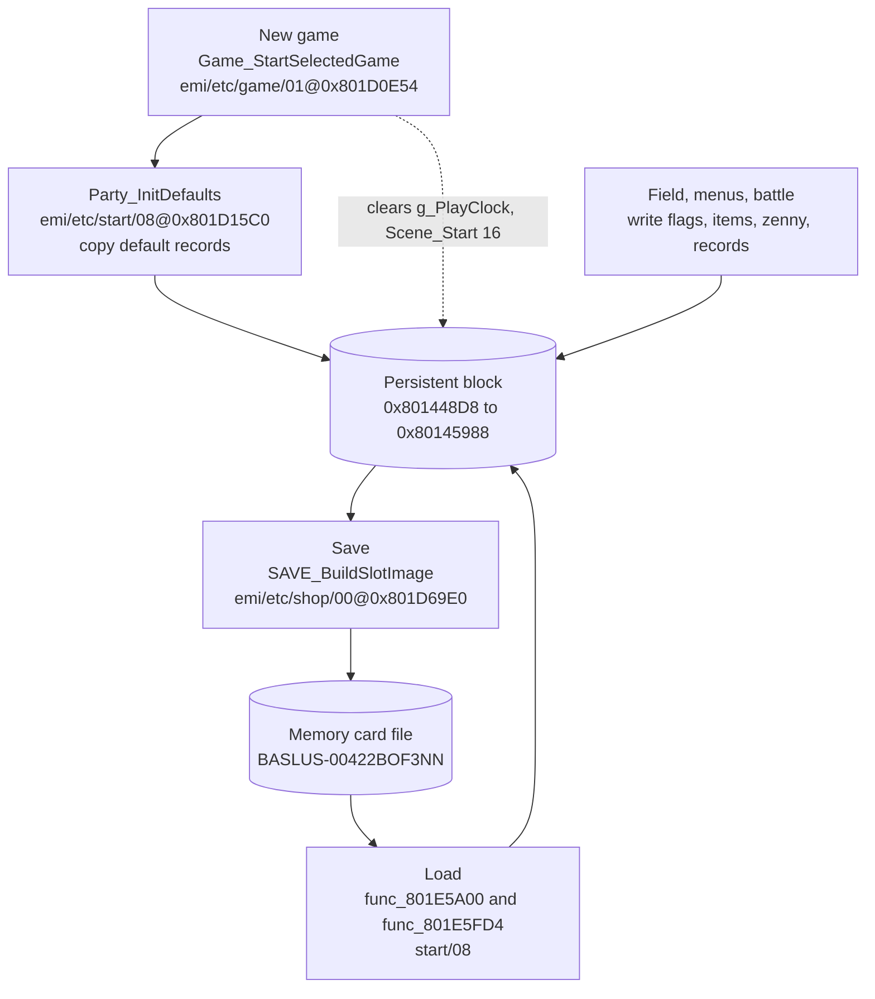
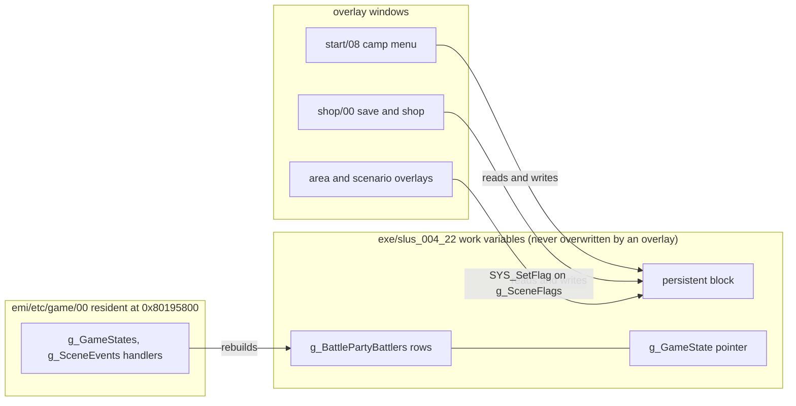

# Persistent game state

*Read this if you need to know where the party, inventory, flags and clock live.*

This page maps where the game keeps its long-lived state: the party, inventory, zenny, flags,
scenario index, play time and area. It names the image that owns each part, says which parts survive
an overlay swap, which are rebuilt when a mode or area starts, and which a memory-card save stores.
The save and load code path is in [saving.md](saving.md).

Static reading of the game code; nothing here was run on an emulator.

Tags: `[read]` the code was read and the claim follows from it; `[inferred]` the claim follows from
names, data shape or neighbouring code, not from a complete trace; `[unknown]` nothing in the
the code proves it. Addresses are RAM addresses. `image@address` names the load image of the
function.

## Entry points

State has no single owner function. These are the writers and readers that define its shape.

| Symbol                                | Image@address                                | Role                                                                      | Status   |
| ------------------------------------- | -------------------------------------------- | ------------------------------------------------------------------------- | -------- |
| `g_GameState`                         | `exe/slus_004_22@0x80146250`                 | pointer to the active mode work record, not persistent state              | `[read]` |
| `g_Characters`                        | `exe/slus_004_22@0x80144968`                 | eight `0xA4`-byte party records                                           | `[read]` |
| `Party_AddMember`                     | `exe/slus_004_22@0x801667A4`                 | add a character to the field and battle order arrays                      | `[read]` |
| `Party_AddZenny`                      | `exe/slus_004_22@0x8016666C`                 | add to `g_Zenny`, clamp at `0x98967F`                                     | `[read]` |
| `Party_CountItem`                     | `exe/slus_004_22@0x8016628C`                 | count an item in the inventory or in equipment                            | `[read]` |
| `Scene_Start`                         | `emi/etc/game/00@0x801A7704`                 | write `g_SceneState` for a scenario and clear flags 0-31 of its flag word | `[read]` |
| `Party_BuildBattlers`                 | `emi/etc/game/00@0x801C1400`                 | build the per-party work rows in `g_BattlePartyBattlers` from the party   | `[read]` |
| `Char_RebuildStats`                   | `exe/slus_004_22@0x80164A44`                 | rebuild one record's live stats from its base stats                       | `[read]` |
| `Party_InitDefaults`                  | `emi/etc/start/08@0x801D15C0`                | copy the default party records for a new game                             | `[read]` |
| `SAVE_BuildSlotImage`                 | `emi/etc/shop/00@0x801D69E0`                 | gather the live state into the save image                                 | `[read]` |
| `SAVE_RunLoadVerify`, `func_801E5FD4` | `emi/etc/start/08@0x801E5A00`, `@0x801E5FD4` | verify the image and publish it back to live RAM                          | `[read]` |

## Where state lives

### One persistent block

Every long-lived value sits in one `0x10B0`-byte block at `0x801448D8` to `0x80145988`. The save
writes this block and the load copies it back, byte for byte. `[read]`
(`func_801D69E0` copies `0x10B0` bytes from `g_SceneEventFlags - 0x650`, which is `0x801448D8`;
`func_801E5A00` copies the same length back.)

The block lies in the executable's work variables, outside every overlay window listed in
[memory.md](memory.md). `exe/slus_004_22` owns every symbol in it. An overlay swap therefore never
moves or clears it. `[read]` (the block's addresses lie between the exe named symbols and the lowest
overlay window)

Offsets below are block-relative. The save-file frame adds `0x200`, so frame offset = block offset +
`0x200`; [records.md](../records.md#save-layout) uses the frame.

| Block offset | RAM          | Size    | Content                                                | Owner image       | Status       |
| -----------: | ------------ | ------- | ------------------------------------------------------ | ----------------- | ------------ |
|      `+0x00` | `0x801448D8` | `0x10`  | copy of `g_SceneState` (scenario id, step, timer)      | `exe/slus_004_22` | `[read]`     |
|      `+0x13` | `0x801448EB` | 3       | scene-event state bytes (`D_801448EB`, `EC`, `ED`)     | `emi/etc/game/00` | `[read]`     |
|      `+0x20` | `0x801448F8` | 4       | four script variable bytes from `0x80146864`-`67`      | `exe/slus_004_22` | `[read]`     |
|      `+0x24` | `0x801448FC` | 2       | area id copied from `g_GameAreaId`                     | `exe/slus_004_22` | `[read]`     |
|      `+0x27` | `0x801448FF` | 1       | entry kind byte, from `D_80145E98`                     | `emi/etc/game/00` | `[inferred]` |
|      `+0x28` | `0x80144900` | 8       | two position words, from `D_80145EC4` and `D_80145EC8` | `emi/etc/game/00` | `[read]`     |
|      `+0x79` | `0x80144951` | 1       | stereo or mono sound flag, read by `func_801E5A00`     | `exe/slus_004_22` | `[read]`     |
|      `+0x7A` | `0x80144952` | 2       | window style and palette bytes (`D_80144952`, `53`)    | `exe/slus_004_22` | `[inferred]` |
|      `+0x90` | `0x80144968` | `0x520` | `g_Characters`, 8 records of `0xA4`                    | `exe/slus_004_22` | `[read]`     |
|     `+0x5B0` | `0x80144E88` | `0xA0`  | `g_SceneFlagWords`: 20 scenario flag words of 8 bytes  | `exe/slus_004_22` | `[read]`     |
|     `+0x650` | `0x80144F28` | `0x28`  | `g_SceneEventFlags`: event flag bits                   | `exe/slus_004_22` | `[read]`     |
|     `+0x678` | `0x80144F50` | 4       | `g_Zenny`                                              | `exe/slus_004_22` | `[read]`     |
|     `+0x682` | `0x80144F5A` | 3 + 3   | field order `D_80144F5A`, battle order `D_80144F5D`    | `exe/slus_004_22` | `[read]`     |
|     `+0x6E8` | `0x80144FC0` | 4       | `g_PlayClock`: hours, minutes, seconds, thirtieths     | `exe/slus_004_22` | `[read]`     |
|     `+0x70C` | `0x80144FE4` | `0x20`  | `g_FishBestCatch`                                      | `exe/slus_004_22` | `[read]`     |
|     `+0x74C` | `0x80145024` | 1       | `g_EmiLoadedCharacterIndex`                            | `exe/slus_004_22` | `[read]`     |
|     `+0x74D` | `0x80145025` | 1       | low byte of `g_GameFlags`                              | `exe/slus_004_22` | `[read]`     |
|     `+0x774` | `0x8014504C` | `0x200` | `g_InventoryIds`: 4 categories of 128 id bytes         | `exe/slus_004_22` | `[read]`     |
|     `+0x974` | `0x8014524C` | `0x200` | `g_InventoryCounts`: matching quantities               | `exe/slus_004_22` | `[read]`     |
|     `+0xB74` | `0x8014544C` | `0x20`  | `g_VitalItemIds`                                       | `exe/slus_004_22` | `[read]`     |
|     `+0xCA0` | `0x80145578` | `0x1C`  | slot summary: name, party portraits, level, clock      | `exe/slus_004_22` | `[read]`     |
|     `+0xCBC` | `0x80145594` | `0x12`  | nine button mask halfwords (`g_InputMasks` copy)       | `exe/slus_004_22` | `[read]`     |
|     `+0xCF0` | `0x801455C8` | `0x1E0` | `g_FairyJobs`: 60 rows of 8 bytes                      | `exe/slus_004_22` | `[read]`     |

Rows are in address order. The block also holds records this page does not split further (dragon genes at `0x80145548`,
masters at `0x8014554C`, the fairy village rooms at `0x801457A8`, per
[records.md](../records.md#save-layout)). `[inferred]` for those three, from the offsets in that
table and the block range; the code that fills them was not traced here.

Evidence for the less obvious rows:

- The slot summary is written by `func_801D69E0` and read back by the slot lists. The name is five
  bytes copied from `g_Characters[0]`, the three party portraits come from the field order array,
  the level is `g_Characters[0].level`, and the clock copy comes from `0x80144FC0`. `[read]`
- `func_801E5FD4` restores the button masks from `0x80145594` into `g_InputMasks`. `[read]`
- `g_SceneFlags` is a pointer into `g_SceneFlagWords`, `scenario_id * 8` bytes in. `Scene_Start`
  sets it and `func_801E5FD4` rebuilds it after a load. `[read]`
- Only the low byte of `g_GameFlags` (`u16` at `0x80146258`) is saved, through `D_80145025`.
  `[read]`

### Not persistent

| Symbol                                    | RAM                        | Why it is not saved                                               | Status       |
| ----------------------------------------- | -------------------------- | ----------------------------------------------------------------- | ------------ |
| `g_GameState`                             | `0x80146250`               | pointer into `g_BattlePartyBattlers` rows, set per mode           | `[read]`     |
| `g_BattlePartyBattlers`                   | `0x80145E90`               | per-party work rows of `0x140`, rebuilt from `g_Characters`       | `[read]`     |
| `g_GameStateIndex`                        | `0x80143BB0`               | request code for the next field step, reset on entry              | `[read]`     |
| `g_GameEntryState`, `g_GameEntrySubstate` | `0x80143B90`, `0x80143B92` | menu and main-loop step selectors                                 | `[read]`     |
| `g_AreaWalkFlags`                         | `0x8014625A`               | outside the block; `Game_ResetGameState` sets the entry bits      | `[read]`     |
| `g_PartySize`                             | `0x80146254`               | party size, recomputed from the order array by `Party_CountOrder` | `[read]`     |
| Area, scene and actor tables              | overlay windows            | reloaded with the area and scenario overlays                      | `[inferred]` |

## Flows

### What each phase writes

The arrow from `Game_StartSelectedGame` clears the play clock and calls `Scene_Start(16)`.
`[read]` (`Game_StartSelectedGame`, `emi/etc/game/01@0x801D0E54`). The default records come from
`func_801D15C0`, which copies `D_801EB514[0..6]` into `g_Characters[0..6]` and `D_801EB990` into the
slot named by `D_80181B1A`. `[read]` Whether the new-game name entry reaches `func_801D15C0` before
the first field frame was not traced. `[unknown]`

### What survives an overlay swap

Overlays hold code and tables only. They keep no state of their own across a swap; every value that
must outlive the overlay sits in the block or in the exe work variables. `[read]` for the writers
shown (`func_801E5FD4`, `func_801D69E0`, `Scene_Start`); `[inferred]` for scenario overlays writing
flags through `g_SceneFlags`, from the symbol evidence (`g_SceneFlagWords`).

## Per-mode rebuild

| Trigger                       | What is rebuilt                                                                                  | Function (image@address)                                | Status   |
| ----------------------------- | ------------------------------------------------------------------------------------------------ | ------------------------------------------------------- | -------- |
| Field entry after boot / load | `g_BattlePartyBattlers` rows from `g_Characters` and the field order; `g_PartySize`              | `Party_BuildBattlers` (`emi/etc/game/00@0x801C1400`)    | `[read]` |
| Field entry after boot / load | `g_GameAreaId` set to `0xFFFF`, then the area load; entry context and position from the block    | `Game_ResetGameState` (`emi/etc/game/00@0x801970EC`)    | `[read]` |
| Field entry                   | `g_GameStateIndex = 5`, so the next field step is the entry step                                 | `Game_RequestAreaChange` (`emi/etc/game/00@0x8019FA28`) | `[read]` |
| Load                          | live stats for all 8 records: base `+0x3C` block copied over `+0x1C`, then fatigue and equipment | `Char_RebuildStats` (`exe/slus_004_22@0x80164A44`)      | `[read]` |
| Load                          | character code and graphics archives for `g_EmiLoadedCharacterIndex`                             | `SAVE_RunLoadRestore` (`emi/etc/start/08@0x801E5FD4`)   | `[read]` |
| Load                          | scenario overlay for `g_SceneState.scenario_id`                                                  | `Scene_RequestOverlay` via `func_801E5FD4`              | `[read]` |
| Entering the save screen      | nothing is rebuilt; the shop overlay streams in and the field frame keeps running under it       | `Game_LoadShopOverlay` (`emi/etc/game/00@0x80198270`)   | `[read]` |

`g_GameState` is not a record of game progress despite its name. `func_801E3EC4`
(`emi/etc/start/08@0x801E3EC4`) points it at a `g_BattlePartyBattlers` row for the camp menu, and
`Party_BuildBattlers` points it at one row per party member for the field. `[read]`

## Key data

### Party records

`g_Characters` holds eight `0xA4`-byte records. Their field layout is in
[records.md](../records.md). Two details come from the code and are not in that page:

- The flag byte `unk_07` has bit `0x01` for "on the roster" and bit `0x02` for "in the field
  order". `Party_AddMember` sets both on the added character and tests `0x02` to choose which member
  to replace when three are already in the field. `[read]`
- `Char_RebuildStats` treats `+0x3C` as base stats and `+0x1C` as live stats; a load recomputes all live
  stats, so any stale live value in a save is overwritten. `[read]`

### Order arrays

`D_80144F5A` holds the field order and `D_80144F5D` the battle order, three bytes each, with `0xFF`
as an empty entry. `Party_CountOrder` counts the leading non-`0xFF` entries of either array
(`mode` selects the array, `mode * 3` bytes in) and `Party_AddMember` fills both. `[read]`

### Inventory

Four categories (item, weapon, armor, accessory) with 128 id bytes and 128 quantity bytes each. The
pointer tables `D_801C893C` and `D_801C8950` live in `emi/etc/game/00`, yet `Party_CountItem` in
`exe/slus_004_22` indexes them. The executable therefore depends on the game overlay being resident
whenever it counts items. `[read]` (`Party_CountItem`, `exe/slus_004_22@0x8016628C`)

### Zenny

`Party_AddZenny` adds to `g_Zenny` and clamps at `0x98967F` (9,999,999). When its second argument
is zero it also adds to `D_80145030`, a second running total whose use was not traced.
`[read]`; use `[unknown]`.

## Connections

- [saving.md](saving.md): what the save writes from this block and how load rebuilds the rest.
- [phases.md](phases.md): the entry states that call `Game_ResetGameState`.
- [loading.md](loading.md): the overlay loads that follow a load (`Scene_RequestOverlay`, the
  character archives).
- [scheduler.md](scheduler.md): the callback slots that carry `Game_RunMainLoop`.
- [area.md](area.md): area entry from `g_GameContextSeed` and the saved position.
- [../records.md](../records.md): field-level record layout and the save frame offsets.
- [../runtime.md](../runtime.md): targets and load addresses.

## Gaps

- The meaning of `D_80145E98`, `D_80145EC4` and `D_80145EC8` as saved entry values rests on their
  offsets in the first party row (`g_BattlePartyBattlers + 8`, `+0x34`, `+0x38`) and on the way
  `Game_ResetGameState` names them (`context_kind`, `context_a`, `context_b`). `[inferred]`
- The scene-event bytes at `0x801448EB`-`ED` are inside the block, so a save taken from the save
  point event stores the event's in-progress state. Whether the load resumes that event was not
  traced. `[unknown]`
- The block's content between `0x80144F5A` and `0x80144FC0`, and between `0x80145025` and
  `0x8014504C`, is not classified by any named symbol. `[unknown]`
- `D_80145030` (second zenny total) has no reader found. `[unknown]`
- Which scenario overlays write which flag bits was not traced. `[unknown]`
