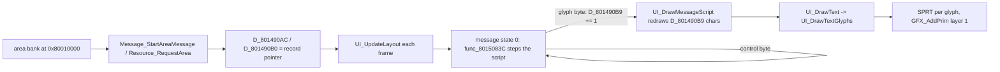
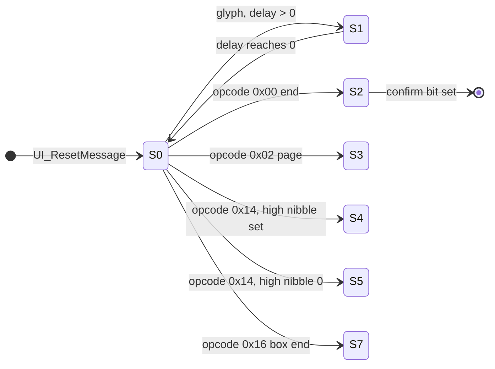

# UI: windows, text and screen effects

*Read this if you work on windows, message drawing or screen fades.*

How menu and dialogue text gets from disc data to the screen: the message state machine, the window panels,
the text drawers and the full-screen fades. Byte encoding and control-code meaning are in
[game text](../text.md); this page covers the code that runs them.

Static reading of the game code; nothing here was run on hardware. Tags:
`[read]` code read directly, `[inferred]` deduced from several reads, `[unknown]` not established.
`exe` is `exe/slus_004_22`.

## Terms

| Term          | Meaning in this wiki                                                                                |
| ------------- | --------------------------------------------------------------------------------------------------- |
| Message       | One script of text bytes in a message bank. The engine draws it a character at a time.              |
| Channel       | The window script record at `g_UiWindowChannel` (`0x801490A4`): flags, delay timer, script cursors. |
| Message state | The byte `D_801490A0.state_00` (0 to 7) that selects the engine's current step.                     |
| Panel         | A window frame task in `g_MenuPanelTasks`; see [scheduler](scheduler.md#work-record-tables).        |
| Local mode    | One of 21 screen effects started by `UI_SetMode` (a fade or wipe).                                  |

## Entry points

| Symbol                     | Image@address    | Role                                                                 | Status   |
| -------------------------- | ---------------- | -------------------------------------------------------------------- | -------- |
| `Message_StartAreaMessage` | `exe@0x80150224` | start the message `index` of the loaded area bank                    | `[read]` |
| `Resource_RequestArea`     | `exe@0x80150284` | start a message by resource id                                       | `[read]` |
| `Resource_Resolve`         | `exe@0x801502D0` | resource id to RAM address                                           | `[read]` |
| `UI_ResetMessage`          | `exe@0x80150304` | clear the engine and arm panel 0                                     | `[read]` |
| `UI_UpdateLayout`          | `exe@0x801503E0` | per-frame engine step; returns whether the confirm bit is clear      | `[read]` |
| `UI_DrawMessageScript`     | `exe@0x80150470` | redraw the message up to the characters shown so far                 | `[read]` |
| `func_8015083C`            | `exe@0x8015083C` | message state 0: run the script to the next glyph or stop opcode     | `[read]` |
| `UI_DrawText`              | `exe@0x8014F800` | set the text cursor and draw one record                              | `[read]` |
| `UI_DrawTextGlyphs`        | `exe@0x8014F84C` | draw control bytes and glyphs                                        | `[read]` |
| `UI_DrawTextString`        | `exe@0x8014FC90` | draw a name-style string (`0x01`, `0xFF`, `0x15`)                    | `[read]` |
| `UI_DrawAsciiString`       | `exe@0x8014FF0C` | draw ASCII as 8 by 12 sprites                                        | `[read]` |
| `UI_DrawGlyphString`       | `exe@0x80150098` | draw ASCII as 8 by 8 sprites                                         | `[read]` |
| `UI_SetMode`               | `exe@0x8014ECAC` | start a screen effect (see [scheduler](scheduler.md#local-ui-modes)) | `[read]` |
| `Menu_ArmPanelTask`        | `exe@0x80158DB8` | arm a panel task slot                                                | `[read]` |

## The string path

A string reaches the screen in five steps. Encoding of the bytes is in [game text](../text.md).

1. **Bank in RAM.** An area archive's message bank is copied to `0x80010000` by the EMI loader
   ([loading](loading.md)). `[read]` (`Message_StartAreaMessage`, `func_801514D0` read `0x80010000` as the bank)
2. **Request.** Game code calls `Message_StartAreaMessage(index)` or `Resource_RequestArea(id)`. The first reads
   the `u16` at `0x80010000 + index * 2` and adds `0x80010000`. The second calls `Resource_Resolve`, which
   uses the table at `0x8001A000` (group = `(id >> 12) & 0xC` selects a base word, then a `u16` offset table). Both
   store the record pointer in `D_801490AC` and `D_801490B0`, store the request in `g_MessageRequest`
   (`g_MessageRequest`) and call `UI_ResetMessage`. `[read]`
3. **Engine.** `UI_UpdateLayout` runs once per frame while the panel is open. It dispatches the message state
   (8 states) and the selection state (6 states), then redraws the message. `[read]`
4. **Glyph.** `UI_DrawMessageScript` walks the script from the start each frame and draws `D_801490B9`
   characters, one `UI_DrawText` call per character at 8 pixels advance; the script step `func_8015083C` adds one
   to `D_801490B9` per character. This redraw is the typewriter effect. `[read]`
5. **Sprite.** `UI_DrawTextGlyphs` builds one `SPRT` per glyph and calls `GFX_AddPrim` on layer 1
   ([rendering](rendering.md)). `[read]`

The diagram follows `Message_StartAreaMessage`, `UI_UpdateLayout`, `func_8015083C`, `UI_DrawMessageScript` and
`UI_DrawTextGlyphs`. `[read]`

Each frame the engine draws the message from its first byte. Control codes that insert text (`TEXT_GOTO`,
`TEXT_INSERT`, `TEXT_VAR`, `TEXT_LINK`) are followed by a character budget: 6 for a party-record name at
`0x80144968 + slot * 0xA4`, 33 for a variable string at `0x801490D8 + n * 32`, 17 for a link through the
bank's own table. After the budget the cursor returns to the byte after the code. `[read]`
(`UI_DrawMessageScript` `count = 6`, `33`, `17`)

## Message state machine

`func_801507BC` copies the table `D_80149A5C` to the stack and calls the handler for `D_801490A0.state_00`.
`func_801518F4` does the same for the selection state `D_801490A2` with `D_80149AB4`. `[read]`

| State | Handler              | Role                                                                                            | Status                                     |
| ----: | -------------------- | ----------------------------------------------------------------------------------------------- | ------------------------------------------ |
|     0 | `func_8015083C`      | run the script until a glyph, a page, a choice, the end or a box end                            | `[read]` (read from the disassembly)       |
|     1 | `UI_TickChoiceTimer` | count the per-character delay `D_801490A6` down; at zero return to state 0                      | `[read]`                                   |
|     2 | `func_80150E48`      | message end: step 0 waits for a button (`func_80150E98`), step 1 sets confirm (`func_80150F08`) | `[read]`                                   |
|     3 | `func_80150F3C`      | page wait: step 0 draws the wait marker and waits for a button, step 1 is `func_8015102C`       | `[read]`                                   |
|     4 | `func_801510DC`      | choice list, 8 steps by `g_UiWindowStep`                                                        | `[read]` names, `[unknown]` per-step roles |
|     5 | `func_80151538`      | choice list variant, 6 steps by `g_UiWindowStep`                                                | `[read]` names, `[unknown]` per-step roles |
|     6 | `func_80151820`      | clears the state when the owner mode byte is 2                                                  | `[read]`                                   |
|     7 | `func_80151844`      | box end, 2 steps by `g_UiWindowStep`                                                            | `[read]` dispatch only                     |

The diagram follows `func_8015083C`'s `switch` and the table `D_80149A5C`; only the transitions out of
state 0 are shown. `[read]` for the opcodes, `[inferred]` for the exits of states 2 to 7 (the handlers
change the owner mode byte `D_80148333` and `g_UiWindowChannel` bits that other code reads).

**Typewriter speed.** After each glyph, `func_8015083C` loads the delay from the byte table at `D_8017F5B4`,
row `D_80144950` (a signed byte; the option that sets it was not traced): byte 0 when a pad button is held
(`g_InputMasks & g_InputHeld`), byte 1 otherwise. A zero delay keeps state 0, any other value goes to state 1
with that many frames. `FRONTEND_FLAG_FORCE_STEP` forces delay 3. `[read]` The channel flag
`FRONTEND_FLAG_NO_INPUT_WAIT` (toggled by `0x10` and `0x11`) makes the script run without waiting. `[read]`

**Choice.** `TEXT_CHOICE` stores the count (`operand & 0xF`, minus one) and the layout nibble, then enters
state 4 or 5. The player's pick is kept in `D_801490C7` and `UI_HandleChoiceInput` moves it on repeated
direction input, wrapping at zero. The pick selects the next message through a dozen small functions
(`func_80152370`, `func_80152510` to `func_801526C8`), each of which stores entry `D_801490C7` of a row of
tables at `0x8017F628..0x8017F664` into `g_MessageRequest`. `[read]` The start of the next message is the `u16` of the bank at
`0x80010000 + g_MessageRequest * 2` (`func_801514D0`). `[read]`

## Windows and panels

The text box is the panel in `g_MenuPanelTasks` slot 0. `UI_ResetMessage` calls `Menu_ArmPanelTask(0, 0)`, which
sets the slot active with handler index 0, and sets the slot's mode byte to 2. `[read]` Handler 0 is
`func_80158F80`, which picks one of three sub-kinds from the byte `+2` through `D_80149B30`
(`func_80158FE0`, `func_801598F4`, `func_80159A20`). `func_80158FE0` runs the five panel states of
`D_80149B3C`, indexed by the byte `+3`: `func_80159050`, `func_8015920C`, `func_80159510`, `func_80159580`,
`func_801598B8`. The panel task machine itself (22 slots, 9 handlers,
three passes) is described in [scheduler](scheduler.md#work-record-tables).

| Piece            | What the code does                                                                                                                                                             | Status      |
| ---------------- | ------------------------------------------------------------------------------------------------------------------------------------------------------------------------------ | ----------- |
| State 0, set up  | `func_80159050` picks size 200 by 54 (`0xC8`, `0x36`), or 120 by 54 when the request flag `0x40` is set; it sets the start position and per-frame steps of a fifth of the size | `[read]`    |
| State 1, growing | `func_8015920C` adds the step each frame, snaps to the origin table, then draws the frame with `func_80159FA0`                                                                 | `[read]`    |
| Text origin      | `UI_UpdateLayout` sets it to `(D_80148334 >> 4) + 10`, `(D_80148336 >> 4) + 6` before each redraw                                                                              | `[read]`    |
| State 2, open    | `func_80159510`; not read. It is the step between growing and shrinking                                                                                                        | `[unknown]` |
| State 3, closing | `func_80159580` shrinks the box the same way and calls `UI_UpdateLayout` while the sub-kind is 0                                                                               | `[read]`    |
| Frame            | `func_80159FA0` draws a grey (`0x78`) four-point outline and `func_8015A2B0` draws the inner line, both on layer 1                                                             | `[read]`    |
| Position         | `g_MenuPanelOrigins` (`0x8017F90C`), 32 bytes: two sets of 8 (x, y) byte pairs, selected by `D_801490CE`                                                                       | `[read]`    |

The panel's fill and the other seven panel handlers are not in the resident image. `g_MenuPanels` holds fixed
addresses `0x801D2F9C`, `0x80199558`, `0x801E9074`, `0x801EFD98`, `0x800B0180`, `0x801E8D14`, `0x801E27BC` and
`0x800B2088`. They point into overlay windows ([memory](memory.md)); a panel armed while its overlay is not
loaded would jump into other code. `[read]` for the addresses, `[inferred]` for the risk (no loader check was
found). `0x80199558` is in `etc/game/00` and `0x801E9074` in `battle/battle/03` according to their symbols;
the owners of the other six are `[unknown]`.

## Text drawing

| Drawer                         | Sheet and cell                                                                                             | CLUT                       | Primitive         |
| ------------------------------ | ---------------------------------------------------------------------------------------------------------- | -------------------------- | ----------------- |
| `UI_DrawTextGlyphs`            | 31 columns, cell 8 wide, 12 high, `u = ((c - 0x30) % 31) * 8`, `v = ((c - 0x30) / 31) * 12 + 0x48 + shade` | `0x7800 \| (flags & 0xF)`  | `SPRT` (`0x14`)   |
| `UI_DrawTextGlyphs` `TEXT_NUM` | 21 columns of 12, `u = ((n + 0x5B) % 21) * 12`, `v = shade + ((n + 0x5B) / 21) * 12`                       | same                       | `SPRT`            |
| `UI_DrawAsciiString`           | same 31-column sheet as the first row                                                                      | `0x7800 \| (flags & 0x3F)` | `SPRT` (`0x14`)   |
| `UI_DrawTextString`            | 31 columns, or 32 columns of 8 by 8 for `0x15`: `u = ((n + 0x40) % 32) * 8`                                | `0x7800 \| (flags & 0xF)`  | `SPRT`            |
| `UI_DrawGlyphString`           | 32 columns of 8 by 8 from `0x20`: `u = ((c - 0x20) % 32) * 8`, `v = ((c - 0x20) / 32) * 8`                 | `0x7800 \| (clut & 0x3F)`  | `SPRT_8` (`0x10`) |

All of them first call `func_8014FC00(0)`, which emits a draw-mode packet with texture page `0x2F` (column 15,
4 bits per pixel) on layer 1, so the glyph sheets live in that page. `[read]` The `flags` byte holds the
palette in its low nibble and a row style in its high nibble; the high nibble indexes a pair of bytes in
`g_NumberRowShades` or `g_TextRowShades` that offset `v` and trim the cell height. `[read]` Glyph colors are
the 16 cells of stage palette row 0 (`0x7800 | n` is VRAM row 480, column `n * 16`); see
[rendering](rendering.md#textures-tims-and-palettes). `[read]`

Positions use the cursor `D_80145ACA` (x), `D_80145ACC` (y) and `D_80145ACE` (line start x) set by
`UI_DrawText`. A newline moves y by 12 (14 in the message engine, `UI_DrawMessageScript`). `[read]`
Formatted numbers go through `g_UiWindowTextBuffer` (`0x80145AD4`) with `sprintf`, then `UI_DrawGlyphString`.
`[read]` (symbol note; sprintf call sites not listed)

## Screen effects

`UI_SetMode` starts one of 21 effects ([scheduler](scheduler.md#local-ui-modes) has the dispatch). Each
table entry is a small function that calls `func_8014F514` (a full-screen fade) or `func_8014F5F0` (a variant)
with a step, a semi-transparency flag and a layer. `[read]`

| Modes (table index) | Call                                            | Effect                            |
| ------------------- | ----------------------------------------------- | --------------------------------- |
| 0, 1                | `func_8014F514(+0x800 / -0x800, 1, 0)`          | fade, 16 frames                   |
| 2, 3                | `(+0x2000 / -0x2000, 1, 0)`                     | fast fade, 4 frames               |
| 4, 5                | `(+0x400 / -0x400, 1, 0)`                       | slow fade, 32 frames              |
| 6, 7                | `(+0x800 / -0x800, 1, 2)`                       | fade on layer 2                   |
| 8, 9                | `func_8014F5F0(+0x800 / -0x800, 1, 0)`          | variant fade                      |
| 10, 11, 17, 18, 20  | loops that also change `g_AreaCameraAngle`      | camera-spin wipes                 |
| 12                  | sets `g_AreaViewOffsetZ = 0x5DC`, fade `-0x800` | fade with a camera distance reset |
| 13, 14, 15, 16      | `+0x200 / -0x200` with `F514` or `F5F0`         | slow fades (64 frames)            |
| 19                  | `func_8014F514(0x100, 1, 0)`                    | very slow fade (128 frames)       |

The fade body `func_8014F704` draws a 320 by 240 `TILE` with grey level `position >> 7`, semi-transparent with
draw-mode `GetTPage(1, abr, 0x140, 0)`, and adds the step to a 16-bit level each frame until the sign bit
flips. The frame count is `0x8000 / step`. The thread then calls `CallbackExit`, so every effect ends its
slot. `[read]` That `abr = 2` is a subtractive blend (fade to black) is PSX GPU behaviour, not game data.
`[inferred]` The modes with camera changes were read only for their loop shape. `[unknown]`

`g_UiWindowEffectBusy` (`0x80143C40`) is the flag other code tests before it starts input or a new effect;
the reads are in the title code (`UI_WaitTitleInput` `0x801D0F00`, `UI_UpdateChoicePrompt` `0x801D0FB8`,
`UI_DrawChoicePrompt` `0x801D11E4`, all `emi/etc/game/01`) and `UI_SetMode`. No writer is in the resident code; the writers are overlay functions
(`func_801D74D4`, `func_80198780`, `func_801985C8`). `[read]` for the readers, `[unknown]` for who sets it.

## Key data

| Object                     | Address      | Role                                                                              | Status   |
| -------------------------- | ------------ | --------------------------------------------------------------------------------- | -------- |
| `g_UiWindowChannel`        | `0x801490A4` | channel flags: timer, confirm, selection, request, no-wait, advance, latch, force | `[read]` |
| `D_801490A0`               | `0x801490A0` | message state byte (`state_00`)                                                   | `[read]` |
| `D_801490A2`               | `0x801490A2` | selection state                                                                   | `[read]` |
| `g_UiWindowStep`           | `0x801490A1` | step index inside a state's sub-table                                             | `[read]` |
| `g_MessageRequest`         | `0x801490A8` | message index; `0xFFFF` = none                                                    | `[read]` |
| `D_801490AC`, `D_801490B0` | `0x801490AC` | script start and current record pointer                                           | `[read]` |
| `D_801490B9`               | `0x801490B9` | characters shown                                                                  | `[read]` |
| `D_801490C7`               | `0x801490C7` | player's choice                                                                   | `[read]` |
| `g_TextVariables`          | `0x801490D8` | 32-byte variable strings                                                          | `[read]` |
| `g_UiLocalMode`            | `0x80143C90` | current screen effect                                                             | `[read]` |

## Data and limits

| Limit                       | Value                                                                                      | Code                                                      | Asset must stay within                                                 | Status   |
| --------------------------- | ------------------------------------------------------------------------------------------ | --------------------------------------------------------- | ---------------------------------------------------------------------- | -------- |
| Characters per frame budget | the primitive arena, 36,812 bytes: about 2,300 `SPRT_8` or 1,840 `SPRT`                    | `GFX_AddPrim` ([rendering](rendering.md#data-and-limits)) | text beyond the arena is dropped, not truncated by the engine          | `[read]` |
| Name insert                 | 6 characters                                                                               | `UI_DrawMessageScript` `count = 6`                        | party names fit 6 glyphs when inserted into a message                  | `[read]` |
| Variable string             | 32 bytes per entry; the budget is 33 steps because the cursor steps past the operand first | `count = 33`, `g_TextVariables[][0x20]`                   | variable text stays under 32 bytes                                     | `[read]` |
| Bank link                   | 17 characters                                                                              | `count = 17`                                              | a linked message shows at most 17 characters                           | `[read]` |
| Message bank offsets        | `u16` offsets from `0x80010000`                                                            | `Message_StartAreaMessage`                                | a bank is under 64 KB; the record pointer is `0x80010000 + u16`        | `[read]` |
| Resource groups             | 4 (id bits 14 and 15)                                                                      | `Resource_Resolve` mask `0xC`                             | resource ids use groups 0 to 3, index below `0x4000`                   | `[read]` |
| Window size                 | 200 by 54 or 120 by 54 pixels                                                              | `func_80159050`                                           | message text fits the box: glyphs advance 8 pixels, a newline moves 14 | `[read]` |
| Window positions            | 8 per set, 2 sets                                                                          | `g_MenuPanelOrigins`, `D_801490CE`                        | position index below 8                                                 | `[read]` |
| Panel tasks                 | 22                                                                                         | `Menu_ResetPanelTasks`                                    | at most 22 panels open together                                        | `[read]` |
| Screen effects              | 21 modes                                                                                   | `g_UiLocalModeFuncs`                                      | effect index below 21                                                  | `[read]` |
| Glyph sheet                 | 31 columns by cells of 8 by 12 at texture page `0x2F`; 32 columns of 8 by 8                | `UI_DrawTextGlyphs`, `UI_DrawGlyphString`                 | a replacement font keeps the cell grid and page                        | `[read]` |
| Palette for text            | 16 cells (columns 0 to 15) of stage row 0                                                  | CLUT `0x7800 \| n`                                        | text colors sit in the first 16 cells of arena row 0                   | `[read]` |

## Connections

- Frame order and the callback that calls these drawers: [frame loop](frame-loop.md), [scheduler](scheduler.md).
- Primitive arena, layers and palette cells: [rendering](rendering.md). Loading banks: [loading](loading.md).
- Where menus open and which overlay owns each screen: [screens](screens.md), [phases](phases.md).
- Shop, save and start-menu panel code: [saving](saving.md), [screens](screens.md).
- Text bytes and bank layout for editors: [game text](../text.md), [editor guide](editor-guide.md),
  [disc and files](disc-and-files.md).

## Gaps

| Gap                                                                      | What would prove it                                                                      |
| ------------------------------------------------------------------------ | ---------------------------------------------------------------------------------------- |
| Per-step roles of message states 4, 5 and 7                              | Read the 8, 6 and 2 step functions and the shop and start-menu callers                   |
| Source of `D_80144950` (message speed) and the row count of `D_8017F5B4` | Search writers of `D_80144950` in the options menu                                       |
| Who writes `g_UiWindowEffectBusy`                                        | Read `func_801D74D4`, `func_80198780`, `func_801985C8`                                   |
| Overlay owners of six `g_MenuPanels` handlers                            | Map each address to its overlay window and archive                                       |
| Panel fill drawing and the pass-order meaning of mode 0, 1, 2            | Read `func_80158FE0`, `func_801598F4`, `func_80159A20`                                   |
| Battle messages (`g_BattleMessageState`) use a separate path             | Read `battle/battle/03` message functions                                                |
| Camera-spin effects (modes 10 to 20)                                     | Read `func_8014EF80`, `func_8014F024`, `func_8014F24C`, `func_8014F2F0`, `func_8014F460` |
