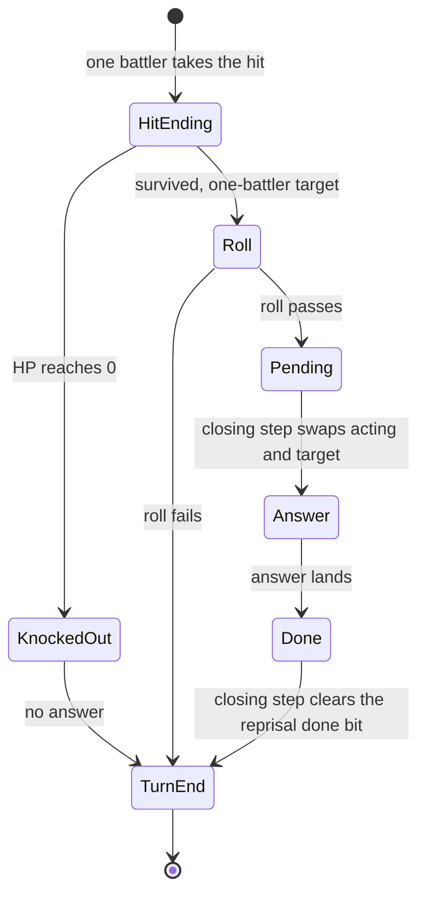

# Battle

*Read this if you need the battle data in RAM: battlers, status words, dispatch tables and drops.*

The battle overlays' working set: the records they build at run time, the state words that drive
them and the dispatch tables that select their handlers. The static enemy, encounter and ability
tables are in [game records](records.md#gameemi-fixed-tables); this page covers RAM. The two battle
overlays share the records instead of redeclaring a row. Every record below is an offset table.
Evidence cells name the retail function as `name (image@address)`. A bare `func_XXXXXXXX` in an
evidence cell lives in `emi/battle/battle/03` when its address is `0x801D0C00` or above, and in
`emi/battle/battle/15` when its address is in `0x80096800..0x800BFFFF`.

## Where the records are

Every address is fixed RAM. `emi/battle/battle/03` loads at `0x801D0C00` and
`emi/battle/battle/15` at `0x80096800`; both read the same work tables.

| Object                     |      Address |    Size | Count | Readers                                                     |
| -------------------------- | -----------: | ------: | ----: | ----------------------------------------------------------- |
| mode byte                  | `0x801462E0` |     `1` |     1 | `Battle_DispatchMode (emi/battle/battle/03@0x801D112C)`     |
| main step                  | `0x801462E1` |     `1` |     1 | the mode's step tables                                      |
| sub-step                   | `0x801462E2` |     `1` |     1 | `Battle_DispatchEntrance (emi/battle/battle/03@0x801D17C4)` |
| state word `g_BattleState` | `0x801462E8` |     `2` |     1 | both overlays, boss and bmagic handlers                     |
| command state              | `0x80146375` |     `1` |     1 | `func_801DD448`, `func_801E020C`                            |
| acting battler             | `0x80146374` |     `1` |     1 | both overlays                                               |
| target selector            | `0x80146384` |     `1` |     1 | both hit endings (`func_800A9820` takes it as an argument)  |
| result byte                | `0x80146328` |     `1` |     1 | `func_801D43EC`, boss endings                               |
| spoils                     | `0x80146326` |  `0x3E` |     1 | `func_801E531C`, `func_801E54EC`                            |
| candidate entries          | `0x801463DC` |  `0x0C` |     8 | `emi/etc/game/00`, `emi/battle/battle/15`                   |
| player work rows           | `0x80145E90` | `0x140` |     3 | both overlays                                               |
| enemy work rows            | `0x801EB630` | `0x118` |     8 | both overlays                                               |
| queued action slots        | `0x801EC330` |  `0x78` |    48 | `Battle_RunEffects (emi/battle/battle/03@0x801E5824)`       |
| panel tasks                | `0x80148330` |  `0x24` |    22 | `func_801E9074`, `func_801EA1E0`, `func_801DA69C`           |
| event slots                | `0x801EB4F0` |  `0x0C` |     - | `Battle_RunEvents (emi/battle/battle/03@0x801DE43C)`        |

The row count is not the battler index space. Player slots are 0-2 and enemy slots 3-10 (11
battlers in all); an enemy work row stores its slot at `+0x05` as `slot + 3`
(`func_800ABCE0 (emi/battle/battle/15@0x800ABCE0)`). A pointer to "battler *n*" is therefore
resolved by side first, then by slot: slot 3 is the first enemy row. The enemy rows are addressed
from the virtual base `0x801EB2E8` (`0x801EB630` minus three enemy strides), so a slot indexes both
sides from one base.

## Player work row

The player work row is the row the mode machines step. Size `0x140`, stride `0x140`, three rows at
`0x80145E90`. The fields the readers prove:

|  Offset | Width         | Field         | Meaning                                                                                                                                                                                    | Evidence                                                                                                                                                                                        |
| ------: | ------------- | ------------- | ------------------------------------------------------------------------------------------------------------------------------------------------------------------------------------------ | ----------------------------------------------------------------------------------------------------------------------------------------------------------------------------------------------- |
|  `0x00` | `u8`          | `flags_00`    | bit 0 row occupied; bit 6 handler busy                                                                                                                                                     | `Battle_SlotIsBlocked (emi/battle/battle/03@0x801DB524)`; `func_801E8D04 (emi/battle/battle/03@0x801E8D04)` clears bit 6                                                                        |
|  `0x01` | `u8`          | `step_01`     | main step inside the current action machine                                                                                                                                                | `func_801E020C (emi/battle/battle/03@0x801E020C)`                                                                                                                                               |
|  `0x02` | `u8`          | `unk_02`      | action-machine sub-step; 4 with step 6 on a knockout, 0 with step 2 after an action                                                                                                        | `func_801E020C (emi/battle/battle/03@0x801E020C)`                                                                                                                                               |
|  `0x05` | `u8`          | `slot`        | battler slot 0-10                                                                                                                                                                          | `Battle_CalcDamage (emi/battle/battle/03@0x801DC044)` takes it as an argument                                                                                                                   |
|  `0x0C` | `s32`         | `unk_0C`      | added to x each physics step                                                                                                                                                               | `func_800A8B40 (emi/battle/battle/15@0x800A8B40)`                                                                                                                                               |
|  `0x10` | `s32`         | `unk_10`      | added to y each physics step                                                                                                                                                               | `func_800A8B40 (emi/battle/battle/15@0x800A8B40)`                                                                                                                                               |
|  `0x14` | `s32`         | `unk_14`      | added to the height half `+0x3E` each step; `unk_20` is added to it; at `-0x40` the step advances                                                                                          | `func_800A8B40 (emi/battle/battle/15@0x800A8B40)`                                                                                                                                               |
|  `0x18` | `s32`         | `unk_18`      | added to the whole word at `+0x3C` each step                                                                                                                                               | `func_800A8B40 (emi/battle/battle/15@0x800A8B40)`                                                                                                                                               |
|  `0x20` | `s32`         | `unk_20`      | added to `unk_14` each step                                                                                                                                                                | `func_800A8B40 (emi/battle/battle/15@0x800A8B40)`                                                                                                                                               |
|  `0x32` | `u16`         | `z`           | depth halfword handed to the primitive builder                                                                                                                                             | `func_800AB910 (emi/battle/battle/15@0x800AB910)` calls it `off_z`                                                                                                                              |
|  `0x34` | `s32` (16.16) | `coord_x_34`  | x; read as one word and as two halfwords                                                                                                                                                   | `func_800A8B40 (emi/battle/battle/15@0x800A8B40)`                                                                                                                                               |
|  `0x38` | `s32` (16.16) | `coord_y_38`  | y; read as one word and as two halfwords                                                                                                                                                   | `func_800A8B40 (emi/battle/battle/15@0x800A8B40)`                                                                                                                                               |
|  `0x3C` | `s32`         | `word_3C`     | 16.16 z word; the physics code reads the height in the high half `+0x3E` (the vertical span); the two overlays read that halfword with opposite signs; `func_800AF764` projects it negated | `func_800A8B40 (emi/battle/battle/15@0x800A8B40)`; copied whole by `func_801E72F4` and `func_801DDAF0`; the span is written by `func_801DEF0C` and `func_801E352C` (all `emi/battle/battle/03`) |
|  `0x74` | 0xA4 bytes    | `stats`       | a copy of the character record ([layout](records.md#character-and-master-data)); `reprisal_chance` is at `stats + 0x35` (`+0xA9`) and `critical_chance` at `stats + 0x36` (`+0xAA`)        | `func_801DD08C (emi/battle/battle/03@0x801DD08C)` copies `0xA4` bytes here                                                                                                                      |
| `0x118` | `u8`          | `unk_118`     | unnamed                                                                                                                                                                                    | -                                                                                                                                                                                               |
| `0x119` | `u8`          | `mode_119`    | action state kept while a reprisal is pending; cleared otherwise                                                                                                                           | `func_801E1DD4 (emi/battle/battle/03@0x801E1DD4)`                                                                                                                                               |
| `0x11A` | `u16`         | `command`     | command word                                                                                                                                                                               | -                                                                                                                                                                                               |
| `0x11C` | `s16`         | `hp_change`   | signed HP delta shown by the hit; seeded from `stats.current_hp`                                                                                                                           | `func_801D527C (emi/battle/battle/03@0x801D527C)` seeds it; `func_801DFCB4 (emi/battle/battle/03@0x801DFCB4)` tests its sign                                                                    |
| `0x11E` | `s16`         | `ap_change`   | signed AP delta                                                                                                                                                                            | `func_801DFCB4 (emi/battle/battle/03@0x801DFCB4)`                                                                                                                                               |
| `0x121` | `u8`          | `counter_121` | counter                                                                                                                                                                                    | -                                                                                                                                                                                               |
| `0x124` | `u32`         | `flags_124`   | damage word (bits below)                                                                                                                                                                   | hit and popup readers                                                                                                                                                                           |
| `0x128` | `u32`         | `flags_128`   | action word (bits below)                                                                                                                                                                   | action gate and turn order                                                                                                                                                                      |
| `0x134` | `u16`         | `unk_134`     | unnamed                                                                                                                                                                                    | -                                                                                                                                                                                               |
| `0x136` | `u8`          | `counter_136` | counter                                                                                                                                                                                    | -                                                                                                                                                                                               |
| `0x137` | `u8`          | `counter_137` | counter                                                                                                                                                                                    | -                                                                                                                                                                                               |
| `0x138` | `u8`          | `charge`      | charge                                                                                                                                                                                     | -                                                                                                                                                                                               |

Other cells: `0x29-0x2B` signed bytes and `0x2C` a halfword, read by both overlays; `0x2E` and
`0x30` halfwords, read unsigned by `emi/battle/battle/03` and signed by `emi/battle/battle/15` and
the field overlays (the panels slide to negative screen positions); `0x40`, `0x44` and `0x4C`
words, `0x1C` a word and `0x48` a byte, read only by `emi/battle/battle/03`; `0x4B`, `0x58`,
`0x5A` and `0x5C-0x5F` are unnamed cells. Offsets `0x06-0x0B`, `0x24-0x28`, `0x50`, `0x54`,
`0x120`, `0x122`, `0x123`, `0x12C-0x133`, `0x139` and `0x13A-0x13F` carry no proven role.

## Enemy work row

Size `0x118`, eight rows at `0x801EB630`. The cells from `+0x06` to `+0x5F` are cleared when
`func_800ABCE0 (emi/battle/battle/15@0x800ABCE0)` and `func_800AC01C (emi/battle/battle/15@0x800AC01C)`
arm a slot and keep their address names; their widths follow those accesses.

|  Offset | Width         | Field             | Meaning                                                                                                                         | Evidence                                                                                             |
| ------: | ------------- | ----------------- | ------------------------------------------------------------------------------------------------------------------------------- | ---------------------------------------------------------------------------------------------------- |
|  `0x00` | `u8`          | `unk_00`          | bit 0 row occupied                                                                                                              | `Battle_SlotIsBlocked (emi/battle/battle/03@0x801DB524)`                                             |
|  `0x01` | `u8`          | `step_01`         | main step                                                                                                                       | -                                                                                                    |
|  `0x05` | `u8`          | `slot`            | battler slot, stored as `slot + 3`                                                                                              | `func_800ABCE0 (emi/battle/battle/15@0x800ABCE0)`                                                    |
|  `0x08` | `u8`          | `unk_08`          | `g_BattleScrollDir` (0-3, a scroll direction) with bit 1 flipped (`xori 2`)                                                     | the slot setup (`func_800ABCE0`, `func_800AC01C`)                                                    |
|  `0x29` | `u8`          | `unk_29`          | set to 4 when the slot is armed                                                                                                 | the slot setup (`func_800ABCE0`, `func_800AC01C`)                                                    |
|  `0x34` | `s32`         | `coord_x_34`      | the enemy's x                                                                                                                   | -                                                                                                    |
|  `0x38` | `s32`         | `coord_y_38`      | the enemy's y                                                                                                                   | -                                                                                                    |
|  `0x3C` | `s32`         | `word_3C`         | high half `+0x3E` is the vertical span at the enemy's position (`Area_SampleHeight` of x and y), written when the slot is armed | the whole word is copied into the local work row's `+0x3C` by `func_800AE82C`                        |
|  `0x4B` | `u8`          | `unk_4B`          | set to `0xFF` when the slot is armed                                                                                            | the slot setup (`func_800ABCE0`, `func_800AC01C`)                                                    |
|  `0x74` | `u8[8]`       | `name`            | enemy name drawn as text                                                                                                        | `func_801D8AE4 (emi/battle/battle/03@0x801D8AE4)`                                                    |
|  `0x7C` | `u8`          | `kind_id`         | kind id                                                                                                                         | -                                                                                                    |
|  `0x7E` | `u8`          | `unk_7E`          | byte cell of `emi/battle/battle/03`                                                                                             | `func_801E25E0 (emi/battle/battle/03@0x801E25E0)`                                                    |
|  `0x80` | `u16`         | `event_flags`     | bit 2 makes the enemy eligible to counter an attack                                                                             | `func_801E4368 (emi/battle/battle/03@0x801E4368)`                                                    |
|  `0x82` | `u16`         | `status_82`       | status word; `0x4000` is knockout                                                                                               | `func_801E496C (emi/battle/battle/03@0x801E496C)`                                                    |
|  `0x84` | `u16`         | `unk_84`          | damage; cleared by `func_801E54EC`                                                                                              | `func_801E54EC (emi/battle/battle/03@0x801E54EC)`                                                    |
|  `0x86` | `u16`         | `unk_86`          | damage; banked into `D_8014632C` by `func_801E54EC`                                                                             | `func_801E54EC (emi/battle/battle/03@0x801E54EC)`                                                    |
|  `0x88` | `u16`         | `power`           | turn-order ranking value                                                                                                        | the turn-order ranking reader                                                                        |
|  `0x8C` | `u8[8]`       | `techniques`      | the bytes the event packet's tail is copied into                                                                                | `func_8009C994 (emi/battle/battle/15@0x8009C994)`                                                    |
|  `0x94` | `u16`         | `hp_94`           | current HP                                                                                                                      | `func_801E496C (emi/battle/battle/03@0x801E496C)`                                                    |
|  `0x96` | `u16`         | `ap`              | AP; cell of `emi/battle/battle/03`                                                                                              | -                                                                                                    |
|  `0x98` | 2 × 4 bytes   | `drops_98`        | two drop rows: item id and rate index (layout below)                                                                            | `func_801E531C (emi/battle/battle/03@0x801E531C)`                                                    |
|  `0xA0` | `u16` or `u8` | `cell_A0`         | max HP; every read is `lhu`/`sh`; the panel task copies it as the HP bar divisor                                                | `func_801E496C (emi/battle/battle/03@0x801E496C)`, `func_800AFC98 (emi/battle/battle/15@0x800AFC98)` |
|  `0xA4` | `u16`         | `attack`          | attack; cell of `emi/battle/battle/15`                                                                                          | -                                                                                                    |
|  `0xA6` | `u16`         | `unk_A6`          | cell of `emi/battle/battle/15`                                                                                                  | -                                                                                                    |
|  `0xA8` | `u16`         | `agility`         | agility; cell of `emi/battle/battle/03`                                                                                         | -                                                                                                    |
|  `0xAA` | `u16`         | `unk_AA`          | cell of `emi/battle/battle/15`                                                                                                  | -                                                                                                    |
|  `0xAF` | `u8[9]`       | `resistances`     | one level per element, in the character record's resistance order                                                               | -                                                                                                    |
|  `0xE0` | `u8`          | `kind`            | selects the enemy kind and the event handlers                                                                                   | `func_801E8DD8 (emi/battle/battle/03@0x801E8DD8)`                                                    |
|  `0xE4` | `u32` pointer | `unk_E4`          | per-enemy hook: mode 0 chooses, 1 is hit, 2 every frame                                                                         | `func_801E25E0 (emi/battle/battle/03@0x801E25E0)`, `func_801E3C14 (emi/battle/battle/03@0x801E3C14)` |
|  `0xE8` | `u32` pointer | `unk_E8`          | pointer to `u16` cells                                                                                                          | -                                                                                                    |
|  `0xEC` | `u32` pointer | `script`          | pointer to a `u8` script                                                                                                        | -                                                                                                    |
|  `0xF6` | `u16`         | `technique`       | technique                                                                                                                       | -                                                                                                    |
|  `0xF8` | `s16`         | `damage_F8`       | damage dealt this hit; negative heals                                                                                           | `func_801E496C (emi/battle/battle/03@0x801E496C)`                                                    |
|  `0xFC` | `u8`          | `target_flags_FC` | side/slot mask                                                                                                                  | `func_800A9820 (emi/battle/battle/15@0x800A9820)`                                                    |
| `0x100` | `u32`         | `flags_100`       | damage word (bits below)                                                                                                        | both overlays                                                                                        |
| `0x104` | `u32`         | `flags_104`       | action word (bits below)                                                                                                        | both overlays                                                                                        |

The cells `0x06`, `0x07`, `0x0C-0x24`, `0x2B`, `0x2E`, `0x30`, `0x32`, `0x48`, `0x5C-0x5F` are the
cleared cells with address names; `0x7D`, `0x7F`, `0xE1-0xE3`, `0xF0`, `0xF5`, `0xFA`, `0xFD`,
`0x112`, `0x114` and `0x115` are unnamed bytes or halfwords with no proven role.

The drop row (4 bytes):

| Offset | Width | Field     | Meaning                                                 |
| -----: | ----- | --------- | ------------------------------------------------------- |
| `0x00` | `u16` | `item_00` | item id the spoils gain when the roll passes            |
| `0x02` | `u8`  | `rate_02` | index into the 8-byte drop chance table at `0x801D0CB8` |
| `0x03` | `u8`  | padding   |                                                         |

## Smaller records

The spoils record at `0x80146326` (size `0x3E`; `func_801E531C (emi/battle/battle/03@0x801E531C)`
walks it):

| Offset | Width      | Meaning                                                 |
| -----: | ---------- | ------------------------------------------------------- |
| `0x00` | `u8`       | escape attempts; `emi/battle/battle/15` reads this byte |
| `0x01` | `u8`       | count of listed drops, capped at 15                     |
| `0x0E` | 16 × `u16` | dropped item ids                                        |
| `0x2E` | 16 × `u8`  | drops of each id                                        |

One candidate entry (table at `0x801463DC`, 8 rows of `0x0C` bytes). The game overlay fills the
table before a wild encounter and the battle overlay walks it to place the enemy.

| Offset | Width         | Meaning                                                                                                    |
| -----: | ------------- | ---------------------------------------------------------------------------------------------------------- |
| `0x00` | `u8`          | live flag; set by `func_801C6AEC (emi/etc/game/00@0x801C6AEC)`, cleared when the candidate is out of reach |
| `0x01` | `u8`          | index of one `0x88`-byte enemy record (`&D_800E405E + id * 0x88`); `0xFF` means none                       |
| `0x04` | `s32` (16.16) | encounter x; written by `func_801C6BB4 (emi/etc/game/00@0x801C6BB4)`                                       |
| `0x08` | `s32` (16.16) | encounter y; written by `func_801C6BB4 (emi/etc/game/00@0x801C6BB4)`                                       |

`func_800ABC30 (emi/battle/battle/15@0x800ABC30)` reads the three cells and hands the id, x and y
to `func_800ABCE0`.

The panel tasks are 22 slots of `0x24` bytes at `0x80148330`, ending at `0x80148648`; `0x80148648` itself
is a pointer cell, and `func_800B0410` loads it and reads through it. `emi/battle/battle/15` reads only
the first `0x0C` bytes of a task and reads x and y signed:

| Offset | Width | Meaning                                                                                                                                   |
| -----: | ----- | ----------------------------------------------------------------------------------------------------------------------------------------- |
| `0x03` | `u8`  | short-menu state word                                                                                                                     |
| `0x04` | `u16` | panel x                                                                                                                                   |
| `0x06` | `u16` | panel y                                                                                                                                   |
| `0x0A` | `u8`  | selected battler slot in `emi/battle/battle/03` (row index is `slot - 3`); slide mode in `emi/battle/battle/15` (0 moves the panel right) |
| `0x0B` | `u8`  | ratio: enemy value * `0x37` / divisor, floored at 1                                                                                       |
| `0x0D` | `u8`  | cursor; cleared on panel entry                                                                                                            |
| `0x12` | `u16` | first row of the panel list (`func_800B1728 (emi/battle/battle/15@0x800B1728)`)                                                           |
| `0x14` | `u16` | HP bar numerator, copied from the enemy row's `hp_94`                                                                                     |
| `0x1C` | `u16` | HP bar divisor, copied from the enemy row's `cell_A0`                                                                                     |

`func_800B1728` and `func_800B0F9C (emi/battle/battle/15@0x800B0F9C)` also read the cells at
`+0x12` and `+0x14` as bytes: `+0x12` is the box drawer's scale and `+0x14` the rows it draws.

The queued action slot (table at `0x801EC330`, 48 rows of `0x78` bytes). `emi/battle/battle/03`
names the head fields and `emi/battle/battle/15` the tail:

| Offset | Width   | Meaning                                                                                                                                                                               |
| -----: | ------- | ------------------------------------------------------------------------------------------------------------------------------------------------------------------------------------- |
| `0x05` | `u8`    | handler index into the mode's handler table; stored by `Battle_AllocEffect (emi/battle/battle/03@0x801E590C)`                                                                         |
| `0x06` | `u8`    | slot mode (selects the stage table)                                                                                                                                                   |
| `0x29` | `u8`    | action step; stored by `func_801DE1D4 (emi/battle/battle/03@0x801DE1D4)`                                                                                                              |
| `0x34` | `s32`   | x (16.16)                                                                                                                                                                             |
| `0x38` | `s32`   | y (16.16)                                                                                                                                                                             |
| `0x4B` | `u8`    | panel cell index stored by `emi/battle/battle/15`                                                                                                                                     |
| `0x5C` | 4 bytes | cleared by `func_801DE1D4` as a byte row                                                                                                                                              |
| `0x60` | `s32`   | action target index (stored by `func_800AAEBC (emi/battle/battle/15@0x800AAEBC)`); the low halfword is the capture count that `func_801E5CA4 (emi/battle/battle/03@0x801E5CA4)` draws |
| `0x74` | `u32`   | address of the work record the slot points at                                                                                                                                         |

The owner table is the panel task array at `0x80148330` shifted by 3, so records start at `0x80148333`; byte `+0x07` of record *i* is the kind
that `func_801DA69C (emi/battle/battle/03@0x801DA69C)` walks (`0x8014833A` stride `0x24`). The
panel-owner table at `0x801ED9B0` has 4-byte entries: owner index (`u8` at `0x00`), a second byte
(`0x01`), panel id (`u16` at `0x02`). The selection-type table at `0x801CA71C` has `0x14`-byte
rows: a `u16` mask at `0x00`; `emi/battle/battle/15` reads the rest byte by byte.

## State word bits

`g_BattleState` (`0x801462E8`) is the shared latch the overlays poll. The setter and reader of each
bit:

|      Bit | Name             | Set by                                  | Read as                                                                  |
| -------: | ---------------- | --------------------------------------- | ------------------------------------------------------------------------ |
| `0x0002` | window busy      | boss windows                            | `Battle_Update` tests it                                                 |
| `0x0004` | effect playing   | the hit endings and every effect module | the closing step waits for the effect                                    |
| `0x0010` | command armed    | command menu                            | menu steps                                                               |
| `0x0040` | reprisal pending | a won reprisal roll                     | the turn's closing step                                                  |
| `0x0080` | critical         | critical-hit roll                       | damage and popup readers                                                 |
| `0x0400` | effect loading   | the effect stream request               | action steps wait until `EMI_LoaderIsReady (exe/slus_004_22@0x80162D00)` |
| `0x0800` | ap paid          | AP spend                                | action gate                                                              |
| `0x1000` | reprisal done    | the answer's own hit ending             | the next closing step clears it                                          |
| `0x2000` | damage applied   | damage application                      | popup and end-of-hit steps                                               |
| `0x4000` | over             | battle end                              | both overlays                                                            |
| `0x8000` | reload party     | the reload path                         | the reload path clears it                                                |

`EFFECT_LOADING` is held from the action's effect stream request until the loader is ready
(`func_801D3F6C (emi/battle/battle/03@0x801D3F6C)`).

`0x0008` is also used: set by `func_801D277C (emi/battle/battle/03@0x801D277C)` and
`func_8009B828 (emi/battle/battle/15@0x8009B828)`, cleared by
`func_801D656C (emi/battle/battle/03@0x801D656C)`. No reader is known, so it keeps no name.

The damage and action words carry their own flags. `flags_124`/`flags_100` bit 6 marks a marked
damage target, bit 7 runs the popup and countdown, bit 8 makes the hit lethal and queues the
reaction cue, bit 9 marks a damage row, bit 12 skips the action gate, bit 15 is the reprisal
rating and bit 16 zeroes the damage and the HP-bar numerator. `flags_128`/`flags_104` bit 3 marks
an installed mode-handler action, bit 4 keeps the row available during suppression, bit 6 applies
the queued power boost, bit 9 halves damage, bits 11 and 13 zero the holy and fire resistance, bit
14 charges the action and bit 15 marks a preemptive turn.

The target selector byte (`0x80146384`; `func_800A9820` takes it as an argument) holds one battler slot (0-10)
in its low values; bit 6 (`0x40`) selects the enemy side, bit 7 (`0x80`) the party side, and `0xC0`
both sides.

## A reprisal exchange

A reprisal is the struck battler's immediate physical answer. The game decides it in the hit's
ending step, hands the turn over at the closing step, and marks the answer so it cannot be
answered again. The player sees the target turn and strike back.

| Step                             | Function                                                  | Rule (`g_BattleState` bit `0x0040` is reprisal pending, `0x1000` is reprisal done)                                                                                                                                                                                                                                                                                  |
| -------------------------------- | --------------------------------------------------------- | ------------------------------------------------------------------------------------------------------------------------------------------------------------------------------------------------------------------------------------------------------------------------------------------------------------------------------------------------------------------- |
| Hit ending of the struck battler | `func_801E020C`, `func_801E414C` (`emi/battle/battle/03`) | The target was knocked out: clear pending and go to step 6, sub-step 4. Else pending was set: clear pending and set done. Else, when the action targets one battler rather than a side: a physical action sets pending when the reprisal roll passes; an ability whose kind mask has `0x800` and whose kind flag `0x10` is clear sets pending when the roll passes. |
| Closing step of the turn         | `func_801D43EC` (`emi/battle/battle/03`)                  | Clear done. When pending is set: swap the 16 action-state bytes of the acting battler and the target, set the command state to physical, and restart the acting battler at step 0, sub-step 1.                                                                                                                                                                      |

The party roll is `reprisal_chance` (character record offset `0x35`) out of 100
(`func_801DD448 (emi/battle/battle/03@0x801DD448)`), forced by `flags_124` bit 15; ability `0xA1`
never lets a party member answer. The enemy roll passes when `event_flags` bit 2 is set and either
`flags_100` bit 15 is set or a flat 70% roll passes
(`func_801E4368 (emi/battle/battle/03@0x801E4368)`).

## Dispatch tables

The battle code copies a table to the stack and indexes it. Names follow the selector; the row
count alone never names a table. Every row of the mode and entrance tables is a function pointer
that takes no arguments and returns nothing.

| Table                           |      Address | Rows | Index selects                               | Reader                                                      |
| ------------------------------- | -----------: | ---: | ------------------------------------------- | ----------------------------------------------------------- |
| `g_BattlePhases`                | `0x801D0C04` |    6 | battle mode `0x801462E0`                    | `Battle_DispatchMode (emi/battle/battle/03@0x801D112C)`     |
| `g_BattleEntrances`             | `0x801D0C1C` |    4 | sub-step `0x801462E2`                       | `Battle_DispatchEntrance (emi/battle/battle/03@0x801D17C4)` |
| `g_BattleEvents`                | `0x801D0C84` |    5 | event slot's kind bit                       | `Battle_RunEvents (emi/battle/battle/03@0x801DE43C)`        |
| `g_BattleEffectStages`          | `0x801D0CC0` |    4 | queued slot mode `+0x06`                    | `Battle_RunEffects (emi/battle/battle/03@0x801E5824)`       |
| `g_BattleEffectStage0Funcs`     | `0x801D0CD0` |   19 | queued slot `handler_index` `+0x05`, mode 0 | `func_801E5AF4`                                             |
| `g_BattleEffectStage1Funcs`     | `0x801D0D1C` |  110 | queued slot `handler_index` `+0x05`, mode 1 | `func_801E5B8C`                                             |
| `g_BattleEffectStage3Funcs`     | `0x801D0ED4` |    8 | queued slot `handler_index` `+0x05`, mode 3 | `func_801E5C1C`                                             |
| `g_BattlePanelFuncs`            | `0x801D0F80` |    8 | panel task kind `+0x02`                     | `func_801E9074`                                             |
| `g_BattlePanelTaskForwarders`   | `0x801D0FEC` |    3 | caller's selector byte                      | `func_801EA1E0`                                             |
| `g_BattleRecallAbilities`       | `0x801EAC58` |   32 | `rand() & 0x1F`; row is an ability id       | `Battle_PickTarget (emi/battle/battle/03@0x801D3844)`       |
| `g_BattleMagicShuffleAbilities` | `0x801EAC78` |   32 | `rand() & 0x1F`; row is an ability id       | `Battle_PickTarget (emi/battle/battle/03@0x801D3844)`       |
| `D_801D0CB8` drop chances       | `0x801D0CB8` |    8 | a drop row's `rate_02`                      | `func_801E531C (emi/battle/battle/03@0x801E531C)`           |

The two recall tables are the pick weights, not padding: ability 118 (`Burn`) repeats 16 times in
the first and 8 times in the second. The panel forwarders take seven arguments and a selector. A
four-entry result-ring icon table of function pointers sits at `0x801D1004`; the battle effects
read the same shape from their own module head. The boss-battle event hook takes a mode (0-6 from
`emi/battle/battle/03`) and returns a byte; `func_801D656C` treats `0xFF` as pending.

Dispatch chain: `g_BattlePhases[mode]` runs for mode 0 to 5, and each mode owns a step table whose step advances the row
and may call the sub-step dispatcher. Sub-step 0 to 3 runs `g_BattleEntrances[sub]`. A queued slot with mode 0 to 3 runs
`g_BattleEffectStages[mode]`, and its `handler_index` selects the entry in that mode's handler table.

## Values

| Value                  | Source                                             | Meaning                                                                                                                                                           |
| ---------------------- | -------------------------------------------------- | ----------------------------------------------------------------------------------------------------------------------------------------------------------------- |
| drop chance            | `D_801D0CB8 = {0,0,1,3,7,0x1F,0x7F,0xFF}`          | a row drops when the roll (`andi 0xFF`) is at most `chance[rate]`, so the probability is `(chance + 1) / 256`; a row never drops when `rate_02` or `item_00` is 0 |
| escape thresholds      | `0x800B44F0`, six bytes `0x20`-`0x34`              | steps of 4, starting at 32                                                                                                                                        |
| difficulty thresholds  | `0x800B50DC`, eight bytes `1,2,4,8,12,16,24,48`    | indexed by the ability high nibble `+0x0D`                                                                                                                        |
| critical chance byte   | character record offset `0x36` (`critical_chance`) | percentage                                                                                                                                                        |
| reprisal chance byte   | character record offset `0x35` (`reprisal_chance`) | percentage                                                                                                                                                        |
| palette stage row      | `0x80035600`, `0x40`-byte rows                     | one per battler slot (index << 6); `func_80166C48` copies 32 halfwords                                                                                            |
| accessory effect table | `0x80149EC8`, four-byte pointers                   | indexed by `accessory_id - 1`, bound `0x17` (23 entries)                                                                                                          |

Overlays loaded at `0x80096800` (`emi/battle/battle/15` and the boss archives) carry their own copy
of the byte tables, each indexed directly by the record id: the ability call table at
`0x800B44F8`, the item call table at `0x800B45E0` and the item animation table at `0x800B6AC0`.
The `0x800E4000` encounter table has `0x88`-byte enemy rows; `+0xCA` and `+0xCB` are the two
bytes that `Area_BuildEncounter` and `func_801E8DD8` read; `func_801C7064` takes them as a reach and a y offset. Resistances are at battler `+0xAF`.

The battle result byte at `0x80146328` uses bit 0 defeat, bit 1 victory and bit 3 no background
music (the post-battle replay of the field music is skipped); any bit forces the end state.

## How to reproduce

The tables are in the battle overlay, not the executable; extract the entry that loads at
`0x80096800` and map it there.

Look for the six escape bytes, the eight difficulty bytes, and the drop chances `00 00 01 03 07
1F 7F FF`. The dispatch tables start at `0x801D0C04`; the words there are addresses in the same
overlay. The RAM rows exist only at run time: read `g_BattleState` at `0x801462E8` in an emulator or
with a debugger.

## Sources

Record layouts and bits are read from the retail functions named in each row. The community RAM map
confirms the row addresses but not the field roles ([sources](../sources.md)).
