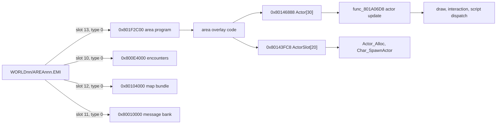

# Field and party

*Read this if you need the field entities, the party and inventory in RAM, or the village and fishing tables.*

The working set of the field, world and menu overlays: the entity rows a map runs on, the field
slot table a scene fills, the party's inventory and money, and the village and fishing tables. The
static archives these rows come from are in [area](../formats/area.md); the character record is in
[game records](records.md#character-and-master-data). Every record below is an offset table. The
evidence cells name the retail function that reads or writes the cell, as `name (image@address)`.
The executable image is `exe/slus_004_22`.

## Where the records are

| Object                  |      Address |    Size | Count | Readers                                                                                                                   |
| ----------------------- | -----------: | ------: | ----: | ------------------------------------------------------------------------------------------------------------------------- |
| actor rows              | `0x80146888` |  `0x98` |    30 | `func_801A06D8 (emi/etc/game/00@0x801A06D8)`, area/plchar/scenario overlays                                               |
| published actor pointer | `0x80146884` |     `4` |     1 | `Area_RunParty (exe/slus_004_22@0x8015A758)`, `func_8015A7E8 (exe/slus_004_22@0x8015A7E8)`                                |
| scratchpad work pointer | `0x1F800044` |     `4` |     1 | every field, plchar, world and scenario overlay                                                                           |
| field slots             | `0x80143FC8` |  `0x74` |    20 | `Actor_FindFreeSlot (emi/etc/game/00@0x8019601C)`, scene overlays and the setup stream's type-`E` record (`Actor_Create`) |
| party records           | `0x80144968` |  `0xA4` |     8 | see [records](records.md#character-and-master-data)                                                                       |
| inventory ids           | `0x8014504C` | `0x200` | 4×128 | `Party_CountItem (exe/slus_004_22@0x8016628C)`, item menu                                                                 |
| inventory counts        | `0x8014524C` | `0x200` | 4×128 | item menu, `func_801D8364 (emi/world00/area030/04@0x801D8364)`                                                            |
| vital items             | `0x8014544C` |  `0x20` |    32 | `func_80166140 (exe/slus_004_22@0x80166140)`, `func_80166180 (exe/slus_004_22@0x80166180)`                                |
| zenny                   | `0x80144F50` |     `4` |     1 | `Party_SpendZenny (exe/slus_004_22@0x8016663C)`, `Party_AddZenny (exe/slus_004_22@0x8016666C)`, every shop                |
| play clock              | `0x80144FC0` |     `4` |     1 | `func_80198CAC (emi/etc/game/00@0x80198CAC)`, status/save/shop panels                                                     |
| fairy jobs              | `0x801455C8` |     `8` |    60 | `Fairy_JoinVillage (emi/etc/commu00/00@0x801F00D4)`, `func_801F01F4 (emi/etc/commu00/00@0x801F01F4)`                      |
| best catches            | `0x80144FE4` |     `1` |    32 | `func_801DB554 (emi/world00/area030/04@0x801DB554)`, `func_801E0B6C (emi/world00/area030/04@0x801E0B6C)`                  |
| fishing rod table       | `0x801E2748` |  `0x0A` |     6 | `func_801DDE2C (emi/world00/area030/04@0x801DDE2C)`                                                                       |
| fishing lure table      | `0x801E2720` |  `0x14` |     - | `func_801DDE2C (emi/world00/area030/04@0x801DDE2C)`                                                                       |

Slot numbers are the TOC indexes for `WORLD00/AREA001.EMI`; the seven world shapes move the area
program between slots 9, 13 and 14 ([EMI](../formats/emi.md#archive-shapes)).

## Actor rows

`Actor` is one map object or interaction slot. The table has 30 rows of `0x98` bytes; the update
walks only rows whose in-use bit is set. The scratchpad work cell at `0x1F800044` points into the
table and the pointer cell at `0x80146884` publishes the current row. Every overlay reads the same
rows: the area overlays place objects and run their scripts, the communication minigame indexes
them as tasks, the scenario overlays dispatch their callbacks, and the fishing code steps the
stamina gauge of the pond rows. The community map calls the table the fish pond array, but only
`world00/area030/04` reads it as a pond; every other overlay reads map objects, tasks or scene
entities.

Retail loads some offsets at several widths and signs (a signed byte at `+0x5D` is `lb`, an
unsigned one `lbu`). The table lists the width of the most frequent reader.

| Offset | Width         | Field            | Meaning                                                                                                                                               | Evidence                                                                                                                                                                                                                |
| -----: | ------------- | ---------------- | ----------------------------------------------------------------------------------------------------------------------------------------------------- | ----------------------------------------------------------------------------------------------------------------------------------------------------------------------------------------------------------------------- |
| `0x00` | `u8`          | `flags_00`       | row state; bits in the flag table below                                                                                                               | `Area_DrawObjectSprite (exe/slus_004_22@0x8014C4D4)`; `func_801A06D8 (emi/etc/game/00@0x801A06D8)`                                                                                                                      |
| `0x01` | `u8`          | `unk_01`         | per-kind dispatch index; `commu00` calls it the task mode                                                                                             | `func_801A06D8 (emi/etc/game/00@0x801A06D8)` indexes `D_801C83D8`                                                                                                                                                       |
| `0x02` | `u8`          | `state_02`       | task state                                                                                                                                            | `func_801D11C0 (emi/world00/area030/04@0x801D11C0)`                                                                                                                                                                     |
| `0x05` | `u8`          | `unk_05`         | region/scene index; `commu00` calls it the source row; scales the script copy's staging offset                                                        | `Actor_CopyScriptEntry (exe/slus_004_22@0x8014D54C)`; cleared by `Area_InitScene (exe/slus_004_22@0x801673AC)` at scene init; role beyond that open                                                                     |
| `0x06` | `u8`          | `unk_06`         | live flag (`commu00` name); 9 gates the draw-mode stamp, 10 calls `func_8015A944`                                                                     | `func_80167E00 (exe/slus_004_22@0x80167E00)`; `func_8015A944 (exe/slus_004_22@0x8015A944)`                                                                                                                              |
| `0x07` | `u8`          | `unk_07`         | spawn options; bits in the flag table below                                                                                                           | `func_801A06D8 (emi/etc/game/00@0x801A06D8)`                                                                                                                                                                            |
| `0x08` | `u8`          | `direction_08`   | facing direction 0-7; selects the velocity row and script; `commu00` calls it the cue resource                                                        | `func_801A06D8 (emi/etc/game/00@0x801A06D8)`                                                                                                                                                                            |
| `0x09` | `u8`          | `unk_09`         | holds the row out of the script path while set; `area032` calls it the marker mode byte                                                               | `func_801A06D8 (emi/etc/game/00@0x801A06D8)`                                                                                                                                                                            |
| `0x0C` | `s32`         | `unk_0C`         | `area032` adds it to x as the x step                                                                                                                  | `area032` overlay (`emi/world00/area032/13`)                                                                                                                                                                            |
| `0x14` | `s32`         | `vz`             | signed vertical speed                                                                                                                                 | -                                                                                                                                                                                                                       |
| `0x18` | `s32`         | `unk_18`         | `commu00` calls it variant_arg_0                                                                                                                      | `commu00` overlay (`emi/etc/commu00/00`)                                                                                                                                                                                |
| `0x1C` | `s32`         | `unk_1C`         | `commu00` calls it variant_arg_1                                                                                                                      | `commu00` overlay (`emi/etc/commu00/00`)                                                                                                                                                                                |
| `0x20` | `s32`         | `gravity`        | added to `vz` each step                                                                                                                               | -                                                                                                                                                                                                                       |
| `0x24` | `u8`          | `flags_24`       | bit 6 marks the record active                                                                                                                         | `func_8014DE78 (exe/slus_004_22@0x8014DE78)`                                                                                                                                                                            |
| `0x2E` | `s16`         | `unk_2E`         | screen x (signed; the draw culls outside `-0x40..0x180`); `area032` calls it the marker's x                                                           | `Area_DrawObjectSprite (exe/slus_004_22@0x8014C4D4)`                                                                                                                                                                    |
| `0x30` | `s16`         | `unk_30`         | screen y; `area032` calls it the marker's y                                                                                                           | `Area_DrawObjectSprite (exe/slus_004_22@0x8014C4D4)`                                                                                                                                                                    |
| `0x34` | `s32` (16.16) | `x`              | world x                                                                                                                                               | `func_8014DE78 (exe/slus_004_22@0x8014DE78)`; `Char_SpawnActor (emi/plchar/plp012/00@0x801CEF14)`                                                                                                                       |
| `0x38` | `s32` (16.16) | `y`              | world y                                                                                                                                               | `func_8014DE78 (exe/slus_004_22@0x8014DE78)`; `Char_SpawnActor (emi/plchar/plp012/00@0x801CEF14)`                                                                                                                       |
| `0x3C` | `s32` (16.16) | `z`              | elevation; readers use the high half `+0x3E` as the height (the ground height)                                                                        | `func_8014DE78 (exe/slus_004_22@0x8014DE78)`; `Char_SpawnActor (emi/plchar/plp012/00@0x801CEF14)`                                                                                                                       |
| `0x48` | `u8`          | `unk_48`         | `commu00` calls it the reset flag                                                                                                                     | `commu00` overlay (`emi/etc/commu00/00`)                                                                                                                                                                                |
| `0x4A` | `u8`          | `unk_4A`         | the world slot mode seed                                                                                                                              | -                                                                                                                                                                                                                       |
| `0x4B` | `u8`          | `unk_4B`         | script-bank record index                                                                                                                              | `Actor_BeginScript (exe/slus_004_22@0x8014D6DC)` reads `work + 0x4B` ([area](../formats/area.md#0x800d3800-area-script-bank))                                                                                           |
| `0x50` | `u32` pointer | `source_50`      | cursor into the area script stream                                                                                                                    | `Actor_CopyScriptEntry (exe/slus_004_22@0x8014D54C)`; `Actor_SeekScript (exe/slus_004_22@0x8014D910)`; `func_8014DAEC (exe/slus_004_22@0x8014DAEC)`                                                                     |
| `0x54` | `u32` pointer | `range_54`       | range record pointer (also read as an integer); byte 2 is the reach, byte 3 bit `0x10` blocks                                                         | `func_8014DE78 (exe/slus_004_22@0x8014DE78)`                                                                                                                                                                            |
| `0x58` | `u16`         | `unk_58`         | per-slot counter                                                                                                                                      | -                                                                                                                                                                                                                       |
| `0x5C` | 4 bytes       | `tint`           | flags byte, then three tint bytes (`+0x5D..+0x5F`); read whole as a packed tint, as unsigned bytes, and as the signed steps a fade adds toward `0xC0` | `func_801F3728 (emi/world00/area032/13@0x801F3728)`; `func_801F3920 (emi/world00/area032/13@0x801F3920)`                                                                                                                |
| `0x70` | `u8`          | `speed_70`       | low byte of a state word: the scene flag-table byte; packed voice numbers sit above it; "speed" is unproven                                           | written by `Area_FindSceneRecord (exe/slus_004_22@0x8014DD3C)`; voice numbers OR'd above it by `SND_QueueSelectionFx (exe/slus_004_22@0x8015D71C)`; read as an argument by `func_801B8A9C (emi/etc/game/00@0x801B8A9C)` |
| `0x74` | `u8`          | `flags_74`       | interaction state; bits in the flag table below                                                                                                       | `func_801A06D8 (emi/etc/game/00@0x801A06D8)`                                                                                                                                                                            |
| `0x75` | `u8`          | `timer_75`       | unnamed cell (`timer_75`)                                                                                                                             | -                                                                                                                                                                                                                       |
| `0x78` | `u8`          | `unk_78`         | `commu00` names it variant_state, `area008` names it state_78                                                                                         | `commu00` overlay (`emi/etc/commu00/00`)                                                                                                                                                                                |
| `0x7A` | `u8`          | `callback_index` | scenario callback table index; `0xFF` is none                                                                                                         | `func_801F8358 (emi/scenario/scena16/00@0x801F8358)`; `Scene_DispatchActor (emi/scenario/scena00/00@0x801FC7D0)` and the other scenario overlays index their table                                                      |
| `0x7C` | `u16`         | `unk_7C`         | 16-bit signal; `commu00` calls it the label id                                                                                                        | `commu00` overlay (`emi/etc/commu00/00`)                                                                                                                                                                                |
| `0x8C` | `s16`         | `stamina_max_8C` | fishing gauge maximum                                                                                                                                 | `func_801E026C (emi/world00/area030/04@0x801E026C)`                                                                                                                                                                     |
| `0x8E` | `u16`         | `stamina_8E`     | fishing gauge; a signed delta is added and the result is clamped into `[0, stamina_max_8C]`                                                           | `func_801E026C (emi/world00/area030/04@0x801E026C)`                                                                                                                                                                     |
| `0x90` | `u16`         | `roll_90`        | compared with `0x1F` by the update: the idle path runs when it is `>= 0x1F` and `unk_09` is 0                                                         | `func_801A06D8 (emi/etc/game/00@0x801A06D8)`                                                                                                                                                                            |
| `0x92` | `u8`          | `facing_92`      | the fishing code writes `rand() & 3` into it; it is a lane or position selector, not a turn                                                           | `func_801DE5EC (emi/world00/area030/04@0x801DE5EC)`                                                                                                                                                                     |

Offsets not listed (`0x03`, `0x04`, `0x0A`, `0x0B`, `0x10`, `0x25-0x2D`, `0x32`, `0x40`, `0x44`,
`0x49`, `0x4C`, `0x5A`, `0x60-0x6C`, `0x71-0x73`, `0x76-0x77`, `0x79`, `0x7B`, `0x7E`,
`0x80-0x88`, `0x93-0x97`) have no proven role.

Flag values:

The readers are the update `func_801A06D8 (emi/etc/game/00@0x801A06D8)` for `flags_74` and the
spawn options, the draw `Area_DrawObjectSprite (exe/slus_004_22@0x8014C4D4)` for `flags_00`, and the actor
scan `func_8014DE78 (exe/slus_004_22@0x8014DE78)` for `flags_24`.

| Byte       |    Bit | Name                        | Effect                                                                                                           |
| ---------- | -----: | --------------------------- | ---------------------------------------------------------------------------------------------------------------- |
| `flags_00` | `0x01` | in use                      | the update and draw walk the row                                                                                 |
| `flags_00` | `0x02` | skip palette stage          | skips queuing the row's palette pair                                                                             |
| `flags_00` | `0x10` | step move                   | takes the advance-stream tail after the step deltas                                                              |
| `flags_00` | `0x20` | semi transparent            | marks the row's primitives semi-transparent                                                                      |
| `flags_00` | `0x40` | hidden                      | the draw returns before queuing sprite cells; also hides the row from the walkability and entity-lookup paths    |
| `flags_00` | `0x80` | offscreen                   | culled outside the window; treated as arrived                                                                    |
| `flags_24` | `0x40` | active                      | the record is active                                                                                             |
| `flags_74` | `0x01` | interaction pending         | runs the area interaction handler                                                                                |
| `flags_74` | `0x02` | fade white                  | selects the white fade handler                                                                                   |
| `flags_74` | `0x04` | fade black                  | selects the black fade handler                                                                                   |
| `flags_74` | `0x08` | moving                      | a path or movement step is in progress (set when a move starts, cleared on arrival); the route needs re-applying |
| `flags_74` | `0x10` | script request              | starts the map/message request                                                                                   |
| `flags_74` | `0x20` | script pending              | dispatches the scenario record                                                                                   |
| `unk_07`   | `0x01` | `ACTOR_OPT_HIDDEN_ON_SPAWN` | sets `flags_00` bit 6 at spawn                                                                                   |
| `unk_07`   | `0x02` | `ACTOR_OPT_KEEP_FACING`     | keeps the row's own facing instead of the opposite one                                                           |
| `unk_07`   | `0x04` | `ACTOR_OPT_NO_SCRIPT_START` | drops the script arm                                                                                             |
| `unk_07`   | `0x08` | `ACTOR_OPT_ROUTE_LOCKED`    | skips re-applying the route                                                                                      |
| `unk_07`   | `0x20` | `ACTOR_OPT_WAIT_STREAM`     | skips the animation-stream advance                                                                               |
| `unk_07`   | `0x80` | `ACTOR_OPT_NO_TARGET`       | skips the walkability and target test and the entity lookup                                                      |

The update (`func_801A06D8`, `emi/etc/game/00@0x801A06D8`) publishes each row through `g_SpadWork`
and `g_CurrentActor`, then:

Per frame, the update returns at once while the area walk step is active. Otherwise it visits the 30 rows in order, and
for each row:

1. Publish the row.
2. Skip it when the in-use flag is clear.
3. Clear the scratchpad step byte.
4. When `unk_09` is 0 and a script is pending: with a script request, arm the script and turn the row unless the route
   is locked; without one, dispatch the scenario record.
5. Else when an interaction is pending, run the interaction handler and go to the next row.
6. Else when `roll_90` is at least `0x1F` and `unk_09` is 0, run the idle path.
7. Else run the per-kind handler `D_801C83D8[unk_01]`.
8. Re-apply the route when the row is moving; otherwise advance the animation stream unless the wait-stream flag is set.

The per-kind table `D_801C83D8` is the game overlay's row update table; its index is `unk_01`.
The scratchpad cell is a pointer, so every overlay types the same cell with its own work view; the
field view is the `Actor` row above. The state step in the scratchpad work cell is the byte that task
dispatch indexes and that the battle step tables read and write; clearing the row's state sets
`+0x02` to 0 so the record starts a new task at state 0.

## Field slots

`ActorSlot` is the scene's object table, not the actor table: a slot is claimed, filled and cleared
by the scene and frontend code, while the actor rows are the live map objects. Twenty rows of
`0x74` bytes at `0x80143FC8`.

| Offset | Width         | Field          | Meaning                                                                                                                                         | Evidence                                                                                                                                                                    |
| -----: | ------------- | -------------- | ----------------------------------------------------------------------------------------------------------------------------------------------- | --------------------------------------------------------------------------------------------------------------------------------------------------------------------------- |
| `0x00` | `u8`          | `flags_00`     | set to 1 when the slot is claimed                                                                                                               | `Actor_FindFreeSlot (emi/etc/game/00@0x8019601C)`                                                                                                                           |
| `0x01` | `u8`          | `unk_01`       | kind passed to `Char_SpawnActor`                                                                                                                | `Char_SpawnActor (emi/plchar/plp012/00@0x801CEF14)`                                                                                                                         |
| `0x05` | `u8`          | `type`         | actor type and handler index; seen values `0x0F`, `0x10`, `0x1E`, `0x32`, `0x69`; `0x34` for a character spawn; also read as an accessory count | `Char_SpawnActor (emi/plchar/plp012/00@0x801CEF14)`                                                                                                                         |
| `0x06` | `u8`          | `unk_06`       | area id in area030; slot index in game00                                                                                                        | -                                                                                                                                                                           |
| `0x09` | `u8`          | `layer_09`     | draw layer; seen values `0x20`, `0x40`, `0x60`, `0x90`, `0xFF`                                                                                  | no reader named                                                                                                                                                             |
| `0x0B` | `u8`          | `link_0B`      | index of the linked slot                                                                                                                        | `Char_SpawnActor (emi/plchar/plp012/00@0x801CEF14)`                                                                                                                         |
| `0x0C` | `s32`         | `step_0C`      | scenario step                                                                                                                                   | scene readers                                                                                                                                                               |
| `0x10` | `s32`         | `selection_10` | frontend selection                                                                                                                              | frontend readers                                                                                                                                                            |
| `0x18` | `s32`         | `counter_18`   | counter                                                                                                                                         | writer `func_801F92DC (emi/scenario/scena00/00@0x801F92DC)`; also written by `func_801F2C04`, `func_801F2CD4` and `func_801F5A44` as slot cells; no reader found (unproven) |
| `0x1C` | `s32`         | `counter_1C`   | counter                                                                                                                                         | writer `func_801F92DC (emi/scenario/scena00/00@0x801F92DC)`; also written by `func_801F2C04`, `func_801F2CD4` and `func_801F5A44` as slot cells; no reader found (unproven) |
| `0x29` | `u8`          | `unk_29`       | cleared when the slot is rebuilt                                                                                                                | -                                                                                                                                                                           |
| `0x34` | `s32` (16.16) | `x`            | world x; `Area_SampleHeight` argument                                                                                                           | `Char_SpawnActor (emi/plchar/plp012/00@0x801CEF14)`                                                                                                                         |
| `0x38` | `s32` (16.16) | `y`            | world y; `Area_SampleHeight` argument                                                                                                           | `Char_SpawnActor (emi/plchar/plp012/00@0x801CEF14)`                                                                                                                         |
| `0x3C` | `s32` (16.16) | `z`            | `Area_SampleHeight` of x and y in the integer half (`+0x3E`); the call passes the shifted 16.16 values                                          | `Char_SpawnActor (emi/plchar/plp012/00@0x801CEF14)`                                                                                                                         |
| `0x64` | 3 × `s32`     | `pos`          | scene origin plus offset                                                                                                                        | scene readers                                                                                                                                                               |

Other cells (`0x02-0x04`, `0x07`, `0x08`, `0x0A`, `0x14`, `0x20-0x28`, `0x2A-0x33`, `0x40-0x63` (including `0x4A`),
`0x70-0x73`) have no proven role.

The allocation and spawn path:

`Actor_FindFreeSlot` (`emi/etc/game/00@0x8019601C`) returns the first slot whose `flags_00` is 0, or `0xFF`.
`Char_SpawnActor(kind, x, y)` (`emi/plchar/plp012/00@0x801CEF14`, shared by every plchar program) returns when the
allocation gives `0xFF`. Otherwise it sets `flags_00` to 1, `type` to `0x34`, `x` and `y` to the arguments shifted left by
16, `unk_01` to `kind`, the integer half of `z` to the sampled ground height plus `0x100`, and `link_0B` to 0.

`Area_SampleHeight (exe/slus_004_22@0x8015477C)` samples the four corner height bytes of the map
bundle and returns the ground height as `s16`; it is not a distance
([area](../formats/area.md#0x80104000-map-bundle)).

## Inventory, money and time

The inventory is four parallel 128-slot id rows and four count rows, plus a 32-byte vital-item row.
Category order is the item-category enum:

| Index | Category   | Retail menu label |
| ----: | ---------- | ----------------- |
|   `0` | item       | item              |
|   `1` | weapon     | weapon            |
|   `2` | armor      | armor             |
|   `3` | accessory  | accessory         |
|   `4` | vital item | `VITAL`           |

The arrays are flat, and the pointer tables `D_801C893C` (ids) and `D_801C8950` (counts) hold their
bases in category order; the vital-item row is the fifth id pointer. Both pointer tables hold five
slots; the fifth count pointer is null. The base order and pointer-table contents come from the shipped
image; the first four category labels are proven in code, and the vital-item label of the fifth id
array is inferred from its position and category 4. A count is the stack size,
and `0x63` (99) is the cap the code tests. The menu label for category 4 is `VITAL` in the retail
text.

Zenny is a `u32` clamped at 9,999,999 by `Party_AddZenny`; a shop subtracts only when the balance
covers the price. The play clock is four bytes:

| Offset | Width | Field      | Meaning              |
| -----: | ----- | ---------- | -------------------- |
| `0x00` | `u8`  | hours      | stops at `0x63` (99) |
| `0x01` | `u8`  | minutes    | rolls at 60          |
| `0x02` | `u8`  | seconds    | rolls at 60          |
| `0x03` | `u8`  | thirtieths | rolls at 30          |

Thirtieths roll at 30, seconds and minutes at 60, and the clock stops at `99:59:59` (the low three
bytes read `0x3B3B63`) instead of incrementing past it. The two countdown timers at `0x80145554`
(celerity) and `0x80145558` (bonebreak) use the same fields in reverse and borrow at the same
boundaries. The tick loop is in the `emi/etc/game/00` overlay; the shop, `commu00` and
`emi/etc/game/01` overlays format the same bytes for display.

## Fairy village and fishing

`FairyJob` is one of 60 rows of 8 bytes at `0x801455C8`:

| Offset | Width | Field             | Meaning                                     |
| -----: | ----- | ----------------- | ------------------------------------------- |
| `0x00` | `u8`  | `active`          | the slot is live while set                  |
| `0x01` | `u8`  | `type`            | the job being worked                        |
| `0x02` | `u8`  | `record_state`    | record state                                |
| `0x03` | `u8`  | `unk_03`          | unnamed                                     |
| `0x04` | `u32` | `progress_anchor` | the battle count when the job last advanced |

The 720-fairy roster and its reward tables stay in the archives ([records](records.md#area-data));
the RAM jobs table is `g_FairyJobs`.

Fishing keeps three state bytes, six 10-byte rod rows, 20-byte lure rows and 32 best-catch bytes:

| Address      | Width     | Meaning                                                                                            |
| ------------ | --------- | -------------------------------------------------------------------------------------------------- |
| `0x80145026` | `u8`      | selected lure                                                                                      |
| `0x80145027` | `u8`      | lure quantity; `Party_CountItem` adds it to the lure's item count                                  |
| `0x80145028` | `u8`      | selected rod                                                                                       |
| `0x80144FE4` | 32 × `u8` | best catch, one byte per fish, in the index order of the count table; saved at save offset `0x90C` |

The rod row is `rod_table + rod * 10` and the lure row is `lure_table + lure * 20`
(`func_801DDE2C`, `emi/world00/area030/04@0x801DDE2C`). `func_801E0B6C` walks all 32 best-catch
bytes. The fishing code reads the pond rows through the same `Actor` table: `stamina_8E` is
clamped into `[0, stamina_max_8C]`, and `facing_92` takes `rand() & 3` (a lane or position selector).

Rod row (10 bytes, every cell one byte):

| Offset | Width | Field                | Meaning                                                                          |
| -----: | ----- | -------------------- | -------------------------------------------------------------------------------- |
| `0x00` | `u8`  | cast power/speed     | cast power and speed                                                             |
| `0x01` | `u8`  | cast sweep direction | `0` linear bidirectional, `1` linear unidirectional, `2` quadratic bidirectional |
| `0x02` | `u8`  | max distance         | half the value in metres                                                         |
| `0x03` | `u8`  | reel cursor size     | reel cursor size                                                                 |
| `0x04` | `s8`  | cursor return speed  | signed                                                                           |
| `0x05` | `s8`  | cursor left speed    | signed                                                                           |
| `0x06` | `s8`  | cursor right speed   | signed                                                                           |
| `0x07` | `u8`  | unnamed              | role unknown                                                                     |
| `0x08` | `u8`  | snap left tension    | snap tension                                                                     |
| `0x09` | `u8`  | snap right tension   | snap tension                                                                     |

Lure row (20 bytes):

| Offset | Width   | Meaning             |
| -----: | ------- | ------------------- |
| `0x00` | `u8`    | unnamed             |
| `0x01` | 3 bytes | idle float rate     |
| `0x04` | 4 bytes | reeling float rate  |
| `0x08` | 4 bytes | sideways float rate |
| `0x0C` | 8 bytes | unnamed             |

The community notes call each float group a 16-bit value but give the byte spans `+1..3`, `+4..7`
and `+8..11`; the group widths are unresolved.

## How to reproduce

The static area payloads are the evidence for the record shapes; the RAM rows are built from them.

`emi list` shows the load argument of each entry: slot 10 is `0x800E4000`, slot 11 is
`0x80010000`, slot 12 is `0x80104000`, slot 13 is `0x801F2C00`. `encounters` writes the two
encounter/enemy blocks, `terrain` writes the map bundle as glTF, and `message` writes the area's
text bank.

The item table holds 92 rows; the JSON follows the record order (name, flags, price) for items and
adds the ability/equipment fields where the record has them. The inventory, zenny, clock and actor
rows exist only at run time; read them in an emulator at the addresses above.

## Gaps

- Reference notes give the same rod and lure strides at `0x801E2914` and `0x801E2950`; those
  addresses are unverified. The rod and lure strides (`10` and `0x14`) are read from `func_801DDE2C`, but both addresses lie inside the `D_801E2424` panel-icon array (74 x `0x10`), and the bytes at `0x801E2748` read as icon data. Which addresses hold the tables is unresolved.

## Sources

The layouts are read from the retail readers named in each table. The community RAM map and save
editor confirm addresses and strides, never field roles ([sources](../sources.md)).
