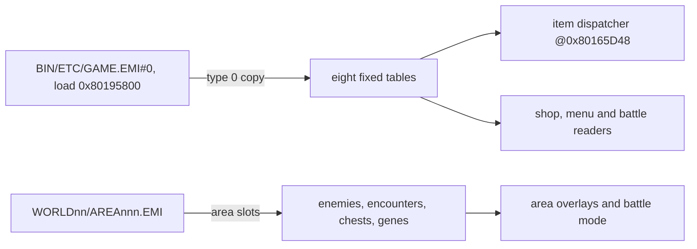

# Game records

*Read this if you edit items, skills, enemies, shops, characters or other game tables.*

Record layouts, tables and value encodings of the game data, with the archives that own them.

Record layouts, counts and table coordinates are storage facts measured against the US
`Breath of Fire III (USA)` data set (`SLUS-00422`, md5 `9dd9a7c934b8b59d0ce76b0f25d18176`). Offsets are raw archive
offsets unless a row says payload-relative.

## `GAME.EMI` fixed tables

All eight tables live in entry 0 of `BIN/ETC/GAME.EMI`, loaded at `0x80195800`. The runtime address
of a row is `0x80195800 + payload_relative`; its archive offset is `payload_relative + 0x800`.

| Table        |   Archive |   Payload |      Runtime | Records × size |
| ------------ | --------: | --------: | -----------: | -------------: |
| items        | `0x33964` | `0x33164` | `0x801C8964` |    92 × `0x12` |
| vital items  | `0x33FDC` | `0x337DC` | `0x801C8FDC` |    16 × `0x10` |
| weapons      | `0x340DC` | `0x338DC` | `0x801C90DC` |    83 × `0x18` |
| armor        | `0x348A4` | `0x340A4` | `0x801C98A4` |    68 × `0x16` |
| accessories  | `0x34E7C` | `0x3467C` | `0x801C9E7C` |    52 × `0x14` |
| shops        | `0x3528C` | `0x34A8C` | `0x801CA28C` |    40 × `0x17` |
| abilities    | `0x3570C` | `0x34F0C` | `0x801CA70C` |   228 × `0x14` |
| level growth | `0x368DC` | `0x360DC` | `0x801CB8DC` |   693 × `0x08` |

The ability table ends exactly at `0x368DC`; level growth ends at `0x37E84`. The archive is
`0x3A800` bytes. Names occupy 12 bytes and need not have a terminator when they fill the field.

| Record        | Stride | Field groups                                                                          |
| ------------- | -----: | ------------------------------------------------------------------------------------- |
| `Item`        | `0x12` | name `[12]`, flags, one unknown byte, description id, price                           |
| `VitalItem`   | `0x10` | name `[12]`, description id, one unknown halfword                                     |
| `Weapon`      | `0x18` | name, equipability, flags, kind, element, weight, sound, power, description, price    |
| `Armor`       | `0x16` | name, equipability, flags, equip type, weight, power, description, price              |
| `Accessory`   | `0x14` | name, equipability, flags, kind, weight, description, price                           |
| `Ability`     | `0x14` | name, targeting flags, type, cost, power, element, flags, description                 |
| `ShopStock`   | `0x17` | stock count and eleven `ShopItemRef` slots                                            |
| `LevelGrowth` | `0x08` | experience, HP, AP, packed power/defense, packed agility/intellect, two ability bytes |

A `ShopItemRef` is `item_type` then `item_index` (2 bytes). `ShopStock` is `item_count` at `+0x00`
and eleven `ShopItemRef` slots from `+0x01`. Field offsets of the item, equipment and ability
records and of `LevelGrowth`: [editor guide](architecture/editor-guide.md#10-items-skills-magic-shops-drops-and-other-records).

Field notes:

- `flags`: item flags (below). `description`: little-endian resource ID used by
  `WinLookupChoiceResource`; ability `description` is passed to `Resource_Resolve` by battle/battle/15
  `func_8009704C`.
- `kind`: low nibble selects the icon through `func_80165E04`. `sound`: cue-table index in
  battle/battle/15 `func_800AB834` and `func_800AB910`.
- `equipability`: one bit per character (below). `equip_type`: 0 nothing, 2 shield, 3 helmet,
  4 body.
- `type`: low two bits select the `AbilityType` (below). `targeting_flags`: one of the targeting
  bytes; `0x10` gates the all-side target sets and `0x01` is the usable-in-field switch.
- `ShopStock.item_count` precedes 11 `ShopItemRef` slots. `LevelGrowth` packs power/defense and
  agility/intellect into one byte each (`high << 4 | low`); `character = index / 99` (0 to 6, seven characters), `level =
  index % 99 + 1`.

The runtime dispatcher `exe/slus_004_22@0x80165D48` masks an item category and computes the record
address; all five categories enter a shared continuation at `0x80165DFC`.

| Category | Family     |         Base | Stride |
| -------: | ---------- | -----------: | -----: |
|      `0` | item       | `0x801C8964` | `0x12` |
|      `1` | weapon     | `0x801C90DC` | `0x18` |
|      `2` | armor      | `0x801C98A4` | `0x16` |
|      `3` | accessory  | `0x801C9E7C` | `0x14` |
|      `4` | vital item | `0x801C8FDC` | `0x10` |

Callers handle `0xFF` (empty/zenny) outside the dispatcher. Battle selection code reads the same
`0x14`-byte ability stride at `0x801CA70C + 0x0C`: `+0x0C` selection flags, `+0x10` selection mask
(loaded `u16`), `+0x12` selection name/resource ID. That is an alternate view of the record, not a
second layout.

## Character and master data

| Table             | Archive               |    Offset |              Records × size |
| ----------------- | --------------------- | --------: | --------------------------: |
| base stats        | `BIN/ETC/START.EMI`   | `0x72914` |                  8 × `0xA4` |
| base-stats copy   | `BIN/ETC/STATUS.EMI`  | `0x1B114` | 8 × `0xA4` (byte-identical) |
| master skills     | `BIN/ETC/SISYOU.EMI`  |  `0x3C88` |                 17 × `0x0C` |
| master stats      | `BIN/ETC/SISYOU.EMI`  |  `0x3D54` |                 17 × `0x06` |
| master names      | `BIN/ETC/AFLDKWA.EMI` |  `0x1BE0` |                  17 strings |
| master names copy | `BIN/ETC/FIRST.EMI`   | `0x3CBE0` |                  17 strings |
| dragon pointers   | `BIN/ETC/STATUS.EMI`  | `0x1C018` |                  10 × `u32` |

`Character` (`8 × 0xA4`) is one record with four field groups: identity and growth (name,
character id, level, `u32` experience, master), live combat state (status word, six equipment ids,
current HP/AP/willpower, bonus stats, nine resistances, five chance bytes), the same block as base
stats (`base_*`), and four ten-byte ability arrays plus six level-up modifiers. The member offsets
are in the [editor guide](architecture/editor-guide.md#9-character-and-monster-stats). `MasterSkills` is six
`level | ability << 8` pairs: `func_801D3A24` walks the six pairs of the chosen master,
comparing each level byte with `diff`, the levels the character has gained since the master was assigned (character `level - unk_84`; masters 0xB to 0xE (11 to 14) are special-cased on `diff >= 3`), and `func_801D2CA4` copies the
`MasterStats` row into the six `level_up_modifiers` bytes at assignment. `MasterStats` is six
signed bonuses (HP, AP, power, defense, agility, intellect); `DragonPointers` is ten `u32`
addresses. Master ids are the array index: 0 Bunyan, 1 Mygas, 2 Yggdrasil, 3 D'lonzo, 4 Fahl,
5 Durandal, 6 Giotto, 7 Hondara, 8 Emitai, 9 Deis, 10 Hachio, 11 Bais, 12 Lang, 13 Lee, 14 Wynn,
15 Ladon, 16 Meryleep. The name table itself is text: 17 packed null-terminated strings in the name
encoding (`0x8E` spells the apostrophe of `D'lonzo`). The bytes are entry 8 of
`BIN/ETC/START.EMI` (characters), entry 0 of `BIN/ETC/AFLDKWA.EMI` (master names) and entry 0 of
`BIN/ETC/SISYOU.EMI` (master skills and stats). Every skill
level byte and the whole stat table match the `D_801D4088` and `D_801D4154` rows.

Verified opening values (level, HP, AP, power, defense, agility, intellect): Ryu 1/20/11/12/10/8/10,
Nina 5/27/33/13/13/14/24, Garr 13/99/7/58/44/17/21, Teepo 1/22/13/13/10/10/12, Rei 5/42/12/23/15/19/22,
Momo 10/52/40/30/25/15/50, Peco 1/40/8/18/14/3/4, Whelp 0/15/15/10/8/4/8. Whelp stores
`character_index = 10`, not slot 7. All characters store `master_id = 0xFF`; runtime code assigns
masters. Master ids are the array index 0-16; indices 11-14 are restricted and their skills do not
randomize. `AFLDKWA.EMI` holds the v1.1 bytes at `0x1571`/`0x1598`, and `FIRST.EMI` copies them
at `0x3C571`/`0x3C598`; they are the name-entry strings `Please choose a name` and `Close Config`,
not a seed display. The randomizer seed's own storage is not identified here.

Level-up: `emi/etc/game/00@0x801ADDD4` reads level at `+0x06` and experience at `+0x08`, indexes
level-growth rows as `character × 99 + level`, updates base halfwords `0x3C`-`0x46` clamped to 999,
adds signed modifier bytes `0x85`-`0x8A`, writes the new level, recalculates, and passes the two
ability bytes to `func_801651DC`. All 693 shipped `extra_ability` bytes are zero; `ability` is not.

### Party message tables

Seven area programs hold a `g_PartyMemberMessages` table of `PartyMemberMessages` records:
four `u8` tags at `+0x00` then four `s16` message ids at `+0x04`, 12 bytes each —
`AREA112/13` and `AREA143/13` one record, `AREA145/14` three, `AREA148/13`, `AREA173/14` and
`AREA196/13` two each, `AREA197/13` seven (18 in all). `WORLD_SHOW_PARTY_MESSAGE`, expanded in
each overlay's `Message_ShowParty` functions, matches tag `i` against byte 0 of the
battle-record rows in `D_80145F09` and shows `messages[i]` through `Message_StartAreaMessage`. The
addresses are runtime addresses in the area image; the payload offset is the
address minus the image base `0x801F2C00`:

| Overlay      |      Address | Records |
| ------------ | -----------: | ------: |
| `AREA112/13` | `0x801F48FC` |       1 |
| `AREA143/13` | `0x801F52FC` |       1 |
| `AREA145/14` | `0x801F5C9C` |       3 |
| `AREA148/13` | `0x801F6144` |       2 |
| `AREA173/14` | `0x801F5914` |       2 |
| `AREA196/13` | `0x801F42F4` |       2 |
| `AREA197/13` | `0x801F4A2C` |       7 |

Each row names an archive and an entry: `AREA112/13` is entry 13 of `AREA112.EMI` (find the archive by name under the disc folder).

### Save layout

The record frame is `PARTY_ZENNY - 0x878` (`0x801446D8`). It is a virtual origin: only frame
`+0x200` onward exists in live RAM, as the block at `0x801448D8`. `CardBuildFileHeader`
`CardBuildFileHeader (emi/etc/start/09@0x801EF27C)` writes the `SC` magic to the staging buffer at `0x800C1800`, not to
`0x801446D8`; the save routine `SAVE_BuildSlotImage (emi/etc/shop/00@0x801D69E0)` copies `0x801448D8` to staging `+0x200`
(`g_SaveBuffer`, `0x800C1A00`). The frame offsets of the notes line up with that copy, and
`frame + 0x8E8` being the clock (`g_PlayClock`, `0x80144FC0`) confirms the origin. `START.EMI`'s `0x801E5A00` zeroes the halfword at `frame + 0x270`, byte-sums
`0x10B0` bytes from `frame + 0x200` into a 32-bit accumulator, and compares the low halfword. Two
frames appear in the sources and are not interchangeable: the notes frame above, and a save-editor
frame relative to a decoded payload that starts `0x878` bytes into the file, so
`editor = notes - 0x878`. The character stride is `0xA4`.

|       Notes offset | Editor offset | Meaning                                                                                                     |
| -----------------: | ------------: | ----------------------------------------------------------------------------------------------------------- |
| `+0x200`-`+0x12B0` |               | checksum bytes (sum of these, low 16 bits)                                                                  |
|           `+0x85D` |               | hide-and-seek flags (Bais `0x20`, Lang `0x40`, all-found `0x80`)                                            |
|           `+0x85E` |               | hide-and-seek flags (participation `0x04`, Lee `0x01`, Wynn `0x02`)                                         |
|           `+0x878` |       `0x000` | zenny                                                                                                       |
|           `+0x881` |               | formation unlock flags                                                                                      |
|           `+0x882` |               | three character ids (`D_80144F5A`); indexes `g_CharSlot` (notes: field order or formation id, at `+0x880`)  |
|           `+0x885` |               | three character ids (`D_80144F5D`); swapped against `D_80144F5A` entries (notes: battle order, at `+0x883`) |
|           `+0x8E8` |               | running clock, `Clock` format                                                                               |
|           `+0x8EC` |               | timer state (notes give the address only)                                                                   |
|           `+0x90C` |               | fishing records                                                                                             |
|           `+0x92C` |               | notes give the address only                                                                                 |
|           `+0xE70` |       `0x5F8` | dragon genes                                                                                                |
|           `+0xEA0` |               | save name, five characters                                                                                  |
|           `+0xEA5` |               | three party portraits                                                                                       |
|           `+0xEA8` |               | save level (Ryu's level)                                                                                    |
|           `+0xEAC` |               | timer, `Clock` format                                                                                       |
| `+0xEDC`, `+0xEEA` |               | notes give the addresses only                                                                               |
|           `+0xEF0` |               | fairy job data                                                                                              |
|                    |       `0x0FC` | item/category id arrays                                                                                     |
|                    |       `0x2FC` | quantity arrays                                                                                             |
|                    |       `0x4FC` | vital items                                                                                                 |
|                    |       `0x51C` | skill note                                                                                                  |
|                    |       `0x594` | countdown timers (hour, minute, second, subsecond)                                                          |
|                    |       `0x5FC` | masters                                                                                                     |

## Area data

Each `WORLD*/AREA*.EMI` is the sole source for its area. Pointer maps are raw archive offsets, one
per line as `HEXOFFSET@ARCHIVE/PATH.EMI`; empty slots use `0x00000`/`0xFFFFF`.

| Family        |             Records |                  Archives | Record size |
| ------------- | ------------------: | ------------------------: | ----------: |
| enemies       | 1,400 (v1.0: 1,386) |           200 (v1.0: 198) |      `0x88` |
| encounters    | 1,600 (v1.0: 1,584) |           200 (v1.0: 198) |      `0x09` |
| chests        |     224 (v1.0: 216) |             77 (v1.0: 76) |      `0x03` |
| genes         |                  17 |                        15 |      `0x01` |
| chrysms       |                  13 |                        13 |      `0x01` |
| fairies       |                 720 |                        12 |      `0x09` |
| Manillo items |                 165 |                         3 |      `0x08` |
| Manillo stock |                  16 | 1 (`AREA030` @ `0x3E53E`) |      `0x0A` |

Field groups with offsets (`Enemy` offsets: [editor guide](architecture/editor-guide.md#9-character-and-monster-stats)):

| Record         | Field groups                                                                                                                                                                 |
| -------------- | ---------------------------------------------------------------------------------------------------------------------------------------------------------------------------- |
| `Enemy`        | name `[8]`, `enemy_id` `u16`, choice AI, target preference, zenny, experience, level, eight initial skills, six stats, two drop rows, four `EnemyAiBlock`s, nine resistances |
| `Encounter`    | eight enemy indexes (`+0x00`-`+0x07`) and an appearance rate (`+0x08`)                                                                                                       |
| `Chest`        | memory byte (`+0x00`), item id (`+0x01`), item type (`+0x02`)                                                                                                                |
| `Gene`         | one gene index                                                                                                                                                               |
| `Chrysm`       | one gene index                                                                                                                                                               |
| `Fairy`        | name `[5]` (`+0x00`) and four stat bytes (`+0x05`)                                                                                                                           |
| `ManilloTrade` | item id (`+0x00`), item type (`+0x01`), three fish indexes (`+0x02`), three fish quantities (`+0x05`)                                                                        |
| `ManilloStock` | ten trade indexes                                                                                                                                                            |

An `EnemyAiBlock` is a condition byte, seven parameters and eight skills.

- Skills block `0x63` (99) marks an unused AI block. A boss is an enemy in no encounter with a
  nonzero appearance rate. Encounter `0xFF` is empty; only enemy ids 0-6 occur.
- Enemy id is bytes 8-9, range `0x0001`-`0x04A8`, 175 ids for 168 names. Six enemies carry two
  or three ids: Ammonite `0x95`/`0x96`, Beyd `0x58`/`0x59`, Garr `0x454`/`0x465`, Golem
  `0x4C`/`0x4D`, Nue `0x0D`/`0x0E`, ToxicMan `0x7F`/`0xAE`/`0xAF`. The pointer index is not the id.
- Resistance array: Fire, Frost, Thunder, Earth, Wind, Holy, Psionic, Status, Death; values 0-7.
- Genes 17 records; `gene_index` `0x00`-`0x11`, with `0x21` reserved for patch-gated Flame.
  Chrysms use the same byte layout but a separate namespace; 13 records. Dragon gene locations are
  per archive: Flame/Defender in `SCENA03`, Shadow/Fusion in `SCENA08`, Frost in `AREA067`, Thunder
  in `AREA100`, Radiance in `AREA146`, Force in `AREA117`, Eldritch in `AREA077`, Miracle in
  `AREA103`, Gross in `AREA105`, Thorn in `AREA054`, Reverse in `AREA093`, Mutant in `AREA075`,
  `???` in `AREA114`, Trance in `AREA123`, Failure in `AREA145`; Infinity has no pointer.
- Fairy record: 5-byte name and 4 stat bytes. The 9-byte roster is distinct from the reward tables
  (`COMMU00` gifts 20 × 4 at `0x848`, exploration 48 × 2 at `0x4218`; `COMMU02` prizes 48 × 2 at
  `0x2D900`). The gift, exploration and prize rewards at those offsets have battle counts and roll
  bytes that match the `D_801EEC44_Data`.
- Chest `item_type = 0xFF` means zenny `item_index × 40`.
- Manillo records: 3 fish indexes and 3 quantities; fish items start at item index `0x38`.

## Encoding and values

| Namespace                |  Width | Proven values                                                      | Owner         |
| ------------------------ | -----: | ------------------------------------------------------------------ | ------------- |
| item category            |   `u8` | 0 item, 1 weapon, 2 armor, 3 accessory, 4 vital item, `0xFF` empty | dispatcher    |
| item index               |   `u8` | `0x00`-`0x5B`                                                      | `Item`        |
| fish item index          |   `u8` | `0x38`-`0x4C`                                                      | item table    |
| ability index            |   `u8` | `0x00`-`0xE3` (228)                                                | `Ability`     |
| level-growth index       |  array | 0-692                                                              | `LevelGrowth` |
| character slot           |  array | 0-7; Whelp stores id `0x0A`                                        | base stats    |
| master id                |  array | 0-16                                                               | master tables |
| enemy id                 | `le16` | `0x0001`-`0x04A8`                                                  | `Enemy +0x08` |
| gene / chrysm byte       |   `u8` | 0-17; `0x21` patch-gated                                           | gene/chrysm   |
| shop index               |  array | 0-39                                                               | `ShopStock`   |
| fairy gift/explore/prize |  array | 0-19 / 0-47 / 0-47                                                 | reward tables |

| Mask             | Bits                                                                                                                                 |
| ---------------- | ------------------------------------------------------------------------------------------------------------------------------------ |
| equipability     | 0 Ryu, 1 Nina, 2 Garr, 3 Teepo, 4 Rei, 5 Momo, 6 Peco, 7 Whelp                                                                       |
| element          | 0 Fire, 1 Ice, 2 Lightning, 3 Earth, 4 Wind, 5 Holy, 6 Psionic, 7 Status                                                             |
| item flags       | 7 usable_menu, 6 show_animation, 5 show_name, 4 story_item, 3 target_all, 2 target_enemy_default, 1 target_selectable, 0 target_both |
| ability flags    | 4 affects_stats, 3 unknown_3, 2 target_ally_default, 1 examinable, 0 unknown_0                                                       |
| armor equip type | 0 nothing, 2 shield, 3 helmet, 4 body                                                                                                |
| ability type     | 0 heal, 1 assist, 2 attack, 3 skill (Blue Magic)                                                                                     |

Ability targeting bytes (`Ability.targeting_flags`): `0x02`/`0x0E` self, `0x1E`/`0x1F` all
player, `0x32`/`0x3A`/`0x3E` all enemy, `0x4E` single player, `0x62`/`0x6A`/`0x6E` single enemy,
`0x7A`/`0x7E` all enemy, `0x96` all both, `0x9E` all both random, `0xBA` single both random,
`0xCE`/`0xCF` single either side, `0xDE`/`0xDF` all either side, `0xE2`/`0xEA`/`0xEE` single either
side enemy-first, `0xF2` all either side enemy-first. Bit `0x10` gates the all-side sets; bit `0x01`
is the usable-in-field switch. Four values occur with no established meaning: `0x00` (empty
record), `0x06`, `0x09`, `0x0A`. `0x4E`, `0x62` and `0x6A` also occur as battle command ids; the
namespaces are separate.

Status word: tested or cleared bits are `0x01`, `0x02`, `0x04`, `0x08`, `0x10`, `0x40`, `0x80`,
`0x800`, `0x2000`, `0x4000`; the rejection mask is `0x4944` and the heal mask `0xEF`. Named effects
from the notes: `0x04` paralysis, `0x08` blind, `0x10` mute, `0x20` confused (a battle/battle/15 lift
comment calls it magic-defense; the code proves only that the bit is cleared and restored), `0x40`
sleep, `0x80` poison.

Name encoding for item, weapon, armor, accessory and ability names: `0x00` end, `0xFF` space,
`0x8E` apostrophe, `0x3D` hyphen, `0x3E` period, `0x8B` plus, `0x05 0x02` red, `0x05 0x03` blue,
`0x06` no color, `0x01` newline. Master names use the same punctuation encoding (`D'lonzo`).
Level-growth stat bytes pack `power << 4 | defense` and `agility << 4 | intellect`. A master skill
pair is `level | ability << 8`; `0xFF` in the high byte is empty and `0x63` in the low byte is the
unused-level marker. A shop item reference is `item_type | item_index << 8`. Signed-byte fields are
`MasterStats` bonuses and base-stat modifiers `0x85`-`0x8A`: `0x80`-`0xFF` decode as
`value - 256`.

Formulas: a drop row's `rate_02` indexes the eight-byte chance table at `0x801D0CB8`
(`0, 0, 1, 3, 7, 0x1F, 0x7F, 0xFF`), and the roll passes when `chance[rate] >= rand() & 0xFF`, a probability of `(chance + 1) / 256`
(`func_801E531C`, `emi/battle/battle/03@0x801E531C`); rate 0 and item 0 never drop. Enemy resistance is a
level 0-7 per element. Name fields are 12 bytes; trailing bytes belong to the next field, not the
name.

## Battle and field RAM

The battle overlays' working set (work rows, state bits, reprisal exchange and dispatch tables) is
in [battle](battle.md). The field actor table, field slots, inventory, money, clock and the
village/fishing tables are in [field](field.md). Both pages name every reader.

| Record             |      Address |    Size | Count |
| ------------------ | -----------: | ------: | ----: |
| candidate entry    | `0x801463DC` |  `0x0C` |     8 |
| spoils             | `0x80146326` |  `0x3E` |     1 |
| player work row    | `0x80145E90` | `0x140` |     3 |
| enemy work row     | `0x801EB630` | `0x118` |     8 |
| queued action slot | `0x801EC330` |  `0x78` |    48 |
| actor row          | `0x80146888` |  `0x98` |    30 |
| field slot         | `0x80143FC8` |  `0x74` |    20 |

Candidate entry: `0x00 active`, `0x01 id` (enemy-record index, `0xFF` none), `0x04 x` and
`0x08 y` (16.16). `battle/battle/15@func_800ABC30` hands id/x/y to `func_800ABCE0`, which arms the
enemy slot and copies the position to the enemy work row `+0x34` and `+0x38`.

## Field, world and work records

The field actor and slot layouts are in [field](field.md#actor-rows). The world records
(`AreaTrail`, `AreaSlotWork`, `Vec2us`, `AreaVertex`) and the map bundle are in
[area](../formats/area.md#neighboring-buffers); the fishing and village tables are in
[field](field.md#fairy-village-and-fishing). The area program's map bank entry (`AreaLoad`, at least `0x44` bytes) is in
[runtime](runtime.md#which-image-is-which).

## Archive families

| Family              | Role                                                   |
| ------------------- | ------------------------------------------------------ |
| `BATTLE`            | battle code, graphics and audio                        |
| `BENEMY`            | enemy audio banks (200 archives, 67 distinct contents) |
| `BGM`               | VAB and sequence music bundles                         |
| `BMAGIC`            | battle-effect code, graphics and audio                 |
| `BOSS`              | encounter code and resources                           |
| `BPLCHAR`, `PLCHAR` | player-character resources                             |
| `ETC`               | shared frontend and system archives                    |
| `SCENARIO`          | scenario controllers and resources                     |
| `WORLD00`-`WORLD04` | world and area code-data archives                      |

Notable `ETC` archives: `SHOP.EMI` (shop), `BATE.EMI` (battle event), `DEMO.EMI` (demo/cutscene),
`ENDKANJI.EMI` (end credits), `SHISU.EMI` (status screen), `START.EMI` (camp menu; entry 9 is the
save/card code), `MTEST.EMI`/`RTEST.EMI` (test). Data ownership:
equipment/abilities/shops/levels `GAME.EMI`; base stats `START.EMI` (copy in `STATUS.EMI`); master
skills/stats `SISYOU.EMI`; master names `AFLDKWA.EMI` (copy in `FIRST.EMI`); fairy gifts/exploration
`COMMU00.EMI` (prizes in `COMMU02.EMI`); enemies/encounters in each `WORLD*/AREA*.EMI`; chests,
genes and chrysms through their pointer maps; Manillo trades in selected area archives. `BENEMY`
archives are audio, not enemy overlays; the `enemy id N -> ENEMY{N-1}.EMI` relation needs a
runtime caller before it becomes code.

## Evidence and recovery

A record family is complete when every byte range is classified, its ids and sentinels have an
owning namespace, version differences are recorded, and a runtime consumer confirms every field
whose width or signedness is open.

Method for a family: build the pointer map (accessor, then base and count, then the `u32` array, then the pointed-to
records, then the stride); collect every cross-reference to get offsets and widths, union them into one map and confirm
it with two independent consumers. Accept a layout when the offsets are stable, the widths agree, the count matches, the
images agree and no byte is orphaned.

## Community RAM map

Three community notes serve as references: `bof3-data-doc` (EMI, overlay,
texture and palette notes), `vast-violence` (US data-table offsets and record layouts) and
`bof3-notes`. They confirm a name or layout that the retail users already support; they are never
the evidence by themselves. They declare no license (`bof3-data-doc`, `vast-violence`), so no
content is copied.

The US cheat databases (DuckStation chtdb `SLUS-00422.cht`, Almar's Guides CodeBreaker and Action
Replay NTSC-U pages) agree with `bof3-notes` and a memory-card save editor on these records:

| Record            | Address and stride                                                                                                    | Fields the codes prove                                                                                              |
| ----------------- | --------------------------------------------------------------------------------------------------------------------- | ------------------------------------------------------------------------------------------------------------------- |
| Party (field)     | `0x80144968`, 8 × `0xA4` (Ryu, Nina, Garr, Teepo, Rei, Momo, Peco, Whelp)                                             | level +6, exp +8 (u32), equipment +0xE (6 B), HP/AP +0x14/+0x16, max HP/AP +0x1C/+0x1E, PWR/DEF/AGL/INT +0x20-+0x26 |
| Player combatants | `0x80145E90`, 3 × `0x140`                                                                                             | status +0x80, HP +0x88, AP +0x8A                                                                                    |
| Enemy combatants  | `0x801EB630`, 8 × `0x118`                                                                                             | HP +0x94, first drop rate +0x9A, second drop rate +0x9E                                                             |
| Inventory         | ids `0x8014504C`/`0x801450CC`/`0x8014514C`/`0x801451CC` (items, weapons, armor, options; 128 B each), counts `+0x200` | vital items 32 B at `0x8014544C`                                                                                    |
| Money, play time  | `0x80144F50` (u32 zenny), `0x80144FC0` (hours, minutes, seconds, subseconds)                                          |                                                                                                                     |
| Fairy village     | stats `0x801F2700` (60 × 9 B), jobs `0x801455C8` (60 × 8 B), rooms `0x801457A8` (9 × 8 B, from its readers)           |                                                                                                                     |
| Save file         | RAM = save offset + `0x801446D8` for offsets from `0x290`                                                             |                                                                                                                     |

The enemy work row stride is `0x118`, the one both battle overlays read; the notes'
`0x140` is the player row's stride. Field and battle roles are in [field](field.md) and
[battle](battle.md).

## Locating the records

The [EMI container](../formats/emi.md) lists the archive offset, load argument, size and type of every row; the fixed tables all live in entry 0 of `GAME.EMI`. The first row of the item table is the empty `Nothing` row, and the level-growth table has 693 rows. Area records come from one archive; the encounters block is the entry loaded at `0x800E4000` and the scene table the entry loaded at `0x800E3800`.

## Sources

Layouts, counts and coordinates are measured from the retail data set. Community material confirms
them and is never the evidence by itself ([sources](../sources.md)):

- Table and record layouts: [vast_violence](https://github.com/abyssonym/vast_violence) and
  [BoF3-Data-Doc](https://github.com/GlitchedDragon-dev/BoF3-Data-Doc), both without a license, cited only.
- RAM map: [bof3-notes](https://github.com/glitch-in-the-herring/bof3-notes) (CC-BY-SA-4.0),
  [bof3-save-editor](https://github.com/glitch-in-the-herring/bof3-save-editor), the DuckStation
  [chtdb](https://github.com/duckstation/chtdb/blob/master/cheats/SLUS-00422.cht) cheats, the
  libretro Game Buster cheats, the Almar's Guides
  [CodeBreaker](https://almarsguides.com/retro/walkthroughs/PS1/Games/BreathOfFireIII/CodeBreaker/) and
  [Action Replay](https://almarsguides.com/retro/walkthroughs/PS1/Games/BreathofFireIII/ActionReplay/) pages, and a
  [GameShark list](https://www.geocities.ws/Tokyo/Fuji/2280/bof3gs.html).
- Uncertain: party fields beyond the cheat-proven ones rest on bof3-notes alone, and the flag block
  at `0x80144F2x`-`0x80144F5x` and the counters at `0x80145000` come from single cheats.
