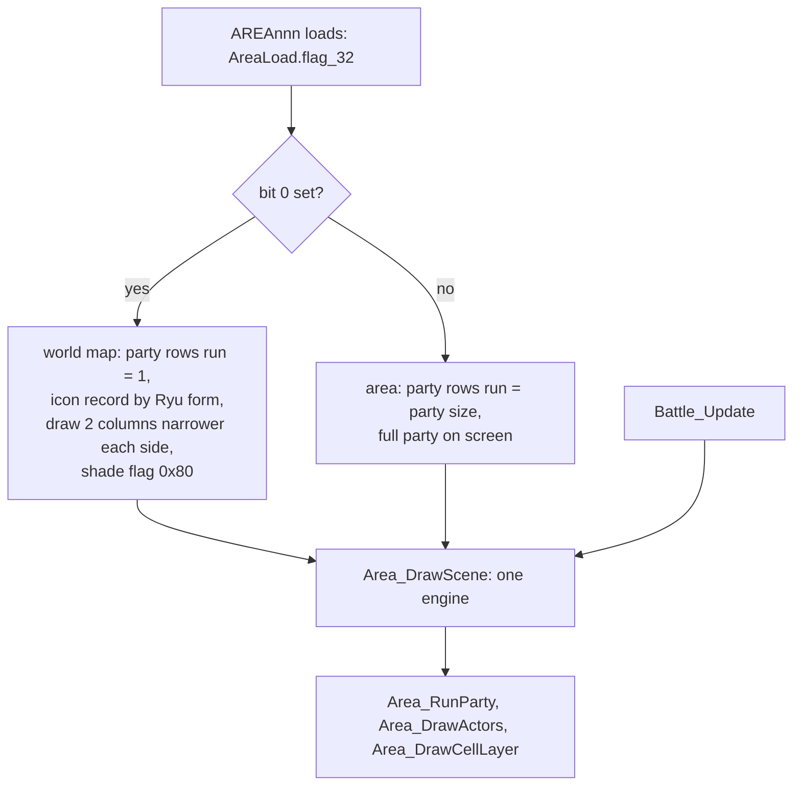

# Runtime

*Read this if you need load addresses, program families or the boot and title flow.*

Targets, load addresses, overlay families, the boot and loader path, and the frontend flow of the
retail game. The SDK release the
retail link used: [PsyQ SDK](#psyq-sdk).

An image is one program the game loads: the main executable, the logo executable, or the code held in one EMI entry. An image is identified by its payload, load address and id. Equal addresses in two images are unrelated. Read the load address from the image's own layout before citing an address; the executable's PS-X header carries `t_addr` at `0x18`.

## Images

An image id has the form `exe/<name>` or `emi/<family>/<archive>/<slot>`. It names one payload and one load address, so `emi/<family>/<archive>/<entry>` is the overlay held in that archive entry. An image may also reserve zero-fill regions, copy a range to another address, and call into companion overlays.

Names belong to one owner: the SDK libraries, the BIOS, the main executable `exe/slus_004_22` (shared with every EMI image), `exe/logo`, and the image itself where it has local names. There is no global name map.

Each image loads at one address. The load addresses by program family:

| Load address | Images                                                                                                                                                                                                                                |
| -----------: | ------------------------------------------------------------------------------------------------------------------------------------------------------------------------------------------------------------------------------------- |
| `0x80096800` | `exe/slus_004_22` image base (PS-X header `t_addr`; code and data occupy only `0x80149800..0x8018B2B4`, see [executable layout](#executable-layout)); `emi/battle/battle/15` (battle command-menu overlay, loaded beside `battle/03`) |
| `0x800C1800` | `emi/boss/*`: boss battle module programs                                                                                                                                                                                             |
| `0x80195800` | `emi/etc/game/00`: resident game core (actors, scene and state tables, camp and status menu panels); the title is `emi/etc/game/01`, the save screens `emi/etc/shop/00`, the load screens `emi/etc/start/08`                          |
| `0x801CE000` | `exe/logo`: logo sequence player (independent executable)                                                                                                                                                                             |
| `0x801CE400` | `emi/plchar/*`: character code overlays                                                                                                                                                                                               |
| `0x801D0C00` | `emi/battle/battle/03` (main battle program); `emi/etc/{bate,commu01-05,game/01,shisu,shop,sisyou,start/08}`; `emi/scenario/sce10eff`, `sce15ef0-3`; `emi/world00/area030/04`                                                         |
| `0x801EEC00` | `emi/bmagic/*` (battle-effect modules); `emi/battle/{batl_end,batl_ovr}`; `emi/etc/commu00/00`, `emi/etc/start/09`                                                                                                                    |
| `0x801F2C00` | `emi/world0N/area*`: world area code                                                                                                                                                                                                  |
| `0x801F6C00` | `emi/scenario/scenaNN`: scenario controllers                                                                                                                                                                                          |
|        other | `emi/battle/batl_re2/01` at `0x80036E00` and `emi/etc/bate/03` at `0x80033A00`: 512-byte CLUT banks (assets, no code); `emi/world00/area030/05` at `0x800F5000`; `emi/world01/area049/13` at `0x80117000`                             |

Overlay bases repeat across families; always name the image with the address. A data-only image
has one segment and no function boundary.

### Program families

A family is the set of code entries the loader copies to one address. Its members share a load
address, a name map and the rule that finds the first function. A payload byte-identical to an
earlier member at the same load address is a copy: it keeps its own disc entry and reuses the earlier member's
code and data. A byte-identical payload at a different load address is a
relocated program with its own layout, not a copy.

The load address does not detect a family. The first function starts at a `lui`, a frame prologue
or a bare return, and the chain follows returns. A payload with no stack prologue and no `jr $ra` is
data and links as one data block, even when a coverage sweep counts its bytes as code. The WORLD
area program family at `0x801F2C00` has 200 entries: 181 code programs and 19 data blocks.

### Module windows

Two destinations hold swappable game modules rather than one program family. Every payload starts
with a `u32` module id, the word the type-0 loader compares with the archive TOC cache
([EMI](../formats/emi.md)). Across the two windows the ids run `0x11E`-`0x1BF`.

| Window       | Reservation                                           | Entries | Content                                    |
| ------------ | ----------------------------------------------------- | ------: | ------------------------------------------ |
| `0x800C1800` | `slot_800c1800_boss034`, `0x33800` bytes, stamp `0xA` |      40 | boss battle modules                        |
| `0x801EEC00` | inside the `overlay_arena` reservation                |     157 | battle-effect, battle-end and menu modules |

Both windows are reserved regions of the executable image. No executable instruction forms
either address. Battle code enters the BOSS window through the callback table at
`D_801EB298` of `emi/battle/battle/03`: 63 rows holding `0x800C1804..0x800C1EB0` pointers (row 0 is null). The battle-effect modules have no static caller in the executable;
their entry path is unresolved.

After the id, a module head holds strings, thresholds and handler tables; the first dispatched
function follows at the first word that starts with `addiu sp,sp,-N` or with the scratchpad
dispatch `lui r,0x1F80; lw r,0x44(r)`. A dispatch indexes a handler table by the state byte at
`g_SpadWork + 1` (`0x1F800044`). Head length and the code/data split differ per module, so a
image's layout is measured from its own bytes: the head and any data block are data, each code block is code, and a block that does not read as code is data.

In the 124 battle-effect modules the id runs `0x144`-`0x1BF`, one per archive, and the head length
runs 4 to 76 bytes. After the id the head is a variable-length callback table: its words are
addresses of functions in the same module (one module carries two constants after three callbacks).
The module entry copies three consecutive callbacks and calls the one the spad step byte selects;
that triple is the head's first three callbacks in 27 modules and sits at +0x10 to +0x4C in the
other 11. The modules call the PsyQ GTE and GPU functions (`rsin`, `rcos`, `GetGraphType`,
`SetDrawMode`, `SetSemiTrans`), the SLUS graphics helper `GfxAppendPrim` and the resident battle
overlay (`0x801E5988` in `battle/battle/03`, `0x800A9820` in `battle/battle/15`); some modules select the step
with byte 2 instead of byte 1.

### Executable layout

The `exe/slus_004_22` header declares `t_addr = 0x80096800`, `t_size = 0x160800` and initial PC
`0x8014AA0C`. The image is mostly reservation. Code and data sit at `0x80149800..0x8018B2B4`
(image offsets `0xB3800..0xF52B4`). Below them the reservations at `0x80096800` (`0x2B000` bytes), `0x800C1800` (the boss window), `0x800F5000` (`area030/05`) and `0x80117000` hold the
windows other images load into; above them the overlay arena (image offset `0x13A400`) and the tail padding are
zero-filled except for stamp words.
`emi/battle/battle/15` loads into the first window, so it is resident beside `battle/03`
(`0x801D0C00`); the two share the action-slot table at `0x801EC330` ([battle](battle.md)).

## Runtime layout

`SYSTEM.CNF` selects `SLUS_004.22`. `LOGO/LOGO.EXE` is a separate PS-X executable loaded
independently. An EMI archive contains independently loaded code and data entries; the archive is
never an image.

### Boot and frame loop

`SYS_Main` (`exe/slus_004_22@0x8014AAC8`) is the frame loop. Startup calls `__main`,
`SYS_InitRuntime` (`@0x8014ACA0`) then `SYS_RunLogo` (`@0x8014AEE0`). `SYS_InitRuntime`
calls `SYS_InitHardware` (`@0x8014AD28`) first, which initializes the loader at `EMI_LoaderInit` (`@0x80161F58`).
It then calls `SYS_InitDisplay` and runs `SYS_ResetDisplayFrame` twice, once for each `0x90`-byte render
record at `g_GfxDisplayFrames` and `g_GfxDisplayFrames + 0x90`.
`SYS_RunLogo` executes `LOGO/LOGO.EXE` and calls `SYS_InitHardware` again after it returns.

Each frame draws through the record at `g_GfxCurrentDisplayFrame`: display environment at `+0`, draw environment
at `+0x14`, ordering table cleared at `+0x70` for eight entries, head at `+0x8C`. The loop toggles
`g_FrameBufferIndex` and selects `g_GfxDisplayFrames + g_FrameBufferIndex * 0x90`. It calls `EMI_LoaderService`
(`@0x80163010`) once per frame.

| Function                                  | Role                                                                                  |
| ----------------------------------------- | ------------------------------------------------------------------------------------- |
| `SYS_Main` (`@0x8014AAC8`)                | frame loop; `EMI_LoaderService` once per frame                                        |
| `EMI_LoaderService` (`@0x80163010`)       | `g_EmiServiceMode == 1` calls `EMI_LoaderServiceStream`; `== 2` calls `SND_ServiceXa` |
| `EMI_LoaderServiceStream` (`@0x8016305C`) | drains queued callbacks through the six-entry vector `g_EmiSlotDrainFuncs`            |
| `SND_ServiceXa` (`@0x801638B0`)           | indirect-dispatches the current XA CD state through `g_XaStateFuncs`                  |

`g_EmiServiceMode` selects the loader service, not a game mode: `0` from `@0x80161F58`, `1` from
`@0x80161FDC`, `2` from `@0x801636A0`. The callback vector holds
`0x80163230, 0x8016327C, 0x80163238, 0x80163378, 0x80163418, 0x80163698`. `SND_ServiceXa` is the
XA audio state machine; it loads no EMI entry ([loading](architecture/loading.md)). The state
byte `g_EmiServiceState` (`g_EmiServiceState`) indexes:

| State | Operation                                                                                    |
| ----: | -------------------------------------------------------------------------------------------- |
|   `0` | clear timer `D_8014681C` and status `D_8014682E`                                             |
|   `1` | set CD mode `0xC8`, seek; accepted seek -> `2`                                               |
|   `2` | negative status retries `1` or moves `8`; nonzero -> `3`                                     |
|   `3` | set CD filter, issue `CdlReadS`; accepted -> `4`                                             |
|   `4` | negative status retries `3` or moves `8`; nonzero advances the counter, `>= 6` -> `5`        |
|   `5` | alternate status checks and CD-position conversion; `D_80146810` -> `6`                      |
|   `6` | issue `CdlPause`; accepted -> `7`                                                            |
|   `7` | negative status retries `6` or moves `8`; nonzero resets to `0`, sets `g_EmiStreamState = 3` |
|   `8` | wait for `CdSync`; completed -> `6`                                                          |

The slot-LBA vector is `g_EmiSlotLbas`; `g_EmiSlotLbas + slot * 4` yields the shipped LBA, and
`EMI_LoaderSlotLba` (`exe/slus_004_22@0x80162160`) indexes it directly. The RNG entry is the PsyQ symbol `rand`
at `0x8017E3D4`, a BIOS `A0:2F` thunk (`A0:3F` at `+0x10`).

The frame loop enters its reset branch while `(g_InputHeld & (PADselect | PADstart)) == 0x900`
(`g_InputHeld` is `g_InputHeld`). `g_SysResetHoldFrames` (`g_SysResetHoldFrames`) counts to `60` and waits
there until `EMI_LoaderIsReady()` succeeds. Then `SND_Exit` (`@0x8015CEBC`) and `CallbackStopAll`
(`@0x8014B33C`) run, and `CallbackRegister(0, SYS_StartFrontend)` restarts the frontend. Select
plus Start held for 61 frames is a soft reset.

### Load path

1. Resolve a logical slot to a disc LBA.
2. Read and validate the EMI header.
3. Compute the aligned entry offset.
4. Dispatch by entry type.
5. Stream into RAM, graphics or audio state; transfer control separately when the payload is
   executable.

## EMI loader

The loader is the contiguous SLUS range `0x80161F58..0x80162D9C`. Functions outside it are callers
or neighboring EXE services. The entry type selects the handler:

|      Type | Handler      | Function                  | Role                   |
| --------: | ------------ | ------------------------- | ---------------------- |
|       `0` | `0x801625E4` | `EMI_LoaderCopyPayload`   | direct RAM copy        |
|  `1`, `2` | `0x80162618` | `EMI_LoaderQueuePayload`  | queued RAM load        |
|       `3` | `0x80162698` | `EMI_LoaderLoadGraphics`  | graphics upload        |
|  `4`, `5` | `0x80162500` | `EMI_LoaderReadToc`       | shared special path    |
|       `6` | `0x80162790` | `EMI_LoaderLoadVabHeader` | VAB header             |
|       `7` | `0x80162898` | `EMI_LoaderLoadVabBody`   | VAB body               |
|       `8` | `0x801629F0` | `EMI_LoaderLoadVabCues`   | auxiliary audio buffer |
| `9`, `10` | `0x80162A6C` | `EMI_LoaderLoadSequence`  | sequence-side copy     |

| Address      | Function                   | Role                                 |
| ------------ | -------------------------- | ------------------------------------ |
| `0x80161F58` | `EMI_LoaderInit`           | initialize EMI/CD loader state       |
| `0x80161FDC` | `EMI_LoaderStreamInitSlot` | begin an EMI stream                  |
| `0x80162160` | `EMI_LoaderSlotLba`        | read a slot-table LBA                |
| `0x80162178` | `EMI_LoaderBeginRead`      | initialize a transfer                |
| `0x801621E8` | `EMI_OnCdSync`             | CD sync callback                     |
| `0x80162230` | `EMI_OnCdReady`            | service the active entry             |
| `0x80162D00` | `EMI_LoaderIsReady`        | return whether loader state is ready |

`exe/slus_004_22@0x8016728C` (`EMI_StreamFamilyArchive`) maps a content family/index to a slot and starts its
stream. It adds slot biases `0x26A`, `0x1DB`, `0x1EE`, `0x27D` for family values `0..3`; family `3`
leaves `g_EmiStreamHint` unchanged, family `0` stores `index | 0x80`, families `1` and `2` the plain
index. Family `0` is the `PLxxx` bank, `1` the `BPLDxxx` bank, `2` the `BPLUxxx` bank and `3` the
`PLPxxx` code archive (slot ids 618, 475, 494 and 637 are `PL012`, `BPLD012`, `BPLU012` and `PLP012`
in the disc list; see [EMI disc slot ids](../formats/emi.md#disc-slot-ids)). `@0x80166F84` resolves
a three-byte family key through `@0x80166FF8` and calls `EMI_StreamFamilyArchive` only when the cached hint
differs.

A static call can reach a separate companion
image. `emi/world00/area030/04` calls `0x801E0C28 -> 0x800F500C` into the independently
bootstrapped `emi/world00/area030/05` (`0x800F5000`, `0x2250` bytes). The call proves a static
call target in the extracted payload only; it does not prove concurrent residency, load order,
ABI or entry ownership.

## Frontend flow

`emi/etc/game/01` owns the title and New Game/Load presentation loop;
`emi/etc/game/00` and `emi/scenario/scena16/00` participate in later transitions. The entry point
is `Game_RunTitle` (`emi/etc/game/01@0x801D0C04`: clear the window state, run the eight-handler
loop). `Scene_RunEffect` (`emi/scenario/sce10eff/00@0x801D0C10`) is the entry of a different
overlay, the effect handler selected by the work byte; its caller is unknown. Addresses are
image-local.

| Function                                              | Transition                                                                                                                 |
| ----------------------------------------------------- | -------------------------------------------------------------------------------------------------------------------------- |
| `Game_BeginTitle (emi/etc/game/01@0x801D0C90)`        | select layout bank 2, request `DEMO.EMI`, wait for the loader, initialize title fade/window state                          |
| `Game_WaitTitleFade (emi/etc/game/01@0x801D0D5C)`     | wait for fade phase 2, arm a 360-tick timer                                                                                |
| `Game_AdvanceTitleFade (emi/etc/game/01@0x801D0D94)`  | at expiry select fade phase 3, open the window phase, arm 900 ticks                                                        |
| `SND_StartTitleBgm (emi/etc/game/01@0x801D0DF0)`      | at expiry enter local mode 0, open the selection effect                                                                    |
| `UI_HandleStartButton (emi/etc/game/01@0x801D104C)`   | intercept Start; early path to state 2, later open-popup closes the mode, queues cue `0x105`, goes to state 7              |
| `Game_StartSelectedGame (emi/etc/game/01@0x801D0E54)` | after the selection effect closes, reset phases, initialize `etc/game/00`, request scenario index 16 through `Scene_Start` |

`@0x801D12CC` (`UI_DrawChoicePanels`) draws the New Game/Load prompt panels.

`Scene_Start` (`emi/etc/game/00@0x801A7704`) stores scenario index 16, waits for its SCENA
payload, then enters scenario-local dispatch. In `emi/scenario/scena16/00`, `0x801F6D90` branches on
the current area identifier for area IDs 2, 4 and 31. Scene 16 and area 31 are not shown to be one
identifier.

The 900-tick expiry does not launch an inactivity demo. At expiry
`SND_StartTitleBgm (emi/etc/game/01@0x801D0DF0)` opens the selection effect, and `Game_StartSelectedGame`
(`@0x801D0E54`) calls `Scene_Start(16)` once the effect closes, then registers `Game_RunMainLoop`.

Open questions: the New Game path into name entry; the name editor's owner (the mutable
character record is `0x80144968`, name bytes `0x00..0x04`). The `etc/game/00` callback tables at
`0x801C7B08`, `0x801C7B14`, `0x801C7B44`, `0x801C7B54`, `0x801C7B7C`, `0x801C7B88`, `0x801C7B98`,
`0x801C7BA4`, `0x801C7BB0` are initialised data in the payload (offsets `0x32308..0x323B0`:
`g_GameCampMenuLoad`, `g_GameStates`, `g_GameEntryHandlers`, `g_GameModeHandlers`,
`g_GameStateHandlers`, `g_GameSubstateHandlers`, `g_MenuAbilityOpen`, `g_MenuStatusOpen`,
`g_GameFlowHandlers`). No code writes them; the load fixes the
handlers.

## Loader transfer slot

| Object            | Offset | Width | Field          |
| ----------------- | -----: | ----: | -------------- |
| EMI transfer slot | `0x00` |     4 | size           |
|                   | `0x04` |     4 | remaining size |
|                   | `0x08` |     4 | read offset    |
|                   | `0x0C` |     2 | state          |

Minimum size `0x10`.

The battle work records are in [battle](battle.md).

## Map modes and the shared map engine

The game has one resident map engine. The world map and the area
maps are both AREA images that it runs; a flag in the area's load entry selects the world-map
variant.

### Which image is which

`g_AreaLoads[area_id]` (old `g_MapLoadTable`, `exe/slus_004_22@0x8017F974`, 200 entries) points to an
`AreaLoad` entry in the area's own image. Byte `+0x32` (`flag_32`, `AreaLoadFlags`) is the map kind:

| Bit    | Kind                        | Areas (retail)                                        |
| ------ | --------------------------- | ----------------------------------------------------- |
| `0x01` | world map                   | 016, 033, 045, 065, 087, 088, 104, 115, 121, 151, 152 |
| `0x06` | random battlefield          | 020, 029, 063, 064, 072, 073, 110, 124, 125           |
| `0x08` | fishing area                | 030, 089, 129                                         |
| `0x10` | fairy village (COMMU00 map) | 175-185                                               |
| `0x20` | open; set with `0x01` only  | 104, 121                                              |
| `0x40` | camp scenes                 | 090, 153, 154, 187, 191, 192                          |
| `0x00` | walked area (town, dungeon) | the other 160, including AREA000                      |

AREA000 is McNeil, not the world map. Each world map pairs with its battlefield in
`WorldMapBattlefield` (`emi/etc/game/00@0x801CD224`, 10 rows of two `u16`: world-map area, paired battlefield area): 16>20, 33>29, 45>63, 65>64, 87>72, 88>73,
115>110, 121>20, 151>124, 152>125.

### What the flag changes

The three forks, by function:

| Function                                                                                        | Fork                                                                                                                                                                                                                                                                                                                                                                                                                |
| ----------------------------------------------------------------------------------------------- | ------------------------------------------------------------------------------------------------------------------------------------------------------------------------------------------------------------------------------------------------------------------------------------------------------------------------------------------------------------------------------------------------------------------- |
| `func_801BFF9C (emi/etc/game/00@0x801BFF9C)`, party rows                                        | When the map is not loading and `flag_32 & 9` is set (or the area is `0xBD`, `0xBB` or another listed one), the party row count is 1. With `flag_32 & 1` set, `Area_FindSceneRecord` then runs for the record `0x52` (Ryu form byte `D_8014496D` is 0), `0xCB` (form 9) or `0x27A` (form 7, adult Ryu); any other form runs no lookup. Otherwise the count is the return of `Party_CountOrder(0)`, the whole party. |
| `func_801530D0 (exe/slus_004_22@0x801530D0)`, `Area_DrawCellLayer (exe/slus_004_22@0x80155B40)` | With `flag_32 & 1` set, the skipped columns are the column count minus 2, at least 0.                                                                                                                                                                                                                                                                                                                               |
| `func_80153DE8 (exe/slus_004_22@0x80153DE8)`, shading and camera                                | The shade flag is `0x80` when `flag_32 & 1` is set, else 0. The camera height is 0 when `flag_32 & 8` is set, else `Area_ReadHeight(x, y)`.                                                                                                                                                                                                                                                                         |

### Renderer

One renderer, GTE-rotated textured quads, for both kinds and for battle: `func_80153DE8` builds a
56 x 28 grid of `POLY_FT4` cells, `Area_DrawCellLayer` walks it, `Area_DrawParts` and
`Area_DrawGouraudQuads` project parts through the GTE, and `Area_DrawScene`
`Area_DrawScene (exe/slus_004_22@0x8014BA54)` runs the record list, `Area_DrawActors` and the cell layers. There is no
separate flat-cell renderer for area maps.

### Shared engine and tags

| Tag        | Meaning                                                             | Examples                                                        |
| ---------- | ------------------------------------------------------------------- | --------------------------------------------------------------- |
| `Area`     | the resident map engine and anything an AREA image runs             | `Area_DrawScene`, `Area_RunParty`, `Area_Update`, `g_AreaLoads` |
| `WorldMap` | code or data only the 11 world-map images use                       | `WorldMap_StartScene`, `WorldMapBattlefield`, `WorldMapPoint`   |
| `World`    | a whole WORLD## archive: folder names and `WORLD0N_FAMILY_H` guards | `world00`                                                       |

`Field` is retired. The `Actor` rows `Area_RunParty` steps (`D_80147A58`, four rows) are the party's
map objects in every map kind and in battle.

### Measurement

The map-kind table is measured over all 200 `AreaLoad` entries: the pointer table at
`g_AreaLoads` gives each entry's address in its area image, and `flag_32` is the byte at `+0x32`.

## PsyQ SDK

The retail link used PsyQ 3.7 for every runtime library. Of 732 SDK units, 728 reproduce from a 3.7 library member object, and 4
have no member object that reproduces them: `2MBYTE.OBJ`, `NONE3.OBJ` and
the LIBGTE `MSC01`/`MSC02` span. `slus_004_22` and `logo` link all their SDK code; the EMI overlays
link none and call the main executable. Both executables carry the SCE 3.7 version word
`DA 94 37 00` at `0x8017ED10` (`0x801D7940` in `LOGO.EXE`).

| Library                                 | Evidence for 3.7 objects and headers                                     |
| --------------------------------------- | ------------------------------------------------------------------------ |
| LIBGPU                                  | `getTPage`/`setDrawTPage` call `GetGraphType`; all units reproduce       |
| LIBGTE                                  | all units reproduce (`rsin`, `rcos` included)                            |
| LIBAPI                                  | 3.7 declares `Exec`, `EnterCriticalSection`, `SystemError`, `_card_chan` |
| LIBC                                    | identical export set in every release compared; 3.7 declarations         |
| LIBCARD                                 | 3.6, 3.7 and 4.0 export the same 20; 3.7 declares them                   |
| LIBCD, LIBETC, LIBSND, LIBSPU, LIBPRESS | every unit reproduces                                                    |
| LIBGS, LIBMATH, LIBSN, LIBSIO, LIBGUN   | 3.7 exports reproduce or are contained in 4.0's set                      |
| LIBCOMB, LIBTAP                         | 3.7 exports contained in 4.0's set                                       |

Two declarations the retail release provided and 3.7 omits: `checkRECT(char *, RECT *)` (retail
`0x8017B438`) and `s32 GetGraphType(void)` (retail `0x8017B2B4` reads no argument). 3.7 declares
`sprintf(char *, char *, ...)`.

The SLUS loader's `D_80146518` is an address-backed view at `g_EmiStreamState + 0x84`; `EMI_LoaderTransferVabBody` (`exe/slus_004_22@0x80163418`)
indexes it and `EMI_OnCdReady` (`exe/slus_004_22@0x80162230`) writes the same slots as word `0x21 + slot` of `g_EmiStreamState`.

## Sources

Addresses, module windows and call paths are measured from the retail executable and overlays. The
community RAM structures that confirm the field-side records are in
[game records](records.md#community-ram-map); the library names are PsyQ 3.7 ([sources](../sources.md)).
