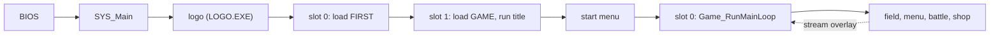

# Game architecture

This section explains how Breath of Fire III (NTSC-U) runs, from power-on to a running frame. The game is one resident executable, one resident game program and a large set of overlays that the game streams from the disc into fixed RAM windows. Each page below covers one part of that, and this page tells the whole story once, in order. Claims carry the evidence tags that the [conventions](conventions.md#evidence-tags) defines. A claim with no tag is read directly in the code.

## From power-on to a running frame

The PlayStation BIOS loads `SLUS_004.22` and jumps to its first instruction. A short C runtime stub clears the BSS, sets the stack and calls `SYS_Main`. `SYS_Main` starts the hardware, builds two display buffers and plays the Capcom logo. The logo is a second program, `LOGO.EXE`, which the executable loads into RAM and runs with `Exec`. When it returns, `SYS_Main` registers a first callback and enters a loop that never ends. [Boot](systems/boot.md) covers this part.

Every pass of that loop does the same thing. It waits for the display, swaps the two buffers, draws what the last pass built, runs the game logic and builds the next set of primitives. The loop runs 30 passes per second. The game logic is not called directly. It lives in four cooperative callback slots that the loop runs in turn, and a slot's code runs until it yields or exits. The [frame loop](systems/frame-loop.md) page explains one pass and the [scheduler](systems/scheduler.md) explains the slots.

The first callback loads the first archive, `FIRST.EMI`, with the EMI loader, and then registers a second callback in the next slot. That callback loads `GAME.EMI`, which holds the resident game program and the title overlay, and runs the title. The loader reads the disc in the background of the frame loop, so a callback waits for it with a yield and never blocks a frame. [Loading](systems/loading.md) describes how a request flows through the loader, and [disc and files](formats/disc.md) lists what the disc holds.

From the title, a choice leads to the start menu, which offers a new game or a saved one. Either choice installs `Game_RunMainLoop` in slot 0. That function runs a 12-entry state table once per pass. The field is one state in that table, and menus, battles and shops are the others. Within the field, the area code runs each frame and a story controller (a scenario overlay) drives events. When the game needs more code, such as a battle or a scenario, it asks the loader to stream an overlay into its window, and then calls into it. [Phases](systems/phases.md) follows the transitions, and [memory](systems/memory.md) shows which images share which RAM.

## Reading order

Read the first six pages in order for the mechanism. The rest cover one system each and can go in any order.

| Order | Page                                         | It answers                                                                               |
| ----: | -------------------------------------------- | ---------------------------------------------------------------------------------------- |
|     1 | [Boot](systems/boot.md)                      | What runs between the BIOS handoff and the first title frame.                            |
|     2 | [Frame loop](systems/frame-loop.md)          | What happens in one frame, in what order, and where game code gets control.              |
|     3 | [Scheduler](systems/scheduler.md)            | How the four callback slots and the state-byte tables run game logic.                    |
|     4 | [Memory](systems/memory.md)                  | Which image owns which RAM range, and which overlays share a window.                     |
|     5 | [Loading](systems/loading.md)                | How each kind of data gets from the disc to RAM, VRAM or the SPU, and what blocks.       |
|     6 | [Phases](systems/phases.md)                  | Every phase from power-on to the end credits, with its entry, code and exits.            |
|     7 | [Scenario](systems/scenario.md)              | How the 20 story controllers sit on the field and advance the chapters.                  |
|     8 | [Area](systems/areas.md)                     | How an area loads, arrives, updates each frame and hands over to another area.           |
|     9 | [Battle](systems/battle.md)                  | How a battle starts, runs and returns to the field.                                      |
|    10 | [Screens](systems/screens.md)                | How menus, shops, fishing, the fairy village and the master screen are entered and left. |
|    11 | [UI](systems/ui.md)                          | How a string gets from disc data to a window on screen.                                  |
|    12 | [Rendering](systems/rendering.md)            | How RAM becomes pixels: primitives, VRAM, palettes and sprite colors.                    |
|    13 | [Audio](systems/audio.md)                    | How music, effects and XA reach the SPU, and the budgets they must fit.                  |
|    14 | [Saving](systems/saving.md)                  | What the memory card holds, from which RAM, and what the load path rebuilds.             |
|    15 | [Persistent state](systems/state.md)         | Where the party, inventory, flags and clock live and what survives an overlay swap.      |
|    16 | [Open questions](appendix/open-questions.md) | What the pages above do not establish, with the proof each gap needs.                    |

Three companion pages sit beside these:

| Page                                 | It answers                                            |
| ------------------------------------ | ----------------------------------------------------- |
| [Disc and files](formats/disc.md)    | What the disc holds and where each file sits.         |
| [Responsibilities](data/code-map.md) | Which code image owns which job.                      |
| [Editor guide](guides/editing.md)    | What an editor must keep intact for each asset class. |

System pages list in a limits section the counts, sizes and addresses that an edited asset must stay within. Read those sections and the [editor guide](guides/editing.md) before changing any asset.
