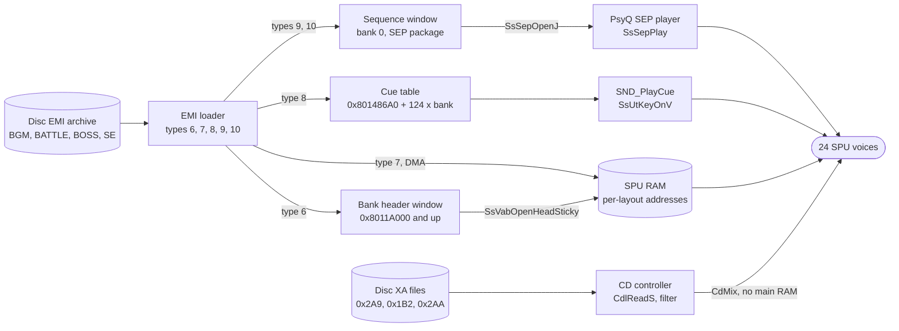

# Audio

The player hears three kinds of sound: music that changes with the area, short effects for menu cursors and spells, and voiced or long recorded effects. The game plays each kind through a different route. Music and effects are sampled instruments held in the SPU's own memory and played by a sequencer or by direct key-on. Recorded speech is streamed from the disc by the CD controller and mixed into the output without touching main RAM.

This page covers the runtime between the disc and the speakers: how banks are loaded into SPU memory, how a music track starts and survives a battle, how an effect cue becomes voices, and how the XA streams are driven. The file formats are in [audio formats](../formats/audio.md). The loader steps that feed this code are in [loading](loading.md), and the RAM windows are in [memory](memory.md#sound-memory).

## Data to SPU

Three routes lead to the SPU. Music and effects both pass through the EMI loader. XA does not touch main RAM.

The CD controller mixes XA into the audio output itself. `SND_SetCdVolume (exe/slus_004_22@0x80163EB0)` sets that mix with `CdMix`.

## Initialisation

`SYS_StartFrontend` calls `SND_Init (exe/slus_004_22@0x8015CD00)`, `SND_SetBankLayout(0)` and later `SND_Start (exe/slus_004_22@0x8015CE70)` ([boot](boot.md)).

- `SND_Init` calls `SsInit`, `SsSetTableSize(D_80148A50, 2, 4)`, `SsSetTickMode` in 60 Hz mode, turns room reverb on, and calls `SsSetAutoKeyOffMode(0)` and `SsSetReservedVoice(0x10)`. It sets the seven VAB ids `D_80148FB0..FB6` to 0 through 6 and the seven SEP owners `g_SelectionFxVoices[0..6]` (`0x80148FC0`) to `-1`. It then calls `SpuSetVoiceAttr` to set volume `0x3FFF` on voices 16 to 23.
- The tick mode argument selects a 60 Hz sequencer step, the NTSC frame rate `[inferred]` from the PsyQ meaning of that mode.
- The first `SsSetTableSize` argument is the sequence table. `func_80197C94` and `func_80197F48` save and restore 1,376 bytes of it, so the table is 1,376 bytes at `0x80148A50`.
- `SND_Start` calls `SsStart2` and sets the master volume to `0x7F` and the serial (CD) volume to `0x6E`.
- `SND_Exit (exe/slus_004_22@0x8015CEBC)` keys off all voices, closes the seven VABs and SEP owners, turns reverb off and calls `SsEnd`.

## Banks

Seven bank records (20 bytes each, at `0x8014677C`) tie a VAB id to a RAM window, an SPU address and a cue table. `SND_SetBankLayout (exe/slus_004_22@0x80161808)` fills them from one of three static layouts. It lays two RAM windows per bank back to back from `0x8011A000`: a header window (`D_8018239C[n][bank]`), then a sequence window (`D_801823F0[n][bank]`). The SPU address comes from `D_80182348[n][bank]`. The cue table pointer is `0x801486A0 + 124 * bank`.

The active layout decides what fits in SPU RAM:

| Layout | Set by                                                                                                                                                | Banks in use | When                         |
| -----: | ----------------------------------------------------------------------------------------------------------------------------------------------------- | -----------: | ---------------------------- |
|      0 | `SYS_StartFrontend`, `Game_StartSelectedGame` and `Game_LeaveTitle` (`emi/etc/game/01`), `func_801D6A14` and `func_801D6F28` (`emi/battle/battle/03`) |            3 | Menus, field, after a battle |
|      1 | `func_80197AA4` (`emi/etc/game/00`)                                                                                                                   |            7 | Battle                       |
|      2 | `Game_BeginTitle (emi/etc/game/01@0x801D0C90)`                                                                                                        |            2 | Title screen                 |

Bank 0 carries the music in every layout, with a different window size in each. Layout sizes are in [Data and limits](#data-and-limits) and in [memory](memory.md#sound-memory) and [loading](loading.md#audio-banks).

An EMI audio entry reaches its bank record in this order:

1. **Type 6** (`EMI_LoaderLoadVabHeader`) copies the VAB header (VH) into the bank's header window. If the bank already owns a SEP (`g_SelectionFxVoices[bank] != -1`), it calls `SsUtAllKeyOff(0)` and `SsSepClose`, and resets the owner to `-1`.
2. **Types 9 and 10** (`EMI_LoaderLoadSequence`) copy the SEP package into the bank's sequence window and set record flag bit 1 (value 2).
3. **Type 8** (`EMI_LoaderLoadVabCues`) copies the cue table into the bank's cue chunk.
4. **Type 7** (`EMI_LoaderLoadVabBody`) sets SPU DMA mode, calls `SsVabClose`, and calls `SsVabOpenHeadSticky(header window, vab id, spu address)`. Ring state 4 then runs `EMI_LoaderTransferVabBody`: `SsVabTransBodyPartly` pushes each ring sector of the body to the SPU, and `SsVabTransCompleted` waits for the DMA.
5. After the transfer, when the record flag is set, `SsSepOpenJ(sequence window, vab id, 4)` opens the package with four sequences and stores the result in `g_SelectionFxVoices[bank]`. The flag clears. A result of `-1` sets the loader error state.

The entry's load argument says which bank record it targets. The `BGM` archives hold types 6, 10 and 7 only, and their `BgmTrack.sep_slot` is 0 in all 165 rows, so music lives in bank 0. The bank targets of the sound-effect archives (the common and battle effect archives) are not traced `[unknown]`.

## Music

`BgmTrack` rows connect a track id to an archive and a sequence. The table `D_80181EB8` (`0x80181EB8`) has 165 rows of 4 bytes: a `u16` `bank_slot`, then `sep_slot` and `sequence` bytes. All 165 rows use `sep_slot` 0. Their `bank_slot` values are 81 distinct archives from `0xD1` to `0x121`, the `BGM` family. `sequence` runs 0 to 3, since a SEP package holds four sequences.

`SND_StartBgm (exe/slus_004_22@0x80161B24)(id, level, shape)` is the field-side entry:

1. `SND_RequestBgm (exe/slus_004_22@0x80161BBC)(id)` compares the `bank_slot` of `id` with that of `g_SndBgmId`. If they differ, or nothing is active, it calls `EMI_LoaderStreamInitSlot(bank_slot)` and returns 1. If they match, the archive is already in bank 0.
2. If it returned 1, `SND_StartBgm` polls `EMI_LoaderIsReady` with `CallbackWait(1)`.
3. If `g_SndBgmId != id`, `SND_PlayBgm (exe/slus_004_22@0x80161C20)` runs `SND_PlaySequence(sep_slot, sequence, 0, 0)`, then `SND_FadeInSequence(sep_slot, sequence, level, shape)`, stores `D_80143F20 = level`, and sets `g_SndBgmId`.

Two tracks of one archive share the load: the second `SND_RequestBgm` returns 0 and only the sequence changes. `0xFF` means no track. `SND_FadeOutBgm (exe/slus_004_22@0x80161CD0)` fades out and stops the track's sequence.

Who starts a track:

| Source                 | Code                                                                                                                                                                                                                                       |
| ---------------------- | ------------------------------------------------------------------------------------------------------------------------------------------------------------------------------------------------------------------------------------------ |
| Area arrival           | `func_8019FAA0` (`emi/etc/game/00`) calls `SND_StartBgm(g_GamePrevSelection, 100, 8)`. `0xFF` clears `g_SndBgmId`.                                                                                                                         |
| Area track id          | `func_801A0380` writes `g_GamePrevSelection` from byte 6 of the area's zone rectangle at the player's cell, or through a flag-conditioned list when byte 7 is nonzero (`D_80181E40`). It keeps the active track when `g_GameFlags & 0x80`. |
| Event script           | `func_801A96E4` (`emi/etc/game/00`) opcodes `0xB4` (`SND_PlayBgm`), `0xB5` (`SND_FadeOutBgm`) and `0xBE` (`SND_StartBgm`).                                                                                                                 |
| Scenario and area code | Direct `SND_PlayBgm`, `SND_RequestBgm` and `SND_FadeOutBgm` calls in `scena00`, `scena16` and area overlays.                                                                                                                               |
| Title                  | `Game_BeginTitle` calls `SND_PlayBgm(0x8D, 100, 8)`.                                                                                                                                                                                       |

The name `g_GamePrevSelection` is misleading: `func_801A0380` writes the track of the area that is about to load, and `func_8019FAA0` reads it. The zone rectangle is described in [area](areas.md#zone-list).

When the area changes to a different track, `Game_RunFieldState` case 5 calls `SND_StartDecrescendo` on the old track (level 100, shape 16) and `SND_StopSequence` after the transition effect. `func_801985C8` does the same for the other exit path.

### Music across a battle

A battle replaces bank 0 and then restores it.

1. `func_80197C94` (`emi/etc/game/00`, battle entry) checks `g_BattleOptions & 0x40` (keep the field music). When it is clear, it sets bit `0x40` of `g_EmiStreamFlags`, whether or not a track is active. When a track is active it also pauses the field sequence with `SsSepPause`, copies the 1,376-byte sequence table `D_80148A50` into `D_8018E268`, and stops the sequence. It then streams the battle archive (slot 6 or 7, or the boss slot).
2. `EMI_LoaderTransferVabBody` sees bit `0x40` and the bank match (`D_80146855` and `D_80146856` are 0, 0) and calls `SND_PlaySequence(0, 0, 100, 100)` as soon as the battle bank is open. The same call restarts the field track after a battle when `func_801D7234` stored its owner and sequence in `D_80146855` and `D_80146856`. The battle music is therefore the SEP package inside the `BATTLE` or `BOSS` archive.
3. At the battle end `func_801D7234` (`emi/battle/battle/03`) waits for the loader and runs the end hook. When the keep-music option (`g_BattleOptions & 0x40`) is clear it calls `SND_StopAllSequences`, sets `g_EmiStreamFlags` bit `0x20`, and, when the result has bit `0x10`, bit `0x40` too. It then re-streams the field track's archive (`D_80181EB8[g_SndBgmId].bank_slot`). Bit `0x20` makes `EMI_LoaderNextRead` skip every entry of type below 6, so only audio entries load.
4. `func_80197F48` (`emi/etc/game/00`, battle exit) copies `D_8018E268` back into `D_80148A50` and calls `SsSepReplay`, `SND_SetSequenceVolume` and `SND_FadeInSequence` on the field track.

Steps 3 and 4 together resume the field track, either from a reloaded bank or from the restored table. The code does not say which path wins when both run `[inferred]`. The bits of `g_EmiStreamFlags` are `0x20` for audio-only reload and `0x40` for auto-play on load. See [battle](battle.md) for the entry and exit states.

## Sound effects

A cue is a 16-bit id: bank in bits 8 to 11, record index in bits 0 to 7. `SND_PlayCue (exe/slus_004_22@0x8015DF18)(id)` stores bank and index, then calls `g_SndCueReaders[bank]`, one of seven readers (`func_8015E994`, `func_8015EFAC`, `func_8015F5C8`, `func_8015FBE4`, `func_80160200`, `func_8016081C`, `func_80160E38`). The reader decodes the 4-byte cue record (voice, program, tone) into up to four voice slots. `SND_PlayCue` then calls `SsUtKeyOnV` once per slot (modes 0 to 3) and, when `D_8018B3F4 == 0x80`, `SsUtSetDetVVol` with the volume cells `D_8018B3D8` and `D_8018B3DC`. The record layout and bank readers are in [audio formats](../formats/audio.md#emi-type-8-cue-records).

- A cue's bank must be 0 to 6. The table has seven entries and `SND_PlayCue` does not range-check a larger bank nibble.
- Event scripts reach cues through opcodes `0xB0` to `0xB3` (`SND_PlayCue(byte | bank << 8)`, banks 0 to 3) and `0xBC` (`SND_QueueCueVolume`, a 16-bit id), both in `func_801A96E4`. `SND_QueueCueVolume (exe/slus_004_22@0x8015D7C8)` loads left and right volume from `D_80182288`, then calls `SND_PlayCue`.
- The volume cells come from `D_80182288` and the tables after it (`D_80182290` to `D_80182308`): 16-bit `0xXXFF` pairs, a stepped ladder. Their use beyond `SND_QueueCueVolume` is not traced `[unknown]`.
- `SND_QueueSelectionFx` clears the four voice-slot cells to `-1`, calls `SND_PlayCue`, and packs the first four voice numbers (5 bits each) into the caller's actor record at `+0x70`, setting flag bit 3. Actors therefore remember the voices they own.

Sequence control of effect packages uses `SND_StopSequence`, `SND_SetSequenceVolume`, `SND_StopAllSequences` (stops the four sequences of every live owner) and `SND_FindFreeFxVoice` (scans the four sequences of owner 0 with `SsIsEos`; its outer loop ends after index 0). Event opcodes `0xB8` to `0xBB` call the sequence functions with script bytes.

## Voices and loudness

- `SND_UpdateVoiceStatus (exe/slus_004_22@0x8015D044)` stores `SpuGetKeyStatus(1 << i)` for `i = 0..23` into `D_8018E140` each frame, called from `SYS_Main`.
- The PlayStation SPU has 24 voices. `SsSetReservedVoice(0x10)` reserves 16 of them for the library, and voices 16 to 23 are prepared as the effect voices `[inferred]`. The reservation meaning is the PsyQ contract.
- `D_80144954` is a duck gate. While it is nonzero, `SND_PlaySequence` starts sequences at volume 0 and the fade-in and decrescendo calls return. `SYS_StartFrontend` and `func_801E18D0` (`emi/etc/start/08`) clear it. Who sets it is not traced `[unknown]`.
- `D_80144951` selects mono: when it is nonzero, `SND_SetCdVolume` halves all four `CdMix` bytes, so each output gets half the level on both channels. Who sets it is not traced `[unknown]`.

## XA streams

XA plays speech and long effects from three disc files, selected by a key. `SND_StartXaStream (exe/slus_004_22@0x801636A0)(key, _)` sets `g_EmiServiceMode = 2` (XA mode in `EMI_LoaderService`) and `g_EmiStreamState = 0` (so `EMI_LoaderIsReady` is false). It clears the request block, calls `SND_ResolveXaStream (exe/slus_004_22@0x80163744)(key)`, converts the start LBA with `CdIntToPos`, and installs `SND_StoreXaSyncResult` as the CD sync callback. The second argument is unused.

`SND_ResolveXaStream` turns the key into a file, a channel and a sector range:

- The group is `key >> 12` and the index is `key & 0xFFF`. The file is `g_EmiSlotLbas[D_80183230[group]]`, that is loader slot `0x2A9` (group 0), `0x1B2` (group 1) or `0x2AA` (group 2).
- Each group has a `u16` table (`D_8018323C[group]`: `D_801839C4`, `D_801832C4`, `D_80183298`). The code walks `index` entries. An entry with bit 15 set skips one extra `u16` and adds 1 to a channel counter (`D_80146835`).
- The start sector is `base + (entry & 0x7FFF) * scale + channel`, with `scale` 8 for group 0 and `0x10` for the others. The stop bound is the same expression for the next entry, minus `0x96` (150 sectors). The 150 is probably the CD pregap offset of the position conversion, one table entry is a track start in units of interleaved sectors, and the counter is the XA channel `[inferred]`.
- `CdlSetfilter` is sent with file `1` and that channel `[inferred]` from the parameter block at `D_80146834`.

`SND_ServiceXa (exe/slus_004_22@0x801638B0)` runs one state of `g_XaStateFuncs[state]` per frame, called by `EMI_LoaderService` while `g_EmiServiceMode == 2`, then increments a timer `D_8014681C`:

| State | Function                  | Action                                                                                                    |
| ----: | ------------------------- | --------------------------------------------------------------------------------------------------------- |
|     0 | `SND_XaStateIdle`         | Clear timer and status.                                                                                   |
|     1 | `SND_XaStateSeek`         | `CdlSetmode` double speed, real time, subheader filter (`CdlModeSpeed\|CdlModeRT\|CdlModeSF`), `CdSeekP`. |
|     2 | `SND_XaStateSeekResult`   | A negative status retries state 1 or goes to 8. Success goes to 3.                                        |
|     3 | `SND_XaStateRead`         | `CdlSetfilter`, `CdlReadS`.                                                                               |
|     4 | `SND_XaStateReadProgress` | A negative status retries 3 or goes to 8. Success goes to 5.                                              |
|     5 | `SND_XaStateReadResult`   | `CdlGetlocL` every second call. When the position reaches the stop bound, go to 6.                        |
|     6 | `SND_XaStatePause`        | `SND_FadeCdVolume(0)`, `CdPause`.                                                                         |
|     7 | `SND_XaStatePauseResult`  | Success: state 0, `g_EmiStreamState = 3`, clear the sync callback.                                        |
|     8 | `SND_XaStateWaitSync`     | Wait for `CdSync`, then back to 6.                                                                        |

A timer above 181 ticks returns to state 1 and counts a retry. The sixth retry, or a CD error bit, sends the machine to state 8. Streaming ends by stopping at the stop bound, not by an end marker in the data. State 7 sets the loader's ready byte to 3, so `EMI_LoaderIsReady` is false for the whole stream, and none of the callers waits for it first ([loading](loading.md#xa-audio)).

XA callers are the scene scripts (opcode `0x89` in `func_801AB458`, key from the script), `Scene_RunShopSaveEvent` (key 0), `func_801A83DC` (key 9), the shop and save screens (key 0), `commu00` (keys 8 and 10), and battle (`func_801DDF50` in `emi/battle/battle/03`, key `0x1000 + n` from an effect table).

## Data and limits

| Limit                     | Value                                                                                                        | Source                                     |
| ------------------------- | ------------------------------------------------------------------------------------------------------------ | ------------------------------------------ |
| Track ids                 | 165, 81 archives `0xD1` to `0x121`, `sequence` 0 to 3                                                        | `D_80181EB8`                               |
| Sequences per package     | 4                                                                                                            | `SsSepOpenJ(.., 4)`, `SND_FindFreeFxVoice` |
| Open SEP packages         | Seven owner slots, `SsSetTableSize(.., 2, 4)`                                                                | `g_SelectionFxVoices[7]`, `SND_Init`       |
| Concurrent sequence limit | 2 packages by the table size `[inferred]`; the arguments' meaning is the PsyQ contract                       | `SND_Init`                                 |
| Sequence table            | 1,376 bytes at `0x80148A50`                                                                                  | `func_80197C94`, `func_80197F48`           |
| VAB banks                 | 7 (ids 0 to 6)                                                                                               | `SND_Exit`, `SND_SetBankLayout`            |
| SPU voices                | 24 polled, 16 reserved, effect voices 16 to 23 prepared `[inferred]`                                         | `SND_UpdateVoiceStatus`, `SND_Init`        |
| Cue banks and records     | Bank nibble indexes 7 readers. 31 records per bank chunk (`124` bytes). A disc entry has at most 24 records. | `g_SndCueReaders`                          |
| Voices per cue            | 1 to 4 `SsUtKeyOnV` calls (layer bits)                                                                       | `SND_PlayCue`                              |
| XA files                  | Three: slots `0x2A9`, `0x1B2`, `0x2AA`. Keys use 12 bits of index.                                           | `D_80183230`, `SND_ResolveXaStream`        |
| XA timeout                | 181 ticks, 6 retries                                                                                         | `SND_ServiceXa`                            |
| Volume                    | Master `0x7F`, serial `0x6E`                                                                                 | `SND_Start`                                |

### RAM and SPU budget per layout

Each bank has a header window and a sequence window in main RAM (sizes in bytes, from `D_8018239C` and `D_801823F0`) and an SPU start address (`D_80182348`). The SPU body of a bank may extend up to the next bank's start; the spans below are that subtraction `[inferred]`.

| Layout | Bank | Header window | Sequence window | SPU start | SPU span to next bank               |
| -----: | ---: | ------------: | --------------: | --------: | ----------------------------------- |
|      0 |    0 |      `0x2A20` |        `0xC3A0` |  `0x1010` | `0x3D090` (250,000)                 |
|      0 |    1 |      `0x1020` |               0 | `0x3E0A0` | `0x11170` (70,000)                  |
|      0 |    2 |      `0x1220` |        `0x1000` | `0x4F210` | To the end of SPU RAM, `<= 0x30DF0` |
|      1 |    0 |      `0x2620` |        `0x8D60` |  `0x1010` | `0x3D090` (250,000)                 |
|      1 |    1 |       `0xE20` |               0 | `0x3E0A0` | `0x14050` (82,000)                  |
|      1 |    2 |       `0xC20` |               0 | `0x520F0` | `0x9080` (36,992)                   |
|      1 |    3 |      `0x1020` |               0 | `0x5B170` | `0x7920` (31,008)                   |
|      1 |    4 |      `0x1020` |               0 | `0x62A90` | `0x7910` (30,992)                   |
|      1 |    5 |      `0x1020` |               0 | `0x6A3A0` | `0x7920` (31,008)                   |
|      1 |    6 |      `0x1A20` |               0 | `0x71CC0` | To the end, `<= 0xE340`             |
|      2 |    0 |      `0x3020` |        `0xD3A0` |  `0x1010` | `0x6B6C0` (440,000)                 |
|      2 |    1 |      `0x1220` |               0 | `0x6C6D0` | To the end, `<= 0x13930`            |

The round decimal spans (250,000, 70,000, 82,000, 440,000) suggest designed budgets `[inferred]`.

What an edited audio asset must stay within:

- **VAB header (VH).** A VH is `0xA20 + ps * 0x200` bytes ([audio formats](../formats/audio.md#bank-layout)). The header window sets the program count `ps`. Bank 0 allows `ps <= 16` in layout 0, `<= 14` in layout 1 and `<= 19` in layout 2. In layout 0, bank 1 allows 3 and bank 2 allows 4. The loader functions copy sectors with no size check that this reading found `[inferred]`.
- **VAB body (VB).** It must fit the SPU span of its bank and layout above. SPU RAM is 512 KiB (`0x80000`) and the table starts at `0x1010`. The reverb work area also occupies the top of SPU RAM in room mode, which is the PsyQ contract `[inferred]`. The loader reports an error only when `SsVabOpenHeadSticky` or `SsSepOpenJ` returns -1.
- **SEP package.** It must fit the bank's sequence window (bank 0: `0xC3A0` in layout 0, `0x8D60` in layout 1, `0xD3A0` in layout 2) and hold 4 sequences. A track archive replaces bank 0, so battle music (`BATTLE`, `BOSS` archives) uses the layout 1 limit `[inferred]`.
- **Cue table.** At most 24 records per disc entry and 31 per bank chunk. Each record's voice field is 0 to 23.
- **Track ids.** A new track needs a new row in `D_80181EB8` (executable data, 165 fixed rows) and the archive slot in the disc table `g_EmiSlotLbas` ([disc and files](../formats/disc.md)). Enlarging the table is a code change; see the [guide to editing sound](../guides/sound.md).
- **XA.** A key resolves to a table entry, a file and a channel. New speech needs table entries and sectors at the matching positions. The channel interleave factor is 8 (group 0) or 16 (other groups) `[inferred]`.

See also [frame loop](frame-loop.md) for where the loader runs each frame, [area](areas.md) for arrival music and [scenario](scenario.md) for scenario music calls.

## Gaps

| Gap                                                                                         | What would settle it                                                                  |
| ------------------------------------------------------------------------------------------- | ------------------------------------------------------------------------------------- |
| Bank targets of the common and battle effect archives, and which archives fill banks 1 to 6 | Read the load arguments in those archives' type-6 and type-8 entries.                 |
| Whether the loader checks any window or SPU size                                            | Trace `EMI_LoaderCopySector` and the ring stage for a bound against the window sizes. |
| Concurrent open SEP count (`SsSetTableSize` meaning)                                        | PsyQ sound library documentation, or a trace of `SsSepOpenJ` returning -1.            |
| Which of `func_801D7234` and `func_80197F48` resumes the field track                        | Trace the order of both with that option clear and result bit `0x10` set.             |
| Writers of `D_80144954` (duck gate) and `D_80144951` (mono)                                 | Search overlays and `emi/etc/start/08` for stores to `0x80144954` and `0x80144951`.   |
| Meaning of cue volume ladders `D_80182290` to `D_80182308`                                  | Find readers of those tables.                                                         |
| XA group sizes, group 2 callers, and the content of each table entry                        | Read the three tables against the XA file sector map.                                 |
| The seven bank readers' per-bank differences                                                | Read `func_8015E994` to `func_80160E38`.                                              |
| Opcode `0xBD` (`func_8015D820`) in event scripts                                            | Read `func_8015D820`.                                                                 |
