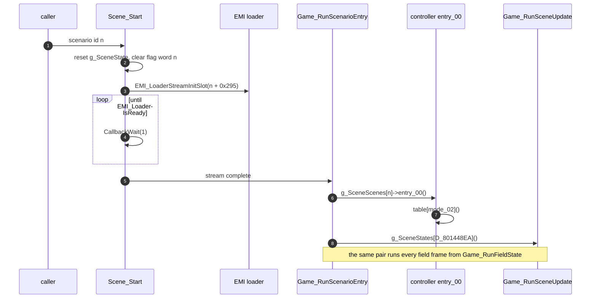

# Scenario engine

The story advances in chapters. The player sees it as a new stretch of the world opening: doors that were shut now open, characters stand in new places, and a cutscene plays when the party walks into the right spot. The game does not keep a script for this. It keeps 20 small programs called scenarios, `SCENA00` to `SCENA19`, and one of them is active at a time. The active scenario decides what each area looks like and what each step into a cell does. A story flag set by the scenario is what opens a door in [areas and the field](areas.md).

The resident field code in `emi/etc/game/00` loads the active scenario into a fixed RAM window and calls it at fixed points of the [frame loop](frame-loop.md). A second, smaller layer, the event stage, runs one-off handlers chosen by an event id. Overlay placement is in [memory](memory.md) and [loading](loading.md).

What each scenario means in the story is not established.

## Starting a scenario

`Scene_Start (emi/etc/game/00@0x801A7704)` takes a scenario number `n` and does four things:

1. Writes `n` to `g_SceneState.scenario_id` and zeroes the rest of the state (`mode_02`, `state_04`, `step_05`, `timer_06`, `flags_01`).
2. Clears the first 32 flags of scenario `n`'s flag word and points `g_SceneFlags` at that word.
3. Streams the scenario's code from EMI slot `n + 0x295` (`Scene_RequestOverlay`), waiting with `CallbackWait(1)` until `EMI_LoaderIsReady` reports done. During the wait it calls `func_801992B8` each frame once an area is loaded and the game state index is not 5.
4. Runs `Game_RunScenarioEntry` once.

After the first entry, `Game_RunFieldState (emi/etc/game/00@0x80197378)` runs `Game_RunScenarioEntry` once per field frame. `func_80199230` and `func_80199368` also call it.

Three places start a scenario:

| Caller                                                | Argument                       | When                                                                                                                             |
| ----------------------------------------------------- | ------------------------------ | -------------------------------------------------------------------------------------------------------------------------------- |
| `Game_StartSelectedGame (emi/etc/game/01@0x801D0E54)` | 16                             | The title selection ends. It also registers `Game_RunMainLoop` in callback slot 0.                                               |
| `Start_RunNewGame (emi/etc/start/08@0x801E2584)`      | 0                              | New Game. It sets `D_801448EA = 0`, `g_GameAreaId = 0xFFFF`, clears the 20 flag words, then `CallbackReplace(Game_RunMainLoop)`. |
| `func_8019FAA0 (emi/etc/game/00@0x8019FAA0)`          | `scenario_id + 1`, skipping 16 | Chapter advance, below.                                                                                                          |

## The controller overlay

`g_SceneScenes (emi/etc/game/00@0x801C8454)` is a table of 20 absolute pointers, one per scenario, into the window `0x801F6C00..0x801FEA80` (32,384 bytes). Every scenario is built for that window, so each pointer is fixed: the `SCENA00` handler block sits at `0x801FC9FC`, the `SCENA16` block at `0x801F8538`.

The first word of each loaded image is its module id, `0x105 + n` (`0x105` for `SCENA00`, `0x118` for `SCENA19`). The type-0 loader checks it against the archive table of contents ([loading](loading.md)).

The pointer in `g_SceneScenes` leads to a handler block of five code pointers. The resident code calls them through the wrapper named in the table.

| Offset | Slot       | Called by                                          | Contract                                                                                                                      |
| -----: | ---------- | -------------------------------------------------- | ----------------------------------------------------------------------------------------------------------------------------- |
| `0x00` | `entry_00` | `Game_RunScenarioEntry`                            | Per-frame controller. `SCENA00` and `SCENA16` read `mode_02` and jump through a mode table.                                   |
| `0x04` | `entry_04` | `Game_DispatchScenarioRecord`                      | `void (record)`. The player talks to or touches an entity whose `callback_index` is set.                                      |
| `0x08` | `entry_08` | `func_801B0E44` through `Area_IsStepBlocked`       | `s8 (x, y)`. A nonzero result blocks the step into the cell. Zero falls back to `func_801A8728`, a switch on the area id.     |
| `0x0C` | `entry_0C` | `func_801B146C` through `func_801A79A4`            | `s8 (x, y)`. A nonzero result overrides the cell test. Zero falls back to `func_801A8B84`.                                    |
| `0x10` | `entry_10` | `func_801B6258` through `Game_CallScenarioHandler` | `s8 (a, b)`, optional. A negative or null result falls back to `func_801A8CB4`, which reads the area hook table `D_801C86F8`. |

The wrappers are `Area_IsStepBlocked (emi/etc/game/00@0x801A7914)`, `func_801A79A4`, `Game_CallScenarioHandler (emi/etc/game/00@0x801A7A34)` and `Game_DispatchScenarioRecord (emi/etc/game/00@0x801A7878)`. A scenario therefore only has to override what differs from the default; the fallbacks cover the rest.

In `SCENA00` the five words are at `0x801FC9FC` and the mode table follows at `0x801FCA10`. `entry_00` (`0x801F913C`) loads `D_80146872` (`mode_02`) and jumps through that table. `SCENA16` stores its handler block as one array: slots 0 to 4, then mode handlers from index 5, then state handlers from index 8, then three `(record, state)` event handlers. The other 18 controllers are not decoded one by one. That `entry_00` starts with a `mode_02` jump in them is `[inferred]`.

### Scenario state

`g_SceneState` (`0x80146870`, 16 bytes) is the controller's working memory.

| Field         | Offset | Use                                                                                              |
| ------------- | -----: | ------------------------------------------------------------------------------------------------ |
| `scenario_id` |   0x00 | Index into `g_SceneScenes` and the EMI slot offset.                                              |
| `flags_01`    |   0x01 | Bit `0x80` requests a chapter advance. Bit `0x20` is set by `func_8019A904`; no reader is known. |
| `mode_02`     |   0x02 | Dispatch byte of the controller.                                                                 |
| `state_04`    |   0x04 | Second-level state, used by `SCENA16` and others.                                                |
| `step_05`     |   0x05 | Third-level step.                                                                                |
| `timer_06`    |   0x06 | Countdown for the step.                                                                          |

`SAVE_RunLoadRestore (emi/etc/start/08@0x801E5FD4)` copies 16 bytes from `D_801448D8` into `g_SceneState` on load. The flag words and the event-flag block (see [Flags](#flags)) lie inside the 4,272-byte persistent block that boot zeroes from `D_801448D8` ([boot](boot.md), [state](state.md#one-persistent-block)). Whether the save image carries them is in [saving](saving.md).

## Chapter advance

`Scene_RequestChapterAdvance (emi/etc/game/00@0x801A78F8)` sets bit `0x80` of `flags_01`. A controller calls it when its chapter is done. Nothing happens at once. On the next area load, `func_8019FAA0` sees the bit, increments `scenario_id` (a result of 16 becomes 17), and calls `Scene_Start` with it. `Scene_Start` clears `flags_01`, so one request advances one chapter. The test is in the assembly at `0x8019FD18..0x8019FD68`.

`func_8019FAA0` also sets `mode_02 = 1` just before it calls `Game_RunScenarioEntry`, so a controller sees mode 1 on every arrival in a new area.

`SCENA00` to `SCENA15` each contain a call to `Scene_RequestChapterAdvance`; `SCENA16` to `SCENA19` do not. The result is a linear chain `SCENA00` to `SCENA15`, then `SCENA17`. `SCENA16` is outside the chain; the title selection starts it directly.

## Scenarios on the disc

All 20 images are present as `scenario/scenaNN` entries; the largest, `SCENA08`, fills the whole 32,384-byte window. Only some have been decoded.

| Scenario             | What is established                                                                                                                                                                                                                                 |
| -------------------- | --------------------------------------------------------------------------------------------------------------------------------------------------------------------------------------------------------------------------------------------------- |
| `SCENA00`            | New Game start. Calls `Game_RequestAreaChange(9, 0x570000, 0x40000, 7)` ([phases](phases.md)).                                                                                                                                                      |
| `SCENA07`, `SCENA08` | Stream slots `0x254` (`A085SE2`) and `0x255` (`A108SE2`).                                                                                                                                                                                           |
| `SCENA10`            | Streams slot `0x290` (`SCE10EFF`) into `0x801D0C00`, waits 30 frames (`D_80146876 = 0x1E`), then calls `Message_StartAreaMessage`.                                                                                                                  |
| `SCENA15`            | Streams slots `0x291`, `0x292` and `0x294`, the `SCE15EF*` effect overlays.                                                                                                                                                                         |
| `SCENA16`            | Started by the title selection. Enters area 4 at `(0x1A0000, 0x88000)` with BGM 6. Mode 1 branches on the area id (2, 4 or 31). Three-level `mode_02`, `state_04`, `step_05` machine. Its role as the title attract or intro scene is `[inferred]`. |
| `SCENA17`            | Streams `0x260` (`ENDKANJI`) and `0x266` (`SHOP`). Its role as the ending is `[inferred]`.                                                                                                                                                          |
| `SCENA18`, `SCENA19` | Stubs: mode setters and an empty handler.                                                                                                                                                                                                           |
| others               | `[unknown]`; not decoded.                                                                                                                                                                                                                           |

The effect overlays run in the shared window at `0x801D0C00`. `Scene_RunEffect (emi/scenario/sce10eff/00@0x801D0C10)` picks one of three handlers (begin, end, run) by byte 1 of `g_SpadWork`. The begin handler stages scene objects of type `0x69` through `Actor_FindFreeSlot (emi/etc/game/00@0x8019601C)`. The call site that enters `Scene_RunEffect` is `[unknown]`.

## Event stage

The event stage is a two-state machine that sits beside the controller. `Game_RunSceneUpdate (emi/etc/game/00@0x801A7BF0)` indexes the two-entry table `g_SceneStates` by `D_801448EA`.

- State 0 is `Scene_ResetEventState (emi/etc/game/00@0x801A7C2C)`. It sets `D_801448EA = 1`, clears the event bytes `D_801448E8..F0`, and reloads the first 16 bytes of `g_SceneEventFlags` from `s_EventFlagsReset` (`08 00 00 0A`, then zeros).
- State 1 is `Scene_RunEventHandler (emi/etc/game/00@0x801A7CAC)`. It calls `g_SceneEvents[D_801448EB]`.

`D_801448EB` is the event id. Field code writes it (`func_801B6674` writes `0x37` and `0x1B`). Handler 0, `func_801A7CE8`, is the idle handler, so id 0 means no event. Each active handler returns the stage to idle by clearing `D_801448EB`, and keeps its own sub-step in `D_801448EC`.

`g_SceneEvents` has 64 entries. The ones known:

|             Event id | Handler                                                                                                       | Reading                                                                                |
| -------------------: | ------------------------------------------------------------------------------------------------------------- | -------------------------------------------------------------------------------------- |
|                    0 | `func_801A7CE8`                                                                                               | Idle `[inferred]`.                                                                     |
|                    4 | `Master_RunSceneEvent`                                                                                        | Master screen: streams `SISYOU`, then `func_801D25D8`, and restores the party archive. |
| 5, 6, 10, 27, 44, 55 | `func_801A7E54`, `func_801A82F8`, `Scene_RunShopSaveEvent`, `func_801A839C`, `func_801A83DC`, `func_801A852C` | Resident event handlers. Roles `[unknown]`.                                            |
|               others | Addresses in `0x801F....`                                                                                     | Code at fixed addresses inside the scenario window.                                    |

`Scene_DispatchObject (emi/etc/game/00@0x801A86D4)` does the same for entities: it runs `g_SceneObjects[callback_index](record, g_SceneEventFlags)`, which `Game_DispatchScenarioRecord` uses when `unk_7C & 0x4000` is set in the record. `g_SceneObjects` has 66 entries. The setup stream writes `callback_index` with opcode `D` ([area](areas.md#setup-stream)).

## Flags

Story state lives in three bit arrays. All are read with `SYS_TestFlag (exe/slus_004_22@0x8015B5D4)`, whose bit argument is a `u8`: it indexes at most 256 bits, 32 bytes, from the array start.

| Array               | Address      | Size            | Use                                                                           |
| ------------------- | ------------ | --------------- | ----------------------------------------------------------------------------- |
| `g_SceneFlagWords`  | `0x80144E88` | 20 words of 8 B | One word per scenario. `Scene_Start` clears bits 0 to 31 of the started word. |
| `g_SceneFlags`      | `0x8014686C` | pointer         | The active scenario's word. Controllers use `SYS_SetFlag(g_SceneFlags, bit)`. |
| `g_SceneEventFlags` | `0x80144F28` | 40 bytes        | Event flags. `Scene_ResetEventState` resets the first 16 bytes.               |

An exit door can test any scenario's word: `func_801A0048` reads `SYS_TestFlag(g_SceneFlagWords + (b << 3), bit)` for the scenario byte `b` of a door row ([area](areas.md#doors)).

A scenario word has 64 bits. The test does not check the bit against the word, so bit 64 or above reads the next scenario's word, and the words run straight into the event flags.

## What an edit must keep

A rebuilt or relocated scenario has to respect these limits.

- **Handler block address.** `g_SceneScenes[n]` holds an absolute address. The block must sit at that address, or the table must change. The first word of the image must stay `0x105 + n`.
- **Window size.** The image must fit 32,384 bytes ([memory](memory.md)).
- **Fallback signals.** `entry_08` and `entry_0C` return zero to let the resident fallback run. `entry_10` returns a negative value for the same.
- **Flag budget.** 64 bits per scenario word, as above.
- **Handler addresses.** A handler address in `g_SceneEvents` or `g_SceneObjects` that lies in the area window runs whatever the loaded area program places there ([area](areas.md#data-and-limits)).
- **Slot range.** Scenario code uses EMI slots `0x295-0x2A8`. The effect overlays use `0x290-0x294`.
- **Save compatibility.** `scenario_id` and the flag words are part of the state restored on load ([saving](saving.md)).

See also the [guide to editing maps and scripts](../guides/maps.md) and [disc and files](../formats/disc.md).

## Gaps

| Gap                                                                       | What would settle it                                                            |
| ------------------------------------------------------------------------- | ------------------------------------------------------------------------------- |
| Story meaning of each scenario and each flag bit                          | Read each controller's mode table and the `SYS_SetFlag` sites.                  |
| Mode and state counts of the 18 undecoded controllers                     | Read the five-word block and the table after it for each.                       |
| Caller that enters `Scene_RunEffect`, and the `SCE15EF*` overlays         | Find the call into `0x801D0C10` from `SCENA10` and `SCENA15`.                   |
| Purpose of `SCENA16` and `SCENA17`                                        | Trace the title idle path and the ending path.                                  |
| Roles of event ids 5, 6, 10, 27, 44, 55 and the `0x801F....` handlers     | Read each handler and the writers of `D_801448EB` (`func_801B6674` and others). |
| Whether the save image carries `g_SceneFlagWords` and `g_SceneEventFlags` | The save writer in [saving](saving.md).                                         |
| Reader of the `flags_01 & 0x20` bit set by `func_8019A904`                | Find its readers.                                                               |
